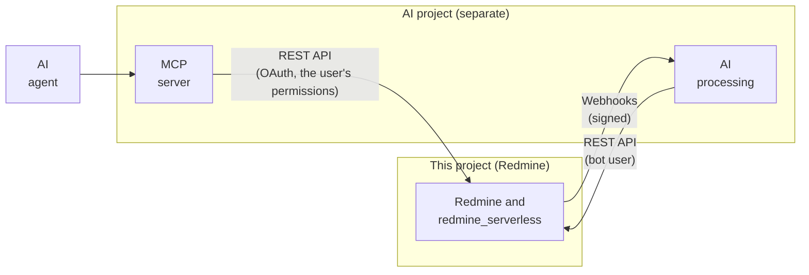

# Integration with AI features

AI features (triaging issues that arrive by email, summarizing long issues and wiki pages, an MCP server that lets AI agents use Redmine, etc.) are not built in this project. They belong in a separate project. This project provides only the interfaces on the Redmine side, so that AI features can be connected later.

The specifications on this page were checked against the Redmine 7.0.3 source as of 2026-11-08. Sources are in [sources.md](sources.md).

## Approach

- **AI features are separate:** Calls to AI services, prompts, cost, and the screens of AI features live in a separate project. They are not part of this project's image, plugin or IAM.
- **Connect only through public interfaces:** The AI side uses only the Redmine REST API and Redmine's standard webhooks (below). It does not touch the database or S3 directly. This keeps Redmine's permissions in effect for the AI side too.
- **No custom mechanisms:** Every interface is a standard Redmine 7.0 feature (REST API, OAuth, webhooks). The only thing this project adds is a way to send large attachments through the API (uploading through CloudFront to S3 with a signed URL).

## Interfaces provided

### REST API and authorization

| Interface | Details | When used |
| --- | --- | --- |
| REST API | Redmine's standard REST API (issues, notes, wiki, projects, attachments, etc.) | The AI side reads content and writes results |
| API key | Redmine standard. One key per user | Used by the bot user (below) |
| OAuth 2 | Redmine 7.0 can act as an OAuth 2 provider with the doorkeeper gem (`Gemfile`, `config/initializers/doorkeeper.rb`, the `oauth2_applications` pages) | When an MCP server or similar operates Redmine with a user's permissions |
| Large attachments | Make uploads through CloudFront (`/s3_uploads/presign`, `/s3_uploads/complete`) available with API keys and OAuth too | When the AI side attaches files such as summaries. `POST /uploads.json` in the REST API is limited to 1 MB ([attachments.md](https://redmine-kit.github.io/redmine_serverless_s3/attachments.html#uploads-through-lambda)) |

- **Bot user:** When AI processing writes, it uses a dedicated Redmine user. What the AI writes stays as notes and updates by this user. Its permissions are limited by role to the projects and actions it needs (reading, adding notes, etc.). It is not an administrator. The API key is managed as a secret on the AI side, in the AI project.
- **The user's permissions:** When an AI agent operates Redmine on behalf of a user, OAuth allows only what that user's permissions allow.
- **API entry point:** The API, like the pages, comes in through CloudFront. The per-IP rate limit in WAF applies to the API too ([lambda.md](lambda.md#flat-rate-free-plan-and-waf)).

### Event notifications (Redmine's standard webhooks)

Events in Redmine are sent to the AI side with Redmine 7.0's standard webhooks. No custom mechanism is built.

| Item | Redmine 7.0 webhooks (`app/models/webhook.rb`, `webhook_payload.rb`) |
| --- | --- |
| Who creates them | Users create webhooks. The project permission "Use webhooks" (`use_webhooks`) is required |
| What is selected | The destination URL, the event types (in the form "type.action", such as `issue.created`), and the projects |
| Payload | The event's subject, built with the permissions of the user who created the webhook. Anything that user cannot see (`visible?`) is not sent |
| Signature | When a secret is set, the HMAC-SHA256 of the body is added in the `X-Redmine-Signature-256` header |
| Delivery | Sent by a job (`WebhookJob`). In this design, `redmine-worker` sends it |
| Destination restrictions | `webhook_blocklist` in `configuration.yml` defines destinations that must not be used |

- **Create them as the bot user:** Webhooks for AI are created by the bot user ("REST API and authorization" above). The payload is limited to what the bot user can see.
- **Route out:** Webhooks are sent from `redmine-worker` to a URL on the AI side. `redmine-worker` is outside a VPC and can reach the internet directly, so it can send them as is. With the RDS setup, only the NAT instance setup can send them. The VPC endpoint setup cannot, so the AI side polls for updates through the REST API instead ([rds.md](rds.md#routes-out-of-the-vpc)).
- **Destinations that must not be used:** Put private, loopback and link-local addresses in `webhook_blocklist`. The values are in the table in [lambda.md](lambda.md#rails-and-redmine-settings). This prevents webhooks from being used to send requests to internal addresses. The NAT instance in the RDS setup uses the same values.
- **Receiving endpoint on the AI side:** The AI project provides an endpoint (such as a Lambda function URL) that verifies the signature and receives webhooks.

## What the other side takes care of

The following are decided in the AI project. This project's documentation covers only how they relate to the Redmine interfaces.

- The AI service to use (the Claude API, Claude Platform on AWS, Amazon Bedrock, etc.) and the model
- Prompts, cost, and processing speed
- The MCP server (which turns the Redmine REST API into MCP tools) and where it runs
- The screens and settings of the AI features

## Safety rules

The protections on the Redmine side and those on the AI side are separate.

| Protection | Responsible side |
| --- | --- |
| AI can act only within the permissions of the bot user or the user it acts for | This project (Redmine permissions, roles, OAuth scopes) |
| The bot user is not allowed to delete, administer, or change permissions | This project (role settings) |
| The webhook payload is limited to what the bot user can see. Webhooks cannot be sent to private addresses | This project (Redmine's webhook permission checks, `webhook_blocklist`) |
| The bodies of emails and issues are treated as untrusted input (instructions written in the body are not followed) | The AI project |
| AI output is first written as a proposal (a note or draft), and changes such as status changes are made after a person checks them | The AI project |

Issues received by email contain text written by outside people ([mail.md](mail.md#receiving)). For AI processing, this is the input that needs the most care.

## To verify

- Which scopes are available with OAuth in Redmine 7.0, and how much of the REST API can be used with OAuth
- How CSRF is handled when uploads through CloudFront are used with API keys and OAuth (the CSRF check is skipped for the API)
- The list of event types sent by webhooks (`WebhookPayload.events`) and the payload format
