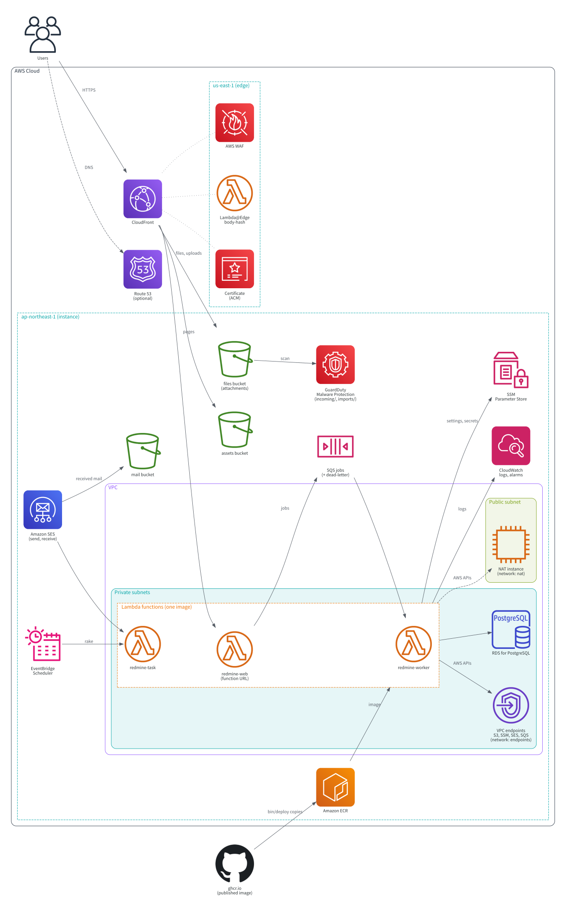
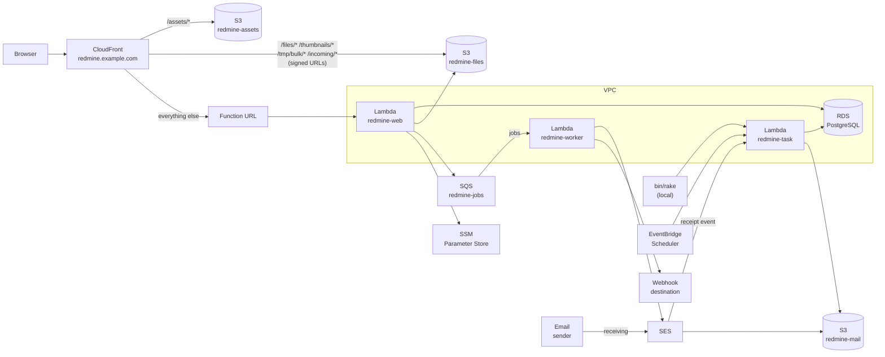

# Architecture

This is a design for running the latest Redmine (7.0.3) on AWS Lambda Event Functions. Attachments and assets live in S3. The database is RDS for PostgreSQL in a VPC. No external plugins are installed, and the theme stays the default. Extensions for Lambda, S3 and SES are the project's own plugins.

The specifications in this document were checked against official information as of 2026-11-08. Sources are in [sources.md](sources.md).

## AWS resources

The resources one instance creates in AWS (`infra/*.yaml`), drawn with the AWS Architecture Icons. Only one of the NAT instance and the VPC endpoints is created, by `network.mode` in the deployment configuration ([deploy-config.md](deploy-config.md)).



The source is `docs/diagrams/architecture.py`. `bin/diagrams` draws it in Docker with the Python library [diagrams](https://diagrams.mingrammer.com/) and writes `docs/diagrams/architecture.svg` and `architecture.ja.svg`, with the icons embedded. Run it after changing the templates' resources, and commit the SVGs.

## Diagram



`redmine-web`, `redmine-worker` and `redmine-task` use the same image. All three run in the private subnets of a VPC and use the database (some lines are omitted from the diagram). RDS has no public access. S3 is reached through a gateway endpoint, and SQS, SES and SSM through VPC endpoints or a NAT instance. Webhook destinations on the internet are reached only through the NAT instance. The diagram with the routes and how to choose between them are in [rds.md](rds.md#routes-out-of-the-vpc). A one-off task longer than 15 minutes runs on Fargate in the same private subnets ([tasks.md](tasks.md#tasks-longer-than-15-minutes)).

## Decisions

| Item | Decision | Reason | Details |
| --- | --- | --- | --- |
| Redmine | 7.0.3 (latest stable version). No external plugins, default theme | As requested | [lambda.md](lambda.md) |
| Extensions | The project's own plugins: `redmine_serverless` (running on Lambda), `redmine_serverless_s3` (attachments in S3), `redmine_serverless_ses` (mail through SES), `redmine_serverless_sqs` (jobs on SQS) and `redmine_serverless_ssm` (settings and secrets from SSM Parameter Store) | Redmine's standard extension mechanism; Redmine's own files are not modified | "The plugins" below |
| Runtime | Event Functions, container image, arm64 | Can run Ruby. Web Functions support only Node.js (see below) | [lambda.md](lambda.md) |
| Image | Lambda's Ruby base image (`public.ecr.aws/lambda/ruby:4.0`) with Redmine, dependencies such as ImageMagick, and Lambda Web Adapter | Same OS and Ruby as Lambda, built to run on Lambda. The HTTP server (Puma) can be used as is | [lambda.md](lambda.md#choosing-the-base) |
| Three functions | `redmine-web` (pages), `redmine-worker` (jobs), `redmine-task` (rake and mail import). The same image, switched by the environment variable `REDMINE_ROLE`. Only `redmine-web` starts Puma | One build, and the same code runs everywhere | [tasks.md](tasks.md#how-one-image-runs-everything) |
| Entry point | CloudFront → function URL. The function URL uses IAM authentication and accepts only requests signed by OAC. Lambda@Edge (`redmine-body-hash`) adds the body hash for POST and similar requests | Direct requests without a signature are rejected before the function is invoked. No secret header is needed. CloudFront Functions cannot read the body, so Lambda@Edge is used. Request bodies are limited to 1 MB | [lambda.md](lambda.md#cloudfront-and-function-urls) |
| Assets | CloudFront routes `/assets/*` to S3 | Bypasses Lambda, reducing cold-start waits and concurrent requests | [lambda.md](lambda.md#serving-assets) |
| Database | RDS for PostgreSQL (db.t4g.micro, Single-AZ) in the private subnets of a VPC, with no public access. The password is in SSM Parameter Store. Redmine's standard migrations run as they are | Redmine supports PostgreSQL as it is, so no adapter or migration changes are needed. The cost is predictable | [rds.md](rds.md) |
| Settings and secrets | Stored in SSM Parameter Store (`/<instance>/env/`) and read at startup | No secrets in Lambda environment variables. Settings are added by adding parameters | [lambda.md](lambda.md#settings-and-secrets-ssm-parameter-store) |
| Administration pages | The state of mail sending and receiving, jobs, S3 attachments and AWS connections can be checked and operated under one "Serverless" item of Redmine's administration menu, which all the plugins share | Checking state and actions such as resending can be done without opening the AWS console | [admin.md](https://redmine-kit.github.io/redmine_serverless/admin.html#the-serverless-menu) |
| IAM | A separate execution role per function, with resources narrowed by ARN. No access keys | The web function does not have permissions for rake or mail receiving | [iam.md](iam.md) |
| Security | Only CloudFront is reachable from outside. AWS WAF (the five rules of the flat-rate Free plan), two-factor authentication, secure default settings, retention periods for logs and records | Assets to protect, possible incidents, remaining risks and incident procedures are gathered in one place | [security.md](security.md) |
| Attachments | Read and written through the S3 API, following the approach of a Redmine S3 plugin | S3 can be the only storage. Files are shared across Lambda environments | [attachments.md](https://redmine-kit.github.io/redmine_serverless_s3/attachments.html) |
| Upload | Browser → CloudFront → S3 by PUT, with a CloudFront signed URL and a SHA256 that S3 checks | Lambda requests are limited to 6 MB. Request bodies to Lambda through CloudFront are limited to 1 MB | [attachments.md](https://redmine-kit.github.io/redmine_serverless_s3/attachments.html#upload) |
| Download | All downloads redirect to a CloudFront signed URL on Redmine's domain; CloudFront reads S3 and adds the sandbox CSP | Lambda responses are limited to 6 MB. S3 cannot add the sandbox CSP | [attachments.md](https://redmine-kit.github.io/redmine_serverless_s3/attachments.html#download) |
| Background jobs | ActiveJob enqueues to SQS with AWS's official gem `aws-activejob-sqs`, and `redmine-worker` runs the jobs | No custom code needed. Retries and a dead-letter queue are available. Page requests do not wait for jobs | [lambda.md](lambda.md#background-jobs) |
| Mail sending | Sent through the SES API using a Rails ActionMailer delivery method (`:ses_v2` from `aws-actionmailer-ses`). `redmine-worker` sends | Standard Rails mechanism; no custom code needed | [mail.md](mail.md#sending) |
| Domain and DNS | Web and mail use the same host name (a subdomain for Redmine). The web uses an alias-type record pointing to CloudFront, with MX on the same name. If the parent domain's DNS cannot hold these, the subdomain is delegated to Route 53 | URLs and mail addresses match. CNAME and MX cannot be on the same name | [mail.md](mail.md#receiving-domain) |
| Mail receiving | SES receives mail and stores it in S3; `redmine-task` imports it with Redmine's `MailHandler`. Addresses per project (`<identifier>@<subdomain>`) and one for the whole instance. Mail that fails DMARC is dropped | SES in Tokyo can receive mail. Mail with a forged sender is not imported | [mail.md](mail.md#receiving) |
| Migrations and rake | `redmine-task` runs any rake task and `rails runner` from a local command | Runs with the same image and settings as production. `rake db:migrate` and `redmine:plugins:migrate` run on RDS as they are | [tasks.md](tasks.md) |
| Redmine upgrades | When a new version is released, review the new migrations, run them on a test database (PostgreSQL), check the impact on the plugins' replaced code, then upgrade. Record the results per version | Prevents finding breakage only after upgrading | [upgrade.md](upgrade.md) |
| Tests | Tests for each piece of replaced code, and Redmine's own tests must pass. Locally, AWS is replaced by moto and LocalStack, and the database by a PostgreSQL container. Every deployment is checked against real AWS | Breakage of replaced code caused by Redmine upgrades is noticed | [testing.md](testing.md) |
| Network | One VPC with private subnets in two AZs. Lambda and RDS are in the private subnets. AWS services are reached through VPC endpoints or a NAT instance, chosen with `network.mode` in the configuration file | RDS is reached only from inside the VPC. Endpoints need no operation and have no way out to the internet; a NAT instance costs less and lets webhooks be sent | [rds.md](rds.md#routes-out-of-the-vpc) |
| AI features | Split into a separate project. The AI side connects through Redmine's standard REST API, OAuth and webhooks | Decisions about AI services and their cost are kept separate from the Redmine platform | [ai.md](ai.md) |
| Region | Tokyo (ap-northeast-1). Other Regions work the same by substituting endpoint names and unit prices | Close to users in Japan. Unit prices are also estimated for this Region | — |

## Why not Web Functions

Web Functions are a new kind of Lambda that runs an HTTP server listening on a port as is. They are not used for Redmine, for these reasons.

- **Runtime:** Only `nodejs24.x` is supported. Ruby runtimes and container images are not. Starting a bundled Ruby as a child process from a Node.js entry point is conceivable, but it is a setup not covered by the official documentation.
- **`/tmp`:** Fixed at 512 MB. This limits the size available for the attachment cache ([attachments.md](https://redmine-kit.github.io/redmine_serverless_s3/attachments.html#the-tmp-cache)).
- **Constant cost:** Memory is billed while the environment exists (including between requests). Keeping 2 GB on for a month costs about 22 USD.

Lambda Managed Instances (Event Functions that handle multiple requests in one environment) are not used either: Ruby is not among the supported languages, and at least three environments keep running.

## Request flow

### Showing and saving pages

1. The browser opens `https://redmine.example.com/` (the domain is an example).
2. CloudFront returns `/assets/*` from S3 and forwards everything else to the function URL. Before forwarding, Lambda@Edge adds the body hash and OAC signs the request.
3. Lambda Web Adapter turns the request back into HTTP and passes it to Puma.
4. Redmine reads and writes RDS and returns HTML.

One environment handles only one request at a time. When concurrent requests increase, Lambda adds environments.

### Attachments

- **Upload:** The browser computes the SHA256 of the file, receives a CloudFront signed URL from Redmine and PUTs the file through CloudFront to S3, which rejects it if the contents do not match the SHA256. Redmine reads the checksum S3 has checked and creates the attachment record.
- **Download:** Redmine checks permissions, then redirects to a CloudFront signed URL under `/files/`. CloudFront reads the object from S3 through OAC and adds Redmine's sandbox CSP.
- **Server-side processing:** Processing that needs a local file, such as thumbnails and previews of Office files, fetches the file from S3 into the `/tmp` cache.

Details are in [attachments.md](https://redmine-kit.github.io/redmine_serverless_s3/attachments.html).

### Email

- **Sending:** Redmine enqueues a notification mail job to SQS, and `redmine-worker` sends it through the SES API.
- **Receiving:** SES stores received mail in S3 and invokes `redmine-task`. `redmine-task` fetches the full message from S3 and turns it into an issue or a note with Redmine's `MailHandler`.

Details are in [mail.md](mail.md).

## The plugins

Extensions for Lambda and AWS are the project's own plugins, built with Redmine's standard extension mechanism. Each plugin is developed in its own repository and placed in `plugins/` when the image is built. Redmine's own files are not modified. The plugins appear with their versions in the "Plugins" list of the administration pages.

| Plugin | What it does | Enabled when | Documentation |
| --- | --- | --- | --- |
| [`redmine_serverless`](https://github.com/redmine-kit/redmine_serverless) | Running on Lambda: the Rack middleware for Lambda Web Adapter's `/events`, the setting that stops automatic asset compilation, Redmine settings that cannot work on Lambda fixed to disabled, the "Status and connections" administration page | `REDMINE_ROLE` exists | [Redmine Serverless](https://redmine-kit.github.io/redmine_serverless/) |
| [`redmine_serverless_s3`](https://github.com/redmine-kit/redmine_serverless_s3) | Attachments in S3: storage, uploads through CloudFront to S3, redirects to CloudFront signed URLs with the sandbox CSP, the `/tmp` cache, the "Attachments in S3" administration page | S3 bucket settings exist | [Redmine Serverless S3](https://redmine-kit.github.io/redmine_serverless_s3/) |
| [`redmine_serverless_ses`](https://github.com/redmine-kit/redmine_serverless_ses) | Mail through SES: retries of sending, importing received mail, addresses per project, the mail administration pages | SES settings exist | [Redmine Serverless SES](https://redmine-kit.github.io/redmine_serverless_ses/) |
| [`redmine_serverless_sqs`](https://github.com/redmine-kit/redmine_serverless_sqs) | Jobs on SQS: the settings of `aws-activejob-sqs` (queues and the job classes it may run), records of jobs that fail for the last time, the "Jobs" administration page | `REDMINE_JOBS_QUEUE_URL` is set | [Redmine Serverless SQS](https://redmine-kit.github.io/redmine_serverless_sqs/) |
| [`redmine_serverless_ssm`](https://github.com/redmine-kit/redmine_serverless_ssm) | Settings and secrets: reads the parameters under `REDMINE_SSM_PATH` into environment variables before Rails reads `config/database.yml` and `SECRET_KEY_BASE`. It is also a gem, added by path in `image/Gemfile.local`, so that it runs that early | `REDMINE_SSM_PATH` is set | [Redmine Serverless SSM](https://redmine-kit.github.io/redmine_serverless_ssm/) |

- **Why five plugins:** S3 attachments, mail through SES, jobs on SQS and the SSM settings also work outside Lambda (jobs with the gem's poller instead of a Lambda event source). Separate plugins let a Redmine on an ordinary server use one of them without the parts for Lambda. On Lambda, the image installs all five, because Lambda cannot write to the file system and has no mailbox.
- **Names:** A GitHub repository search found no Redmine plugin named `redmine_serverless` (2026-11-08; the only hit was an unrelated Slack bot). The names of the S3, SES, SQS and SSM plugins have not been checked yet.

### Features

The features of each plugin and their enabling conditions are in the documentation of each plugin (the table above).

### Distribution

The plugins are published as gems on the GitHub Packages RubyGems registry (`https://rubygems.pkg.github.com/redmine-kit`), and the Redmine image for Lambda is published on the GitHub Packages container registry (`ghcr.io`). The owner of both is the redmine-kit organization.

| What | Location | How to use |
| --- | --- | --- |
| Redmine image for Lambda | `ghcr.io/redmine-kit/serverless` (arm64, one architecture, no index). CI pushes it for each commit on main whose release tests pass (the `publish` job in `.github/workflows/ci.yml`, with the version read by `bin/redmine-version`). Tags: the Redmine version (`7.0.3`), the Redmine minor version (`7.0`) and `main`. Use the Redmine version: the tag moves to each new build of that version (updated gems and plugins), and `bin/deploy` uses it by default. `7.0` also follows Redmine's patch releases. Older builds stay without a tag and can be pulled by digest; the label `org.opencontainers.image.revision` holds the commit | `bin/deploy` pulls it by digest and copies it to ECR in the account where the instance is deployed ([deploy-config.md](deploy-config.md#deployment-commands)). Lambda can only use images in ECR in the same Region |
| Plugins | The gem `redmine_serverless_x` on GitHub Packages, one per plugin, published by each repository's workflow for every version tag. It holds the plugin's run-time files | Add it in `Gemfile.local` from the GitHub Packages source, run `bundle install`, and link the installed gem into `plugins/` (each plugin's setup page) |
| Plugins (without the gem) | A checkout of the repository | Clone into `plugins/` |

- **Why gems:** A gem is installed by Bundler with the other gems and recorded with its version and checksum in `image/Gemfile.lock`, so a plugin update reaches the image through the weekly gem update ([testing.md](testing.md#order-in-ci)) like any other gem. `redmine_serverless_ssm` must be a gem anyway: it reads SSM Parameter Store before Rails reads the configuration.
- **Why linked into `plugins/`:** Redmine 7.0.3 loads only plugins in the `plugins/` directory (`lib/redmine/plugin_loader.rb`); it has no mechanism to load plugins from gems. The image links each installed plugin gem there (`link-plugins` in `image/Dockerfile`). The gem does not contain the plugin's `Gemfile`, so Redmine's `Gemfile` does not load the plugin twice.
- **A token is needed:** The GitHub Packages RubyGems registry requires a token with `read:packages` to install, even for a public gem (GitHub documentation, checked on 2026-11-09). CI uses its `GITHUB_TOKEN`; locally, the token of the `gh` login. The build receives it as a secret and does not keep it in a layer (`bin/lib/plugin.sh`).
- **Version:** Each plugin's version is kept in sync between the gemspec, `version` in `init.rb` and the Git tag (the publishing workflow checks it), and the supported Redmine version is declared with `requires_redmine`.
- **Adopters:** Adopters reference the Redmine image by digest, not by tag (the same idea as "pin by digest" in [AGENTS.md](../AGENTS.md)).

### Derived images

This project's image contains only the default theme and the five plugins. Adopters who want to add themes or plugins build a derived image on top of this project's image and point to it with `image` in the configuration file ([deploy-config.md](deploy-config.md#fields-of-redminejson)).

- **How to build:** Point `FROM` to this project's image by digest, put themes in `themes/<theme>/` and plugins in `plugins/<plugin>/`, and rebuild the assets (`assets:precompile`). Redmine 7.0 reads themes from `themes/` or `app/assets/themes/` and serves them as Propshaft assets (`lib/redmine/themes.rb`).
- **Assets:** `bin/deploy` syncs the assets in the derived image to S3. Theme assets are also served from CloudFront's `/assets/*`.
- **Checks:** Derived images also go through this project's image tests (read-only, low-privilege user, three roles) ([testing.md](testing.md#image-tests)). Added plugins are not checked by this project.


### What is not in the plugins

The following are not in the plugins, because they must load before plugins or they run outside Redmine.

| What | Location | Reason |
| --- | --- | --- |
| Settings for cache, jobs and schema dump | `config/additional_environment.rb` | Needed before the database connection and the cache are created. Plugins load after that |
| Settings for the database, attachment storage and mail sending | `config/database.yml`<br>`config/configuration.yml` | Redmine configuration files |
| Startup script, extension script | `image/` | Run before Redmine |
| Function that adds the body hash | `edge/` | Runs on CloudFront Lambda@Edge (Node.js) |
| Task handler | `image/` | Starts rake as a child process without loading Rails |
| `bin/rake`<br>`bin/rails` | `bin/` | Used locally against the deployed Redmine |
| `bin/test`<br>`bin/check-migrations` | `bin/` | Used locally and in CI for tests and migration review |

Mail sending (`aws-actionmailer-ses`) and jobs (`aws-activejob-sqs`) use AWS's official gems; no delivery method or queue adapter is written. The jobs' settings belong to `redmine_serverless_sqs`.

## Repository layout

```text
serverless/
  image/          Container image (Dockerfile, configuration files, startup script, extension script, task handler)
  edge/           The functions that run at CloudFront: redmine-body-hash (Lambda@Edge, adds the body hash) and the CloudFront Function that limits uploads, with their tests
  infra/          CloudFormation (the account roles; the shared base; per instance: VPC use, database, S3, SQS, Lambda, CloudFront, WAF, SES, schedules, alarms; Lambda@Edge, the certificate and the web ACL in us-east-1)
  deploy/         The steps of bin/deploy and its tools image
  schema/         The JSON Schema of redmine.json
  bin/            Commands: build, lint, tests, update-gems and deploy
  test/           Tests outside the plugins (image, deployment, Lambda on LocalStack) and the services they use
  .github/        CI and the other workflows
  docs/           Documentation
```

The plugins are in their own repositories ("The plugins" above). When the image is built, the chosen version of each is placed in `plugins/`.

Infrastructure is written in CloudFormation. `bin/deploy` applies the stacks with the infrastructure deployment role (an SSO administrator, or a GitHub Environment that requires approval). Updates to the Redmine image only are done by GitHub Actions with the code deployment role ([iam.md](iam.md)). The deployment stages are in [deploy-config.md](deploy-config.md#deployment-commands).

## Order of work

Work starts with the points that decide whether it works at all. At each stage, tests are written within the same stage and must pass in CI before moving on ([testing.md](testing.md)).

| Stage | What to build | Tests written in the same stage |
| --- | --- | --- |
| 1 | CI foundation (static checks, containers for PostgreSQL, moto and LocalStack) | RuboCop, ShellCheck, actionlint, cfn-lint |
| 2 | Image (Lambda's Ruby base image, Redmine, dependencies, switching between the three roles) | Image tests (read-only, low-privilege user, startup of the three roles), Redmine's own tests |
| 3 | Startup on Lambda (VPC, RDS, SSM, `redmine-task`, opening `redmine-web` through the function URL) | Tests for SSM loading and the task handler. Measuring startup time |
| 4 | CloudFront and assets (domain, S3 for `/assets/*`, OAC and the Lambda@Edge `redmine-body-hash`) | Tests for `redmine-body-hash`. Checking that POST passes with OAC. The first checks after deployment |
| 5 | Attachments (`redmine_serverless_s3`) | The plugin's unit, functional, integration and system tests. Redmine's own attachment tests pass with S3 |
| 6 | Jobs and mail sending (SQS, `redmine-worker`, SES and the sending part of `redmine_serverless_ses`, resending) | Tests for jobs and mail sending, retry tests per error type. Checks with the mailbox simulator |
| 7 | Administration pages (state and connections, mail sending, jobs, S3 attachments) | Functional and system tests per page. Non-administrators cannot open them |
| 8 | Mail receiving (MX, receipt rules, import in `redmine_serverless_ses`, the "Mail receiving" administration page) | Import tests (spoofing, spam, auto-replies). Checking real mail receiving |
| 9 | Migration (if data from an old Redmine is moved) | The checks after deployment pass with the migrated data |

## Open questions

| Item | Options | Needed to decide |
| --- | --- | --- |
| Whether to migrate data from an old Redmine | Migrate / start fresh | The source setup (version, database, attachment storage). [migration.md](migration.md) |
| Route out of the VPC | VPC endpoints / NAT instance (`network.mode`) | Whether webhooks or external APIs are needed, and the monthly cost of each. [rds.md](rds.md#which-to-choose) |
| Monthly cost | The estimate in [cost.md](cost.md) | Usage measured after deployment. [cost.md](cost.md) |
| Domain | The name of the Redmine subdomain (for example `redmine.example.com`). Keep the parent domain's DNS or delegate to Route 53 | [mail.md](mail.md#receiving-domain) |
| CloudFront pricing plan | Flat-rate Free plan (includes WAF) / pay-per-use | Whether the account still has room for a Free plan. [lambda.md](lambda.md#flat-rate-free-plan-and-waf) |
| Attachment size limit | Redmine's `attachment_max_size`, enforced on `/incoming/*` by the CloudFront Function. Redmine does not read the file at registration; what limits it is what CloudFront accepts for one PUT and the time the browser takes to hash the file | Measured results. [attachments.md](https://redmine-kit.github.io/redmine_serverless_s3/attachments.html#upload) |
| Default project for received mail | The project used when there is no subaddress | [mail.md](mail.md#importing) |
