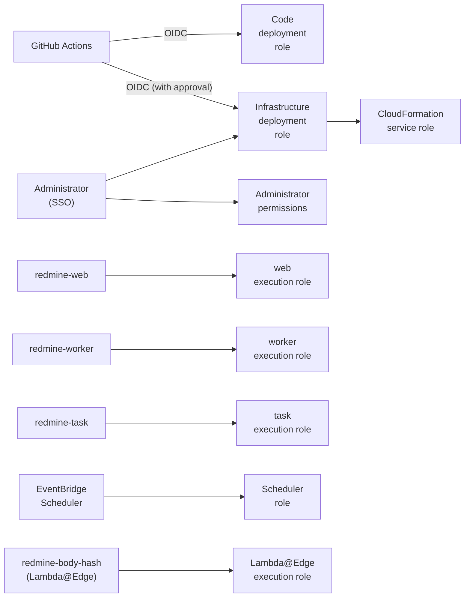

# IAM and permissions

This page lists the IAM roles, policies and resource-based policies that Serverless uses. This page is the source of truth for the details of permissions. Other pages link here.

The specifications on this page were checked against official information as of 2026-11-09. Sources are in [sources.md](sources.md).

The names of roles, functions and SSM paths are derived from the instance name (`instance` in `redmine.json`) ([deploy-config.md](deploy-config.md#names-derived-from-the-instance-name)). The names on this page are those for the default instance name `redmine`.

## Approach

- **One role per function:** `redmine-web`, `redmine-worker` and `redmine-task` use the same image but separate execution roles. The web function does not get the permissions for rake or email receiving.
- **Scope by ARN:** Scope S3 to the bucket and prefix, SQS to the queue, SES to the identity, and SSM to the path. Use `*` only for AWS APIs that cannot be scoped to a resource (such as `ses:GetAccount`).
- **No access keys:** Lambda uses temporary credentials from its execution role, GitHub Actions uses OIDC, and people use IAM Identity Center (SSO). No IAM users or access keys are created.
- **Scope calls from services by caller:** When allowing a service such as SES, CloudFront or EventBridge Scheduler, use `aws:SourceAccount` and `aws:SourceArn` to allow only calls from specific resources in this account (to prevent the confused deputy problem).
- **People approve infrastructure changes:** `bin/deploy`, which applies the CloudFormation stacks (including IAM roles), runs with the infrastructure deployment role. Only SSO administrators and workflows in a GitHub Environment that requires approval can assume this role ("Role for deploying infrastructure" below). The GitHub Actions role that only updates code cannot change IAM or the database.
- **Permissions boundary:** Roles that the stacks create get a fixed permissions boundary. The infrastructure deployment role cannot create roles stronger than the boundary.
- **The database password stays in SSM:** RDS connects with a password, which is a SecureString in SSM Parameter Store. Only the execution roles of the three functions can read it ([rds.md](rds.md#connecting-from-rails)).

## Overview

| Role | Assumed by | Purpose |
| --- | --- | --- |
| `redmine-web-execution` | Lambda (`redmine-web`) | Pages, attachments, enqueuing jobs, admin pages |
| `redmine-worker-execution` | Lambda (`redmine-worker`) | Running jobs (sending email, deleting projects, etc.) |
| `redmine-task-execution` | Lambda (`redmine-task`) | rake, `rails runner`, email import |
| `redmine-scheduler` | EventBridge Scheduler | Scheduled rake and warm-up calls during business hours |
| `redmine-body-hash-execution` | Lambda and Lambda@Edge (`redmine-body-hash`) | Adds the hash of the request body ([lambda.md](lambda.md#function-that-adds-the-body-hash-lambdaedge)). Only writes logs |
| `redmine-github-deploy` | GitHub Actions (OIDC) | Code deployment. Pushing the image, syncing assets, updating functions, migrations |
| `redmine-infra-deploy` | SSO administrators, a GitHub Environment that requires approval (OIDC) | Applies the stacks with `bin/deploy`. The role that `deployRoleArn` in the configuration file points to |
| `redmine-cfn-exec` | CloudFormation | Creates the stack resources (CloudFormation service role) |

The role names are provisional.

## Permissions common to the three functions

| Permission | Resource | Use |
| --- | --- | --- |
| `logs:CreateLogStream`, `logs:PutLogEvents` | The log group of each function | Logs. CloudFormation creates the log groups in advance with a retention period ([security.md](security.md#retention-periods)) |
| `ssm:GetParametersByPath` | `arn:aws:ssm:<region>:<account>:parameter/redmine/env` and below it (`parameter/redmine/env/*`) | Settings and secrets at start-up, including the database password ([lambda.md](lambda.md#settings-and-secrets-ssm-parameter-store)) |
| `ec2:CreateNetworkInterface`, `ec2:DescribeNetworkInterfaces`, `ec2:DeleteNetworkInterface`, `ec2:AssignPrivateIpAddresses`, `ec2:UnassignPrivateIpAddresses` | `*` (the EC2 API cannot be scoped) | Running in the VPC. The same as the AWS managed policy `AWSLambdaVPCAccessExecutionRole` ([rds.md](rds.md#routes-out-of-the-vpc)) |

- **Decrypting SecureString:** Encrypt with the default SSM key (`aws/ssm`). Whether `kms:Decrypt` must be granted in IAM for this key is checked when building it.

- **Where the permissions come from:** Each row belongs to one of the plugins, whose setup pages explain the permissions for use outside Serverless too: [Redmine Serverless SQS](https://redmine-kit.github.io/redmine_serverless_sqs/setup.html#iam-permissions) (jobs and the "Jobs" page), [Redmine Serverless S3](https://redmine-kit.github.io/redmine_serverless_s3/setup.html#iam-permissions) (attachments), [Redmine Serverless SES](https://redmine-kit.github.io/redmine_serverless_ses/setup.html#iam-permissions) (email) and [Redmine Serverless SSM](https://redmine-kit.github.io/redmine_serverless_ssm/setup.html#iam-permissions) (settings at start-up). [Redmine Serverless](https://redmine-kit.github.io/redmine_serverless/setup.html#iam-permissions) needs none of its own. This page puts them together per function.

## Execution role of `redmine-web`

| Permission | Resource | Use |
| --- | --- | --- |
| `s3:GetObject`, `s3:PutObject`, `s3:DeleteObject` | `files/*`, `thumbnails/*`, `imports/*`, `incoming/*`, `tmp/*` in the attachments bucket | Storing attachments, `HeadObject` with the checksum and copying at registration, the `/tmp` cache, deletion, temporary files for bulk download ([attachments.md](https://redmine-kit.github.io/redmine_serverless_s3/attachments.html)) |
| `s3:ListBucket` | The attachments bucket | Get 404 instead of 403 for `HeadObject` on a missing object. Delete thumbnails by prefix |
| `sqs:SendMessage` | The job queue | Enqueuing jobs ([lambda.md](lambda.md#background-jobs)) |
| `sqs:GetQueueAttributes` | The job queue and the dead-letter queue | The "Jobs" admin page |
| `sqs:StartMessageMoveTask`, `sqs:ListMessageMoveTasks` | The job dead-letter queue | Moving the dead-letter queue back to the source queue from the "Jobs" admin page |
| `ses:SendEmail`, `ses:SendRawEmail` | The SES identity of the sender domain | Redmine's standard test email (sent within a page request) |
| `ses:GetEmailIdentity` | The SES identity of the sender domain | The "Sending email" admin page |
| `ses:GetAccount`, `ses:ListSuppressedDestinations`, `ses:DeleteSuppressedDestination` | `*` (cannot be scoped) | Same as above ([admin.md](https://redmine-kit.github.io/redmine_serverless_ses/admin.html#sending-email)) |

- **Two sending permissions:** Email is sent by passing the full message (raw) to SES v2 `SendEmail`. The examples in the AWS SES documentation allow both `ses:SendEmail` and `ses:SendRawEmail` as sending permissions, so this design follows them. Whether `ses:SendRawEmail` is required for raw sending with v2 has not been checked (not checked yet).
- **Signed URLs:** Browsers do not use this role. Uploads and downloads go through CloudFront with URLs signed by the CloudFront private key, which the functions read from SSM Parameter Store with the other secrets ([setup.md](https://redmine-kit.github.io/redmine_serverless_s3/setup.html#iam-permissions)). CloudFront reaches the bucket through OAC, allowed by the bucket policy ("Resource-based policies" below).

## Execution role of `redmine-worker`

| Permission | Resource | Use |
| --- | --- | --- |
| `sqs:ReceiveMessage`, `sqs:DeleteMessage`, `sqs:GetQueueAttributes`, `sqs:ChangeMessageVisibility` | The job queue | Receiving jobs through the event source mapping. The gem's handler deletes messages that succeeded |
| `sqs:SendMessage` | The job queue | Retries within jobs (`retry_on`) and jobs enqueued by jobs |
| `ses:SendEmail`, `ses:SendRawEmail` | The SES identity of the sender domain | Notification email ([mail.md](mail.md#sending)). Sent as the full message (raw) |
| `s3:GetObject`, `s3:PutObject`, `s3:DeleteObject`, `s3:ListBucket` | The attachments bucket (the same scope as `redmine-web`) | Deleting attachments when deleting a project, reconciliation ([admin.md](https://redmine-kit.github.io/redmine_serverless_s3/admin.html#attachments-in-s3)) |
| `s3:GetObject`, `s3:DeleteObject` | `inbound/*` and `processed/*` in the mail bucket | Re-importing email from the admin pages |
| `s3:PutObject` | `processed/*` in the mail bucket | Same as above |

## Execution role of `redmine-task`

| Permission | Resource | Use |
| --- | --- | --- |
| `s3:GetObject`, `s3:DeleteObject` | `inbound/*` in the mail bucket | Importing received email ([mail.md](mail.md#importing)) |
| `s3:PutObject` | `processed/*` in the mail bucket | Moving imported email |
| `s3:GetObject`, `s3:PutObject`, `s3:DeleteObject`, `s3:ListBucket` | The attachments bucket (the same scope as `redmine-web`) | Deleting unattached attachments (`redmine:attachments:prune`), storing attachments from email |
| `ses:SendEmail`, `ses:SendRawEmail` | The SES identity of the sender domain | Email from rake tasks (due date reminders, etc.) |
| `sqs:SendMessage` | The job queue | Jobs enqueued within rake |
| `sqs:SendMessage` | The failure destination queue (`redmine-task-failures`) | The destination for failed asynchronous invocations from SES. Lambda sends to destinations with the execution role's permissions |

## Resource-based policies

| Resource | Allowed principal | Allowed actions | Condition |
| --- | --- | --- | --- |
| `redmine-web` (function) | CloudFront (`cloudfront.amazonaws.com`) | `lambda:InvokeFunctionUrl` | `AWS:SourceArn` is this distribution. The function URL uses `AuthType: AWS_IAM` (OAC) |
| `redmine-web` (function) | CloudFront (`cloudfront.amazonaws.com`) | `lambda:InvokeFunction` | `AWS:SourceArn` is this distribution |
| `redmine-task` (function) | SES (`ses.amazonaws.com`) | `lambda:InvokeFunction` | `aws:SourceAccount` is this account, `aws:SourceArn` is the receipt rule |
| The assets bucket | CloudFront (`cloudfront.amazonaws.com`) | `s3:GetObject` | `AWS:SourceArn` is this distribution (OAC) |
| The mail bucket | SES (`ses.amazonaws.com`) | `s3:PutObject` to `inbound/*` | `aws:SourceAccount` is this account, `aws:SourceArn` is the receipt rule |
| All three buckets | Everyone | Deny everything | `aws:SecureTransport` is `false` (requests not over TLS) |
| The ECR repository | Lambda (`lambda.amazonaws.com`) | `ecr:BatchGetImage`, `ecr:GetDownloadUrlForLayer` | `aws:SourceArn` is a function in this account |

- **Only CloudFront can call the function URL:** The function URL uses IAM authentication and accepts only requests signed by CloudFront OAC. Lambda@Edge adds the body hash for POST requests from browsers ([lambda.md](lambda.md#cloudfront-and-function-urls)). As the CloudFront documentation describes, a function URL behind OAC allows both `lambda:InvokeFunctionUrl` and `lambda:InvokeFunction`.
- **ECR:** For functions in the same account, Lambda adds this policy automatically if the person deploying has `ecr:SetRepositoryPolicy`. CloudFormation states it explicitly.
- **SQS:** The queues are used only by functions in the same account, so there are no queue policies. Access is allowed through the execution roles' permissions.

## Execution role of Lambda@Edge

The trust policy allows both `lambda.amazonaws.com` and `edgelambda.amazonaws.com` to assume the role (a Lambda@Edge requirement).

| Permission | Resource | Use |
| --- | --- | --- |
| `logs:CreateLogGroup`, `logs:CreateLogStream`, `logs:PutLogEvents` | The log group `/aws/lambda/us-east-1.redmine-body-hash` in all regions (`arn:aws:logs:*:<account>:log-group:/aws/lambda/us-east-1.redmine-body-hash:*`) | Logs. Lambda@Edge writes logs to the region close to the edge location where it ran |

- **No other permissions:** It only reads the body and adds the hash, so it gets no permissions for AWS services.
- **Permissions to attach the function to CloudFront:** Attaching a Lambda@Edge function version to CloudFront needs `lambda:EnableReplication*` and `iam:CreateServiceLinkedRole`. The CloudFormation service role has them ("Role for deploying infrastructure" below). The code deployment role does not.

## Role of EventBridge Scheduler

| Permission | Resource | Use |
| --- | --- | --- |
| `lambda:InvokeFunction` | `redmine-task` | Scheduled rake ([tasks.md](tasks.md#scheduled-runs)) |
| `lambda:InvokeFunction` | `redmine-web` | Warm-up calls during business hours (only when used; [lambda.md](lambda.md#waiting-for-start-up)) |

The trust policy is `scheduler.amazonaws.com`, with `aws:SourceAccount` restricted to this account.

## Role for deploying code (GitHub Actions)

The trust policy uses GitHub OIDC (`token.actions.githubusercontent.com`), with `sub` restricted to the production Environment of the deploying repository.

| Permission | Resource | Use |
| --- | --- | --- |
| `ecr:GetAuthorizationToken` | `*` (cannot be scoped) | Logging in to ECR |
| `ecr:BatchCheckLayerAvailability`, `ecr:InitiateLayerUpload`, `ecr:UploadLayerPart`, `ecr:CompleteLayerUpload`, `ecr:PutImage`, `ecr:BatchGetImage` | The Redmine repository | Pushing the image |
| `s3:PutObject`, `s3:GetObject`, `s3:ListBucket` | The assets bucket | Syncing assets ([lambda.md](lambda.md#serving-assets)) |
| `lambda:UpdateFunctionCode`, `lambda:GetFunction`, `lambda:GetFunctionConfiguration` | The three functions | Updating the image and waiting for the update to finish |
| `lambda:InvokeFunction` | `redmine-task` | Migrations during deployment ([tasks.md](tasks.md#migrations-during-deployment)) |

- **What it does not get:** Other `iam:*` and `iam:PassRole`, `lambda:UpdateFunctionConfiguration` (because it can change the execution role and environment variables), CloudFormation, and the database password in SSM. These are changed with the infrastructure deployment role.
- **Assets are not deleted:** Old assets are kept, so it does not get `s3:DeleteObject`. A lifecycle rule deletes old assets.

## Role for deploying infrastructure

This role applies the shared base and instance stacks with `bin/deploy`. `deployRoleArn` in the configuration file points to this role ([deploy-config.md](deploy-config.md)).

| Item | Details |
| --- | --- |
| Assumed by | The SSO administrator permission set. In GitHub Actions, only workflows in an Environment with designated approvers (`sub` restricted to that Environment) |
| Permissions | Creating and updating CloudFormation stacks (`redmine-*` and `<instance>*` stacks), setting the retention period of the Lambda@Edge log groups (`logs:PutRetentionPolicy` in all regions, only for `/aws/lambda/us-east-1.redmine-body-hash`), `iam:PassRole` (only for the CloudFormation service role `redmine-cfn-exec`), creating SSM parameters (when creating secrets for the first time; only `/<instance>/env/*`), copying images to ECR, and the same permissions as the code deployment role |
| Permissions to create resources | None. CloudFormation creates resources with the permissions of `redmine-cfn-exec` |

- **CloudFormation service role:** `redmine-cfn-exec` can create the resources of this design (Lambda, RDS, the VPC and its endpoints, the NAT instance, S3, SQS, SES, CloudFront, AWS WAF web ACL, ACM, IAM roles, logs, alarms). IAM roles it creates must have the permissions boundary `redmine-boundary` (`iam:PermissionsBoundary`).
- **us-east-1:** The same role also applies the stacks for the Lambda@Edge function and the CloudFront certificate in us-east-1 ([deploy-config.md](deploy-config.md#shared-base-and-per-instance-resources)).
- **Permissions to attach the function to CloudFront:** `redmine-cfn-exec` also gets `lambda:EnableReplication*` and `iam:CreateServiceLinkedRole` for attaching the Lambda@Edge function version to CloudFront.

## Permissions of people

| Who | What | Permissions |
| --- | --- | --- |
| Administrators | Apply stacks with `bin/deploy` (assuming the infrastructure deployment role), put SSM parameters, connect to the database through Session Manager port forwarding ([rds.md](rds.md#managing-it-with-systems-manager)) | Administrator permissions in IAM Identity Center |
| Operators | Run rake with `bin/rake`, read logs, move the dead-letter queue back | Administrator permissions, or an operations permission set (table below) |

If an operations permission set is created, it has the following scope (whether to create it is decided when there are more operators).

| Permission | Resource |
| --- | --- |
| `lambda:InvokeFunction`, `lambda:GetFunction` | `redmine-task` |
| `logs:StartQuery`, `logs:GetQueryResults`, `logs:FilterLogEvents` | The log groups of the three functions |
| `sqs:GetQueueAttributes`, `sqs:StartMessageMoveTask`, `sqs:ListMessageMoveTasks` | The job queue and the dead-letter queue |

- **rake is a powerful permission:** Anyone who can invoke `redmine-task` can read and write everything in the database and S3 with rake and `rails runner`. Restrict who can invoke it ([tasks.md](tasks.md#permissions)).

## In the VPC

- **Security groups:** Not a permission, but RDS allows only port 5432 from the functions' security groups, and the VPC interface endpoints allow only port 443 from the functions' security groups ([rds.md](rds.md#security)).
- **Browsers and S3:** Browsers reach attachments only through CloudFront, so nothing from the internet uses the functions' roles on S3.

### Role of the NAT instance (only with a NAT instance)

The role is named `redmine-nat` (provisional) and is assumed by EC2. It is used for management and access through Systems Manager ([rds.md](rds.md#managing-it-with-systems-manager)).

| Permission | Resource | Use |
| --- | --- | --- |
| AWS managed policy `AmazonSSMManagedInstanceCore` | — | Session Manager, Patch Manager, Inventory |
| `logs:CreateLogStream`, `logs:PutLogEvents` | The log group for Session Manager logs | Session logs |
| Route switching such as `ec2:ReplaceRoute` and `ec2:AttachNetworkInterface` | The route tables of the private subnets | Pointing the routes back to itself during recovery |

- **Permissions of people:** People who connect with Session Manager get `ssm:StartSession` only for this instance and specific documents (shell, and port forwarding to a remote host).

## IAM Access Analyzer

If the account uses IAM Access Analyzer, it finds resources that are accessible from outside. This design expects no resources to be accessible from outside. The function URL can also be called only by CloudFront ("Only CloudFront can call the function URL" above).

If it finds a function URL, S3 bucket, SQS queue, SSM parameter or RDS snapshot, that is a configuration error and must be fixed.

## To verify

- Whether reading a SecureString encrypted with the `aws/ssm` key needs `kms:Decrypt`
- Which permissions `sqs:StartMessageMoveTask` needs on the source queue and on the dead-letter queue
- Whether `HeadObject` on a missing object returns 404 when `s3:ListBucket` has a condition (`s3:prefix`)
- Whether sending the full message (raw) with SES v2 `SendEmail` needs `ses:SendRawEmail`
- Whether the resource of `ssm:GetParametersByPath` needs both the path ARN and the path below it (`/*`)
- Whether the service-linked role needed for Lambda@Edge replication can be created under the permissions boundary and the CloudFormation service role
- The ARN format for permissions on SES identities (`ses:SendEmail`, `ses:GetEmailIdentity`), and the permissions needed when using a configuration set
