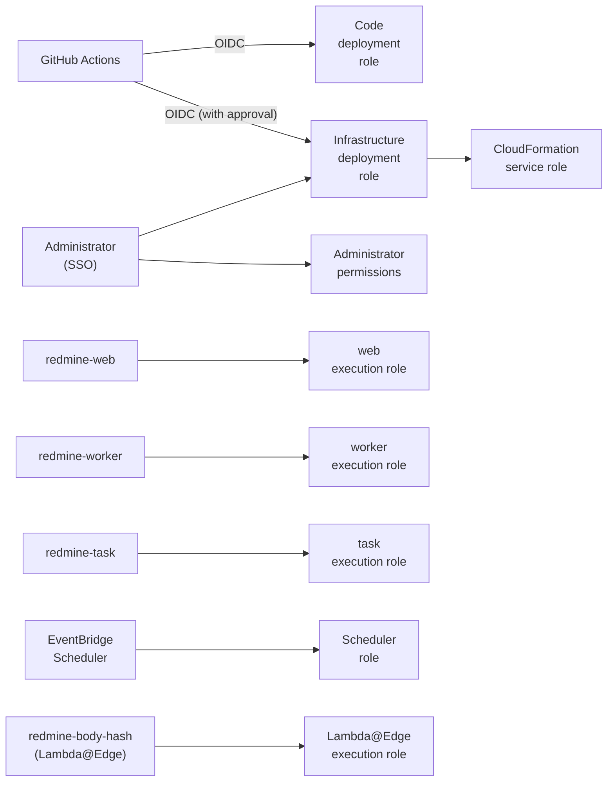

# IAM and permissions

This page lists the IAM roles, policies and resource-based policies that Serverless uses. This page is the source of truth for the details of permissions. Other pages link here.

The specifications on this page were checked against official information as of 2026-11-09. Sources are in [sources.md](sources.md).

The names of roles, functions and SSM paths are derived from the instance name (`instance` in `redmine.json`) ([deploy-config.md](deploy-config.md#names-derived-from-the-instance-name)). The names on this page are those for the default instance name `redmine`.

## Approach

- **One role per function:** `redmine-web`, `redmine-worker` and `redmine-task` use the same image but separate execution roles. The web function does not get the permissions for rake or email receiving.
- **Scope by ARN:** Scope S3 to the bucket and prefix, SQS to the queue, SES to the identity, and SSM to the path. Use `*` only for AWS APIs that cannot be scoped to a resource (such as `ses:GetAccount`).
- **No access keys:** Lambda uses temporary credentials from its execution role, GitHub Actions uses OIDC, and people use IAM Identity Center (SSO). No IAM users or access keys are created.
- **Scope calls from services by caller:** When allowing a service such as SES, CloudFront or EventBridge Scheduler, use `aws:SourceAccount` and `aws:SourceArn` to allow only calls from specific resources in this account (to prevent the confused deputy problem).
- **People approve infrastructure changes:** `bin/deploy`, which applies the CloudFormation stacks (including IAM roles), runs with the infrastructure deployment role. Only SSO administrators and workflows in a GitHub Environment that requires approval can assume this role ("Role for deploying infrastructure" below). The GitHub Actions role that only updates code cannot change IAM or the database.
- **Permissions boundary:** Roles that the stacks create get a fixed permissions boundary. The infrastructure deployment role cannot create roles stronger than the boundary.
- **The database password stays in SSM:** RDS connects with a password, which is a SecureString in SSM Parameter Store. Only the execution roles of the three functions can read it ([rds.md](rds.md#connecting-from-rails)).

## Overview



| Role | Assumed by | Purpose |
| --- | --- | --- |
| `redmine-web` | Lambda (`redmine-web`) | Pages, attachments, enqueuing jobs, admin pages |
| `redmine-worker` | Lambda (`redmine-worker`) | Running jobs (sending email, deleting projects, etc.) |
| `redmine-task` | Lambda (`redmine-task`) | rake, `rails runner`, email import |
| `redmine-scheduler` | EventBridge Scheduler | Scheduled rake and warm-up calls during business hours |
| `redmine-malware-scan` | GuardDuty Malware Protection (`malware-protection-plan.guardduty.amazonaws.com`) | Scans and tags new objects under `tmp/incoming/` and `imports/` of the attachment bucket ([aws-security.md](aws-security.md#malware-protection-for-s3)). Only with `uploads.malwareScan` |
| `redmine-body-hash` | Lambda and Lambda@Edge (`redmine-body-hash`) | Adds the hash of the request body ([lambda.md](lambda.md#function-that-adds-the-body-hash-lambdaedge)). Only writes logs |
| `redmine-github-deploy` | GitHub Actions (OIDC) | Code deployment. Pushing the image, syncing assets, updating functions, migrations |
| `redmine-infra-deploy` | SSO administrators, a GitHub Environment that requires approval (OIDC) | Applies the stacks with `bin/deploy`. The role that `deployRoleArn` in the configuration file points to |
| `redmine-cfn-exec` | CloudFormation | Creates the stack resources (CloudFormation service role) |

The roles that the stacks create are under the path `/redmine/` (for example `arn:aws:iam::<account>:role/redmine/redmine-web`), and have the permissions boundary `redmine-boundary`. The last three, and the boundary, are in `infra/account.yaml` ("Account roles" below).

## Permissions common to the three functions

| Permission | Resource | Use |
| --- | --- | --- |
| `logs:CreateLogStream`<br>`logs:PutLogEvents` | The log group of each function | Logs. CloudFormation creates the log groups in advance with a retention period ([security.md](security.md#retention-periods)) |
| `ssm:GetParametersByPath` | `arn:aws:ssm:<region>:<account>:parameter/redmine/env` and below it (`parameter/redmine/env/*`) | Settings and secrets at start-up, including the database password ([lambda.md](lambda.md#settings-and-secrets-ssm-parameter-store)) |
| `ec2:CreateNetworkInterface`<br>`ec2:DescribeNetworkInterfaces`<br>`ec2:DeleteNetworkInterface`<br>`ec2:AssignPrivateIpAddresses`<br>`ec2:UnassignPrivateIpAddresses` | `*` (the EC2 API cannot be scoped) | Running in the VPC. The same as the AWS managed policy `AWSLambdaVPCAccessExecutionRole` ([rds.md](rds.md#routes-out-of-the-vpc)) |

SecureString parameters are encrypted with the default SSM key (`aws/ssm`). Whether `kms:Decrypt` must be granted in IAM for this key will be checked when building it.

Each row belongs to one of the plugins, and the plugin's IAM page also explains the permissions for use outside Serverless: [Redmine Serverless SQS](https://redmine-kit.github.io/redmine_serverless_sqs/iam.html) (jobs and the "Jobs" page), [Redmine Serverless S3](https://redmine-kit.github.io/redmine_serverless_s3/setup.html#iam-permissions) (attachments), [Redmine Serverless SES](https://redmine-kit.github.io/redmine_serverless_ses/iam.html) (email) and [Redmine Serverless SSM](https://redmine-kit.github.io/redmine_serverless_ssm/iam.html) (settings at start-up). [Redmine Serverless](https://redmine-kit.github.io/redmine_serverless/iam.html) needs none of its own. This page puts them together per function.

## Execution role of `redmine-web`

| Permission | Resource | Use |
| --- | --- | --- |
| `s3:GetObject`<br>`s3:PutObject`<br>`s3:DeleteObject` | In the attachments bucket:<br>`files/*`<br>`imports/*`<br>`tmp/*` | Storing attachments, Markdown previews and thumbnails, `HeadObject` with the checksum and copying at registration, the `/tmp` cache, deletion, temporary files for bulk download ([attachments.md](https://redmine-kit.github.io/redmine_serverless_s3/attachments.html)) |
| `s3:ListBucket` | The attachments bucket | Get 404 instead of 403 for `HeadObject` on a missing object. Delete thumbnails by prefix |
| `sqs:SendMessage` | The job queue | Enqueuing jobs ([lambda.md](lambda.md#background-jobs)) |
| `sqs:GetQueueAttributes` | The job queue and the dead-letter queue | The "Jobs" admin page |
| `sqs:GetQueueUrl`<br>`sqs:StartMessageMoveTask`<br>`sqs:ListMessageMoveTasks`<br>`sqs:ReceiveMessage`<br>`sqs:DeleteMessage` | The job dead-letter queue | Moving the dead-letter queue back to the job queue from the "Jobs" admin page, with `sqs:SendMessage` on the job queue (common to the three functions). The minimum for a redrive is in the SQS plugin's [iam.md](https://redmine-kit.github.io/redmine_serverless_sqs/iam.html#permissions) |
| `ses:SendEmail`<br>`ses:SendRawEmail` | The SES identity of the sender domain | Redmine's standard test email (sent within a page request) |
| `ses:GetEmailIdentity` | The SES identity of the sender domain | The "Email sending" admin tab |
| `ses:GetAccount`<br>`ses:ListSuppressedDestinations`<br>`ses:DeleteSuppressedDestination` | `*` (cannot be scoped) | Same as above ([admin.md](https://redmine-kit.github.io/redmine_serverless_ses/admin.html#sending-email)) |

Email is sent by passing the full message (raw) to SES v2 `SendEmail`. The examples in the AWS SES documentation allow both `ses:SendEmail` and `ses:SendRawEmail` as sending permissions, and this design follows them. Whether `ses:SendRawEmail` is required for raw sending with v2 has not been checked yet.

Browsers do not use this role. Uploads and downloads go through CloudFront with URLs signed by the CloudFront private key, which the functions read from SSM Parameter Store with the other secrets ([Redmine Serverless S3](https://redmine-kit.github.io/redmine_serverless_s3/iam.html)). CloudFront reaches the bucket through OAC, which the bucket policy allows ("Resource-based policies" below).

## Execution role of `redmine-worker`

| Permission | Resource | Use |
| --- | --- | --- |
| `sqs:ReceiveMessage`<br>`sqs:DeleteMessage`<br>`sqs:GetQueueAttributes`<br>`sqs:ChangeMessageVisibility` | The job queue | Receiving jobs through the event source mapping. The gem's handler deletes messages that succeeded |
| `sqs:SendMessage` | The job queue | Retries within jobs (`retry_on`) and jobs enqueued by jobs |
| `ses:SendEmail`<br>`ses:SendRawEmail` | The SES identity of the sender domain | Notification email ([mail.md](mail.md#sending)). Sent as the full message (raw) |
| `s3:GetObject`<br>`s3:PutObject`<br>`s3:DeleteObject`<br>`s3:ListBucket` | The attachments bucket (the same scope as `redmine-web`) | Deleting attachments when deleting a project, reconciliation ([admin.md](https://redmine-kit.github.io/redmine_serverless_s3/admin.html#attachments-in-s3)) |
| `s3:GetObject`<br>`s3:DeleteObject` | In the mail bucket:<br>`inbound/*`<br>`processed/*` | Re-importing email from the admin pages |
| `s3:PutObject` | `processed/*` in the mail bucket | Same as above |

## Execution role of `redmine-task`

| Permission | Resource | Use |
| --- | --- | --- |
| `s3:GetObject`<br>`s3:DeleteObject` | `inbound/*` in the mail bucket | Importing received email ([mail.md](mail.md#importing)) |
| `s3:PutObject` | `processed/*` in the mail bucket | Moving imported email |
| `s3:GetObject`<br>`s3:PutObject`<br>`s3:DeleteObject`<br>`s3:ListBucket` | The attachments bucket (the same scope as `redmine-web`) | Deleting unattached attachments (`redmine:attachments:prune`), storing attachments from email |
| `ses:SendEmail`<br>`ses:SendRawEmail` | The SES identity of the sender domain | Email from rake tasks (due date reminders, etc.) |
| `sqs:SendMessage` | The job queue | Jobs enqueued within rake |
| `sqs:SendMessage` | The failure destination queue (`redmine-task-failures`) | The destination for failed asynchronous invocations from SES. Lambda sends to destinations with the execution role's permissions |

## Cost Explorer (only with `costExplorer.enabled`)

For an image that adds the plugin [Redmine Serverless Cost Explorer](https://redmine-kit.github.io/redmine_serverless_costexplorer/) (a derived image; Serverless's image does not include it), the plugin reads the account's costs. The policy `costexplorer` gives `redmine-task` (the daily refresh, the plugin's only call) `ce:GetCostAndUsage` and `ce:GetCostForecast` on `*`. The two actions take a billing view as their resource (the AWS service reference, checked 2026-11-10) and the plugin uses the primary billing view; whether the policy can be narrowed to its ARN is unverified. `redmine-web` and `redmine-worker` do not call Cost Explorer. The boundary `redmine-boundary` allows these two actions.

## Resource-based policies

| Resource | Allowed principal | Allowed actions | Condition |
| --- | --- | --- | --- |
| `redmine-web` (function) | CloudFront (`cloudfront.amazonaws.com`) | `lambda:InvokeFunctionUrl` | `AWS:SourceArn` is this distribution. The function URL uses `AuthType: AWS_IAM` (OAC) |
| `redmine-web` (function) | CloudFront (`cloudfront.amazonaws.com`) | `lambda:InvokeFunction` | `AWS:SourceArn` is this distribution |
| `redmine-task` (function) | SES (`ses.amazonaws.com`) | `lambda:InvokeFunction` | `aws:SourceAccount` is this account, `aws:SourceArn` is the receipt rule |
| The assets bucket | CloudFront (`cloudfront.amazonaws.com`) | `s3:GetObject` | `AWS:SourceArn` is this distribution (OAC) |
| The mail bucket | SES (`ses.amazonaws.com`) | `s3:PutObject` to `inbound/*` | `aws:SourceAccount` is this account, `aws:SourceArn` is the receipt rule |
| All three buckets | Everyone | Deny everything | `aws:SecureTransport` is `false` (requests not over TLS) |
| The ECR repository | Lambda (`lambda.amazonaws.com`) | `ecr:BatchGetImage`<br>`ecr:GetDownloadUrlForLayer` | `aws:SourceArn` is a function in this account |

- **Only CloudFront can call the function URL:** The function URL uses IAM authentication and accepts only requests signed by CloudFront OAC. Lambda@Edge adds the body hash for POST requests from browsers ([lambda.md](lambda.md#cloudfront-and-function-urls)). As the CloudFront documentation describes, a function URL behind OAC allows both `lambda:InvokeFunctionUrl` and `lambda:InvokeFunction`.
- **ECR:** For functions in the same account, Lambda adds this policy automatically if the person deploying has `ecr:SetRepositoryPolicy`. CloudFormation states it explicitly.
- **SQS:** The queues are used only by functions in the same account, so there are no queue policies. Access is allowed through the execution roles' permissions.

## Execution role of Lambda@Edge

The trust policy allows both `lambda.amazonaws.com` and `edgelambda.amazonaws.com` to assume the role (a Lambda@Edge requirement).

| Permission | Resource | Use |
| --- | --- | --- |
| `logs:CreateLogGroup`<br>`logs:CreateLogStream`<br>`logs:PutLogEvents` | The log group `/aws/lambda/us-east-1.redmine-body-hash` in all regions (`arn:aws:logs:*:<account>:log-group:/aws/lambda/us-east-1.redmine-body-hash:*`) | Logs. Lambda@Edge writes logs to the region close to the edge location where it ran |

The function only reads the body and adds the hash, so it gets no permissions for AWS services. Attaching a Lambda@Edge function version to CloudFront needs `lambda:EnableReplication*` and `iam:CreateServiceLinkedRole`; the CloudFormation service role has them ("Role for deploying infrastructure" below), and the code deployment role does not.

## Role of EventBridge Scheduler

| Permission | Resource | Use |
| --- | --- | --- |
| `lambda:InvokeFunction` | `redmine-task` | Scheduled rake ([tasks.md](tasks.md#scheduled-runs)) |
| `lambda:InvokeFunction` | `redmine-web` | Warm-up calls during business hours (only when used; [lambda.md](lambda.md#waiting-for-start-up)) |

The trust policy is `scheduler.amazonaws.com`, with `aws:SourceAccount` restricted to this account.

## Role for deploying code (GitHub Actions)

The trust policy uses GitHub OIDC (`token.actions.githubusercontent.com`), with `sub` restricted to the production Environment of the deploying repository.

| Permission | Resource | Use |
| --- | --- | --- |
| `ecr:GetAuthorizationToken` | `*` (cannot be scoped) | Logging in to ECR |
| `ecr:DescribeImages`<br>`ecr:BatchCheckLayerAvailability`<br>`ecr:InitiateLayerUpload`<br>`ecr:UploadLayerPart`<br>`ecr:CompleteLayerUpload`<br>`ecr:PutImage`<br>`ecr:BatchGetImage`<br>`ecr:GetDownloadUrlForLayer` | The Redmine repository | Copying the image (and skipping an image already there) |
| `s3:PutObject`<br>`s3:GetObject`<br>`s3:ListBucket` | The assets buckets (`*-assets-<account>-*`, objects under `assets/`) | Syncing assets ([lambda.md](lambda.md#serving-assets)) |
| `lambda:UpdateFunctionCode`<br>`lambda:GetFunction`<br>`lambda:GetFunctionConfiguration`<br>`lambda:InvokeFunction` | Functions with the tag `redmine:instance` | Updating the image, waiting for the update to finish, and the migrations in `redmine-task` ([tasks.md](tasks.md#migrations-during-deployment)) |
| `cloudformation:DescribeStacks` | The account's stacks | Reading the outputs: the repository, the buckets and the distribution |

The permissions are in the managed policy `redmine-code-deploy` (`infra/account.yaml`), which is shared with the role for deploying infrastructure and covers every instance. Instance names are free, so functions are found by the tag `redmine:instance`, which every stack puts on its resources, and buckets by their names.

The role does not get other `iam:*` actions, `iam:PassRole`, `lambda:UpdateFunctionConfiguration` (which could change the execution role and environment variables), CloudFormation, or the database password in SSM; these are changed with the infrastructure deployment role. It does not get `s3:DeleteObject` either, because old assets are kept and a lifecycle rule deletes them.

## Role for deploying infrastructure

This role applies the shared base and instance stacks with `bin/deploy`. `deployRoleArn` in the configuration file points to this role ([deploy-config.md](deploy-config.md)).

| Item | Details |
| --- | --- |
| Assumed by | The SSO administrator permission set. In GitHub Actions, only workflows in an Environment with designated approvers (`sub` restricted to that Environment) |
| Permissions | Creating change sets only with the service role `redmine-cfn-exec` (`cloudformation:CreateChangeSet` with the condition `cloudformation:RoleArn`), and describing, executing and deleting them; `iam:PassRole` only for `redmine-cfn-exec` to CloudFormation; setting the retention period of the Lambda@Edge log groups (`logs:PutRetentionPolicy` in all regions, only for `/aws/lambda/us-east-1.redmine-body-hash`, with `logs:DescribeLogGroups` and `ec2:DescribeRegions`); reading and creating SSM parameters under `/<instance>/env/` and `/<instance>/deploy/` (with `kms:Encrypt` through SSM); putting and reading templates in the templates bucket of the shared base; activating the SES receipt rule set; and the managed policy `redmine-code-deploy` of the code deployment role |
| Permissions to create resources | None. CloudFormation creates resources with the permissions of `redmine-cfn-exec` |

`redmine-cfn-exec` can create the resources of this design: Lambda, RDS, the VPC and its endpoints, the NAT instance, S3, SQS, SES, CloudFront, the AWS WAF web ACL, ACM, IAM roles, logs and alarms. Every IAM role it creates must have the permissions boundary `redmine-boundary` (`iam:PermissionsBoundary`).

The same role also applies the stacks of the Lambda@Edge function and the CloudFront certificate in us-east-1 ([deploy-config.md](deploy-config.md#shared-base-and-per-instance-resources)), and it gets `lambda:EnableReplication*` and `iam:CreateServiceLinkedRole` to attach the function to CloudFront.

## Account roles

`infra/account.yaml` (the stack `redmine-account`) creates the roles above that are not per instance. An administrator applies it once per account with their own credentials ([deploy-config.md](deploy-config.md#deployment-commands)):

```sh
bin/deploy --account
```

| Resource | Contents |
| --- | --- |
| `redmine-boundary` (managed policy) | The permissions boundary of every role the stacks create. Allows only the actions of the roles on this page: writing logs, reading SSM parameters and `kms:Decrypt`, the network interfaces of Lambda in the VPC and the NAT instance's actions, objects in S3, SQS, SES, `lambda:InvokeFunction`, the EventBridge rule and bucket notifications of GuardDuty Malware Protection, and the actions of `AmazonSSMManagedInstanceCore`. Nothing in IAM |
| `redmine-cfn-exec` | CloudFormation (`cloudformation.amazonaws.com`, `aws:SourceAccount` this account). The services of the stacks, and IAM only under the path `/redmine/`: creating roles and putting or attaching their policies only with the boundary (`iam:PermissionsBoundary`), managing roles, instance profiles and policies under `/redmine/`, `iam:PassRole` for roles under `/redmine/` to Lambda, Lambda@Edge, EventBridge Scheduler, EC2 and GuardDuty Malware Protection, `iam:CreateServiceLinkedRole` and `lambda:EnableReplication*`. `iam:DeleteRolePermissionsBoundary` is denied. The account roles and the boundary are outside `/redmine/`, so it cannot change them |
| `redmine-infra-deploy` | The users of an IAM Identity Center permission set (`account.ssoPermissionSet`, default `AdministratorAccess`; `aws:PrincipalArn` of its `AWSReservedSSO_…` roles), and with `account.githubRepository`, GitHub Actions in the Environment `account.githubInfraEnvironment` (default `infrastructure`). Permissions in "Role for deploying infrastructure" above. Sessions up to 2 hours |
| `redmine-github-deploy` | Only with `account.githubRepository`: GitHub Actions in the Environment `account.githubCodeEnvironment` (default `production`), with the audience `sts.amazonaws.com`. The managed policy `redmine-code-deploy` |
| CloudTrail and IAM Access Analyzer | The trail `redmine-trail` and the analyzers, unless the account has them ([aws-security.md](aws-security.md)) |
| The GitHub OIDC provider | Created with `account.githubRepository` unless `account.githubOidcProviderArn` names the one the account already has (an account has one per URL) |

The required approvers of the infrastructure Environment are set on GitHub, and the roles trust only the `sub` of that Environment (`repo:<owner>/<repository>:environment:<name>`).

## Permissions of people

| Who | What | Permissions |
| --- | --- | --- |
| Administrators | Apply stacks with `bin/deploy` (assuming the infrastructure deployment role), put SSM parameters, connect to the database through Session Manager port forwarding ([rds.md](rds.md#managing-it-with-systems-manager)) | Administrator permissions in IAM Identity Center |
| Operators | Run rake with `bin/rake`, read logs, move the dead-letter queue back | Administrator permissions, or an operations permission set (table below) |

If an operations permission set is created, it has the following scope (whether to create it is decided when there are more operators).

| Permission | Resource |
| --- | --- |
| `lambda:InvokeFunction`<br>`lambda:GetFunction` | `redmine-task` |
| `logs:StartQuery`<br>`logs:GetQueryResults`<br>`logs:FilterLogEvents` | The log groups of the three functions |
| `sqs:GetQueueAttributes`<br>`sqs:GetQueueUrl`<br>`sqs:StartMessageMoveTask`<br>`sqs:ListMessageMoveTasks`<br>`sqs:ReceiveMessage`<br>`sqs:DeleteMessage` | The job queue and the dead-letter queue |

Invoking `redmine-task` is a powerful permission: with rake and `rails runner`, anyone who can invoke it can read and write everything in the database and S3. Restrict who can invoke it ([tasks.md](tasks.md#permissions)).

## In the VPC

Security groups add a network layer: RDS allows only port 5432 from the functions' security groups, and the VPC interface endpoints allow only port 443 from them ([rds.md](rds.md#security)). Browsers reach attachments only through CloudFront, so nothing from the internet uses the functions' roles on S3.

### Role of the NAT instance (only with a NAT instance)

The role is named `redmine-nat` (provisional) and is assumed by EC2. It is used for management and access through Systems Manager ([rds.md](rds.md#managing-it-with-systems-manager)).

| Permission | Resource | Use |
| --- | --- | --- |
| AWS managed policy `AmazonSSMManagedInstanceCore` | — | Session Manager, Patch Manager, Inventory |
| `logs:CreateLogStream`<br>`logs:PutLogEvents` | The log group for Session Manager logs | Session logs |
| Route switching such as `ec2:ReplaceRoute` and `ec2:AttachNetworkInterface` | The route tables of the private subnets | Pointing the routes back to itself during recovery |

People who connect with Session Manager get `ssm:StartSession` only for this instance and for specific documents (a shell, and port forwarding to a remote host).

## IAM Access Analyzer

If the account uses IAM Access Analyzer, it finds resources that are accessible from outside. This design expects no resources to be accessible from outside. The function URL can also be called only by CloudFront ("Only CloudFront can call the function URL" above).

If it finds a function URL, S3 bucket, SQS queue, SSM parameter or RDS snapshot, that is a configuration error and must be fixed.

## To verify

- Whether reading a SecureString encrypted with the `aws/ssm` key needs `kms:Decrypt`
- Whether `HeadObject` on a missing object returns 404 when `s3:ListBucket` has a condition (`s3:prefix`)
- Whether sending the full message (raw) with SES v2 `SendEmail` needs `ses:SendRawEmail`
- Whether the resource of `ssm:GetParametersByPath` needs both the path ARN and the path below it (`/*`)
- Whether the service-linked role needed for Lambda@Edge replication can be created under the permissions boundary and the CloudFormation service role
- Whether `cloudformation:CreateChangeSet` honors the condition `cloudformation:RoleArn` for change sets that create a stack, and whether executing them needs anything else
- Whether the Lambda actions of `redmine-code-deploy` (`UpdateFunctionCode`, `InvokeFunction`, `GetFunction`) can be scoped by the tag `aws:ResourceTag/redmine:instance`
- Whether putting a SecureString with the `aws/ssm` key needs `kms:Encrypt` in the caller's policy
- Whether Lambda@Edge replication works with an execution role that has a path and a permissions boundary
- The ARN format for permissions on SES identities (`ses:SendEmail`, `ses:GetEmailIdentity`), and the permissions needed when using a configuration set
