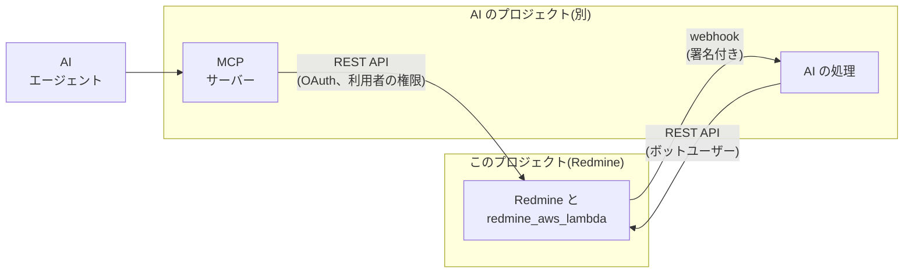

# AI 機能との連携

AI 機能 (メールで受信したチケットの振り分け、長いチケットや wiki の要約、AI エージェントが Redmine を使うための MCP サーバーなど) は、このプロジェクトでは作らず、別のプロジェクトに分けます。このプロジェクトでは、あとから AI 機能を連携できるように、Redmine 側のインターフェイスだけを用意します。

この資料の仕様は、2026-11-08 時点の Redmine 7.0.3 のソースで確認したものです。出典は [sources.md](sources.md) にあります。

## 方針

- **AI 機能は分離する:** AI サービスの呼び出し、プロンプト、費用、AI 機能の画面は、別のプロジェクトに置きます。このプロジェクトのイメージ、プラグイン、IAM には含めません。
- **公開されたインターフェイスだけで連携する:** AI 側は、Redmine の REST API と、Redmine 標準の webhook (下記) だけを使います。データベースや S3 には直接アクセスしません。Redmine の権限が、AI 側にもそのまま適用されるようにするためです。
- **独自の仕組みを追加しない:** どのインターフェイスも、Redmine 7.0 の標準機能 (REST API、OAuth、webhook) です。このプロジェクトが追加するのは、大きな添付ファイルを API で送る仕組み (署名付き URL で CloudFront を通した S3 へのアップロード) だけです。

## 提供するインターフェイス

### REST API と認可

| インターフェイス | 内容 | 用途 |
| --- | --- | --- |
| REST API | Redmine 標準の REST API (チケット、注記、wiki、プロジェクト、添付ファイルなど) | AI 側が、内容を読み、結果を書き込む |
| API キー | Redmine の標準。ユーザーごとのキー | ボットユーザー (下記) で使う |
| OAuth 2 | Redmine 7.0 は、doorkeeper の gem で OAuth 2 のプロバイダーになれる (`Gemfile`、`config/initializers/doorkeeper.rb`、`oauth2_applications` の画面) | MCP サーバーなど、利用者の権限で Redmine を操作するとき |
| 大きな添付ファイル | CloudFront を通したアップロード (`/s3_uploads/presign`、`/s3_uploads/complete`) を、API キーと OAuth でも使えるようにする | AI 側が、要約などのファイルを添付するとき。REST API の `POST /uploads.json` は 1 MB まで ([attachments.md](https://redmine-kit.github.io/redmine_aws_s3/ja/attachments.html#uploads-through-lambda)) |

AI の処理が書き込むときは、専用の Redmine ユーザーを使うので、AI が書いたものはこのユーザーの注記や更新として残ります。このユーザーは管理者にはせず、ロールで、使うプロジェクトと操作 (閲覧、注記の追加など) に絞ります。API キーは、AI 側のシークレットとして、AI のプロジェクトで管理します。AI エージェントが利用者の代わりに Redmine を操作するときは、OAuth で、その利用者の権限の範囲だけを許可します。

API も画面と同じく CloudFront を経由するので、WAF の IP アドレスごとのレート制限が API にも適用されます ([lambda.md](lambda.md#flat-rate-free-plan-and-waf))。

### イベント通知 (Redmine 標準の webhook)

Redmine で発生したイベントは、Redmine 7.0 標準の webhook で、AI 側に通知します。独自の仕組みは作りません。

| 項目 | Redmine 7.0 の webhook (`app/models/webhook.rb`、`webhook_payload.rb`) |
| --- | --- |
| 作成者 | webhook は、ユーザーが作成する。プロジェクトの権限「webhook の利用」(`use_webhooks`) が必要 |
| 設定項目 | 送信先の URL、イベントの種類 (`issue.created` のような「対象.操作」)、プロジェクト |
| ペイロード | イベントの対象を、webhook を作成したユーザーの権限で生成した内容。そのユーザーが閲覧できないもの (`visible?`) は送らない |
| 署名 | シークレットを設定すると、本文の HMAC-SHA256 を `X-Redmine-Signature-256` ヘッダーに付ける |
| 送信方法 | ジョブ (`WebhookJob`) で送る。この設計では、`redmine-worker` が送る |
| 送信先の制限 | `configuration.yml` の `webhook_blocklist` で、送信してはいけない宛先を指定する |

AI 用の webhook はボットユーザー (上の「REST API と認可」) で作成するので、ペイロードはボットユーザーが閲覧できる範囲に限られます。AI のプロジェクトは、署名を検証して webhook を受信するエンドポイント (Lambda の関数 URL など) を用意します。

webhook は、`redmine-worker` から AI 側の URL に送ります。`redmine-worker` は VPC のプライベートサブネットで動くので、インターネットに接続できるのは NAT インスタンスを経由する場合 (`network.mode: nat`) だけです。VPC エンドポイントだけの構成 (`network.mode: endpoints`。デフォルト) では webhook を送れないので、AI 側が REST API で更新を定期的に取得する構成にします ([rds.md](rds.md#routes-out-of-the-vpc))。

`webhook_blocklist` には、プライベート、ループバック、リンクローカルのアドレスを設定します (値は [lambda.md](lambda.md#rails-and-redmine-settings) の表にあります)。webhook で内部のアドレスにリクエストを送らせないためです。RDS 構成の NAT インスタンスでも同じ値にします。

## AI のプロジェクトの担当範囲

次のことは、AI のプロジェクトで決めます。このプロジェクトの資料には、Redmine のインターフェイスとの関係だけを書きます。

- 使う AI サービス (Claude API、Claude Platform on AWS、Amazon Bedrock など) と、モデル
- プロンプト、費用、処理速度
- MCP サーバー (Redmine の REST API を、MCP のツールとして提供するもの) と、その配置場所
- AI 機能の画面と設定

## 安全のための規則

Redmine 側で守ることと、AI 側で守ることを分けます。

| 守ること | 担当 |
| --- | --- |
| AI が、ボットユーザーか、利用者の権限の範囲でしか操作できない | このプロジェクト (Redmine の権限、ロール、OAuth のスコープ) |
| ボットユーザーに、削除、管理、権限の変更を許可しない | このプロジェクト (ロールの設定) |
| webhook のペイロードを、ボットユーザーが閲覧できる範囲に限る。webhook をプライベートアドレス宛てに送らせない | このプロジェクト (Redmine の webhook の権限チェック、`webhook_blocklist`) |
| メールやチケットの本文は、信頼できない入力として扱う (本文に書かれた指示に従わない) | AI のプロジェクト |
| AI の出力は、まず提案 (注記や下書き) として書き、ステータスの変更などは人が確認してから行う | AI のプロジェクト |

メールで受信したチケットには、外部の人が書いた本文が含まれます ([mail.md](mail.md#receiving))。AI の処理にとっては、もっとも注意が必要な入力です。

## 未確認の事項

- Redmine 7.0 の OAuth で使えるスコープと、REST API のどこまでを OAuth で使えるか
- CloudFront を通したアップロードを、API キーと OAuth で使うときの CSRF の扱い (API では CSRF の確認を外す)
- webhook で送るイベントの種類の一覧 (`WebhookPayload.events`) と、ペイロードの形式
