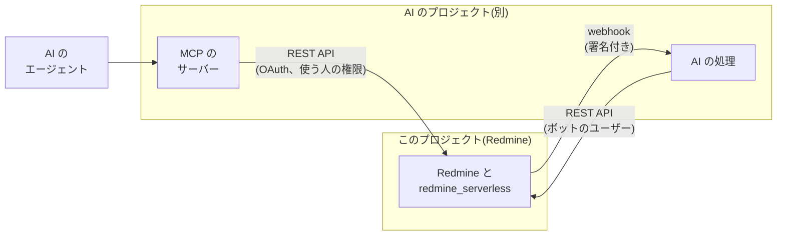

# AI の機能との連携

AI の機能(メールで来たチケットの振り分け、長いチケットや wiki の要約、AI のエージェントが Redmine を使うための MCP のサーバーなど)は、このプロジェクトでは作らず、別のプロジェクトに分けます。このプロジェクトでは、あとから AI の機能をつなげるように、Redmine の側のインターフェイスだけを用意します。

この資料の仕様は、2026-11-08 時点の Redmine 7.0.3 のソースで確認したものです。出典は [sources.md](sources.md) にあります。

## 方針

- **AI の機能は分ける:** AI のサービスの呼び出し、プロンプト、費用、AI の機能の画面は、別のプロジェクトに置きます。このプロジェクトのイメージ、プラグイン、IAM には入れません。
- **公開のインターフェイスだけでつなぐ:** AI の側は、Redmine の REST API と、Redmine の標準の webhook(下記)だけを使います。データベースや S3 には直接触れません。Redmine の権限が、AI の側にもそのまま効くようにするためです。
- **自前の仕組みを足さない:** どのインターフェイスも、Redmine 7.0 の標準の機能(REST API、OAuth、webhook)です。このプロジェクトが足すのは、大きな添付ファイルを API で送る仕組み(署名付きの POST での S3 へのアップロード)だけです。

## 用意するインターフェイス

### REST API と認可

| インターフェイス | 内容 | 使う場面 |
| --- | --- | --- |
| REST API | Redmine の標準の REST API(チケット、注記、wiki、プロジェクト、添付ファイルなど) | AI の側が、中身を読み、結果を書き込む |
| API キー | Redmine の標準。ユーザーごとのキー | ボットのユーザー(下記)で使う |
| OAuth 2 | Redmine 7.0 は、doorkeeper の gem で OAuth 2 のプロバイダーになれる(`Gemfile`、`config/initializers/doorkeeper.rb`、`oauth2_applications` の画面) | MCP のサーバーなど、使う人の権限で Redmine を操作するとき |
| 大きな添付ファイル | 署名付きの POST でのアップロード(`/s3_uploads/presign`、`/s3_uploads/complete`)を、API キーと OAuth でも使えるようにする | AI の側が、要約などのファイルを添付するとき。REST API の `POST /uploads.json` は 1 MB まで([attachments.md](https://redmine-kit.github.io/redmine_serverless_s3/ja/attachments.html#uploads-through-lambda)) |

- **ボットのユーザー:** AI の処理が書き込むときは、専用の Redmine のユーザーを使います。AI が書いたものは、このユーザーの注記や更新として残ります。権限はロールで、使うプロジェクトと操作(読む、注記を足すなど)に絞ります。管理者にはしません。API キーは、AI の側の秘密の値として、AI のプロジェクトで管理します。
- **使う人の権限:** AI のエージェントが、使う人の代わりに Redmine を操作するときは、OAuth で、その人の権限の範囲だけを許します。
- **API の入口:** API も、画面と同じく CloudFront から入ります。WAF の IP ごとのレート制限が、API にも効きます([lambda.md](lambda.md#flat-rate-free-plan-and-waf))。

### 出来事の通知(Redmine の標準の webhook)

Redmine で起きた出来事は、Redmine 7.0 の標準の webhook で、AI の側に通知します。自前の仕組みは作りません。

| 項目 | Redmine 7.0 の webhook(`app/models/webhook.rb`、`webhook_payload.rb`) |
| --- | --- |
| 作る人 | webhook は、ユーザーが作る。プロジェクトの権限「webhook の利用」(`use_webhooks`)が要る |
| 選ぶもの | 送り先の URL、出来事の種類(`issue.created` のような「種類.動き」)、プロジェクト |
| 送る中身 | 出来事の対象を、webhook を作ったユーザーの権限で作った中身。そのユーザーに見えないもの(`visible?`)は送らない |
| 署名 | 秘密の値を設定すると、本文の HMAC-SHA256 を `X-Redmine-Signature-256` のヘッダーに付ける |
| 送り方 | ジョブ(`WebhookJob`)で送る。この設計では、`redmine-worker` が送る |
| 送り先の制限 | `configuration.yml` の `webhook_blocklist` で、送ってはいけない宛先を決める |

- **ボットのユーザーで作る:** AI のための webhook は、ボットのユーザー(上の「REST API と認可」)で作ります。送る中身は、ボットのユーザーに見える範囲に限られます。
- **外に出る経路:** webhook は、`redmine-worker` から、AI の側の URL に送ります。`redmine-worker` は VPC の外にあり、インターネットに直接出られるので、そのまま送れます。RDS の形では、NAT インスタンスの形だけが送れます。VPC のエンドポイントの形では送れないので、AI の側が REST API で、更新を定期的に読みに来る形にします([rds.md](rds.md#routes-out-of-the-vpc))。
- **送ってはいけない宛先:** `webhook_blocklist` に、プライベート、ループバック、リンクローカルのアドレスを入れます。値は [lambda.md](lambda.md#rails-and-redmine-settings) の表にあります。webhook で、内向きのアドレスに要求を送らせないためです。RDS の形の NAT インスタンスでも同じ値にします。
- **AI の側の受信のエンドポイント:** AI のプロジェクトが、署名を確認して webhook を受けるエンドポイント(Lambda の関数 URL など)を用意します。

## 分ける側に任せること

次のことは、AI のプロジェクトで決めます。このプロジェクトの資料には、Redmine のインターフェイスとの関係だけを書きます。

- 使う AI のサービス(Claude の API、Claude Platform on AWS、Amazon Bedrock など)と、モデル
- プロンプト、費用、処理の速さ
- MCP のサーバー(Redmine の REST API を、MCP のツールにするもの)と、その置き場所
- AI の機能の画面と設定

## 安全の決まり

Redmine の側で守ることと、AI の側で守ることを分けます。

| 守ること | 守る側 |
| --- | --- |
| AI が、ボットのユーザーか、使う人の権限の範囲でしか操作できない | このプロジェクト(Redmine の権限、ロール、OAuth の範囲) |
| ボットのユーザーに、削除、管理、権限の変更を許さない | このプロジェクト(ロールの設定) |
| webhook で送る中身を、ボットのユーザーに見える範囲に限る。webhook をプライベートのアドレスの宛先に送らせない | このプロジェクト(Redmine の webhook の権限の確認、`webhook_blocklist`) |
| メールやチケットの本文は、信頼できない入力として扱う(本文に書かれた指示に従わない) | AI のプロジェクト |
| AI が出したものは、まず提案(注記や下書き)として書き、状態の変更などは人が確認してから行う | AI のプロジェクト |

メールで受けたチケットには、外の人が書いた本文が入ります([mail.md](mail.md#receiving))。AI の処理にとっては、もっとも注意が要る入力です。

## 確認すること

- Redmine 7.0 の OAuth で使えるスコープと、REST API のどこまでを OAuth で使えるか
- 署名付きの POST でのアップロードを、API キーと OAuth で使うときの CSRF の扱い(API では CSRF の確認を外す)
- webhook で送る出来事の種類の一覧(`WebhookPayload.events`)と、中身の形
