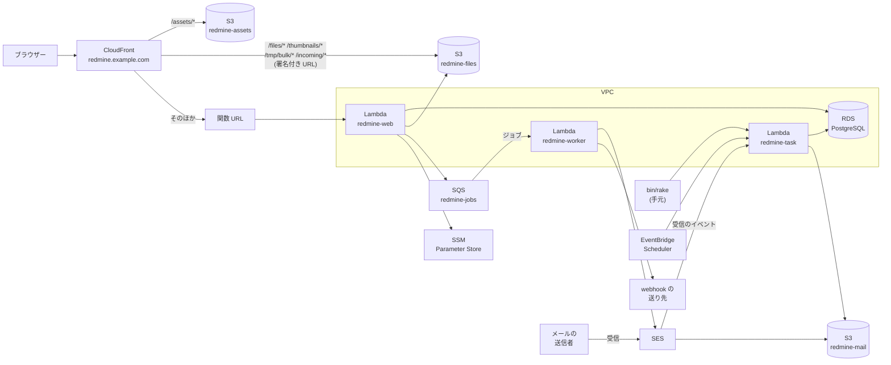

# 全体の構成

最新の Redmine(7.0.3)を、AWS Lambda Event Functions で動かす設計です。添付ファイルとアセットは S3 に置きます。データベースは、VPC の中の RDS for PostgreSQL です。外部のプラグインは入れず、テーマは標準のままにします。Lambda、S3、SES のための拡張は、自前のプラグインにします。

この資料の仕様は、2026-11-08 時点の公式の情報で確認したものです。出典は [sources.md](sources.md) にあります。

<a id="diagram"></a>

## 構成図



`redmine-web`、`redmine-worker`、`redmine-task` は同じイメージです。3 つとも VPC のプライベートのサブネットで動き、データベースを使います(図では一部の線を省いています)。RDS は外から届きません。S3 にはゲートウェイのエンドポイントで、SQS、SES、SSM には VPC のエンドポイントか NAT インスタンスで届きます。インターネットの webhook の送り先には、NAT インスタンスのときだけ届きます。道を描いた構成図と選び方は [rds.md](rds.md#routes-out-of-the-vpc) にあります。15 分を超える 1 回だけのタスクは、同じプライベートのサブネットの Fargate で動かします([tasks.md](tasks.md#tasks-longer-than-15-minutes))。

<a id="decisions"></a>

## 決めたこと

| 項目 | 決めたこと | 理由 | 詳しい資料 |
| --- | --- | --- | --- |
| Redmine | 7.0.3(最新の安定バージョン)。外部のプラグインなし、標準のテーマ | 依頼のとおり | [lambda.md](lambda.md) |
| 拡張 | 自前のプラグイン。`redmine_serverless`(Lambda での実行)、`redmine_serverless_s3`(S3 の添付ファイル)、`redmine_serverless_ses`(SES でのメール)、`redmine_serverless_sqs`(SQS でのジョブ)、`redmine_serverless_ssm`(SSM Parameter Store の設定と秘密の値) | Redmine の標準の拡張の仕組みで、本体のファイルを書き換えない | 下の「自前のプラグイン」 |
| 実行環境 | Event Functions、コンテナイメージ、arm64 | Ruby を動かせる。Web Functions は Node.js だけ(下記) | [lambda.md](lambda.md) |
| イメージ | Lambda の Ruby のベースイメージ(`public.ecr.aws/lambda/ruby:4.0`)に、Redmine、ImageMagick などの依存、Lambda Web Adapter を入れる | Lambda と同じ OS と Ruby で、Lambda で動かす前提の作り。HTTP サーバー(Puma)をそのまま使える | [lambda.md](lambda.md#choosing-the-base) |
| 3 つの関数 | `redmine-web`(画面)、`redmine-worker`(ジョブ)、`redmine-task`(rake とメールの取り込み)。同じイメージを、環境変数 `REDMINE_ROLE` で切り替える。Puma を起動するのは `redmine-web` だけ | ビルドが 1 回で済み、同じコードが動く | [tasks.md](tasks.md#how-one-image-runs-everything) |
| 入口 | CloudFront → 関数 URL。関数 URL は IAM の認証にし、OAC で署名した要求だけを受ける。POST などの本文のハッシュは、Lambda@Edge(`redmine-body-hash`)が入れる | 署名のない直接の要求は、関数が呼ばれる前に断られる。秘密のヘッダーを持たなくてよい。CloudFront Functions は本文を読めないので Lambda@Edge にする。要求の本文は 1 MB までになる | [lambda.md](lambda.md#cloudfront-and-function-urls) |
| アセット | CloudFront の `/assets/*` を S3 に向ける | Lambda を通さず、起動待ちと同時の要求を減らす | [lambda.md](lambda.md#serving-assets) |
| データベース | RDS for PostgreSQL(db.t4g.micro、Single-AZ)。VPC のプライベートのサブネットに置き、外から届かないようにする。パスワードは SSM Parameter Store に置く。Redmine の標準の migration をそのまま実行する | Redmine は PostgreSQL にそのまま対応しているので、アダプターや migration の手直しが要らない。費用の見通しが立つ | [rds.md](rds.md) |
| 設定と秘密の値 | SSM Parameter Store(`/<instance>/env/`)に置き、起動のときに読む | Lambda の環境変数に秘密の値を置かない。パラメーターを足すだけで設定を増やせる | [lambda.md](lambda.md#settings-and-secrets-ssm-parameter-store) |
| 管理画面 | メールの送信と受信、ジョブ、添付ファイルの S3、AWS への接続の状態を、すべてのプラグインが共有する Redmine の管理のメニューの「Serverless」の項目で確認し、操作できるようにする | 状態の確認と、送り直しなどの操作を、AWS のコンソールを開かずに行える | [admin.md](https://redmine-kit.github.io/redmine_serverless/ja/admin.html#the-serverless-menu) |
| IAM | 関数ごとに実行ロールを分け、対象を ARN で絞る。アクセスキーを作らない | 画面の関数が rake やメールの受信の権限を持たない | [iam.md](iam.md) |
| セキュリティ | 外から届くのは CloudFront だけ。AWS WAF(定額プラン Free の 5 つのルール)、二要素認証、安全な既定の設定、ログと記録の保持の期間 | 守るもの、起きうること、残るリスク、事故のときの手順を 1 か所にまとめる | [security.md](security.md) |
| 添付ファイル | S3 の API で読み書きする。Redmine の S3 のプラグインのやり方を参考にする | S3 を唯一の保存先にできる。Lambda の環境どうしでファイルを共有できる | [attachments.md](https://redmine-kit.github.io/redmine_serverless_s3/ja/attachments.html) |
| アップロード | ブラウザー → CloudFront → S3 の PUT。CloudFront の署名付き URL と、S3 が確認する SHA256 を使う | Lambda の要求は 6 MB まで。CloudFront を通って Lambda に届く要求の本文は 1 MB まで | [attachments.md](https://redmine-kit.github.io/redmine_serverless_s3/ja/attachments.html#upload) |
| ダウンロード | すべて Redmine のドメインの CloudFront の署名付き URL にリダイレクトする。CloudFront が S3 から読み、sandbox の CSP を付ける | Lambda の応答は 6 MB まで。S3 では sandbox の CSP を付けられない | [attachments.md](https://redmine-kit.github.io/redmine_serverless_s3/ja/attachments.html#download) |
| バックグラウンドのジョブ | ActiveJob を AWS の公式の gem `aws-activejob-sqs` で SQS に積み、`redmine-worker` で実行する | 自前のコードが要らない。やり直しとデッドレターキューがある。画面の要求がジョブを待たない | [lambda.md](lambda.md#background-jobs) |
| メールの送信 | Rails の ActionMailer の送信方法(`aws-actionmailer-ses` の `:ses_v2`)で、SES の API から送る。送るのは `redmine-worker` | Rails の標準の仕組みで、自前のコードが要らない | [mail.md](mail.md#sending) |
| ドメインと DNS | Web とメールを同じホスト名(Redmine のサブドメイン)にする。Web は CloudFront を向く別名の種類のレコード、同じ名前に MX を置く。親のドメインの DNS で置けなければ、サブドメインを Route 53 に委任する | URL とメールのアドレスがそろう。CNAME と MX は同じ名前に置けない | [mail.md](mail.md#receiving-domain) |
| メールの受信 | SES で受けて S3 に置き、`redmine-task` が Redmine の `MailHandler` で取り込む。アドレスはプロジェクトごと(`<識別子>@<サブドメイン>`)と全体用。DMARC が通らないメールは捨てる | 東京の SES で受信できる。差出人を偽ったメールを取り込まない | [mail.md](mail.md#receiving) |
| migration と rake | `redmine-task` で、手元のコマンドから任意の rake と `rails runner` を実行する | 本番と同じイメージと設定で動く。`rake db:migrate` と `redmine:plugins:migrate` を、RDS の上でそのまま実行する | [tasks.md](tasks.md) |
| Redmine の更新 | 新しいバージョンが出たら、増えた migration を読み分け、試験用のデータベース(PostgreSQL)で実行し、プラグインの差し替えへの影響を確認してから上げる。結果はバージョンごとに記録する | 上げてから壊れたことに気づくのを防ぐ | [upgrade.md](upgrade.md) |
| テスト | 差し替えた処理ごとにテストを付け、Redmine 本体のテストも通す。AWS は手元で moto と LocalStack に、データベースは PostgreSQL のコンテナに代える。デプロイのたびに本物の AWS で確認する | 差し替えた処理が Redmine の更新で壊れたことに気づける | [testing.md](testing.md) |
| ネットワーク | VPC を 1 つ作り、2 つの AZ にプライベートのサブネットを置く。Lambda と RDS はプライベートのサブネットに置く。AWS のサービスには、VPC のエンドポイントか NAT インスタンスで届く。どちらにするかは、設定のファイルの `network.mode` で選ぶ | RDS には VPC の中からしか届かない。エンドポイントは運用が要らず、インターネットへの出口がない。NAT インスタンスは費用が安く、webhook も送れる | [rds.md](rds.md#routes-out-of-the-vpc) |
| AI の機能 | 別のプロジェクトに分ける。AI の側は、Redmine の標準の REST API、OAuth、webhook でつなぐ | AI のサービスや費用の判断を、Redmine の基盤から切り離す | [ai.md](ai.md) |
| リージョン | 東京(ap-northeast-1)。ほかのリージョンでも、エンドポイントの名前と単価を読み替えれば同じ | 日本の利用者に近い。単価もこのリージョンで見積もる | — |

<a id="why-not-web-functions"></a>

## Web Functions を使わない理由

Web Functions は、ポートで待ち受ける HTTP サーバーをそのまま動かせる新しい Lambda です。Redmine では、次の理由で使いません。

- **ランタイム:** 対応しているのは `nodejs24.x` だけです。Ruby のランタイムとコンテナイメージには対応していません。Node.js の入口から、同梱した Ruby を子プロセスで起動する方法は考えられますが、公式の資料にない構成です。
- **`/tmp`:** 512 MB で固定です。添付ファイルのキャッシュ([attachments.md](https://redmine-kit.github.io/redmine_serverless_s3/ja/attachments.html#the-tmp-cache))に使える大きさが限られます。
- **常時の費用:** メモリは、環境があるあいだ(リクエストの合間も)課金されます。2 GB で 1 か月つけたままにすると、約 22 ドルです。

Lambda Managed Instances(1 環境で複数のリクエストを処理する Event Functions)も、対応する言語に Ruby がなく、最小で 3 環境が動き続けるので使いません。

<a id="request-flow"></a>

## リクエストの流れ

<a id="showing-and-saving-pages"></a>

### 画面の表示と保存

1. ブラウザーが `https://redmine.example.com/` を開きます(ドメインは例)。
2. CloudFront が、`/assets/*` を S3 から返し、そのほかを関数 URL に転送します。転送の前に、Lambda@Edge が本文のハッシュを入れ、OAC が要求に署名します。
3. Lambda Web Adapter が、要求を HTTP に戻して Puma に渡します。
4. Redmine が RDS を読み書きし、HTML を返します。

1 つの環境は、同時に 1 件の要求だけを処理します。同時の要求が増えると、Lambda が環境を増やします。

<a id="attachments"></a>

### 添付ファイル

- **アップロード:** ブラウザーがファイルの SHA256 を計算し、Redmine から CloudFront の署名付き URL を受け取って、CloudFront を通して S3 に PUT します。中身が SHA256 と合わなければ、S3 が断ります。Redmine は、S3 が確認したチェックサムを読んで、添付のレコードを作ります。
- **ダウンロード:** Redmine が権限を確認してから、`/files/` の下の CloudFront の署名付き URL へリダイレクトします。CloudFront が OAC で S3 からオブジェクトを読み、Redmine の sandbox の CSP を付けます。
- **サーバーでの処理:** サムネイルや Office のファイルのプレビューなど、ローカルのファイルが要る処理は、S3 から `/tmp` のキャッシュに取って行います。

詳しくは [attachments.md](https://redmine-kit.github.io/redmine_serverless_s3/ja/attachments.html) にあります。

<a id="email"></a>

### メール

- **送信:** Redmine が通知のメールのジョブを SQS に積み、`redmine-worker` が SES の API で送ります。
- **受信:** SES が受けたメールを S3 に置き、`redmine-task` を呼びます。`redmine-task` が、S3 から全文を取り、Redmine の `MailHandler` でチケットや注記にします。

詳しくは [mail.md](mail.md) にあります。

<a id="the-plugins"></a>

## 自前のプラグイン

Lambda と AWS のための拡張は、Redmine の標準の拡張の仕組み(プラグイン)で作る、自前のプラグインです。プラグインはそれぞれ別のリポジトリで開発し、イメージを作るときに `plugins/` に入れます。Redmine 本体のファイルは書き換えません。プラグインは、管理画面の「プラグイン」の一覧に、バージョンとともに出ます。

| プラグイン | すること | 有効にする条件 | 資料 |
| --- | --- | --- | --- |
| [`redmine_serverless`](https://github.com/redmine-kit/redmine_serverless) | Lambda での実行。Lambda Web Adapter の `/events` に答える Rack のミドルウェア、アセットの自動の書き出しを止める設定、Lambda で使えない Redmine の設定を無効に固定すること、管理画面の「状態と接続」 | `REDMINE_ROLE` がある | [Redmine Serverless](https://redmine-kit.github.io/redmine_serverless/ja/) |
| [`redmine_serverless_s3`](https://github.com/redmine-kit/redmine_serverless_s3) | S3 の添付ファイル。保存、CloudFront を通した S3 へのアップロード、sandbox の CSP を付ける CloudFront の署名付き URL へのリダイレクト、`/tmp` のキャッシュ、管理画面の「添付ファイルの S3」 | S3 のバケットの設定がある | [Redmine Serverless S3](https://redmine-kit.github.io/redmine_serverless_s3/ja/) |
| [`redmine_serverless_ses`](https://github.com/redmine-kit/redmine_serverless_ses) | SES でのメール。送信のやり直し、受けたメールの取り込み、プロジェクトごとのアドレス、メールの管理画面 | SES の設定がある | [Redmine Serverless SES](https://redmine-kit.github.io/redmine_serverless_ses/ja/) |
| [`redmine_serverless_sqs`](https://github.com/redmine-kit/redmine_serverless_sqs) | SQS でのジョブ。`aws-activejob-sqs` の設定(キューと、実行してよいジョブのクラス)、最後に失敗したジョブの記録、管理画面の「ジョブ」 | `REDMINE_JOBS_QUEUE_URL` がある | [Redmine Serverless SQS](https://redmine-kit.github.io/redmine_serverless_sqs/ja/) |
| [`redmine_serverless_ssm`](https://github.com/redmine-kit/redmine_serverless_ssm) | 設定と秘密の値。Rails が `config/database.yml` と `SECRET_KEY_BASE` を読む前に、`REDMINE_SSM_PATH` の下のパラメーターを環境変数に読み込む。そのタイミングで動くように gem でもあり、`image/Gemfile.local` で道筋を指定して足す | `REDMINE_SSM_PATH` がある | [Redmine Serverless SSM](https://redmine-kit.github.io/redmine_serverless_ssm/ja/) |

- **5 つに分ける理由:** S3 の添付ファイル、SES でのメール、SQS でのジョブ、SSM の設定は、Lambda 以外でも動きます(ジョブは、Lambda のイベントソースの代わりに gem の取り出し役で動かします)。プラグインを分けると、ふつうのサーバーの Redmine でも、Lambda のための部分なしで片方だけを使えます。Lambda では、ファイルシステムに書けず、メールの受信箱もないので、イメージに 5 つとも入れます。
- **名前:** GitHub のリポジトリの検索では、`redmine_serverless` という名前の Redmine のプラグインは見つかりませんでした(2026-11-08。見つかったのは関係のない Slack のボットだけ)。S3、SES、SQS、SSM のプラグインの名前は、まだ確認していません。

<a id="features"></a>

### プラグインの機能

プラグインごとの機能と、有効にする条件は、それぞれのプラグインの資料(上の表)にあります。

<a id="distribution"></a>

### 配布

プラグインは、GitHub Packages の RubyGems のレジストリ(`https://rubygems.pkg.github.com/redmine-kit`)に gem として公開します。Redmine の Lambda 用のイメージは、GitHub Packages のコンテナのレジストリ(`ghcr.io`)で公開する案です。どちらも、置き場所の持ち主は redmine-kit の組織です。

| もの | 置き場所 | 使い方 |
| --- | --- | --- |
| Redmine の Lambda 用のイメージ(案) | `ghcr.io/redmine-kit/serverless:<Redmine のバージョン>-<このプロジェクトのバージョン>`(arm64) | `bin/deploy` が digest で取り、立てるアカウントの ECR に写す([deploy-config.md](deploy-config.md#deployment-commands))。Lambda は、同じリージョンの ECR のイメージしか使えない |
| プラグイン | GitHub Packages の gem `redmine_serverless_x`。プラグインごとに 1 つで、それぞれのリポジトリのワークフローが、バージョンのタグごとに公開する。プラグインの動かすためのファイルを持つ | `Gemfile.local` で GitHub Packages の source から足し、`bundle install` を実行して、入れた gem を `plugins/` にリンクする(各プラグインの準備のページ) |
| プラグイン(gem を使わない人) | リポジトリのチェックアウト | `plugins/` に clone する |

- **gem にする理由:** gem は、ほかの gem と一緒に Bundler が入れ、バージョンとチェックサムが `image/Gemfile.lock` に残ります。プラグインの更新も、ほかの gem と同じく、毎週の gem の更新でイメージに届きます([testing.md](testing.md#order-in-ci))。`redmine_serverless_ssm` は、Rails が設定を読む前に SSM Parameter Store を読むので、もともと gem である必要があります。
- **`plugins/` にリンクする理由:** Redmine 7.0.3 は、`plugins/` のディレクトリにあるプラグインだけを読み込みます(`lib/redmine/plugin_loader.rb`)。gem のプラグインを読み込む仕組みはありません。イメージは、入れたプラグインの gem を、そこにリンクします(`image/Dockerfile` の `link-plugins`)。gem にはプラグインの `Gemfile` を入れないので、Redmine の `Gemfile` がプラグインを 2 回読み込むことはありません。
- **トークンが要る:** GitHub Packages の RubyGems のレジストリは、公開の gem でも、入れるのに `read:packages` の権限を持つトークンが要ります(GitHub の資料、2026-11-09 に確認)。CI はそのジョブの `GITHUB_TOKEN` を、手元は `gh` のログインのトークンを使います。組み立てには秘密として渡し、レイヤーには残しません(`bin/lib/plugin.sh`)。
- **バージョン:** それぞれのプラグインのバージョンは、gemspec、`init.rb` の `version`、Git のタグでそろえ(公開のワークフローが確認します)、対応する Redmine のバージョンを `requires_redmine` で書きます。
- **使う側:** 使う側は、Redmine のイメージを、タグではなく digest で参照します([AGENTS.md](../../AGENTS.md) の「digest で固定する」と同じ考え方)。

<a id="derived-images"></a>

### 派生のイメージ

このプロジェクトのイメージは、標準のテーマと 5 つのプラグインだけを入れます。テーマやプラグインを足したい使う側は、このプロジェクトのイメージを土台にした派生のイメージを作り、設定のファイルの `image` で指します([deploy-config.md](deploy-config.md#fields-of-redminejson))。

- **作り方:** `FROM` でこのプロジェクトのイメージを digest で指し、テーマを `themes/<テーマ>/` に、プラグインを `plugins/<プラグイン>/` に置いて、アセットを作り直します(`assets:precompile`)。Redmine 7.0 は、テーマを `themes/` か `app/assets/themes/` から読み、Propshaft のアセットとして配ります(`lib/redmine/themes.rb`)。
- **アセット:** `bin/deploy` は、派生のイメージの中のアセットを S3 に同期します。テーマのアセットも、CloudFront の `/assets/*` から配られます。
- **確認:** 派生のイメージも、このプロジェクトのイメージのテスト(読み取り専用、権限の少ないユーザー、3 つの役割)を通します([testing.md](testing.md#image-tests))。足したプラグインは、このプロジェクトでは確認しません。


<a id="what-is-not-in-the-plugins"></a>

### プラグインにしないもの

次のものは、プラグインより前に読み込む必要があるか、Redmine の外で動くので、プラグインにしません。

| もの | 置き場所 | 理由 |
| --- | --- | --- |
| キャッシュ、ジョブ、スキーマの書き出しの設定 | `config/additional_environment.rb` | データベースへの接続とキャッシュの作成より前に要る。プラグインは、そのあとで読み込まれる |
| データベース、添付の置き場所、メールの送信の設定 | `config/database.yml`、`config/configuration.yml` | Redmine の設定ファイル |
| 起動のスクリプト、拡張機能のスクリプト | `image/` | Redmine より前に動く |
| 本文のハッシュを入れる関数 | `edge/` | CloudFront の Lambda@Edge で動く(Node.js) |
| タスクのハンドラー | `image/` | Rails を読み込まずに、rake を子プロセスで起動する |
| `bin/rake`、`bin/rails` | `bin/` | 手元から、デプロイした Redmine に向けて使う |
| `bin/test`、`bin/check-migrations` | `bin/` | 手元と CI で、テストと migration の読み分けに使う |

メールの送信(`aws-actionmailer-ses`)とジョブ(`aws-activejob-sqs`)は、AWS の公式の gem を使い、送信の仕組みやキューのアダプターは書きません。ジョブの設定は `redmine_serverless_sqs` が持ちます。

<a id="repository-layout-planned"></a>

## リポジトリの構成(予定)

```text
serverless/
  image/          コンテナイメージ(Dockerfile、設定ファイル、起動のスクリプト、拡張機能のスクリプト、タスクのハンドラー)
  edge/           Lambda@Edge の関数(本文のハッシュを入れる redmine-body-hash)
  bin/            手元で使うコマンド(rake、rails は本番に向けて。test、check-migrations は手元と CI で)
  infra/          CloudFormation(VPC、データベース、S3、SQS、Lambda、CloudFront、SES。us-east-1 の Lambda@Edge と CloudFront の証明書)
  .github/        ビルドとデプロイのワークフロー
  docs/           資料
```

プラグインは、それぞれ別のリポジトリにあります(上の「自前のプラグイン」)。イメージを作るときに、それぞれの決めたバージョンを `plugins/` に入れます。

インフラは CloudFormation で書きます。スタックは、`bin/deploy` が、インフラのデプロイ用のロール(SSO の管理者か、承認の要る GitHub の Environment)で当てます。Redmine のイメージだけの更新は、GitHub Actions がコードのデプロイ用のロールで行います([iam.md](iam.md))。デプロイの段は [deploy-config.md](deploy-config.md#deployment-commands) にあります。

<a id="order-of-work"></a>

## 作る順番

動くかどうかに効く点から、順に作ります。各段で、テストを同じ段のうちに書き、CI で通してから次へ進みます([testing.md](testing.md))。

| 段 | 作るもの | 同じ段で書くテスト |
| --- | --- | --- |
| 1 | CI の土台(静的な検査、PostgreSQL、moto、LocalStack のコンテナ) | RuboCop、ShellCheck、actionlint、cfn-lint |
| 2 | イメージ(Lambda の Ruby のベースイメージ、Redmine、依存、3 つの役割の切り替え) | イメージのテスト(読み取り専用、権限の少ないユーザー、3 つの役割の起動)、Redmine 本体のテスト |
| 3 | Lambda の上での起動(VPC、RDS、SSM、`redmine-task`、`redmine-web` を関数 URL で開く) | SSM の読み込みとタスクのハンドラーのテスト。起動にかかる時間の計測 |
| 4 | CloudFront とアセット(ドメイン、`/assets/*` の S3、OAC と Lambda@Edge の `redmine-body-hash`) | `redmine-body-hash` のテスト。OAC で POST が通るかの確認。デプロイしたあとの確認の最初のもの |
| 5 | 添付ファイル(`redmine_serverless_s3`) | プラグインのユニット、機能、統合、システムのテスト。本体の添付ファイルのテストを S3 の形で通す |
| 6 | ジョブとメールの送信(SQS、`redmine-worker`、SES と `redmine_serverless_ses` の送信の部分、送り直し) | ジョブとメールの送信のテスト、エラーの種類ごとのやり直しのテスト。メールボックスシミュレーターでの確認 |
| 7 | 管理画面(状態と接続、メールの送信、ジョブ、添付ファイルの S3) | 画面ごとの機能とシステムのテスト。管理者でない人が開けないこと |
| 8 | メールの受信(MX、受信のルール、`redmine_serverless_ses` での取り込み、管理画面の「メールの受信」) | 取り込みのテスト(なりすまし、迷惑メール、自動応答)。本物の受信の確認 |
| 9 | 移行(古い Redmine のデータを移すなら) | 移したデータで、デプロイしたあとの確認を通す |

<a id="open-questions"></a>

## まだ決めていないこと

| 項目 | 選択肢 | 決めるのに要るもの |
| --- | --- | --- |
| 古い Redmine のデータを移すか | 移す / 新しく始める | 移行元の構成(バージョン、データベース、添付ファイルの置き場所)。[migration.md](migration.md) |
| VPC の外への道 | VPC のエンドポイント / NAT インスタンス(`network.mode`) | webhook や外の API が要るか、それぞれの月の費用。[rds.md](rds.md#which-to-choose) |
| 月の費用 | [cost.md](cost.md) の見込み | デプロイしたあとに測った使用量。[cost.md](cost.md) |
| ドメイン | Redmine のサブドメインの名前(たとえば `redmine.example.com`)。親のドメインの DNS のままにするか、Route 53 に委任するか | [mail.md](mail.md#receiving-domain) |
| CloudFront の料金プラン | 定額プラン Free(WAF を含む) / 従量 | Free のプランの枠がアカウントに残っているか。[lambda.md](lambda.md#flat-rate-free-plan-and-waf) |
| 添付ファイルの大きさの上限 | Redmine の `attachment_max_size`。登録のときの SHA256 の計算が 60 秒に収まる範囲 | 測った結果。[attachments.md](https://redmine-kit.github.io/redmine_serverless_s3/ja/attachments.html#upload) |
| メールで受ける既定のプロジェクト | サブアドレスがないときのプロジェクト | [mail.md](mail.md#importing) |
