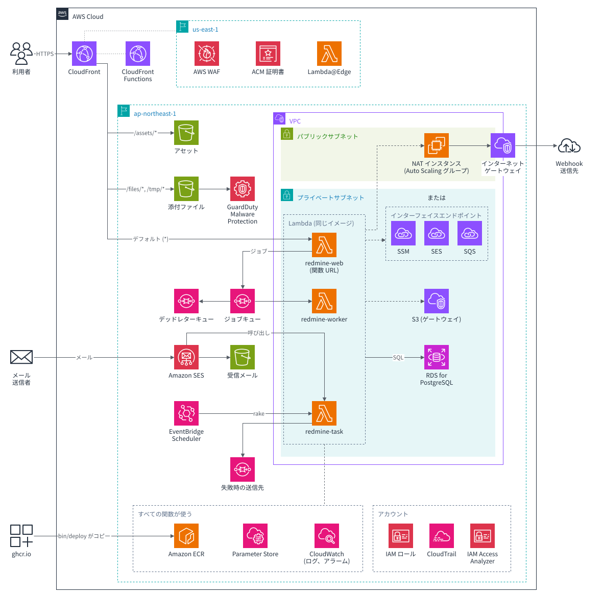
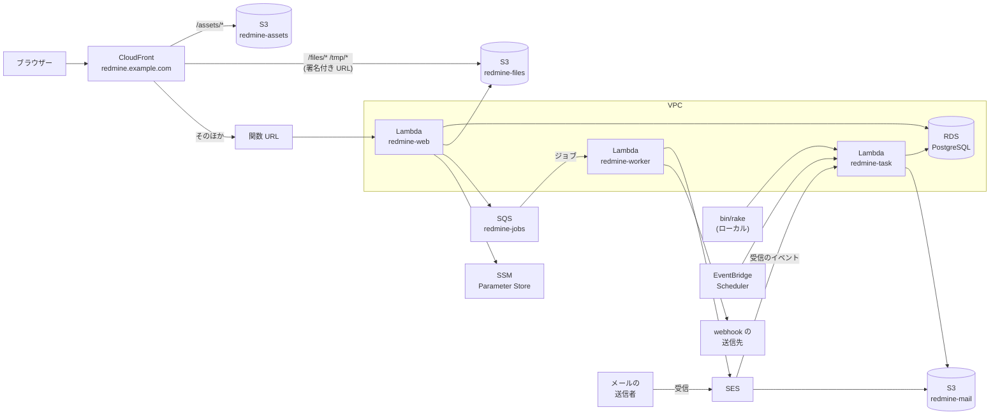

# 全体構成

最新の Redmine (7.0.3) を、AWS Lambda Event Functions で動かす設計です。添付ファイルとアセットは S3 に保存します。データベースは、VPC 内の RDS for PostgreSQL です。サードパーティーのプラグインはインストールせず、テーマは標準のままにします。Lambda、S3、SES のための拡張機能は、独自プラグインとして実装します。

この資料の仕様は、2026-11-08 時点の公式情報で確認したものです。出典は [sources.md](sources.md) にあります。

<a id="aws-resources"></a>

## AWS リソース

1 つのインスタンスが AWS に作成するリソース (`infra/*.yaml`) を、共有基盤とアカウントのリソースと合わせて、AWS アーキテクチャアイコンで描いた図です。NAT インスタンスとインターフェイスエンドポイントは、デプロイ設定の `network.mode` に応じて、どちらか一方だけを作成します ([deploy-config.md](deploy-config.md))。S3 のゲートウェイエンドポイントは常に作成します。Cost Explorer など、デフォルトで無効のオプションは描いていません。



図は `docs/diagrams/gen.py` が draw.io の形式で配置します。`bin/diagrams` がこれを実行し、Docker の中の draw.io で `docs/diagrams/architecture.drawio.svg` と `architecture.ja.drawio.svg` に書き出します。SVG には図が埋め込まれているので、draw.io で開いて編集できます。展開した AWS アーキテクチャアイコンのパッケージ ([AWS Architecture Icons](https://aws.amazon.com/architecture/icons/)) を `AWS_ICONS` で指定して実行します。

```sh
AWS_ICONS=~/Downloads/Icon-package_07312026 bin/diagrams
```

テンプレートのリソースを変えたら、`gen.py` を直して実行し、SVG をコミットします。

<a id="diagram"></a>

## 構成図



`redmine-web`、`redmine-worker`、`redmine-task` は同じイメージです。3 つとも VPC のプライベートサブネットで動作し、データベースに接続します (図では一部の線を省いています)。RDS には外部からアクセスできません。S3 にはゲートウェイエンドポイントで、SQS、SES、SSM には VPC エンドポイントか NAT インスタンスで接続します。インターネット上の webhook の送信先には、NAT インスタンスの場合だけ接続できます。経路を描いた構成図と選び方は [rds.md](rds.md#routes-out-of-the-vpc) にあります。15 分を超える 1 回限りのタスクは、同じプライベートサブネットの Fargate で実行します ([tasks.md](tasks.md#tasks-longer-than-15-minutes))。

<a id="decisions"></a>

## 決定事項

| 項目 | 決定内容 | 理由 | 参照先 |
| --- | --- | --- | --- |
| Redmine | 7.0.3 (最新の安定バージョン)。サードパーティーのプラグインなし、標準テーマ | 依頼のとおり | [lambda.md](lambda.md) |
| 拡張機能 | 独自プラグイン。`redmine_serverless` (Lambda での実行)、`redmine_serverless_s3` (S3 の添付ファイル)、`redmine_serverless_ses` (SES でのメール)、`redmine_serverless_sqs` (SQS でのジョブ)、`redmine_serverless_ssm` (SSM Parameter Store の設定とシークレット) | Redmine 標準の拡張の仕組みを使い、本体のファイルを書き換えない | 下の「独自プラグイン」 |
| 実行環境 | Event Functions、コンテナイメージ、arm64 | Ruby を実行できる。Web Functions は Node.js だけ (下記) | [lambda.md](lambda.md) |
| イメージ | Lambda の Ruby ベースイメージ (`public.ecr.aws/lambda/ruby:4.0`) に、Redmine、ImageMagick などの依存関係、Subversion と Git のクライアント ([lambda.md](lambda.md#repositories))、Lambda Web Adapter をインストールする | Lambda と同じ OS と Ruby で、Lambda で動かす前提の構成。HTTP サーバー (Puma) をそのまま使える | [lambda.md](lambda.md#choosing-the-base) |
| 3 つの関数 | `redmine-web` (画面)、`redmine-worker` (ジョブ)、`redmine-task` (rake とメールの取り込み)。同じイメージを、環境変数 `REDMINE_ROLE` で切り替える。Puma を起動するのは `redmine-web` だけ | ビルドが 1 回で済み、同じコードが動く | [tasks.md](tasks.md#how-one-image-runs-everything) |
| エントリーポイント | CloudFront → 関数 URL。関数 URL は IAM 認証にし、OAC で署名したリクエストだけを受け付ける。POST などのリクエスト本文のハッシュは、Lambda@Edge (`redmine-body-hash`) が追加する | 署名のない直接のリクエストは、関数が呼び出される前に拒否される。秘密のヘッダーを持たなくてよい。CloudFront Functions は本文を読めないので Lambda@Edge を使う。リクエスト本文は 1 MB までになる | [lambda.md](lambda.md#cloudfront-and-function-urls) |
| アセット | CloudFront の `/assets/*` のオリジンを S3 にする | Lambda を通さず、コールドスタートと同時リクエストを減らす | [lambda.md](lambda.md#serving-assets) |
| データベース | RDS for PostgreSQL (db.t4g.micro、シングル AZ)。VPC のプライベートサブネットに配置し、外部からアクセスできないようにする。パスワードは SSM Parameter Store に保存する。Redmine 標準の migration をそのまま実行する | Redmine は PostgreSQL に標準で対応しているので、アダプターや migration の修正が不要。費用の見通しが立つ | [rds.md](rds.md) |
| 設定とシークレット | SSM Parameter Store (`/<instance>/env/`) に保存し、起動時に読み込む | Lambda の環境変数にシークレットを置かない。パラメーターを追加するだけで設定を増やせる | [lambda.md](lambda.md#settings-and-secrets-ssm-parameter-store) |
| 管理画面 | メールの送信と受信、ジョブ、添付ファイルの S3、AWS への接続状態を、すべてのプラグインが共有する Redmine の管理メニューの「Serverless」で確認し、操作できるようにする | 状態の確認と再送などの操作を、AWS コンソールを開かずに行える | [admin.md](https://redmine-kit.github.io/redmine_serverless/ja/admin.html#the-serverless-menu) |
| IAM | 関数ごとに実行ロールを分け、対象を ARN で絞り込む。アクセスキーを作成しない | Web 用の関数が rake やメール受信の権限を持たない | [iam.md](iam.md) |
| セキュリティ | 外部からアクセスできるのは CloudFront だけ。AWS WAF (定額料金プランの無料プランの 5 つのルール)、二要素認証、安全なデフォルト設定、ログと記録の保持期間 | 保護対象、脅威、残存リスク、インシデント対応の手順を 1 か所にまとめる | [security.md](security.md) |
| 添付ファイル | S3 の API で読み書きする。Redmine の S3 プラグインの方式を参考にする | S3 を唯一の保存先にできる。Lambda の実行環境間でファイルを共有できる | [attachments.md](https://redmine-kit.github.io/redmine_serverless_s3/ja/attachments.html) |
| アップロード | ブラウザー → CloudFront → S3 への PUT。CloudFront 署名付き URL と、S3 が検証する SHA256 を使う | Lambda のリクエストは 6 MB まで。CloudFront 経由で Lambda に送られるリクエスト本文は 1 MB まで | [attachments.md](https://redmine-kit.github.io/redmine_serverless_s3/ja/attachments.html#upload) |
| ダウンロード | すべて Redmine のドメインの CloudFront 署名付き URL にリダイレクトする。CloudFront が S3 から読み込み、sandbox の CSP を付ける | Lambda のレスポンスは 6 MB まで。S3 では sandbox の CSP を付けられない | [attachments.md](https://redmine-kit.github.io/redmine_serverless_s3/ja/attachments.html#download) |
| バックグラウンドジョブ | ActiveJob のジョブを AWS 公式の gem `aws-activejob-sqs` で SQS に送り、`redmine-worker` で実行する | 独自のコードが不要。再試行とデッドレターキューがある。画面のリクエストがジョブを待たない | [lambda.md](lambda.md#background-jobs) |
| メール送信 | Rails の ActionMailer の配信方法 (`aws-actionmailer-ses` の `:ses_v2`) で、SES の API から送信する。送信するのは `redmine-worker` | Rails 標準の仕組みで、独自のコードが不要 | [mail.md](mail.md#sending) |
| ドメインと DNS | Web とメールを同じホスト名 (Redmine のサブドメイン) にする。Web は CloudFront を指すエイリアスレコード、同じ名前に MX レコードを置く。親ドメインの DNS で設定できなければ、サブドメインを Route 53 に委任する | URL とメールアドレスがそろう。CNAME と MX は同じ名前に置けない | [mail.md](mail.md#receiving-domain) |
| メール受信 | SES で受信して S3 に保存し、`redmine-task` が Redmine の `MailHandler` で取り込む。アドレスはプロジェクトごと (`<識別子>@<サブドメイン>`) と全体用。DMARC に合格しないメールは破棄する | ap-northeast-1 の SES で受信できる。差出人を偽ったメールを取り込まない | [mail.md](mail.md#receiving) |
| migration と rake | `redmine-task` で、ローカルのコマンドから任意の rake と `rails runner` を実行する | 本番と同じイメージと設定で動く。`rake db:migrate` と `redmine:plugins:migrate` を、RDS に対してそのまま実行する | [tasks.md](tasks.md) |
| Redmine の更新 | 新しいバージョンが出たら、追加された migration を分類し、試験用データベース (PostgreSQL) で実行し、プラグインによる置き換えへの影響を確認してからバージョンアップする。結果はバージョンごとに記録する | バージョンアップ後に不具合に気づく事態を防ぐ | [upgrade.md](upgrade.md) |
| テスト | 置き換えた処理ごとにテストを書き、Redmine 本体のテストも通す。ローカルでは AWS を moto と LocalStack で、データベースを PostgreSQL コンテナで代替する。デプロイのたびに実際の AWS で確認する | 置き換えた処理が Redmine の更新で壊れたときに気づける | [testing.md](testing.md) |
| ネットワーク | VPC を 1 つ作成し、2 つの AZ にプライベートサブネットを置く。Lambda と RDS はプライベートサブネットに配置する。AWS サービスには、VPC エンドポイントか NAT インスタンスで接続する。どちらにするかは、設定ファイルの `network.mode` で選ぶ | RDS には VPC 内からしかアクセスできない。エンドポイントは運用が不要で、インターネットへの出口がない。NAT インスタンスは費用が安く、webhook も送信できる | [rds.md](rds.md#routes-out-of-the-vpc) |
| AI 機能 | 別のプロジェクトに分ける。AI 側とは、Redmine 標準の REST API、OAuth、webhook で連携する | AI サービスや費用の判断を、Redmine の基盤から切り離す | [ai.md](ai.md) |
| リージョン | ap-northeast-1。ほかのリージョンでも、エンドポイント名と単価を読み替えれば同じ | 日本の利用者に近い。単価もこのリージョンで見積もる | — |

<a id="why-not-web-functions"></a>

## Web Functions を使わない理由

Web Functions は、ポートで待ち受ける HTTP サーバーをそのまま実行できる新しい Lambda です。Redmine では、次の理由で使いません。

- **ランタイム:** 対応しているのは `nodejs24.x` だけです。Ruby のランタイムとコンテナイメージには対応していません。Node.js のエントリーポイントから、同梱した Ruby を子プロセスで起動する方法も考えられますが、公式ドキュメントにない構成です。
- **`/tmp`:** 512 MB で固定です。添付ファイルのキャッシュ ([attachments.md](https://redmine-kit.github.io/redmine_serverless_s3/ja/attachments.html#the-tmp-cache)) に使える容量が限られます。
- **常時かかる費用:** メモリは、実行環境が存在するあいだ (リクエストの合間も) 課金されます。2 GB で 1 か月稼働させ続けると、約 22 ドルです。

Lambda Managed Instances (1 つの実行環境で複数のリクエストを処理する Event Functions) も、対応言語に Ruby がなく、最小で 3 つの実行環境が常時稼働するので使いません。

<a id="request-flow"></a>

## リクエストの流れ

<a id="showing-and-saving-pages"></a>

### 画面の表示と保存

1. ブラウザーが `https://redmine.example.com/` を開きます (ドメインは例)。
2. CloudFront が、`/assets/*` を S3 から返し、それ以外を関数 URL に転送します。転送の前に、Lambda@Edge がリクエスト本文のハッシュを追加し、OAC がリクエストに署名します。
3. Lambda Web Adapter が、イベントを HTTP リクエストに変換して Puma に渡します。
4. Redmine が RDS を読み書きし、HTML を返します。

1 つの実行環境は、同時に 1 件のリクエストだけを処理します。同時リクエストが増えると、Lambda が実行環境を増やします。

<a id="attachments"></a>

### 添付ファイル

- **アップロード:** ブラウザーが、Redmine から CloudFront 署名付き URL を受け取って、CloudFront 経由で S3 に PUT します。Redmine は、ファイルを S3 の中の保存先にコピーし、S3 が計算した SHA256 をダイジェストにして、添付ファイルのレコードを作成します。
- **ダウンロード:** Redmine が権限を確認してから、`/files/` の下の CloudFront 署名付き URL へリダイレクトします。CloudFront が OAC で S3 からオブジェクトを読み込み、Redmine の sandbox の CSP を付けます。
- **サーバーでの処理:** サムネイルや Office ファイルのプレビューなど、ローカルファイルが必要な処理は、S3 から `/tmp` のキャッシュに取得して行います。

詳しくは [attachments.md](https://redmine-kit.github.io/redmine_serverless_s3/ja/attachments.html) にあります。

<a id="email"></a>

### メール

- **送信:** Redmine が通知メールのジョブを SQS に送り、`redmine-worker` が SES の API で送信します。
- **受信:** SES が受信したメールを S3 に保存し、`redmine-task` を呼び出します。`redmine-task` が、S3 から全文を取得し、Redmine の `MailHandler` でチケットや注記にします。

詳しくは [mail.md](mail.md) にあります。

<a id="the-plugins"></a>

## 独自プラグイン

Lambda と AWS のための拡張機能は、Redmine 標準の拡張の仕組み (プラグイン) で作る独自プラグインです。プラグインはそれぞれ別のリポジトリで開発し、イメージのビルド時に `plugins/` に配置します。Redmine 本体のファイルは書き換えません。プラグインは、管理画面の「プラグイン」の一覧に、バージョンとともに表示されます。

| プラグイン | 機能 | 有効にする条件 | 資料 |
| --- | --- | --- | --- |
| [`redmine_serverless`](https://github.com/redmine-kit/redmine_serverless) | Lambda での実行。Lambda Web Adapter の `/events` に応答する Rack ミドルウェア、アセットの自動書き出しを止める設定、Lambda で使えない Redmine の設定の無効化 (固定)、管理画面の「状態と接続」 | `REDMINE_ROLE` がある | [Redmine Serverless](https://redmine-kit.github.io/redmine_serverless/ja/) |
| [`redmine_serverless_s3`](https://github.com/redmine-kit/redmine_serverless_s3) | S3 の添付ファイル。保存、CloudFront 経由の S3 へのアップロード、sandbox の CSP を付ける CloudFront 署名付き URL へのリダイレクト、`/tmp` のキャッシュ、管理画面の「添付ファイルの S3」 | S3 バケットの設定がある | [Redmine Serverless S3](https://redmine-kit.github.io/redmine_serverless_s3/ja/) |
| [`redmine_serverless_ses`](https://github.com/redmine-kit/redmine_serverless_ses) | SES でのメール。送信の再試行、受信したメールの取り込み、プロジェクト別のアドレス、メールの管理画面 | SES の設定がある | [Redmine Serverless SES](https://redmine-kit.github.io/redmine_serverless_ses/ja/) |
| [`redmine_serverless_sqs`](https://github.com/redmine-kit/redmine_serverless_sqs) | SQS でのジョブ。`aws-activejob-sqs` の設定 (キューと、実行を許可するジョブクラス)、最後に失敗したジョブの記録、管理画面の「ジョブ」 | `REDMINE_JOBS_QUEUE_URL` がある | [Redmine Serverless SQS](https://redmine-kit.github.io/redmine_serverless_sqs/ja/) |
| [`redmine_serverless_ssm`](https://github.com/redmine-kit/redmine_serverless_ssm) | 設定とシークレット。Rails が `config/database.yml` と `SECRET_KEY_BASE` を読み込む前に、`REDMINE_SSM_PATH` の下のパラメーターを環境変数に読み込む。そのタイミングで動作するように gem でもあり、`image/Gemfile.local` でパスを指定して追加する | `REDMINE_SSM_PATH` がある | [Redmine Serverless SSM](https://redmine-kit.github.io/redmine_serverless_ssm/ja/) |

S3 の添付ファイル、SES でのメール、SQS でのジョブ、SSM の設定は、Lambda 以外でも動作します。その場合、ジョブは Lambda のイベントソースの代わりに gem のポーラーで実行します。プラグインを分けておくと、一般的なサーバー上の Redmine でも、Lambda 向けの部分なしで必要なものだけを使えます。Lambda ではファイルシステムに書き込めず、メールの受信箱もないので、イメージには 5 つともインストールします。

<a id="features"></a>

### プラグインの機能

プラグインごとの機能と有効にする条件は、各プラグインの資料 (上の表) にあります。

<a id="distribution"></a>

### 配布

プラグインは、GitHub Packages の RubyGems レジストリ (`https://rubygems.pkg.github.com/redmine-kit`) に gem として公開します。Redmine の Lambda 用イメージは、GitHub Packages のコンテナレジストリ (`ghcr.io`) で公開します。どちらも、所有者は redmine-kit 組織です。

| 対象 | 保存先 | 使い方 |
| --- | --- | --- |
| Redmine の Lambda 用イメージ | `ghcr.io/redmine-kit/serverless` (arm64 の単一アーキテクチャで、イメージインデックスにしない)。main へのコミットで、リリースバージョンのテストに合格したものを、CI が push する (`.github/workflows/ci.yml` の `publish` ジョブ。バージョンは `bin/redmine-version` で取得する)。タグは、Redmine のバージョン (`7.0.3`)、Redmine のマイナーバージョン (`7.0`)、`main`。基本は Redmine のバージョンタグを使う。このタグはそのバージョンの新しいビルド (gem とプラグインの更新) に付け替わり、`bin/deploy` もデフォルトでこれを使う。`7.0` は Redmine のパッチリリースにも追従する。古いビルドはタグなしで残り、digest で取得できる。コミットは `org.opencontainers.image.revision` ラベルにある | `bin/deploy` が digest で取得し、デプロイ先アカウントの ECR にコピーする ([deploy-config.md](deploy-config.md#deployment-commands))。Lambda は、同じリージョンの ECR イメージしか使えない |
| プラグイン | GitHub Packages の gem `redmine_serverless_x`。プラグインごとに 1 つで、各リポジトリのワークフローが、バージョンタグごとに公開する。プラグインの実行に必要なファイルを含む | `Gemfile.local` で GitHub Packages の source から追加し、`bundle install` を実行して、インストールした gem を `plugins/` にリンクする (各プラグインの導入ページ) |
| プラグイン (gem を使わない場合) | リポジトリのチェックアウト | `plugins/` に clone する |

プラグインを gem にするのは、ほかの gem と一緒に Bundler でインストールし、バージョンとチェックサムを `image/Gemfile.lock` に記録するためです。プラグインの更新も、ほかの gem と同じく、毎週の gem の更新でイメージに反映されます ([testing.md](testing.md#order-in-ci))。`redmine_serverless_ssm` は、Rails が設定を読み込む前に SSM Parameter Store を読むので、もともと gem である必要があります。

Redmine 7.0.3 は、`plugins/` ディレクトリにあるプラグインだけを読み込み (`lib/redmine/plugin_loader.rb`)、gem のプラグインを読み込む仕組みはありません。そこでイメージでは、インストールしたプラグインの gem を `plugins/` にリンクします (`image/Dockerfile` の `link-plugins`)。gem にはプラグインの `Gemfile` を含めないので、Redmine の `Gemfile` がプラグインを 2 回読み込むことはありません。

GitHub Packages の RubyGems レジストリからインストールするには、公開されている gem でも、`read:packages` 権限を持つトークンが必要です (GitHub のドキュメント、2026-11-09 に確認)。CI はそのジョブの `GITHUB_TOKEN` を、ローカルのビルドは `gh` のログイントークンを使います。トークンはビルドにシークレットとして渡し、レイヤーには残しません (`bin/lib/plugin.sh`)。

各プラグインは、バージョンを gemspec、`init.rb` の `version`、Git のタグでそろえ (公開用のワークフローが確認します)、対応する Redmine のバージョンを `requires_redmine` で指定します。アダプタは、Redmine のイメージをタグではなく digest で参照します ([AGENTS.md](../../AGENTS.md) の「digest で固定する」と同じ考え方)。

<a id="derived-images"></a>

### 派生イメージ

このプロジェクトのイメージには、標準テーマと 5 つのプラグインだけを含めます。テーマやほかのプラグインは、インスタンスごとに、このプロジェクトのイメージをベースにした派生イメージで追加します。

通常は、設定ファイルの `image.plugins` と `image.themes` に指定します ([deploy-config.md](deploy-config.md#adding-plugins-and-themes))。どれもバージョンを固定し、gem はそのバージョン、Git のリポジトリはタグかコミット、ディレクトリは設定ファイルの隣のものを指定します。すると `bin/deploy` が、実行しているマシンで、設定ファイルが指定するイメージを digest でベースにして、派生イメージをビルドします (`bin/build-derived-image`、`image/derived/Dockerfile`)。ビルドでは、プラグインを `plugins/<プラグイン>/` に、テーマを `themes/<テーマ>/` に配置し、ベースイメージの gem のバージョンを変えずに gem をロックに追加して (ベースイメージの gem の別のバージョンを必要とするプラグインは、ビルドを失敗させる)、アセットを再生成します (`assets:precompile`)。コンパイラーはビルド用のステージにだけインストールするので、イメージには、ビルドした gem は入りますが、コンパイラーは入りません。GitHub Packages 用の Bundler の認証情報は、このプロジェクト自身のビルドと同じく、BuildKit のシークレットとして渡します。Git の取得元は HTTPS の公開リポジトリで、認証情報なしで取得します。

Redmine 7.0 は、テーマを `themes/` か `app/assets/themes/` から読み込み、Propshaft のアセットとして配信します (`lib/redmine/themes.rb`)。`bin/deploy` はイメージ内のアセットを S3 に同期するので、追加したテーマやプラグインのアセットも、CloudFront の `/assets/*` から配信されます。追加したプラグインのマイグレーションは、デプロイの `redmine:plugins:migrate` (手順 7) で実行し、設定は `redmine.pluginSettings` で指定します。

派生イメージも、プッシュする前に、このプロジェクトのイメージテスト (読み取り専用、権限の少ないユーザー、3 つの役割) を実行します。追加したプラグインが読み込まれてマイグレーション済みであること、追加したテーマが見つかり、そのアセットがコンパイル済みであることも確認します ([testing.md](testing.md#image-tests))。追加したプラグインの動作は、このプロジェクトでは確認しません。

リストで表せないものについては、アダプタは、これまでどおり Dockerfile を自分で書けます。`FROM` でこのプロジェクトのイメージを digest で指定し、テーマを `themes/<テーマ>/` に、プラグインを `plugins/<プラグイン>/` に配置してアセットを再生成し、レジストリにプッシュして、`image.repository` と `image.digest` で指定します。`bin/deploy` は、このプロジェクトのイメージと同じく、アカウントの ECR にコピーします。


<a id="what-is-not-in-the-plugins"></a>

### プラグインに含めないもの

次のものは、プラグインより前に読み込む必要があるか、Redmine の外で動作するので、プラグインにしません。

| 対象 | 配置先 | 理由 |
| --- | --- | --- |
| キャッシュ、ジョブ、スキーマの書き出しの設定 | `config/additional_environment.rb` | データベースへの接続とキャッシュの作成より前に必要。プラグインは、そのあとで読み込まれる |
| データベース、添付ファイルの保存先、メール送信の設定 | `config/database.yml`<br>`config/configuration.yml` | Redmine の設定ファイル |
| 起動スクリプト、拡張機能のスクリプト | `image/` | Redmine より前に動作する |
| リクエスト本文のハッシュを追加する関数 | `edge/` | CloudFront の Lambda@Edge で動作する (Node.js) |
| タスクハンドラー | `image/` | Rails を読み込まずに、rake を子プロセスで起動する |
| `bin/rake`<br>`bin/rails` | `bin/` | ローカルから、デプロイした Redmine に対して使う |
| `bin/test`<br>`bin/check-migrations` | `bin/` | ローカルと CI で、テストと migration の分類に使う |

メール送信 (`aws-actionmailer-ses`) とジョブ (`aws-activejob-sqs`) には AWS 公式の gem を使い、配信の仕組みやキューアダプターは書きません。ジョブの設定は `redmine_serverless_sqs` が持ちます。

<a id="repository-layout"></a>

## リポジトリ構成

```text
serverless/
  image/          コンテナイメージ(Dockerfile、設定ファイル、起動スクリプト、拡張機能のスクリプト、タスクハンドラー)
  edge/           CloudFront で動作する関数。redmine-body-hash(Lambda@Edge。リクエスト本文のハッシュを追加する)と、アップロードのサイズを制限し、添付ファイルのヘッダーを付ける CloudFront Functions の関数、そのテスト
  infra/          CloudFormation(アカウント単位のロール。共有基盤。インスタンス別の VPC の利用、データベース、S3、SQS、Lambda、CloudFront、WAF、SES、スケジュール、アラーム。us-east-1 の Lambda@Edge、証明書、Web ACL)
  deploy/         bin/deploy の手順と、そのツールのイメージ
  schema/         redmine.json の JSON Schema
  bin/            コマンド。ビルド、検査、テスト、update-gems、デプロイ
  test/           プラグイン外のテスト(イメージ、デプロイ、LocalStack 上の Lambda)と、それが使うサービス
  .github/        CI とほかのワークフロー
  docs/           資料
```

プラグインは、それぞれ別のリポジトリにあります (上の「独自プラグイン」)。イメージのビルド時に、それぞれ指定したバージョンを `plugins/` にインストールします。

インフラは CloudFormation で記述します。スタックは、`bin/deploy` が、インフラデプロイ用ロール (SSO の管理者か、承認が必要な GitHub の Environment) で適用します。Redmine のイメージだけの更新は、GitHub Actions がコードデプロイ用ロールで行います ([iam.md](iam.md))。デプロイ手順は [deploy-config.md](deploy-config.md#deployment-commands) にあります。

<a id="order-of-work"></a>

## 作業の順序

動作の可否に影響する点から、順に作ります。各段階で、テストを同じ段階のうちに書き、CI で合格してから次へ進みます ([testing.md](testing.md))。

| 段階 | 作るもの | 同じ段階で書くテスト |
| --- | --- | --- |
| 1 | CI 基盤 (静的解析、PostgreSQL、moto、LocalStack のコンテナ) | RuboCop、ShellCheck、actionlint、cfn-lint |
| 2 | イメージ (Lambda の Ruby ベースイメージ、Redmine、依存関係、3 つの役割の切り替え) | イメージテスト (読み取り専用、権限の少ないユーザー、3 つの役割の起動)、Redmine 本体のテスト |
| 3 | Lambda 上での起動 (VPC、RDS、SSM、`redmine-task`、`redmine-web` を関数 URL で開く) | SSM の読み込みとタスクハンドラーのテスト。起動時間の計測 |
| 4 | CloudFront とアセット (ドメイン、`/assets/*` の S3、OAC と Lambda@Edge の `redmine-body-hash`) | `redmine-body-hash` のテスト。OAC で POST が通るかの確認。デプロイ後の確認の最初の項目 |
| 5 | 添付ファイル (`redmine_serverless_s3`) | プラグインのユニットテスト、機能テスト、統合テスト、システムテスト。本体の添付ファイルのテストを S3 構成で通す |
| 6 | ジョブとメール送信 (SQS、`redmine-worker`、SES と `redmine_serverless_ses` の送信部分、再送) | ジョブとメール送信のテスト、エラーの種類ごとの再試行のテスト。メールボックスシミュレーターでの確認 |
| 7 | 管理画面 (ステータス、メール送信、ジョブ、S3) | 画面ごとの機能テストとシステムテスト。管理者以外が開けないこと |
| 8 | メール受信 (MX、受信ルール、`redmine_serverless_ses` での取り込み、管理画面の「メール受信」) | 取り込みのテスト (なりすまし、迷惑メール、自動応答)。実際の受信の確認 |
| 9 | 移行 (古い Redmine のデータを移行する場合) | 移行したデータで、デプロイ後の確認を通す |

<a id="open-questions"></a>

## 未決定事項

| 項目 | 選択肢 | 判断に必要な情報 |
| --- | --- | --- |
| 古い Redmine のデータを移行するか | 移行する / 新規に始める | 移行元の構成 (バージョン、データベース、添付ファイルの保存先)。[migration.md](migration.md) |
| VPC 外への経路 | VPC エンドポイント / NAT インスタンス (`network.mode`) | webhook や外部の API が必要か、それぞれの月額費用。[rds.md](rds.md#which-to-choose) |
| 月額費用 | [cost.md](cost.md) の見積もり | デプロイ後に計測した使用量。[cost.md](cost.md) |
| ドメイン | Redmine のサブドメイン名 (たとえば `redmine.example.com`)。親ドメインの DNS のままにするか、Route 53 に委任するか | [mail.md](mail.md#receiving-domain) |
| CloudFront の料金プラン | 定額料金プランの無料プラン (WAF を含む) / 従量課金 | 無料プランの枠がアカウントに残っているか。[lambda.md](lambda.md#flat-rate-free-plan-and-waf) |
| 添付ファイルのサイズ上限 | Redmine の `attachment_max_size`。アップロード (`/tmp/incoming/`) は、`/tmp/*` の CloudFront Functions で制限する。登録時に Redmine はファイルを読まないので、制約になるのは 1 回の PUT で CloudFront が受け付けるサイズと、ブラウザーでのハッシュ計算の時間 | 計測結果。[attachments.md](https://redmine-kit.github.io/redmine_serverless_s3/ja/attachments.html#upload) |
| メール受信のデフォルトのプロジェクト | サブアドレスがない場合のプロジェクト | [mail.md](mail.md#importing) |
| Git のリポジトリの保存先 | 未選定。それまでは Subversion のリポジトリだけを使用できる | どの実行環境からも読めるようにベアリポジトリを置く場所と、その更新方法。[lambda.md](lambda.md#repositories) |
| コミットの取得 | `redmine:fetch_changesets` をスケジュール実行に追加する / 必要なときに `bin/rake` で実行する | リポジトリを使うか、取得にかかる時間。[lambda.md](lambda.md#repositories) |
