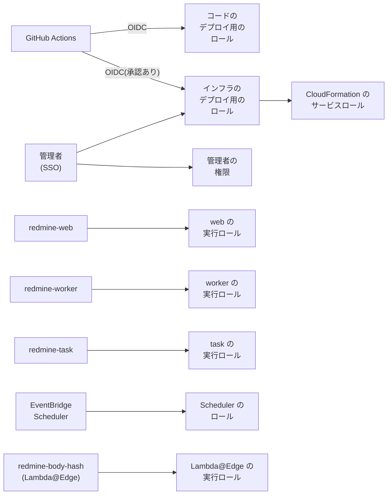

# IAM と権限

Serverless で使う IAM ロール、ポリシー、リソースベースのポリシーをまとめます。権限の詳細は、この資料を正とします。ほかの資料は、ここにリンクします。

この資料の仕様は、2026-11-09 時点の公式情報で確認したものです。出典は [sources.md](sources.md) にあります。

ロール、関数、SSM パスの名前は、インスタンス名 (`redmine.json` の `instance`) から決まります ([deploy-config.md](deploy-config.md#names-derived-from-the-instance-name))。この資料の名前は、インスタンス名がデフォルトの `redmine` のときのものです。

<a id="approach"></a>

## 方針

- **関数ごとにロールを分ける:** `redmine-web`、`redmine-worker`、`redmine-task` は、同じイメージでも別の実行ロールにします。画面の関数が、rake やメール受信の権限を持たないようにします。
- **対象を ARN で絞り込む:** S3 はバケットとプレフィックス、SQS はキュー、SES は ID、SSM はパスまで絞り込みます。AWS の API が対象を絞り込めないもの (`ses:GetAccount` など) だけを `*` にします。
- **アクセスキーを作成しない:** Lambda は実行ロールの一時的な認証情報で、GitHub Actions は OIDC で、人は IAM Identity Center (SSO) で操作します。IAM ユーザーとアクセスキーは作成しません。
- **サービスからの呼び出しは呼び出し元で絞り込む:** SES、CloudFront、EventBridge Scheduler などのサービスに許可するときは、`aws:SourceAccount` と `aws:SourceArn` で、このアカウントの特定のリソースからの呼び出しだけに限定します (混乱した代理問題の防止)。
- **インフラの変更は人が承認する:** CloudFormation スタック (IAM ロールを含む) を適用する `bin/deploy` は、インフラデプロイ用ロールで実行します。このロールを引き受けられるのは、SSO の管理者と、承認が必要な GitHub の Environment のワークフローだけです (下の「インフラデプロイ用ロール」)。コードの更新だけを行う GitHub Actions のロールは、IAM やデータベースを変更できません。
- **アクセス許可の境界:** スタックが作成するロールには、所定のアクセス許可の境界 (permissions boundary) を設定します。インフラデプロイ用ロールが、境界を超える権限のロールを作成できないようにします。
- **データベースパスワードは SSM に保存する:** RDS にはパスワードで接続します。パスワードは SSM Parameter Store の SecureString に保存し、読み取れるのは 3 つの関数の実行ロールだけです ([rds.md](rds.md#connecting-from-rails))。

<a id="overview"></a>

## 一覧



| ロール | 引き受けるプリンシパル | 役割 |
| --- | --- | --- |
| `redmine-web` | Lambda (`redmine-web`) | 画面、添付ファイル、ジョブの投入、管理画面 |
| `redmine-worker` | Lambda (`redmine-worker`) | ジョブの実行 (メール送信、プロジェクトの削除など) |
| `redmine-task` | Lambda (`redmine-task`) | rake、`rails runner`、メールの取り込み |
| `redmine-scheduler` | EventBridge Scheduler | 定期実行の rake と、業務時間のウォームアップの呼び出し |
| `redmine-malware-scan` | GuardDuty Malware Protection (`malware-protection-plan.guardduty.amazonaws.com`) | 添付ファイル用バケットの `tmp/incoming/` と `imports/` の新しいオブジェクトをスキャンし、タグを付ける ([aws-security.md](aws-security.md#malware-protection-for-s3))。`uploads.malwareScan` のときだけ |
| `redmine-body-hash` | Lambda と Lambda@Edge (`redmine-body-hash`) | リクエスト本文のハッシュを追加する ([lambda.md](lambda.md#function-that-adds-the-body-hash-lambdaedge))。ログを書き込むだけ |
| `redmine-github-deploy` | GitHub Actions (OIDC) | コードのデプロイ。イメージの push、アセットの同期、関数の更新、migration |
| `redmine-infra-deploy` | SSO の管理者、承認が必要な GitHub の Environment (OIDC) | `bin/deploy` でスタックを適用する。設定ファイルの `deployRoleArn` が指すロール |
| `redmine-cfn-exec` | CloudFormation | スタックのリソースを作成する (CloudFormation のサービスロール) |

スタックが作成するロールは、パス `/redmine/` の下に置き (たとえば `arn:aws:iam::<account>:role/redmine/redmine-web`)、アクセス許可の境界 `redmine-boundary` を設定します。最後の 3 つとアクセス許可の境界は、`infra/account.yaml` にあります (下の「アカウント単位のロール」)。

<a id="permissions-common-to-the-three-functions"></a>

## 3 つの関数に共通の権限

| 権限 | 対象 | 用途 |
| --- | --- | --- |
| `logs:CreateLogStream`<br>`logs:PutLogEvents` | 関数ごとのロググループ | ログ。ロググループは CloudFormation で、保持期間を設定して先に作成する ([security.md](security.md#retention-periods)) |
| `ssm:GetParametersByPath` | `arn:aws:ssm:<リージョン>:<アカウント>:parameter/redmine/env` と、その下 (`parameter/redmine/env/*`) | 起動時の設定とシークレット。データベースパスワードも含む ([lambda.md](lambda.md#settings-and-secrets-ssm-parameter-store)) |
| `ec2:CreateNetworkInterface`<br>`ec2:DescribeNetworkInterfaces`<br>`ec2:DeleteNetworkInterface`<br>`ec2:AssignPrivateIpAddresses`<br>`ec2:UnassignPrivateIpAddresses` | `*` (EC2 の API が対象を絞り込めない) | VPC 内での実行。AWS 管理ポリシー `AWSLambdaVPCAccessExecutionRole` と同じ内容 ([rds.md](rds.md#routes-out-of-the-vpc)) |

SecureString パラメーターは、SSM のデフォルトのキー (`aws/ssm`) で暗号化します。このキーについて `kms:Decrypt` を IAM で付与する必要があるかは、構築時に確認します。

各行は、いずれかのプラグインのための権限です。Serverless 以外で使うときの権限も、各プラグインの IAM 権限のページにあります。[Redmine AWS SQS](https://redmine-kit.github.io/redmine_aws_sqs/ja/iam.html) (ジョブと「ジョブ」画面)、[Redmine AWS S3](https://redmine-kit.github.io/redmine_aws_s3/ja/setup.html#iam-permissions) (添付ファイル)、[Redmine AWS SES](https://redmine-kit.github.io/redmine_aws_ses/ja/iam.html) (メール)、[Redmine AWS SSM](https://redmine-kit.github.io/redmine_aws_ssm/ja/iam.html) (起動時の設定) です。[Redmine AWS](https://redmine-kit.github.io/redmine_aws/ja/iam.html) と [Redmine AWS Lambda](https://redmine-kit.github.io/redmine_aws_lambda/ja/iam.html) 自体には権限は不要です。このページは、それらを関数別にまとめたものです。

<a id="execution-role-of-redmine-web"></a>

## `redmine-web` の実行ロール

| 権限 | 対象 | 用途 |
| --- | --- | --- |
| `s3:GetObject`<br>`s3:PutObject`<br>`s3:DeleteObject` | 添付ファイル用バケットの<br>`files/*`<br>`imports/*`<br>`tmp/*` | 添付ファイル、Markdown のプレビュー、サムネイルの保存、登録時のチェックサム付きの `HeadObject` とコピー、`/tmp` のキャッシュ、削除、一括ダウンロードの一時ファイル ([attachments.md](https://redmine-kit.github.io/redmine_aws_s3/ja/attachments.html)) |
| `s3:ListBucket` | 添付ファイル用バケット | 存在しないオブジェクトへの `HeadObject` を、403 ではなく 404 として受け取る。サムネイルをプレフィックスで削除する |
| `sqs:SendMessage` | ジョブキュー | ジョブの投入 ([lambda.md](lambda.md#background-jobs)) |
| `sqs:GetQueueAttributes` | ジョブキューとデッドレターキュー | 管理画面の「ジョブ」 |
| `sqs:GetQueueUrl`<br>`sqs:StartMessageMoveTask`<br>`sqs:ListMessageMoveTasks`<br>`sqs:ReceiveMessage`<br>`sqs:DeleteMessage` | ジョブのデッドレターキュー | 管理画面の「ジョブ」から、デッドレターキューのメッセージをジョブキューに戻す。ジョブキューへの `sqs:SendMessage` (3 つの関数に共通) も使う。戻すのに必要な最小限の権限は、SQS プラグインの [iam.md](https://redmine-kit.github.io/redmine_aws_sqs/ja/iam.html#permissions) にある |
| `ses:SendEmail`<br>`ses:SendRawEmail` | 送信元ドメインの SES ID | Redmine 標準のテストメール (画面へのリクエストの処理中に送信する) |
| `ses:GetEmailIdentity` | 送信元ドメインの SES ID | 管理画面の「メール送信」と「メール受信」のタブの「最新の情報に更新」のリンク。SES の状態を読み込み直す。タブを開いても SES は呼び出さず、1 時間ごとの更新で保存した状態を表示する ([tasks.md](tasks.md#scheduled-runs)) |
| `ses:GetAccount`<br>`ses:ListSuppressedDestinations` | `*` (対象を絞り込めない) | 同上 ([admin.md](https://redmine-kit.github.io/redmine_aws_ses/ja/admin.html#sending-email)) |
| `ses:DeleteSuppressedDestination` | `*` (対象を絞り込めない) | 「メール送信」のタブのサプレッションリストの「削除」のボタン |

メールは、SES v2 の `SendEmail` に raw 形式で全文を渡して送信します。SES のドキュメントの例は、送信の権限として `ses:SendEmail` と `ses:SendRawEmail` の両方を許可しているので、この設計もそれに合わせます。v2 の raw 形式の送信に `ses:SendRawEmail` が必須かは、まだ確認していません。

ブラウザーはこのロールを使いません。アップロードとダウンロードは、CloudFront の秘密鍵で署名した URL で CloudFront を経由します。関数は、この鍵をほかのシークレットと一緒に SSM Parameter Store から読み込みます ([Redmine AWS S3](https://redmine-kit.github.io/redmine_aws_s3/ja/iam.html))。CloudFront は OAC でバケットにアクセスし、バケットポリシーがそれを許可します (下の「リソースベースのポリシー」)。

<a id="execution-role-of-redmine-worker"></a>

## `redmine-worker` の実行ロール

| 権限 | 対象 | 用途 |
| --- | --- | --- |
| `sqs:ReceiveMessage`<br>`sqs:DeleteMessage`<br>`sqs:GetQueueAttributes`<br>`sqs:ChangeMessageVisibility` | ジョブキュー | イベントソースマッピングでジョブを受け取る。gem のハンドラーが、成功したメッセージを削除する |
| `sqs:SendMessage` | ジョブキュー | ジョブ内の再試行 (`retry_on`) と、ジョブから投入するジョブ |
| `ses:SendEmail`<br>`ses:SendRawEmail` | 送信元ドメインの SES ID | 通知メール ([mail.md](mail.md#sending))。raw 形式で送信する |
| `s3:GetObject`<br>`s3:PutObject`<br>`s3:DeleteObject`<br>`s3:ListBucket` | 添付ファイル用バケット (`redmine-web` と同じ範囲) | プロジェクトの削除に伴う添付ファイルの削除、整合性チェック ([admin.md](https://redmine-kit.github.io/redmine_aws_s3/ja/admin.html#attachments-in-s3)) |
| `s3:GetObject`<br>`s3:DeleteObject` | メール用バケットの<br>`inbound/*`<br>`processed/*` | 管理画面からのメールの再取り込み |
| `s3:PutObject` | メール用バケットの `processed/*` | 同上 |

<a id="execution-role-of-redmine-task"></a>

## `redmine-task` の実行ロール

| 権限 | 対象 | 用途 |
| --- | --- | --- |
| `s3:GetObject`<br>`s3:DeleteObject` | メール用バケットの `inbound/*` | 受信したメールの取り込み ([mail.md](mail.md#importing)) |
| `s3:PutObject` | メール用バケットの `processed/*` | 取り込んだメールの移動 |
| `s3:GetObject` | メール用バケットの `processed/*` | 取り込み済みのメールの再取り込み (`bin/rake redmine_aws_ses:receive_mail MESSAGE_ID=…`。[mail.md](mail.md#receipt-rules)) |
| `s3:GetObject`<br>`s3:PutObject`<br>`s3:DeleteObject`<br>`s3:ListBucket` | 添付ファイル用バケット (`redmine-web` と同じ範囲) | 未添付の添付ファイルの削除 (`redmine:attachments:prune`)、メールの添付ファイルの保存 |
| `ses:SendEmail`<br>`ses:SendRawEmail` | 送信元ドメインの SES ID | rake タスクのメール (期日通知など) |
| `ses:GetEmailIdentity` | 送信元ドメインの SES ID | メールのタブに表示する SES の状態の、1 時間ごとの更新 (`redmine_aws_ses:refresh`、[tasks.md](tasks.md#scheduled-runs)) |
| `ses:GetAccount`<br>`ses:ListSuppressedDestinations` | `*` (対象を絞り込めない) | 同上 |
| `sqs:SendMessage` | ジョブキュー | rake の中で投入されるジョブ |
| `sqs:SendMessage` | 失敗時の送信先キュー (`redmine-task-failures`) | SES からの非同期呼び出しが失敗したときの送信先。Lambda の送信先へは、実行ロールの権限で送信する |

<a id="cost-explorer-only-with-costexplorerenabled"></a>

## Cost Explorer (`costExplorer.enabled` のときだけ)

プラグイン [Redmine AWS Cost Explorer](https://redmine-kit.github.io/redmine_aws_costexplorer/ja/) を追加したイメージ (派生イメージ。Serverless のイメージには含まれていません) では、このプラグインがアカウントの費用を読み取ります。ポリシー `costexplorer` で、`redmine-task` (毎日の更新。プラグインが呼ぶのはこれだけ) に、`*` に対する `ce:GetCostAndUsage` と `ce:GetCostForecast` を許可します。2 つのアクションは、請求ビューをリソースとします (サービス認可リファレンス、2026-11-10 に確認)。プラグインはプライマリ請求ビューを使います。その ARN にポリシーを絞り込めるかは未確認です。`redmine-web` と `redmine-worker` は Cost Explorer を呼びません。アクセス許可の境界 `redmine-boundary` も、この 2 つのアクションを許可します。

<a id="resource-based-policies"></a>

## リソースベースのポリシー

| リソース | 許可する相手 | 許可するアクション | 条件 |
| --- | --- | --- | --- |
| `redmine-web` (関数) | CloudFront (`cloudfront.amazonaws.com`) | `lambda:InvokeFunctionUrl` | `AWS:SourceArn` がこのディストリビューション。関数 URL は `AuthType: AWS_IAM` (OAC) |
| `redmine-web` (関数) | CloudFront (`cloudfront.amazonaws.com`) | `lambda:InvokeFunction` | `AWS:SourceArn` がこのディストリビューション |
| `redmine-task` (関数) | SES (`ses.amazonaws.com`) | `lambda:InvokeFunction` | `aws:SourceAccount` がこのアカウント、`aws:SourceArn` が受信ルール |
| アセット用バケット | CloudFront (`cloudfront.amazonaws.com`) | `s3:GetObject` | `AWS:SourceArn` がこのディストリビューション (OAC) |
| メール用バケット | SES (`ses.amazonaws.com`) | `inbound/*` への `s3:PutObject` | `aws:SourceAccount` がこのアカウント、`aws:SourceArn` が受信ルール |
| 3 つのバケット | すべて | すべてを拒否 | `aws:SecureTransport` が `false` (TLS でないリクエスト) |
| ECR リポジトリ | Lambda (`lambda.amazonaws.com`) | `ecr:BatchGetImage`<br>`ecr:GetDownloadUrlForLayer` | `aws:SourceArn` がこのアカウントの関数 |

- **関数 URL は CloudFront だけが呼べる:** 関数 URL を IAM 認証にし、CloudFront の OAC が署名したリクエストだけを受け付けます。ブラウザーからの POST の本文のハッシュは、Lambda@Edge が追加します ([lambda.md](lambda.md#cloudfront-and-function-urls))。OAC を使う関数 URL には、CloudFront のドキュメントのとおり、`lambda:InvokeFunctionUrl` と `lambda:InvokeFunction` の両方を許可します。
- **ECR:** 同じアカウントの関数なら、デプロイする人に `ecr:SetRepositoryPolicy` があれば、Lambda がこのポリシーを自動で追加します。CloudFormation で明示しておきます。
- **SQS:** キューは同じアカウントの関数だけが使うので、キューポリシーは設定せず、実行ロールの権限で許可します。

<a id="execution-role-of-lambdaedge"></a>

## Lambda@Edge の実行ロール

信頼ポリシーで、`lambda.amazonaws.com` と `edgelambda.amazonaws.com` の両方にロールの引き受けを許可します (Lambda@Edge の要件)。

| 権限 | 対象 | 用途 |
| --- | --- | --- |
| `logs:CreateLogGroup`<br>`logs:CreateLogStream`<br>`logs:PutLogEvents` | すべてのリージョンのロググループ `/aws/lambda/us-east-1.redmine-body-hash` (`arn:aws:logs:*:<アカウント>:log-group:/aws/lambda/us-east-1.redmine-body-hash:*`) | ログ。Lambda@Edge は、実行されたエッジロケーションに近いリージョンにログを書き込む |

この関数はリクエスト本文を読んでハッシュを追加するだけなので、AWS サービスの権限は付与しません。Lambda@Edge 関数のバージョンを CloudFront に関連付けるには、`lambda:EnableReplication*` と `iam:CreateServiceLinkedRole` が必要です。これは CloudFormation のサービスロールに持たせ (下の「インフラデプロイ用ロール」)、コードデプロイ用ロールには持たせません。

<a id="role-of-eventbridge-scheduler"></a>

## EventBridge Scheduler のロール

| 権限 | 対象 | 用途 |
| --- | --- | --- |
| `lambda:InvokeFunction` | `redmine-task` | 定期実行の rake ([tasks.md](tasks.md#scheduled-runs)) |
| `lambda:InvokeFunction` | `redmine-web` | 業務時間のウォームアップの呼び出し (使う場合だけ。[lambda.md](lambda.md#waiting-for-start-up)) |

信頼ポリシーのプリンシパルは `scheduler.amazonaws.com` で、`aws:SourceAccount` をこのアカウントに限定します。

<a id="role-for-deploying-code-github-actions"></a>

## コードデプロイ用ロール (GitHub Actions)

信頼ポリシーは GitHub の OIDC (`token.actions.githubusercontent.com`) で、`sub` を、デプロイするリポジトリの本番用の Environment に限定します。

| 権限 | 対象 | 用途 |
| --- | --- | --- |
| `ecr:GetAuthorizationToken` | `*` (対象を絞り込めない) | ECR へのログイン |
| `ecr:DescribeImages`<br>`ecr:BatchCheckLayerAvailability`<br>`ecr:InitiateLayerUpload`<br>`ecr:UploadLayerPart`<br>`ecr:CompleteLayerUpload`<br>`ecr:PutImage`<br>`ecr:BatchGetImage`<br>`ecr:GetDownloadUrlForLayer` | Redmine のリポジトリ | イメージのコピー (既存のイメージはコピーしない) |
| `s3:PutObject`<br>`s3:GetObject`<br>`s3:ListBucket` | アセット用バケット (`*-assets-<account>-*` と、その `assets/` の下のオブジェクト) | アセットの同期 ([lambda.md](lambda.md#serving-assets)) |
| `lambda:UpdateFunctionCode`<br>`lambda:GetFunction`<br>`lambda:GetFunctionConfiguration`<br>`lambda:InvokeFunction` | タグ `redmine:instance` を持つ関数 | イメージの更新、更新完了の待機、`redmine-task` での migration ([tasks.md](tasks.md#migrations-during-deployment)) |
| `cloudformation:DescribeStacks` | アカウントのスタック | 出力 (リポジトリ、バケット、ディストリビューション) の読み取り |

権限はカスタマー管理ポリシー `redmine-code-deploy` (`infra/account.yaml`) にまとめ、インフラデプロイ用ロールと共有して、すべてのインスタンスで使います。インスタンス名は自由に決められるので、関数は、どのスタックもリソースに付けるタグ `redmine:instance` で絞り込み、バケットは名前で絞り込みます。

ほかの `iam:*` と `iam:PassRole`、`lambda:UpdateFunctionConfiguration` (実行ロールや環境変数を変更できるため)、CloudFormation、SSM のデータベースパスワードの権限は持たせません。これらは、インフラデプロイ用ロールで変更します。古いアセットは削除せずにライフサイクルルールで削除するので、`s3:DeleteObject` も持たせません。

<a id="role-for-deploying-infrastructure"></a>

## インフラデプロイ用ロール

`bin/deploy` で、共有基盤とインスタンスのスタックを適用するロールです。設定ファイルの `deployRoleArn` が、このロールを指します ([deploy-config.md](deploy-config.md))。

| 項目 | 内容 |
| --- | --- |
| 引き受けるプリンシパル | SSO の管理者の許可セット。GitHub Actions では、承認者を設定した Environment のワークフローだけ (`sub` をその Environment に限定する) |
| 権限 | サービスロール `redmine-cfn-exec` を指定した変更セットだけを作成する権限 (条件 `cloudformation:RoleArn` 付きの `cloudformation:CreateChangeSet`) と、その表示、実行、削除。CloudFormation に対する、`redmine-cfn-exec` だけの `iam:PassRole`。Lambda@Edge のロググループの保持期間の設定 (すべてのリージョンの `logs:PutRetentionPolicy`。対象は `/aws/lambda/us-east-1.redmine-body-hash` だけ。`logs:DescribeLogGroups` と `ec2:DescribeRegions` も)。`/<instance>/env/` と `/<instance>/deploy/` の下の SSM パラメーターの読み取りと作成 (SSM 経由の `kms:Encrypt` も)。共有基盤のテンプレート用バケットへのテンプレートの保存と読み取り。SES の受信ルールセットの有効化。コードデプロイ用ロールのカスタマー管理ポリシー `redmine-code-deploy` |
| リソースの作成権限 | 持たない。リソースは、CloudFormation が `redmine-cfn-exec` の権限で作成する |

`redmine-cfn-exec` は、この設計のリソースを作成できます。Lambda、RDS、VPC とそのエンドポイント、NAT インスタンス、S3、SQS、SES、CloudFront、AWS WAF のウェブ ACL、ACM、IAM ロール、ログ、アラームです。作成する IAM ロールには、アクセス許可の境界 `redmine-boundary` の設定を条件にします (`iam:PermissionsBoundary`)。

同じロールで、Lambda@Edge 関数と CloudFront の証明書のスタックも us-east-1 に適用します ([deploy-config.md](deploy-config.md#shared-base-and-per-instance-resources))。関数を CloudFront に関連付けるための `lambda:EnableReplication*` と `iam:CreateServiceLinkedRole` も、`redmine-cfn-exec` に持たせます。

<a id="account-roles"></a>

## アカウント単位のロール

`infra/account.yaml` (スタック `redmine-account`) が、上のロールのうち、インスタンス単位ではないものを作成します。管理者が自分の認証情報で、アカウントごとに 1 回適用します ([deploy-config.md](deploy-config.md#deployment-commands))。

```sh
bin/deploy --account
```

| リソース | 内容 |
| --- | --- |
| `redmine-boundary` (カスタマー管理ポリシー) | スタックが作成するすべてのロールのアクセス許可の境界。このページのロールの操作だけを許可する。ログの書き込み、SSM パラメーターの読み取り、`kms:Decrypt`、VPC 内の Lambda のネットワークインターフェイスと NAT インスタンスの操作、S3 のオブジェクト、SQS、SES、`lambda:InvokeFunction`、GuardDuty Malware Protection の EventBridge ルールとバケットの通知、`AmazonSSMManagedInstanceCore` の操作。IAM の操作は何も許可しない |
| `redmine-cfn-exec` | CloudFormation (`cloudformation.amazonaws.com`。`aws:SourceAccount` はこのアカウント)。スタックの各サービスの操作と、パス `/redmine/` の下だけの IAM の操作。ロールの作成と、インラインポリシーの追加やポリシーのアタッチは、アクセス許可の境界を設定する場合だけ (`iam:PermissionsBoundary`)。`/redmine/` の下のロール、インスタンスプロファイル、ポリシーの管理。`/redmine/` の下のロールを Lambda、Lambda@Edge、EventBridge Scheduler、EC2、GuardDuty Malware Protection に渡す `iam:PassRole`。`iam:CreateServiceLinkedRole` と `lambda:EnableReplication*`。`iam:DeleteRolePermissionsBoundary` は拒否する。アカウント単位のロールとアクセス許可の境界は `/redmine/` の外にあるので、変更できない |
| `redmine-infra-deploy` | IAM Identity Center の許可セット (`account.ssoPermissionSet`。デフォルトは `AdministratorAccess`。その `AWSReservedSSO_…` ロールの `aws:PrincipalArn` で絞り込む) のユーザーと、`account.githubRepository` があれば、Environment `account.githubInfraEnvironment` (デフォルトは `infrastructure`) の GitHub Actions。権限は上の「インフラデプロイ用ロール」のとおり。セッションは最大 2 時間 |
| `redmine-github-deploy` | `account.githubRepository` があるときだけ。Environment `account.githubCodeEnvironment` (デフォルトは `production`) の GitHub Actions。audience は `sts.amazonaws.com`。カスタマー管理ポリシー `redmine-code-deploy` |
| CloudTrail と IAM Access Analyzer | 証跡 `redmine-trail` とアナライザー。アカウントに既にあれば作成しない ([aws-security.md](aws-security.md)) |
| GitHub の OIDC プロバイダー | `account.githubRepository` があるときに作成する。アカウントに既にあるときは、`account.githubOidcProviderArn` でそれを指定する (1 つのアカウントに、URL ごとに 1 つ) |

インフラ用 Environment の承認者は GitHub 側で設定し、ロールはその Environment の `sub` (`repo:<owner>/<repository>:environment:<name>`) だけを信頼します。

<a id="permissions-of-people"></a>

## 管理者と運用担当者の権限

| 担当 | 操作 | 権限 |
| --- | --- | --- |
| 管理者 | `bin/deploy` でのスタックの適用 (インフラデプロイ用ロールを引き受ける)、SSM パラメーターの設定、Session Manager のポートフォワーディングによるデータベースへの接続 ([rds.md](rds.md#managing-it-with-systems-manager)) | IAM Identity Center の管理者の権限 |
| 運用担当者 | `bin/rake` での rake の実行、ログの閲覧、デッドレターキューのメッセージの戻し | 管理者の権限か、運用のための許可セット (下の表) |

運用のための許可セットを作成する場合は、次の範囲にします (作成するかは、運用担当者が増えたときに決める)。

| 権限 | 対象 |
| --- | --- |
| `lambda:InvokeFunction`<br>`lambda:GetFunction` | `redmine-task` |
| `logs:StartQuery`<br>`logs:GetQueryResults`<br>`logs:FilterLogEvents` | 3 つの関数のロググループ |
| `sqs:GetQueueAttributes`<br>`sqs:GetQueueUrl`<br>`sqs:StartMessageMoveTask`<br>`sqs:ListMessageMoveTasks`<br>`sqs:ReceiveMessage`<br>`sqs:DeleteMessage` | ジョブキューとデッドレターキュー |

`redmine-task` を呼び出せることは強い権限です。呼び出せる人は、rake と `rails runner` で、データベースと S3 のすべてを読み書きできます。呼び出せる人を限定します ([tasks.md](tasks.md#permissions))。

<a id="in-the-vpc"></a>

## VPC 内

権限とは別に、セキュリティグループでもネットワークを制限します。RDS には関数のセキュリティグループからの 5432 番ポートだけを、VPC のインターフェイスエンドポイントには同じく 443 番ポートだけを許可します ([rds.md](rds.md#security))。ブラウザーは CloudFront だけを経由して添付ファイルにアクセスするので、インターネットから関数のロールで S3 を使うものはありません。

<a id="role-of-the-nat-instance-only-with-a-nat-instance"></a>

### NAT インスタンスのロール (NAT インスタンス構成のみ)

ロール名は `redmine-nat` (仮) で、EC2 が引き受けます。Systems Manager による管理と接続に使います ([rds.md](rds.md#managing-it-with-systems-manager))。

| 権限 | 対象 | 用途 |
| --- | --- | --- |
| AWS 管理ポリシー `AmazonSSMManagedInstanceCore` | — | Session Manager、Patch Manager、インベントリ |
| `logs:CreateLogStream`<br>`logs:PutLogEvents` | Session Manager のログ用ロググループ | 操作ログ |
| `ec2:ReplaceRoute`、`ec2:AttachNetworkInterface` などのルートの付け替え | プライベートサブネットのルートテーブル | 復旧時に、ルートを自分に向け直す |

Session Manager で接続する人には、`ssm:StartSession` を、このインスタンスと所定のドキュメント (シェルと、リモートホストへのポートフォワーディング) だけに許可します。

<a id="iam-access-analyzer"></a>

## IAM Access Analyzer

アカウントで IAM Access Analyzer を使っていれば、外部からアクセスできるリソースを検出します。この設計では、外部からアクセスできるリソースはない想定です。関数 URL も、CloudFront だけが呼び出せる構成です (上の「関数 URL は CloudFront だけが呼べる」)。

関数 URL、S3 バケット、SQS キュー、SSM パラメーター、RDS スナップショットが検出されたら、設定の誤りなので修正します。

<a id="to-verify"></a>

## 未確認の事項

- `aws/ssm` キーで暗号化した SecureString を読み取るのに、`kms:Decrypt` が必要か
- `s3:ListBucket` に条件 (`s3:prefix`) を付けたときに、存在しないオブジェクトへの `HeadObject` が 404 になるか
- SES v2 の `SendEmail` で raw 形式で送信するときに、`ses:SendRawEmail` が必要か
- `ssm:GetParametersByPath` の対象に、パスの ARN と、その下 (`/*`) の両方が必要か
- アクセス許可の境界と CloudFormation のサービスロールで、Lambda@Edge のレプリケーションに必要なサービスリンクロールを作成できるか
- 新規作成するスタックの変更セットでも、`cloudformation:CreateChangeSet` が条件 `cloudformation:RoleArn` を評価するか。実行にほかの権限が必要か
- `redmine-code-deploy` の Lambda のアクション (`UpdateFunctionCode`、`InvokeFunction`、`GetFunction`) を、タグ `aws:ResourceTag/redmine:instance` で絞り込めるか
- `aws/ssm` キーで SecureString を書き込むのに、呼び出し側のポリシーに `kms:Encrypt` が必要か
- パスとアクセス許可の境界を持つ実行ロールで、Lambda@Edge のレプリケーションが動作するか
- SES ID に対する権限 (`ses:SendEmail`、`ses:GetEmailIdentity`) の ARN の形式と、設定セットを使う場合に必要な権限
