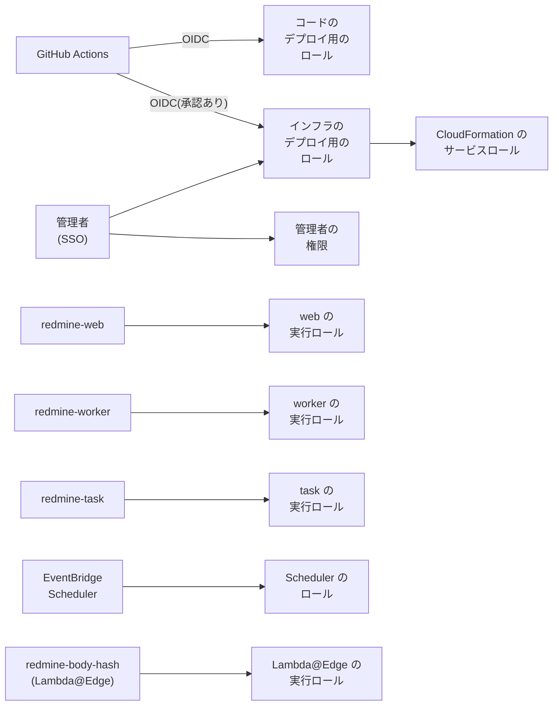

# IAM と権限

Serverless で使う IAM のロール、ポリシー、リソースベースのポリシーをまとめます。権限の詳しい内容は、この資料を正とします。ほかの資料は、ここにリンクします。

この資料の仕様は、2026-11-09 時点の公式の情報で確認したものです。出典は [sources.md](sources.md) にあります。

ロール、関数、SSM のパスの名前は、インスタンスの名前(`redmine.json` の `instance`)から作ります([deploy-config.md](deploy-config.md#names-derived-from-the-instance-name))。この資料の名前は、インスタンスの名前が既定の `redmine` のときのものです。

## 方針

- **関数ごとにロールを分ける:** `redmine-web`、`redmine-worker`、`redmine-task` は、同じイメージでも、別の実行ロールにします。画面の関数が、rake やメールの受信の権限を持たないようにします。
- **対象を ARN で絞る:** S3 はバケットとプレフィックス、SQS はキュー、SES は ID、SSM はパスまで絞ります。AWS の API が対象を絞れないもの(`ses:GetAccount` など)だけを `*` にします。
- **アクセスキーを作らない:** Lambda は実行ロールの一時的な認証情報で、GitHub Actions は OIDC で、人は IAM Identity Center(SSO)で操作します。IAM ユーザーとアクセスキーは作りません。
- **サービスからの呼び出しは、呼び出し元で絞る:** SES、CloudFront、EventBridge Scheduler などのサービスに許すときは、`aws:SourceAccount` と `aws:SourceArn` で、このアカウントの決まったリソースからの呼び出しだけにします(混乱した代理の問題を防ぐ)。
- **インフラの変更は人が承認する:** CloudFormation のスタック(IAM のロールを含む)を当てる `bin/deploy` は、インフラのデプロイ用のロールで動かします。このロールを引き受けられるのは、SSO の管理者と、承認が要る GitHub の Environment のワークフローだけです(下の「インフラのデプロイ用のロール」)。コードの更新だけを行う GitHub Actions のロールは、IAM やデータベースを変えられません。
- **権限の境界:** スタックが作るロールには、決めた権限の境界(permissions boundary)を付けます。インフラのデプロイ用のロールが、境界より強いロールを作れないようにします。
- **データベースのパスワードは SSM に置く:** RDS はパスワードでつなぎます。パスワードは SSM Parameter Store の SecureString に置き、読めるのは 3 つの関数の実行ロールだけです([rds.md](rds.md#connecting-from-rails))。

## 一覧

| ロール | 引き受けるもの | 役目 |
| --- | --- | --- |
| `redmine-web` | Lambda(`redmine-web`) | 画面、添付ファイル、ジョブを積む、管理画面 |
| `redmine-worker` | Lambda(`redmine-worker`) | ジョブの実行(メールの送信、プロジェクトの削除など) |
| `redmine-task` | Lambda(`redmine-task`) | rake、`rails runner`、メールの取り込み |
| `redmine-scheduler` | EventBridge Scheduler | 定期の rake と、業務時間の温めの呼び出し |
| `redmine-malware-scan` | GuardDuty Malware Protection(`malware-protection-plan.guardduty.amazonaws.com`) | 添付ファイルのバケットの `incoming/` と `imports/` の新しいオブジェクトをスキャンし、タグを付ける([aws-security.md](aws-security.md#malware-protection-for-s3))。`uploads.malwareScan` のときだけ |
| `redmine-body-hash` | Lambda と Lambda@Edge(`redmine-body-hash`) | 要求の本文のハッシュを入れる([lambda.md](lambda.md#function-that-adds-the-body-hash-lambdaedge))。ログを書くだけ |
| `redmine-github-deploy` | GitHub Actions(OIDC) | コードのデプロイ。イメージの push、アセットの同期、関数の更新、migration |
| `redmine-infra-deploy` | SSO の管理者、承認が要る GitHub の Environment(OIDC) | `bin/deploy` でスタックを当てる。設定のファイルの `deployRoleArn` が指すロール |
| `redmine-cfn-exec` | CloudFormation | スタックのリソースを作る(CloudFormation のサービスロール) |

スタックが作るロールは、パス `/redmine/` の下に置き(たとえば `arn:aws:iam::<account>:role/redmine/redmine-web`)、権限の境界 `redmine-boundary` を付けます。最後の 3 つと権限の境界は、`infra/account.yaml` にあります(下の「アカウントのロール」)。

## 3 つの関数に共通の権限

| 権限 | 対象 | 使い道 |
| --- | --- | --- |
| `logs:CreateLogStream`、`logs:PutLogEvents` | 関数ごとのロググループ | ログ。ロググループは CloudFormation で、保持の期間を付けて先に作る([security.md](security.md#retention-periods)) |
| `ssm:GetParametersByPath` | `arn:aws:ssm:<リージョン>:<アカウント>:parameter/redmine/env` と、その下(`parameter/redmine/env/*`) | 起動のときの設定と秘密の値。データベースのパスワードも含む([lambda.md](lambda.md#settings-and-secrets-ssm-parameter-store)) |
| `ec2:CreateNetworkInterface`、`ec2:DescribeNetworkInterfaces`、`ec2:DeleteNetworkInterface`、`ec2:AssignPrivateIpAddresses`、`ec2:UnassignPrivateIpAddresses` | `*`(EC2 の API が対象を絞れない) | VPC の中で動く。AWS の管理ポリシー `AWSLambdaVPCAccessExecutionRole` と同じ内容([rds.md](rds.md#routes-out-of-the-vpc)) |

- **SecureString の復号:** SSM の既定の鍵(`aws/ssm`)で暗号化します。この鍵のときに `kms:Decrypt` を IAM で付ける必要があるかは、作るときに確認します。

- **権限の出どころ:** 各行は、どれかのプラグインのためのものです。Serverless の外で使うときの権限も、プラグインの IAM の権限のページにあります。[Redmine Serverless SQS](https://redmine-kit.github.io/redmine_serverless_sqs/ja/iam.html)(ジョブと「ジョブ」の画面)、[Redmine Serverless S3](https://redmine-kit.github.io/redmine_serverless_s3/ja/setup.html#iam-permissions)(添付ファイル)、[Redmine Serverless SES](https://redmine-kit.github.io/redmine_serverless_ses/ja/iam.html)(メール)、[Redmine Serverless SSM](https://redmine-kit.github.io/redmine_serverless_ssm/ja/iam.html)(起動のときの設定)です。[Redmine Serverless](https://redmine-kit.github.io/redmine_serverless/ja/iam.html) 自身の権限は要りません。このページは、それを関数ごとにまとめたものです。

## `redmine-web` の実行ロール

| 権限 | 対象 | 使い道 |
| --- | --- | --- |
| `s3:GetObject`、`s3:PutObject`、`s3:DeleteObject` | 添付ファイルのバケットの `files/*`、`thumbnails/*`、`imports/*`、`incoming/*`、`tmp/*` | 添付ファイルの保存、登録のときのチェックサム付きの `HeadObject` と写し、`/tmp` のキャッシュ、削除、一括のダウンロードの仮のファイル([attachments.md](https://redmine-kit.github.io/redmine_serverless_s3/ja/attachments.html)) |
| `s3:ListBucket` | 添付ファイルのバケット | ないオブジェクトへの `HeadObject` を、403 ではなく 404 として受け取る。サムネイルをプレフィックスで消す |
| `sqs:SendMessage` | ジョブのキュー | ジョブを積む([lambda.md](lambda.md#background-jobs)) |
| `sqs:GetQueueAttributes` | ジョブのキューとデッドレターキュー | 管理画面の「ジョブ」 |
| `sqs:StartMessageMoveTask`、`sqs:ListMessageMoveTasks` | ジョブのデッドレターキュー | 管理画面の「ジョブ」から、デッドレターキューを元のキューに戻す |
| `ses:SendEmail`、`ses:SendRawEmail` | 送信元のドメインの SES の ID | Redmine の標準のテストのメール(画面の要求の中で送る) |
| `ses:GetEmailIdentity` | 送信元のドメインの SES の ID | 管理画面の「メールの送信」 |
| `ses:GetAccount`、`ses:ListSuppressedDestinations`、`ses:DeleteSuppressedDestination` | `*`(対象を絞れない) | 同上([admin.md](https://redmine-kit.github.io/redmine_serverless_ses/ja/admin.html#sending-email)) |

- **送信の権限は 2 つ:** メールは、SES v2 の `SendEmail` に全文(raw)を渡して送ります。AWS の SES の資料の例は、送信の権限として `ses:SendEmail` と `ses:SendRawEmail` の両方を許しているので、それに合わせます。v2 の全文の送信に `ses:SendRawEmail` が欠かせないかは、確認していません(未確認)。
- **署名付き URL:** ブラウザーはこのロールを使いません。アップロードとダウンロードは、CloudFront の秘密鍵で署名した URL で CloudFront を通ります。関数は、この鍵をほかの秘密の値と一緒に SSM Parameter Store から読みます([Redmine Serverless S3](https://redmine-kit.github.io/redmine_serverless_s3/ja/iam.html))。CloudFront は OAC でバケットに届き、バケットポリシーがそれを許します(下の「リソースベースのポリシー」)。

## `redmine-worker` の実行ロール

| 権限 | 対象 | 使い道 |
| --- | --- | --- |
| `sqs:ReceiveMessage`、`sqs:DeleteMessage`、`sqs:GetQueueAttributes`、`sqs:ChangeMessageVisibility` | ジョブのキュー | イベントソースマッピングでジョブを受け取る。gem のハンドラーが、成功したメッセージを消す |
| `sqs:SendMessage` | ジョブのキュー | ジョブの中でのやり直し(`retry_on`)と、ジョブから積むジョブ |
| `ses:SendEmail`、`ses:SendRawEmail` | 送信元のドメインの SES の ID | 通知のメール([mail.md](mail.md#sending))。全文(raw)で送る |
| `s3:GetObject`、`s3:PutObject`、`s3:DeleteObject`、`s3:ListBucket` | 添付ファイルのバケット(`redmine-web` と同じ範囲) | プロジェクトの削除での添付ファイルの削除、突き合わせ([admin.md](https://redmine-kit.github.io/redmine_serverless_s3/ja/admin.html#attachments-in-s3)) |
| `s3:GetObject`、`s3:DeleteObject` | メールのバケットの `inbound/*`、`processed/*` | 管理画面からのメールの取り込み直し |
| `s3:PutObject` | メールのバケットの `processed/*` | 同上 |

## `redmine-task` の実行ロール

| 権限 | 対象 | 使い道 |
| --- | --- | --- |
| `s3:GetObject`、`s3:DeleteObject` | メールのバケットの `inbound/*` | 受信したメールの取り込み([mail.md](mail.md#importing)) |
| `s3:PutObject` | メールのバケットの `processed/*` | 取り込んだメールを移す |
| `s3:GetObject`、`s3:PutObject`、`s3:DeleteObject`、`s3:ListBucket` | 添付ファイルのバケット(`redmine-web` と同じ範囲) | 未添付の添付ファイルの削除(`redmine:attachments:prune`)、メールの添付ファイルの保存 |
| `ses:SendEmail`、`ses:SendRawEmail` | 送信元のドメインの SES の ID | rake のタスクのメール(期日の通知など) |
| `sqs:SendMessage` | ジョブのキュー | rake の中で積まれるジョブ |
| `sqs:SendMessage` | 失敗の送り先のキュー(`redmine-task-failures`) | SES からの非同期の呼び出しが失敗したときの送り先。Lambda の送り先は、実行ロールの権限で送る |

## リソースベースのポリシー

| リソース | 許す相手 | 許すこと | 条件 |
| --- | --- | --- | --- |
| `redmine-web`(関数) | CloudFront(`cloudfront.amazonaws.com`) | `lambda:InvokeFunctionUrl` | `AWS:SourceArn` がこのディストリビューション。関数 URL は `AuthType: AWS_IAM`(OAC) |
| `redmine-web`(関数) | CloudFront(`cloudfront.amazonaws.com`) | `lambda:InvokeFunction` | `AWS:SourceArn` がこのディストリビューション |
| `redmine-task`(関数) | SES(`ses.amazonaws.com`) | `lambda:InvokeFunction` | `aws:SourceAccount` がこのアカウント、`aws:SourceArn` が受信のルール |
| アセットのバケット | CloudFront(`cloudfront.amazonaws.com`) | `s3:GetObject` | `AWS:SourceArn` がこのディストリビューション(OAC) |
| メールのバケット | SES(`ses.amazonaws.com`) | `inbound/*` への `s3:PutObject` | `aws:SourceAccount` がこのアカウント、`aws:SourceArn` が受信のルール |
| 3 つのバケット | すべて | すべてを拒否 | `aws:SecureTransport` が `false`(TLS でない要求) |
| ECR のリポジトリ | Lambda(`lambda.amazonaws.com`) | `ecr:BatchGetImage`、`ecr:GetDownloadUrlForLayer` | `aws:SourceArn` がこのアカウントの関数 |

- **関数 URL は CloudFront だけが呼べる:** 関数 URL を IAM の認証にし、CloudFront の OAC が署名した要求だけを受けます。ブラウザーの POST の本文のハッシュは、Lambda@Edge が入れます([lambda.md](lambda.md#cloudfront-and-function-urls))。OAC の関数 URL には、CloudFront の資料のとおり、`lambda:InvokeFunctionUrl` と `lambda:InvokeFunction` の両方を許します。
- **ECR:** 同じアカウントの関数なら、デプロイする人に `ecr:SetRepositoryPolicy` があれば、Lambda がこのポリシーを自動で足します。CloudFormation で明示しておきます。
- **SQS:** キューは同じアカウントの関数だけが使うので、キューのポリシーは置かず、実行ロールの権限で許します。

## Lambda@Edge の実行ロール

信頼のポリシーで、`lambda.amazonaws.com` と `edgelambda.amazonaws.com` の両方に引き受けを許します(Lambda@Edge の決まり)。

| 権限 | 対象 | 使い道 |
| --- | --- | --- |
| `logs:CreateLogGroup`、`logs:CreateLogStream`、`logs:PutLogEvents` | すべてのリージョンのロググループ `/aws/lambda/us-east-1.redmine-body-hash`(`arn:aws:logs:*:<アカウント>:log-group:/aws/lambda/us-east-1.redmine-body-hash:*`) | ログ。Lambda@Edge は、動いたエッジに近いリージョンにログを書く |

- **ほかの権限を持たせない:** 本文を読んでハッシュを入れるだけなので、AWS のサービスの権限は付けません。
- **関数を CloudFront に付ける権限:** Lambda@Edge の関数のバージョンを CloudFront に付けるには、`lambda:EnableReplication*` と `iam:CreateServiceLinkedRole` が要ります。CloudFormation のサービスロールに持たせます(下の「インフラのデプロイ用のロール」)。コードのデプロイ用のロールには持たせません。

## EventBridge Scheduler のロール

| 権限 | 対象 | 使い道 |
| --- | --- | --- |
| `lambda:InvokeFunction` | `redmine-task` | 定期の rake([tasks.md](tasks.md#scheduled-runs)) |
| `lambda:InvokeFunction` | `redmine-web` | 業務時間の温めの呼び出し(使うときだけ。[lambda.md](lambda.md#waiting-for-start-up)) |

信頼のポリシーは `scheduler.amazonaws.com` で、`aws:SourceAccount` をこのアカウントに絞ります。

## コードのデプロイ用のロール(GitHub Actions)

信頼のポリシーは、GitHub の OIDC(`token.actions.githubusercontent.com`)で、`sub` をデプロイするリポジトリの本番の Environment に絞ります。

| 権限 | 対象 | 使い道 |
| --- | --- | --- |
| `ecr:GetAuthorizationToken` | `*`(対象を絞れない) | ECR へのログイン |
| `ecr:DescribeImages`、`ecr:BatchCheckLayerAvailability`、`ecr:InitiateLayerUpload`、`ecr:UploadLayerPart`、`ecr:CompleteLayerUpload`、`ecr:PutImage`、`ecr:BatchGetImage`、`ecr:GetDownloadUrlForLayer` | Redmine のリポジトリ | イメージを写す(すでにあるイメージは写さない) |
| `s3:PutObject`、`s3:GetObject`、`s3:ListBucket` | アセットのバケット(`*-assets-<account>-*` と、その `assets/` の下のオブジェクト) | アセットの同期([lambda.md](lambda.md#serving-assets)) |
| `lambda:UpdateFunctionCode`、`lambda:GetFunction`、`lambda:GetFunctionConfiguration`、`lambda:InvokeFunction` | タグ `redmine:instance` を持つ関数 | イメージの更新、更新が終わるのを待つこと、`redmine-task` での migration([tasks.md](tasks.md#migrations-during-deployment)) |
| `cloudformation:DescribeStacks` | アカウントのスタック | 出力(リポジトリ、バケット、ディストリビューション)を読む |

- **すべてのインスタンスに 1 つのポリシー:** 権限は、管理ポリシー `redmine-code-deploy`(`infra/account.yaml`)に置き、インフラのデプロイ用のロールと共有します。インスタンスの名前は自由なので、関数は、どのスタックもリソースに付けるタグ `redmine:instance` で、バケットは名前で絞ります。

- **持たせないもの:** ほかの `iam:*` と `iam:PassRole`、`lambda:UpdateFunctionConfiguration`(実行ロールや環境変数を変えられるため)、CloudFormation、SSM のデータベースのパスワード。これらは、インフラのデプロイ用のロールで変えます。
- **アセットを消さない:** 古いアセットを残すので、`s3:DeleteObject` は持たせません。古いアセットは、ライフサイクルで消します。

## インフラのデプロイ用のロール

`bin/deploy` で、共有の土台とインスタンスのスタックを当てるロールです。設定のファイルの `deployRoleArn` が、このロールを指します([deploy-config.md](deploy-config.md))。

| 項目 | 内容 |
| --- | --- |
| 引き受けるもの | SSO の管理者の権限のセット。GitHub Actions では、承認する人を決めた Environment のワークフローだけ(`sub` をその Environment に絞る) |
| 権限 | サービスロール `redmine-cfn-exec` を付けた変更セットだけを作る権限(条件 `cloudformation:RoleArn` 付きの `cloudformation:CreateChangeSet`)と、その表示、実行、削除。CloudFormation への `redmine-cfn-exec` だけの `iam:PassRole`。Lambda@Edge のロググループへの保持の期間の設定(すべてのリージョンの `logs:PutRetentionPolicy`。対象は `/aws/lambda/us-east-1.redmine-body-hash` だけ。`logs:DescribeLogGroups` と `ec2:DescribeRegions` も)。`/<instance>/env/` と `/<instance>/deploy/` の下の SSM のパラメーターを読むことと作ること(SSM を通した `kms:Encrypt` も)。共有の土台のテンプレートのバケットに、テンプレートを置くことと読むこと。SES の受信のルールのセットを有効にすること。コードのデプロイ用のロールの管理ポリシー `redmine-code-deploy` |
| リソースを作る権限 | 持たない。リソースは、CloudFormation が `redmine-cfn-exec` の権限で作る |

- **CloudFormation のサービスロール:** `redmine-cfn-exec` は、この設計のリソース(Lambda、RDS、VPC とそのエンドポイント、NAT インスタンス、S3、SQS、SES、CloudFront、AWS WAF の Web ACL、ACM、IAM のロール、ログ、アラーム)を作れます。作る IAM のロールには、権限の境界 `redmine-boundary` を付けることを条件にします(`iam:PermissionsBoundary`)。
- **us-east-1:** Lambda@Edge の関数と CloudFront の証明書のスタックも、同じロールで us-east-1 に当てます([deploy-config.md](deploy-config.md#shared-base-and-per-instance-resources))。
- **関数を CloudFront に付ける権限:** Lambda@Edge の関数のバージョンを CloudFront に付けるための `lambda:EnableReplication*` と `iam:CreateServiceLinkedRole` も、`redmine-cfn-exec` に持たせます。

## アカウントのロール

`infra/account.yaml`(スタック `redmine-account`)が、上のロールのうち、インスタンスごとではないものを作ります。管理者が、自分の認証情報で、アカウントごとに 1 回当てます(`bin/deploy --account`。[deploy-config.md](deploy-config.md#deployment-commands))。

| リソース | 中身 |
| --- | --- |
| `redmine-boundary`(管理ポリシー) | スタックが作るすべてのロールの権限の境界。このページのロールの操作だけを許す。ログを書く、SSM のパラメーターを読む、`kms:Decrypt`、VPC の中の Lambda のネットワークインターフェースと NAT インスタンスの操作、S3 のオブジェクト、SQS、SES、`lambda:InvokeFunction`、GuardDuty Malware Protection の EventBridge のルールとバケットの通知、`AmazonSSMManagedInstanceCore` の操作。IAM の操作は何も許さない |
| `redmine-cfn-exec` | CloudFormation(`cloudformation.amazonaws.com`。`aws:SourceAccount` はこのアカウント)。スタックのサービスの操作と、パス `/redmine/` の下だけの IAM の操作。ロールを作ることと、ポリシーを入れることや付けることは、権限の境界があるときだけ(`iam:PermissionsBoundary`)。`/redmine/` の下のロール、インスタンスプロファイル、ポリシーの管理。`/redmine/` の下のロールを Lambda、Lambda@Edge、EventBridge Scheduler、EC2、GuardDuty Malware Protection に渡す `iam:PassRole`。`iam:CreateServiceLinkedRole` と `lambda:EnableReplication*`。`iam:DeleteRolePermissionsBoundary` は拒否する。アカウントのロールと権限の境界は `/redmine/` の外にあるので、変えられない |
| `redmine-infra-deploy` | IAM Identity Center の権限のセット(`account.ssoPermissionSet`。既定は `AdministratorAccess`。その `AWSReservedSSO_…` のロールの `aws:PrincipalArn` で絞る)の利用者と、`account.githubRepository` があれば、Environment `account.githubInfraEnvironment`(既定は `infrastructure`)の GitHub Actions。権限は、上の「インフラのデプロイ用のロール」。セッションは 2 時間まで |
| `redmine-github-deploy` | `account.githubRepository` があるときだけ。Environment `account.githubCodeEnvironment`(既定は `production`)の GitHub Actions。audience は `sts.amazonaws.com`。管理ポリシー `redmine-code-deploy` |
| CloudTrail と IAM Access Analyzer | 証跡 `redmine-trail` とアナライザー。アカウントにあれば作らない([aws-security.md](aws-security.md)) |
| GitHub の OIDC のプロバイダー | `account.githubRepository` があるときに作る。アカウントにすでにあるときは、`account.githubOidcProviderArn` でそれを指す(1 つのアカウントに、URL ごとに 1 つ) |

- **GitHub の Environment:** インフラの Environment の承認する人は、GitHub の側で決めます。ロールは、その Environment の `sub`(`repo:<owner>/<repository>:environment:<name>`)だけを信頼します。

## 人の権限

| する人 | すること | 権限 |
| --- | --- | --- |
| 管理者 | `bin/deploy` でスタックを当てる(インフラのデプロイ用のロールを引き受ける)、SSM のパラメーターを置く、Session Manager のポートフォワーディングでデータベースにつなぐ([rds.md](rds.md#managing-it-with-systems-manager)) | IAM Identity Center の管理者の権限 |
| 運用する人 | `bin/rake` で rake を実行する、ログを読む、デッドレターキューを戻す | 管理者の権限か、運用のための権限のセット(下の表) |

運用のための権限のセットを作る場合は、次の範囲にします(作るかは、運用する人が増えたときに決める)。

| 権限 | 対象 |
| --- | --- |
| `lambda:InvokeFunction`、`lambda:GetFunction` | `redmine-task` |
| `logs:StartQuery`、`logs:GetQueryResults`、`logs:FilterLogEvents` | 3 つの関数のロググループ |
| `sqs:GetQueueAttributes`、`sqs:StartMessageMoveTask`、`sqs:ListMessageMoveTasks` | ジョブのキューとデッドレターキュー |

- **rake は強い権限:** `redmine-task` を呼べる人は、rake と `rails runner` で、データベースと S3 のすべてを読み書きできます。呼べる人を絞ります([tasks.md](tasks.md#permissions))。

## VPC の中

- **セキュリティグループ:** 権限ではありませんが、RDS には関数のセキュリティグループからの 5432 番だけを、VPC のインターフェイスエンドポイントには関数のセキュリティグループからの 443 番だけを許します([rds.md](rds.md#security))。
- **ブラウザーと S3:** ブラウザーは CloudFront だけを通して添付ファイルに触れるので、インターネットから関数のロールで S3 を使うものはありません。

### NAT インスタンスのロール(NAT インスタンスの形のときだけ)

ロールの名前は `redmine-nat`(仮)で、EC2 が引き受けます。Systems Manager での管理と接続に使います([rds.md](rds.md#managing-it-with-systems-manager))。

| 権限 | 対象 | 使い道 |
| --- | --- | --- |
| AWS の管理ポリシー `AmazonSSMManagedInstanceCore` | — | Session Manager、Patch Manager、インベントリ |
| `logs:CreateLogStream`、`logs:PutLogEvents` | Session Manager のログのロググループ | 操作のログ |
| `ec2:ReplaceRoute`、`ec2:AttachNetworkInterface` などの経路の付け替え | プライベートのサブネットの経路表 | 立て直しのときに、経路を自分に向け直す |

- **人の権限:** Session Manager でつなぐ人には、`ssm:StartSession` を、このインスタンスと、決めたドキュメント(シェルと、リモートのホストへのポートフォワーディング)だけに許します。

## IAM Access Analyzer

アカウントで IAM Access Analyzer を使っていれば、外から使える状態のリソースを見つけます。この設計では、外から使える状態のリソースはない想定です。関数 URL も、CloudFront だけが呼べる形です(上の「関数 URL は CloudFront だけが呼べる」)。

関数 URL、S3 のバケット、SQS のキュー、SSM のパラメーター、RDS のスナップショットが見つかったら、設定の誤りなので直します。

## 確認すること

- `aws/ssm` の鍵の SecureString を読むのに、`kms:Decrypt` が要るか
- `sqs:StartMessageMoveTask` に、元のキューとデッドレターキューのどちらにどの権限が要るか
- `s3:ListBucket` に条件(`s3:prefix`)を付けたときに、ないオブジェクトへの `HeadObject` が 404 になるか
- SES v2 の `SendEmail` で全文(raw)を送るときに、`ses:SendRawEmail` が要るか
- `ssm:GetParametersByPath` の対象に、パスの ARN と、その下(`/*`)の両方が要るか
- 権限の境界と CloudFormation のサービスロールで、Lambda@Edge の複製に要るサービスリンクロールを作れるか
- 作るスタックの変更セットでも、`cloudformation:CreateChangeSet` が条件 `cloudformation:RoleArn` を見るか。実行にほかの権限が要るか
- `redmine-code-deploy` の Lambda の操作(`UpdateFunctionCode`、`InvokeFunction`、`GetFunction`)を、タグ `aws:ResourceTag/redmine:instance` で絞れるか
- `aws/ssm` の鍵で SecureString を書くのに、呼ぶ側のポリシーに `kms:Encrypt` が要るか
- パスと権限の境界を持つ実行ロールで、Lambda@Edge の複製が動くか
- SES の ID に対する権限(`ses:SendEmail`、`ses:GetEmailIdentity`)の ARN の形と、構成セットを使う場合に要る権限
