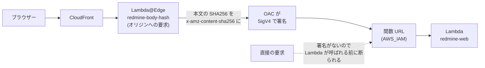
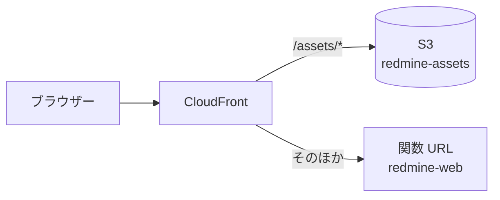

# Lambda Event Functions で Redmine を動かす

Redmine(Rails と Puma)を、Lambda Event Functions で動かすための設計です。Event Functions は、イベントを 1 件ずつ受けて処理する従来の Lambda です。HTTP の要求は、Lambda Web Adapter が普通の HTTP に戻して Puma に渡します。

この資料の仕様は、2026-11-08 時点の公式の情報と、Redmine 7.0.3 と Rails 8.1.4 のソースで確認したものです。出典は [sources.md](sources.md) にあります。

<a id="function-settings"></a>

## 関数の設定

| 項目 | 値 | 理由 |
| --- | --- | --- |
| 関数 | `redmine-web`(画面と API)、`redmine-worker`(ActiveJob のジョブ。下の「バックグラウンドのジョブ」)、`redmine-task`(rake とメールの取り込み。[tasks.md](tasks.md))。3 つとも同じイメージ | 画面は 60 秒、ジョブとタスクは 15 分まで動かす |
| パッケージ | コンテナイメージ(ECR) | zip は展開後 250 MB まで。Redmine と gem と ImageMagick は収まらない見込み。イメージは 10 GB まで |
| アーキテクチャ | arm64 | x86 より実行時間の単価が安い(東京で 1 GB 秒あたり 0.0000133334 ドルと 0.0000166667 ドル) |
| メモリ | 2,048 MB | CPU はメモリに比例して割り当てられる。Rails の起動とサムネイルの生成を速くする。実測で見直す |
| タイムアウト | 60 秒(`redmine-web`)、900 秒(`redmine-worker`、`redmine-task`) | CloudFront のオリジンの応答の待ち時間に合わせる(下記) |
| `/tmp` | 2,048 MB | 添付ファイルのキャッシュ([attachments.md](https://redmine-kit.github.io/redmine_serverless_s3/ja/attachments.html#the-tmp-cache))、PDF の出力、Rails のキャッシュ。512〜10,240 MB で選べる |
| 同時実行数の予約 | 10(`redmine-web`) | 負荷と費用の上限にする |
| VPC | VPC のプライベートのサブネット(2 つの AZ) | RDS には VPC の中からしか届かない。S3 にはゲートウェイのエンドポイントで、SES、SSM、SQS には VPC のエンドポイントか NAT インスタンスで届く([rds.md](rds.md#routes-out-of-the-vpc)) |

<a id="image"></a>

## イメージ

Lambda の Ruby のベースイメージ `public.ecr.aws/lambda/ruby:4.0` を土台にし、Redmine 7.0.3 と、ImageMagick などの依存を入れます。`redmine-web`、`redmine-worker`、`redmine-task` は同じイメージを使い、関数の環境変数 `REDMINE_ROLE`(`web`、`worker`、`task`)で、起動するものを切り替えます([tasks.md](tasks.md#how-one-image-runs-everything))。

<a id="choosing-the-base"></a>

### 土台の選び方

Redmine は、zip ではなくコンテナイメージで動かします。zip は展開後 250 MB までで、Redmine と gem に加えて、ImageMagick、Ghostscript、Pandoc の実行ファイルを入れるのが難しいためです。

| 土台 | 良いところ | 足りないところ | 判断 |
| --- | --- | --- | --- |
| Lambda の Ruby のベースイメージ(`public.ecr.aws/lambda/ruby:4.0`) | Lambda のためのイメージで、Lambda と同じ OS(Amazon Linux 2023)と Ruby。ランタイムインターフェイスクライアントが入っているので、タスク用の関数がそのまま作れる。読み取り専用のファイルシステムと、権限の少ないユーザーで動く前提で作られている | Redmine と依存を自分で入れ、Redmine の更新にも自分で追随する | 使う |
| 公式の Redmine のイメージ(`redmine:7.0.3`、Debian 13) | Redmine のリリースに合わせて更新され(7.0.3 は 2026-11-06)、依存がそろっている | Docker で動かす前提の作り。起動のたびに設定ファイルを書き、migration を実行し、gem を入れる入口を外す必要がある。`HOME` が書き込めない場所にある。ランタイムインターフェイスクライアントがない。Pandoc がない。使わない Git、Subversion なども入っている | 使わない |

コンテナイメージの関数は、どちらの土台でも、Lambda が OS を自動で更新しません。土台のイメージが更新されたら、イメージを作り直してデプロイします。

<a id="what-was-checked-in-the-base-image"></a>

### 土台のイメージで確認したこと

2026-11-08 に、手元の Docker で arm64 のイメージを動かして確認しました。

| 項目 | 内容 |
| --- | --- |
| OS | Amazon Linux 2023(2023.12.20261026) |
| Ruby | 4.0.9。Redmine の wiki は、wiki の描画が遅くなる 4.0.0〜4.0.3 を避け、4.0.4 以上を勧めている。`ruby:3.4` のイメージは 3.4.12 |
| 入口 | `/lambda-entrypoint.sh`。ランタイムインターフェイスクライアントは `/var/runtime` にある |
| パッケージの管理 | `microdnf`(`dnf` もある) |

Amazon Linux 2023 の標準のリポジトリで、次のパッケージが入れられることを確認しました(`microdnf repoquery`)。

| 用途 | パッケージ | バージョン |
| --- | --- | --- |
| サムネイル、ガントの PNG | `ImageMagick` | 6.9.13(2026-11-09 にイメージに入ったもの)。Redmine が呼ぶ `convert` がある |
| PDF のサムネイル | `ghostscript`、`urw-base35-fonts` | 9.56.1 |
| PostgreSQL の接続 | `libpq`(実行)、`libpq-devel`(`pg` の gem のビルド) | 15.0 |
| ガントの PNG の日本語 | `ipa-gothic-fonts` | 003.03。Redmine の `minimagick_font_path` で指定する |
| gem のビルド | `gcc`、`make`、`libyaml-devel` | — |
| ファイルの展開 | `tar`、`gzip` | — |

- **Pandoc:** Amazon Linux 2023 のリポジトリにはありません(探したのは `microdnf repoquery`)。Pandoc の公式の Linux の arm64 の実行ファイル(`pandoc-3.13-linux-arm64.tar.gz`、2026-10-26)を、SHA256 を確認して入れます。Redmine 7.0 で xlsx と pptx をプレビューするには、3.8.3 以上が要ります。
- **ImageMagick 6:** Redmine は、サムネイルを `convert` のコマンドで作ります(`lib/redmine/thumbnail.rb`)。ImageMagick 6 には `convert` があるので、そのまま使えます。

<a id="shape-of-the-dockerfile"></a>

### Dockerfile の形

```dockerfile
FROM public.ecr.aws/lambda/ruby:4.0@sha256:<digest> AS build
# gcc、make、libpq-devel、libyaml-devel、tar、gzip を入れる
# Redmine 7.0.3 の tar.gz を redmine.org から取り、SHA256 を確認して /var/task/redmine に展開する
# config/database.yml、Gemfile.local を入れ、gem を vendor/bundle に入れる(開発用とテスト用は除く)
# アセットを書き出す(bin/rails assets:precompile)

FROM public.ecr.aws/lambda/ruby:4.0@sha256:<digest>
# ImageMagick、ghostscript、urw-base35-fonts、libpq、ipa-gothic-fonts を入れる
# Pandoc の実行ファイルを入れる
# RDS の CA の証明書の束(global-bundle.pem)をダウンロードし、SHA256 を確認して /var/task/rds-global-bundle.pem に置く
# build の段から /var/task/redmine を取る(gcc などのビルドの道具は入れない)
# 設定ファイル、自前のプラグイン(plugins/)、起動のスクリプト、タスクのハンドラーを入れる
# tmp を /tmp/redmine へのシンボリックリンクにする
COPY --from=public.ecr.aws/awsguru/aws-lambda-adapter:1.1.0@sha256:<digest> /lambda-adapter /opt/lambda-web-adapter/lambda-adapter
COPY image/extensions/lambda-adapter /opt/extensions/lambda-adapter
ENTRYPOINT ["/var/task/bin/start"]
```

- **2 段に分ける:** gem のビルドに使う gcc などは、実行のイメージに入れません。イメージが小さくなり、起動のときの取得も短くなる見込みです。
- **1 つのイメージ:** ビルドも push も 1 回で、3 つの関数で同じコードが動きます。
- **ファイル:** Dockerfile は `image/Dockerfile` で、`bin/build-image` でビルドします。gem のバージョンは `image/Gemfile.lock` で固定し、`bin/update-gems` が arm64 の Linux のためだけに書きます。
- **入口(`/var/task/bin/start`):** `REDMINE_ROLE=web` なら Puma を起動します。`worker` と `task` なら、土台の `/lambda-entrypoint.sh` で、それぞれのハンドラーを動かします。どれでもないときは、エラーで終わります。
- **拡張機能(`/opt/extensions/lambda-adapter`):** 小さなシェルのスクリプトです。`REDMINE_ROLE=web` のときだけ、`/opt/lambda-web-adapter/` に置いた本物の Lambda Web Adapter を起動します。`worker` と `task` のときは、何もしない拡張機能として登録して待ちます([tasks.md](tasks.md#how-one-image-runs-everything))。
- **digest で固定する:** 土台のイメージと Lambda Web Adapter は、タグではなく digest で参照します。Redmine、Pandoc、RDS の CA の証明書の束は、ダウンロードしたファイルの SHA256 を確認します。
- **1 つのアーキテクチャのイメージにする:** Lambda は、複数のアーキテクチャをまとめたイメージを受け付けません。arm64 だけのイメージを push します。Docker の buildx は、既定で来歴の情報(provenance)を付けて、イメージをインデックスの形にすることがあるので、付けない設定でビルドします(推測。最初のビルドで確認する)。
- **ECR のイメージを消さない:** Lambda は、関数が使っているイメージを ECR から定期的に取り直します。イメージが消えていると、関数は `Failed` になります。ECR のライフサイクルでは、直近の数個のイメージを残します。

<a id="adapting-redmine-to-lambda"></a>

### Redmine を Lambda に合わせるところ

| 項目 | Lambda での形 | 理由 |
| --- | --- | --- |
| 置き場所 | `/var/task/redmine` | Lambda のベースイメージは、関数のコードを `/var/task`(`LAMBDA_TASK_ROOT`)に置く |
| `config/database.yml` | ビルドのときに入れる。`adapter:` は文字で `postgresql` と書く。接続先、データベースの名前、ユーザーの名前、パスワードは、環境変数から ERB で読む(`REDMINE_DB_HOST`、`REDMINE_DB_NAME`、`REDMINE_DB_USERNAME`、`REDMINE_DB_PASSWORD`)。TLS は、イメージの中の RDS の CA の証明書の束で `verify-full` にする(`sslrootcert: /var/task/rds-global-bundle.pem`) | Redmine の `Gemfile` は、`config/database.yml` の `adapter:` の値で、入れるデータベースの gem を決める。`adapter:` の値を ERB にすると、Gemfile も ERB を評価するので、文字で書いておく方が確か。RDS for PostgreSQL なので、`pg` の gem を使う |
| `Gemfile.local` | `puma`(Redmine はテスト用のグループにしか入れていない)、`aws-sdk-ssm`(設定と秘密の値)、`aws-actionmailer-ses`(メール)、`aws-activejob-sqs`(ジョブ) | Redmine は `Gemfile.local` の gem も読み込む。プラグインが使う gem(`redmine_serverless_s3` の `aws-sdk-s3` など)は、そのプラグインの `Gemfile` に書く |
| 自前のプラグイン | `plugins/redmine_serverless`、`plugins/redmine_serverless_s3`、`plugins/redmine_serverless_ses`、`plugins/redmine_serverless_ssm`。それぞれ別のリポジトリから、決めたコミットで入れる(`redmine_serverless_ssm` は、`Gemfile.local` で道筋を指定した gem としても入れる) | 拡張の部分を自前のプラグインにする([architecture.md](architecture.md#the-plugins)) |
| gem | ビルドのときに `vendor/bundle` に入れ、実行のときは入れない(`BUNDLE_DEPLOYMENT`、`BUNDLE_WITHOUT=development:test`) | 実行のときには書き込めない |
| ファイルの権限 | どのユーザーからも読めるようにする | Lambda は、既定の権限の少ないユーザーで動かす。このユーザーが、実行に要るすべてのファイルを読める必要がある |
| `HOME` | `/tmp` | Bundler、ImageMagick、Pandoc がホームに書くことがある(推測) |

<a id="lambda-web-adapter-settings"></a>

### Lambda Web Adapter の設定

Lambda Web Adapter は、AWS が公開している拡張機能です。Lambda のイベントを HTTP の要求に戻し、イメージの中の HTTP サーバーに渡します。最新のバージョンは 1.1.0(2026-09-18)です。イメージには入れますが、起動するのは `redmine-web` だけです(上の「Dockerfile の形」)。

| 環境変数 | 値 | 理由 |
| --- | --- | --- |
| `AWS_LWA_PORT` | `3000` | Puma が待ち受けるポート |
| `AWS_LWA_READINESS_CHECK_PROTOCOL` | `tcp` | Redmine には軽い確認用のパスがない。ポートが開いたら準備ができたとみなす |
| `AWS_LWA_ASYNC_INIT` | `true` | 初期化の 10 秒を超えても、最初の要求の中で起動を待ち続ける(下記) |
| `AWS_LWA_INVOKE_MODE` | `buffered`(既定) | Redmine の応答は、ストリーミングを要しない。下の圧縮は `buffered` のときだけ使える |
| `AWS_LWA_ENABLE_COMPRESSION` | `true` | 応答を gzip などで圧縮する(`buffered` のときだけ使える)。画面の応答はキャッシュしない設定(`CachingDisabled`)なので、CloudFront の側では圧縮されない見込み。Lambda の応答が小さくなり、6 MB の制限までの余裕が増え、画面の表示も速くなる。CloudFront を通して、ブラウザーに圧縮のまま届くかは、作るときに確認する |

<a id="start-up-script-and-puma"></a>

### 起動のスクリプトと Puma

`REDMINE_ROLE=web` のとき、起動のスクリプトは次のことをします。

1. `/tmp/redmine` の下に、`files`、`thumbnails`、`imports`、`cache`、`pids` のディレクトリを作ります。
2. `bundle exec puma` で Puma を起動します。

`REDMINE_ROLE` が `worker` か `task` のときは、1 のあとで、Puma の代わりにハンドラーを動かします([tasks.md](tasks.md#how-one-image-runs-everything))。

- **プロセスとスレッド:** ワーカーのプロセスは使わず(`-w 0`)、スレッドは 1 本にします(`-t 1:1`)。Event Functions の 1 つの環境は、同時に 1 件の要求しか受けないためです。
- **待ち受け:** `127.0.0.1:3000` で待ち受けます。
- **停止:** Lambda が環境を止めるときに、Puma を待たずに終わってもかまいません。要求の途中で止まることはなく、ジョブは SQS に積んで `redmine-worker` が動かすためです。

<a id="waiting-for-start-up"></a>

## 起動待ち

使われていない環境は、Lambda が止めます。そのあとの最初の要求は、新しい環境の起動を待ちます。

- **初期化の上限:** 初期化は 10 秒までです。超えると、Lambda は最初の呼び出しのときに、関数のタイムアウトの時間で初期化をやり直します。`AWS_LWA_ASYNC_INIT=true` にすると、Lambda Web Adapter が 9.8 秒で初期化を終えたことにし、最初の要求の中で Puma の起動を待ち続けます。
- **起動にかかる時間:** まだ測っていません。Rails の読み込み、データベースへの接続、イメージの取得が入ります。最初に測る項目です。
- **SnapStart は使えない:** SnapStart は Java、Python、.NET だけで、Ruby に対応していません。
- **Provisioned Concurrency は使わない:** 2 GB の環境を 1 つ確保し続けると、東京の arm で月約 23 ドルです(2 GB × 1 GB 秒あたり 0.0000043068 ドル × 2,628,000 秒(730 時間))。予算に合いません。
- **業務時間の温め:** 必要なら、EventBridge Scheduler から業務時間のあいだ 5 分ごとに `redmine-web` を呼びます。HTTP ではないイベントは、Lambda Web Adapter が `/events` への POST として渡します。プラグインの Rack のミドルウェアが、`/events` への要求に、データベースに触れずに 204 を返します。環境が残る時間は公式に書かれていないので、効き目は測って決めます。
- **同時の要求:** 1 つの環境は 1 件ずつしか処理しないので、1 つの画面が同時に多くの要求を出すと、その数だけ環境が起動します。添付ファイルとサムネイルを S3 から直接読ませるのは、このためでもあります([attachments.md](https://redmine-kit.github.io/redmine_serverless_s3/ja/attachments.html#thumbnails))。

<a id="read-only-file-system"></a>

## 読み取り専用のファイルシステム

Event Functions で書き込めるのは `/tmp` だけです。Redmine が実行中に書く場所を、次のように振り分けます。

| Redmine の場所 | 使い道 | 振り分け先 |
| --- | --- | --- |
| `files/` | 添付ファイル、Office のプレビューのキャッシュ(`files/derived_cache/`) | `/tmp/redmine/files`。S3 のキャッシュとして使う。`attachments_storage_path` で指定する |
| `tmp/thumbnails/` | サムネイルの作業 | `/tmp/redmine/thumbnails`。できたサムネイルは S3 に置く |
| `tmp/imports/` | CSV のインポートのファイル | `/tmp/redmine/imports`。S3 にも置き、別の環境では S3 から取る |
| `tmp/` のほか(`tmp/cache/`、`tmp/pids/` など) | PDF の出力の一時ファイル | `/tmp/redmine`(環境ごと) |
| `log/` | ログ | 標準出力(`RAILS_LOG_TO_STDOUT=1`)。CloudWatch Logs に入る |
| `db/schema.rb` | migration のあとのスキーマの書き出し | 書き出さない([tasks.md](tasks.md#notes-on-the-read-only-file-system)) |
| `public/assets/` | CSS と JavaScript | ビルドのときに書き出す(下記) |
| `config/` | 設定ファイル | ビルドのときに入れる。値は環境変数から読む |

- **シンボリックリンク:** イメージの `tmp` は `/tmp/redmine` へのシンボリックリンクにし、起動のスクリプトが `/tmp/redmine` を作ります。`Import#filepath` は `Rails.root/tmp/imports` に固定されているので、この形にします。アセットの書き出しが `tmp/` を使うことがあるので、シンボリックリンクにするのは書き出しのあとです。
- **S3 との出し入れ:** 添付ファイル、サムネイル、インポートのファイルの S3 との出し入れは [attachments.md](https://redmine-kit.github.io/redmine_serverless_s3/ja/attachments.html) にあります。
- **アセット:** Redmine は、起動のときにアセットが古いと判断すると `public/assets` に書き出します(`config.assets.redmine_detect_update`)。ビルドのときに書き出し、この確認は止めます。書き出したアセットは S3 から配ります(下の「アセットの配信」)。

<a id="settings-and-secrets-ssm-parameter-store"></a>

## 設定と秘密の値(SSM Parameter Store)

`SECRET_KEY_BASE` などの秘密の値は、SSM Parameter Store に置き、Redmine が起動のときに読みます。Lambda の環境変数には、秘密の値を置きません。データベースのパスワードも、ここに置きます。

<a id="parameters"></a>

### パラメーター

`/<instance>/env/` の下のパラメーターを、名前の最後の部分を環境変数の名前にして読み込みます(下の表は、インスタンスの名前が `redmine` のときの例)。パラメーターを足せば、コードを変えずに環境変数が増えます。

| パラメーター | 種類 | 中身 |
| --- | --- | --- |
| `/redmine/env/REDMINE_DB_HOST` | String | RDS のエンドポイント(`<インスタンスの ID>.<ランダムな文字>.ap-northeast-1.rds.amazonaws.com`)。秘密ではないが、Redmine の設定をまとめて読むためにここに置く |
| `/redmine/env/REDMINE_DB_PASSWORD` | SecureString | データベースのユーザーのパスワード。データベースを作るときに作る([rds.md](rds.md#settings)) |
| `/redmine/env/SECRET_KEY_BASE` | SecureString | Rails の秘密の鍵(`bin/rails secret` で作る) |

- **秘密でない設定:** バケットの名前、ドメイン、リージョン、データベースの名前、データベースのユーザーの名前は、CloudFormation から関数の環境変数で渡します。イメージは、`REDMINE_DB_NAME`(既定は `redmine`)、`REDMINE_DB_USERNAME`(既定は `redmine`)、`REDMINE_JOBS_QUEUE_URL`(ジョブのキュー)、`REDMINE_HOST`(ドメイン)として読みます。`REDMINE_DB_PORT` と `REDMINE_DB_SSLMODE`(既定は `verify-full`)は、手元のテストでだけ変えます。
- **暗号化:** SecureString は、SSM の既定の鍵(`aws/ssm`)で暗号化します。この鍵のときに、実行ロールに `kms:Decrypt` が要るかは、作るときに確認します。

<a id="loading"></a>

### 読み込み

1. Rails が設定を読む前に、プラグインの `redmine_serverless_ssm` が、関数の環境変数 `REDMINE_SSM_PATH` の道筋(`/<instance>/env/`)に、SSM の `GetParametersByPath`(復号あり)を呼びます。1 回に 10 件までなので、続きがあれば続けて読みます。`REDMINE_SSM_PATH` がなければ(手元の Docker など)、何も読みません。
2. 読んだ値を `ENV` に入れます。すでに環境変数にある名前は上書きしません。手元の Docker で試すときに、環境変数で渡せるようにするためです。環境変数にできる名前(大文字、数字、`_`)だけを読み、指定した道筋より下の階層は読みません。

- **コード:** 読み込みはプラグインの [Redmine Serverless SSM](https://redmine-kit.github.io/redmine_serverless_ssm/ja/) が、Railtie の `before_configuration` で行います(`additional_environment.rb` を含む `config/application.rb` のクラスの本体より前)。プラグインの `init.rb` では遅すぎるので、プラグインは gem でもあり、`image/Gemfile.local` で道筋を指定して足します。SSM につながらなければ、秘密の値なしで続けずに、起動を失敗させます。
- **時機の確認:** イメージのテストでは、データベースのホストを SSM(moto)だけに置き、`db:migrate`、web の画面、worker のジョブが通るので、`config/database.yml` より前に読めています(2026-11-09)。
3. そのあとで、Rails が `config/database.yml` を読み、データベースに接続します。

- **読む場所:** `additional_environment.rb` は `config/application.rb` の中で読まれます。`config/database.yml` の評価と、`SECRET_KEY_BASE` の読み込みはそのあとなので、ここで入れれば間に合います。Redmine の `Gemfile` は `adapter:` の文字しか見ないので、`REDMINE_DB_HOST` がなくても gem を選べます。
- **タスク用の関数:** rake と `rails runner` も Rails の環境を読み込むので、同じ処理で読みます。
- **読む回数:** 環境が起動するときに 1 回だけです。値を変えたら、関数の設定を更新して、新しい環境に切り替えます。
- **権限:** 実行ロールに `ssm:GetParametersByPath` を付けます。対象は `/<instance>/env/` の下だけです([iam.md](iam.md#permissions-common-to-the-three-functions))。

<a id="how-they-reach-the-function"></a>

### 届く経路

`redmine-web`、`redmine-worker`、`redmine-task` は VPC の中にあるので、SSM の VPC のエンドポイントか NAT インスタンスを通って、HTTPS と IAM の認証で届きます([rds.md](rds.md#routes-out-of-the-vpc))。

<a id="rails-and-redmine-settings"></a>

## Rails と Redmine の設定

Rails の設定は、どこに書くかで効くかどうかが変わります。

- **`production.rb` が設定している項目:** `config/additional_environment.rb` は `config/application.rb` の中で読まれ、そのあとで `production.rb` が読まれます。`production.rb` が設定している項目は、`additional_environment.rb` に書いても上書きされます。
- **初期化の早い段階で使う項目:** Rails は、`config/initializers/` を読む前にキャッシュを作ります(`initialize_cache`)。キャッシュの設定は、`config/initializers/` に書いても効きません。

| 設定 | 値 | 書く場所 | 理由 |
| --- | --- | --- | --- |
| `config.cache_store` | `:memory_store`(環境ごと、上限 64 MB) | `additional_environment.rb` | Rails 8.1 の既定は `tmp/cache/` のファイル。`production.rb` は設定していない。キャッシュするもの、調整、共有のキャッシュは [cache.md](cache.md)、セッションは [session.md](session.md) |
| `config.active_job.queue_adapter` | Lambda の上(`REDMINE_ROLE` があるとき)は `:sqs`、手元では `:inline` | `additional_environment.rb` | 既定の `:async` は、環境が止まるとジョブが失われる(下記)。`production.rb` は設定していない |
| `config.active_record.dump_schema_after_migration` | `false` | `additional_environment.rb` | migration のあとの `db/schema.rb` の書き出しを止める。`production.rb` ではコメントアウトされている |
| `config.hosts` | Redmine のドメイン | `additional_environment.rb` | — |
| `config.filter_redirect` | S3 のホスト名 | `additional_environment.rb` | 添付ファイルの署名付き URL へのリダイレクトを、ログに `[FILTERED]` と書かせる([security.md](security.md#logs)) |
| `config.action_mailer.raise_delivery_errors` | `redmine-worker` だけ `true` | プラグイン `redmine_serverless_ses` の `init.rb` | `production.rb` が `false` にしている。送信のエラーでジョブを失敗させ、やり直せるようにする([mail.md](mail.md#when-sending-fails)) |
| `config.assets.redmine_detect_update` | `false` | プラグイン `redmine_serverless` の `init.rb` | `production.rb` が `true` にしている。値は初期化のあと(`after_initialize`)で読まれるので、プラグインを読み込むときに上書きすれば間に合う(推測。作るときに確認する) |
| `RAILS_ENV` | `production` | 環境変数 | — |
| `RAILS_LOG_TO_STDOUT` | `1` | 環境変数 | `production.rb` が、この変数があればログを標準出力に出す |
| `SECRET_KEY_BASE` | 起動のときに SSM Parameter Store から読む(上の「設定と秘密の値」) | 環境変数 | Rails 8.1 は環境変数か credentials から読む。`config/secrets.yml` は読まれない |
| `REDMINE_DB_HOST`、`REDMINE_DB_PASSWORD` | 同上 | 環境変数 | `config/database.yml` が接続先とパスワードを読む |
| `RUBY_YJIT_ENABLE` | `1` | 環境変数 | Lambda の Ruby の資料が、Rails には YJIT を勧めている |
| `attachments_storage_path` | `/tmp/redmine/files` | `configuration.yml` | [attachments.md](https://redmine-kit.github.io/redmine_serverless_s3/ja/attachments.html#the-tmp-cache) |
| `email_delivery` | `:ses_v2`(SES の API) | `configuration.yml` | [mail.md](mail.md) |
| `webhook_blocklist` | プライベートのアドレス(`10.0.0.0/8`、`172.16.0.0/12`、`192.168.0.0/16`、`fc00::/7`)、ループバックのアドレス(`127.0.0.0/8`、`::1/128`)、リンクローカルのアドレス(`169.254.0.0/16`、`fe80::/10`) | `configuration.yml` | webhook を、内向きのアドレスや、メタデータのサービスに使われるアドレスの範囲に送らせない([ai.md](ai.md#event-notifications-redmines-standard-webhooks))。VPC のエンドポイントの形では、すべてのアドレスにする([rds.md](rds.md)) |

`configuration.yml` は ERB で評価されるので、値は環境変数から読めます。

<a id="settings-in-redmines-administration"></a>

### Redmine の管理画面の設定

| 設定 | 値 | 理由 |
| --- | --- | --- |
| ホスト名とパス、プロトコル | Redmine のドメイン、HTTPS | メールの中の URL に使う |
| 添付の一括のダウンロードの上限(`bulk_download_max_size`) | Redmine の既定(100 MB)のまま | zip は S3 の仮のファイルにして返すので、6 MB の制限に当たらない([attachments.md](https://redmine-kit.github.io/redmine_serverless_s3/ja/attachments.html#downloading-all-attachments))。作る時間が 60 秒に収まるかを測る |
| 管理者のパスワード | 初めのデータを入れたらすぐに変える | 初めの管理者は `admin`、パスワードも `admin` |
| 認証が必要(`login_required`) | 有効を勧める | Redmine を、ログインしていない人に見せない。Redmine の標準の `/robots.txt` も、検索エンジンにすべてを拒む(`Disallow: /`)ようになる |

<a id="background-jobs"></a>

### バックグラウンドのジョブ

Redmine は、通知のメール(`deliver_later`)、プロジェクトの削除(`DestroyProjectJob`、`DestroyProjectsJob`)、webhook(`WebhookJob`)を ActiveJob で後回しにします。Redmine 7.0.3 のソースには、時間を置いて動かす指定(`set(wait: …)`)はありません。既定のアダプター `:async` は同じプロセスの中のスレッドで動くので、Lambda では、応答を返したあとに環境が止まると失われます。

そこで、AWS の公式の gem `aws-activejob-sqs` で、ジョブを SQS に積み、ジョブ用の関数(`redmine-worker`)で実行します。


| 項目 | 内容 |
| --- | --- |
| gem | `aws-activejob-sqs` 1.2.0(2026-08-17)。AWS の公式。`activejob` 7.1 以上 |
| アダプター | `config.active_job.queue_adapter = :sqs`。`REDMINE_ROLE` のあるとき(Lambda の上)だけ。手元では `:inline` |
| キュー | 標準のキュー 1 つ(`redmine-jobs`)。デッドレターキュー(`redmine-jobs-dlq`)を付け、3 回受け取って失敗したメッセージを移す |
| ジョブ用の関数 | `redmine-worker`。`redmine-web` と同じイメージで、`REDMINE_ROLE=worker`。Puma は起動しない |
| ハンドラー | gem のもの(`redmine/config/environment.Aws::ActiveJob::SQS::LambdaHandler.job_handler`)。Rails を読み込んでから、メッセージごとにジョブを実行し、成功したメッセージを消す。gem は、イベントの ARN から組み立てたキューの URL で、メッセージを自分で消す |
| キュー | Redmine の ActiveJob のキュー(`default` と、メールの `mailers`)は、どちらも `redmine-jobs` に入れる(`config/aws_active_job_sqs.yml`) |
| 実行してよいジョブ | Redmine のジョブ(`ActionMailer::MailDeliveryJob`、`DestroyProjectJob`、`DestroyProjectsJob`、`WebhookJob`)だけ。gem の `job_class_allowlist` で決める。ほかのクラスの名前のメッセージは、クラスを探す前に拒否する。プラグインが足すジョブは、この一覧に加える |
| まとめて受け取る数 | 1。ハンドラーは、途中のジョブが失敗すると例外で終わるので、1 件ずつにして、失敗したものだけがやり直されるようにする |
| 可視性タイムアウト | 関数のタイムアウト(900 秒)より長くする |

- **速い:** `redmine-worker` は、環境が残っているあいだ、読み込んだ Rails をそのまま使います。ジョブのたびに Rails を起動し直しません。
- **Redmine の bundle を先に:** ランタイムインターフェイスクライアントは、ハンドラーが Rails を読み込む前に、json や uri などの Ruby に最初から入っている gem を読み込みます。そのあとで Bundler が、Redmine の bundle の新しいバージョンを拒否します。そこで `redmine-worker` は、ランタイムが動き出す前に Redmine の bundle を準備します(`RUBYOPT=-rbundler/setup`)(2026-11-09 にランタイムインターフェイスエミュレーターで確認)。
- **やり直し:** ジョブが失敗すると、メッセージは可視性タイムアウトのあとで、もう一度届きます。3 回失敗したら、デッドレターキューに移り、件数をアラームで通知します。
- **2 回動くことがある:** SQS の標準のキューは、同じメッセージを 2 回届けることがあります。通知のメールが 2 通届くことがありえますが、この規模では受け入れます。
- **時間を置くジョブ:** gem は、15 分までの時間を置く指定に対応しています。Redmine 本体は使っていません。
- **要求が速くなる:** 画面の要求は、ジョブを SQS に積んだ時点で応答を返します。通知のメールの送信を待ちません。
- **同時実行数:** `redmine-worker` の同時実行数の予約を 3 にします。ジョブが一度に多く動いて、データベースの接続と費用が増えすぎないようにするためです。
- **webhook:** Redmine 7.0 の webhook は、ジョブ(`WebhookJob`)で送るので、`redmine-worker` が送ります。`redmine-worker` は VPC の中にあるので、webhook を送れるのは NAT インスタンスの形のときだけです([rds.md](rds.md#routes-out-of-the-vpc))。VPC のエンドポイントの形では、すぐに失敗します(上の `webhook_blocklist`)。
  - **有効にする:** Redmine の既定では止まっています(`webhooks_enabled` が 0)。管理者が有効にし、権限(`use_webhooks`)を持つ人が、自分の webhook を作ります。
  - **失敗したとき:** 送り先がエラーを返すか、つながらないと(Redmine の待ち時間は 60 秒)、ジョブが失敗します。SQS が届け直し、3 回失敗したらデッドレターキューに移り、失敗の記録に残ります。管理画面の「ジョブ」から送り直せます([admin.md](https://redmine-kit.github.io/redmine_serverless/ja/admin.html#jobs))。
  - **送り先の制限:** Redmine は、送る前に送り先の名前を IP アドレスに引き、`webhook_blocklist` の範囲なら送りません。引いた IP アドレスに直接つなぐので、DNS の答えを途中で差し替える攻撃にも備えています(`lib/webhook_endpoint_validator.rb`、`Webhook::Executor`)。この設計では、プライベートのアドレスと、リンクローカルのアドレス(メタデータのアドレス `169.254.169.254` を含む)を断ります([ai.md](ai.md#event-notifications-redmines-standard-webhooks))。
- **大きなプロジェクトの削除:** `redmine-worker` で動くので、15 分まで使えます。
- **rake の中のメール:** Redmine の rake のタスク(期日の通知など)は、メールをその場で送る形(`Mailer.with_synched_deliveries`)に切り替えるので、ジョブを積みません。
- **届く経路:** `redmine-web` と `redmine-worker` は、SQS の VPC のエンドポイントか NAT インスタンスを通って、IAM の認証で届きます([rds.md](rds.md#routes-out-of-the-vpc))。

<a id="other-options-considered"></a>

#### 検討したほかの形

| 形 | 良いところ | 足りないところ | 判断 |
| --- | --- | --- | --- |
| SQS だけ(この設計) | AWS の公式の gem で、自前のコードが要らない。やり直し、デッドレターキュー、時間を置くジョブがそろう。Rails を読み込んだまま実行できる | VPC のエンドポイントの形では、SQS のエンドポイントで月約 10.2 ドルかかる | 使う |
| S3 に書き、S3 のイベントを EventBridge で受けて関数を呼ぶ | EventBridge が届けるのをやり直す。VPC のエンドポイントの形でも、S3 のゲートウェイエンドポイント(無料)だけで足りる | アダプターとジョブの実行を自前で書く。時間を置くジョブはできない。ジョブごとに Rails を起動する形になりやすい | 使わない。費用を最優先するときの代わりの案 |
| EventBridge の `PutEvents` に送る | ルールで送り先を選べる | アダプターを自前で書く。キューの機能(受け取り直し、デッドレターキュー)は SQS の方がそろう | 使わない |
| `:inline`(要求の中で実行する) | 何も足さない | 画面の要求がメールの送信を待つ。失敗したメールをやり直さない。60 秒を超える削除が終わらない | 使わない |

<a id="database-connections"></a>

## データベースの接続

- **接続の数:** 1 つの環境が 1 本の接続を持ちます(`pool: 1`)。同時実行数の予約(`redmine-web` で 10、`redmine-worker` で 3、`redmine-task` で 2)で、接続は合わせて 15 本ほどになります。小さな RDS のインスタンスの接続の上限はメモリで決まります。上限、パスワード、RDS Proxy の判断は [rds.md](rds.md) にあります。
- **認証:** データベースのユーザーのパスワードを使います。起動のときに SSM Parameter Store から読みます(`REDMINE_DB_PASSWORD`)。3 つの関数は、1 つのデータベースのユーザーを使います([rds.md](rds.md#settings))。
- **TLS:** 接続は `sslmode=verify-full` にし、サーバーの証明書を、イメージの中の RDS の CA の証明書の束で確認します。
- **止まった環境の接続:** 止まった環境の接続は、環境が消えるまで残ります。合わせた数は、同時実行数の予約の範囲に収まります。

<a id="cloudfront-and-function-urls"></a>

## CloudFront と関数 URL

関数 URL は、Lambda を HTTPS で直接呼べる URL です。カスタムドメインと証明書は、前に置く CloudFront で付けます。関数 URL は IAM の認証にし、CloudFront の OAC(オリジンアクセスコントロール)で署名した要求だけを受けます。



- **関数 URL の認証:** `AuthType: AWS_IAM` にします。関数のリソースベースのポリシーで、CloudFront(`cloudfront.amazonaws.com`)に、`lambda:InvokeFunctionUrl` と `lambda:InvokeFunction` の両方を、このディストリビューションからの要求(`AWS:SourceArn`)だけに許します(CloudFront の資料。[iam.md](iam.md#resource-based-policies))。署名のない直接の要求は、関数が呼ばれる前に断られるので、費用も同時実行数も使いません。
- **OAC:** 種類は Lambda、署名は常に行う(`SigningBehavior: always`、`sigv4`)。
- **本文のハッシュ:** 関数 URL は、署名のない本文(`UNSIGNED-PAYLOAD`)を受けないので、PUT と POST には、本文の SHA256 を `x-amz-content-sha256` に入れて送る必要があります(CloudFront の資料)。ブラウザーの Redmine の画面のフォームは、これを付けません。そこで、オリジンへの要求のところで動く Lambda@Edge の関数 `redmine-body-hash` が、本文からハッシュを計算して入れます。そのあとで、OAC が要求に署名します。
- **CloudFront Functions では作れない:** CloudFront Functions の要求のデータには、本文がありません(メソッド、URI、クエリー、ヘッダー、Cookie だけ)。本文を読めるのは Lambda@Edge だけです。
- **`Host`:** 関数 URL には、ビューアーの `Host` を転送しません(オリジンリクエストポリシーは `AllViewerExceptHostHeader`)。OAC は関数 URL のホスト名で署名します。Redmine のドメインは、オリジンのカスタムヘッダーの `X-Forwarded-Host` で渡します。Rails は `X-Forwarded-Host` から URL を作ります。
- **キャッシュ:** 既定のビヘイビア(関数 URL)はキャッシュしません(`CachingDisabled`)。`/assets/*` は S3 から配り、キャッシュします(下の「アセットの配信」)。
- **オリジンの応答の待ち時間:** CloudFront の既定は 30 秒で、1〜120 秒にできます。60 秒にして、関数のタイムアウトと合わせます。

<a id="function-that-adds-the-body-hash-lambdaedge"></a>

### 本文のハッシュを入れる関数(Lambda@Edge)

| 項目 | 値 | 理由 |
| --- | --- | --- |
| 関数 | `redmine-body-hash`。既定のビヘイビアの、オリジンへの要求(origin request)に付ける。本文を含める(`IncludeBody`) | 本文を読めるのは Lambda@Edge だけ。オリジンへの要求のところなら、本文を 1 MB まで読める(ビューアーからの要求のところでは 40 KB まで) |
| ランタイム | Node.js(Lambda@Edge が対応する最新のもの)。依存の npm のパッケージは使わず、`node:crypto` だけで書く | Lambda@Edge は Node.js と Python だけで、コンテナイメージと arm64 には対応しない |
| アーキテクチャ、メモリ、タイムアウト | x86_64、128 MB、5 秒 | ハッシュの計算だけ |
| リージョン | us-east-1(バージニア北部) | Lambda@Edge の関数は us-east-1 に作る決まり |
| 置き場所 | このリポジトリの `edge/body-hash/` | Redmine の外で動くので、プラグインにしない |

処理は次のとおりです。

1. 本文がないか空なら、空の本文の SHA256(`e3b0c442…b855`)を入れます。
2. 本文が 1 MB を超えて切り詰められていたら(`inputTruncated`)、オリジンに送らず、413 を返します。ハッシュが合わない要求を送っても、関数 URL で断られるだけだからです。
3. 本文を base64 から戻したバイト列のまま、SHA256 を計算して、`x-amz-content-sha256` に入れます。文字列にしてから計算すると、バイナリの本文で値が変わるので、バイト列のまま計算します。

- **本文は 1 MB まで:** CloudFront を通って Redmine に届く要求の本文は、1 MB までになります。画面からの添付ファイルは S3 に直接送るので当たりません。当たるものは [下の「6 MB の制限」](#the-6-mb-limit) にまとめました。
- **費用:** 東京で、100 万件あたり 0.60 ドルと、1 GB 秒あたり 0.00005001 ドルです(価格表)。オリジンへの要求のところに付けるので、キャッシュしない画面の要求ごとに動きます。月 5 万件なら 0.1 ドルより少ない見込みです。CloudFront の定額プランでも使え、料金はプランとは別にかかります(AWS のブログ、2026-03-24)。
- **ログ:** Lambda@Edge のログは、関数が動いたエッジに近いリージョンの CloudWatch Logs に出ます(`/aws/lambda/us-east-1.redmine-body-hash`)。
- **公式の資料にない形:** Lambda@Edge で本文のハッシュを入れてから OAC が署名する形は、公式の資料には書かれていません。動いたという実践の記録はあります(クラスメソッドの記事、2024-07-29。公式の情報ではありません)。最初に試して確認します。

<a id="the-events-path-of-lambda-web-adapter"></a>

### Lambda Web Adapter の `/events`

関数 URL の外から関数を呼ぶイベント(業務時間の温めなど)は、Lambda Web Adapter が `/events` への POST として Puma に渡します(`AWS_LWA_PASS_THROUGH_PATH`)。プラグインの Rack のミドルウェアが、`/events` への要求に、データベースに触れずに 204 を返します。CloudFront から `/events` に来た要求にも、同じく 204 を返すだけです。

<a id="serving-assets"></a>

### アセットの配信

CSS、JavaScript、画像、フォント(`/assets/*`)は、Lambda ではなく S3 から配ります。前に置いた CloudFront が、パスで振り分けます。



| 項目 | 内容 |
| --- | --- |
| バケット | アセット専用のバケット(仮に `redmine-assets`)。添付ファイルのバケットとは分け、権限を混ぜない |
| CloudFront から S3 へ | OAC。バケットポリシーで、このディストリビューションの `cloudfront.amazonaws.com` だけに `s3:GetObject` を許す |
| キャッシュ | `CachingOptimized`(AWS が用意しているポリシー)。Propshaft はファイル名に内容の digest を付けるので、長くキャッシュできる |
| 置き方 | デプロイのときに、ビルドしたイメージの `public/assets/` を S3 に同期する(`.manifest.json` を含む) |
| 古いアセット | 消さずに残す。デプロイの途中や、古い画面を開いたままの人が、前のファイル名で読むため。ライフサイクルで、90 日より古いバージョンを消す |
| 同一オリジン | Redmine と同じドメインで配る。Redmine のアイコンは SVG のスプライトを `<use href>` で参照しており、ブラウザーは別のオリジンの `<use>` を読み込まないので、`config.asset_host` で別のドメインにはしない |

- **Lambda を呼ばない:** 画面を開くたびに読むファイルが Lambda を通らないので、起動待ちと同時の要求の数が減ります。CloudFront のキャッシュが切れたときも、S3 から返ります。
- **デプロイの順番:** アセットを S3 に置いてから、`redmine-web` のイメージを更新します。新しい HTML が参照するファイルが、先に S3 にあるようにするためです。
- **Rails の配信:** Rails 8.1 の既定では、Rails も `public/` のファイルを配ります(`public_file_server.enabled`)。CloudFront が `/assets/*` を S3 に向けるので、Rails には届きません。そのままにしておいても害はありません。

<a id="flat-rate-free-plan-and-waf"></a>

### 定額プラン Free と WAF

CloudFront は、定額プランの Free(月 0 ドル)を既定にします。月 100 万リクエストと 100 GB の転送の枠で、この規模なら収まる見込みです。WAF のルール(5 つまで)も含まれます。プランの違い、含まれないもの(ログなど)、WAF のルールは [security.md](security.md#aws-waf) にあります。

- **この設計で当たらないもの:** Free にない、独自のキャッシュのルールと、VPC の中のオリジンは使いません。AWS が用意しているキャッシュのポリシーだけを使い、オリジン(関数 URL と S3)も VPC の外です。キャッシュのビヘイビアは 2 つで、Free の上限(5)に収まります。

<a id="features-that-cannot-be-used"></a>

## 使えない機能

| 機能 | 理由 |
| --- | --- |
| リポジトリの閲覧 | Git などのリポジトリを置く場所がない(Lambda の `/tmp` は環境ごとで、消える)。設定はプラグイン `redmine_serverless` が無効に固定する([admin.md](https://redmine-kit.github.io/redmine_serverless/ja/admin.html#redmine-settings-that-cannot-work-on-lambda))。GitHub などとの連携は、このプロジェクトでは扱わず、ローカルのリポジトリを置き換える別のプラグインとして、別に考える |
| 受信メール用の Web サービス | メールは SES で受ける。設定はプラグインが無効に固定する(同上) |
| 6 MB を超える応答、1 MB を超える要求の本文 | 下記 |

<a id="the-6-mb-limit"></a>

### 6 MB の制限

Event Functions の同期の呼び出しは、要求と応答がそれぞれ 6 MB までです。関数 URL は、画像などのバイナリの本文を base64 にしてイベントに入れるので、実際に送れるファイルは約 4.5 MB です(推測)。さらに、CloudFront を通る要求の本文は、本文のハッシュを入れる Lambda@Edge が読める 1 MB までになります(上の「本文のハッシュを入れる関数」)。

- **添付ファイル:** アップロードもダウンロードも、ブラウザーと S3 が直接やり取りします([attachments.md](https://redmine-kit.github.io/redmine_serverless_s3/ja/attachments.html))。REST API の `POST /uploads.json` は Lambda を通るので、1 MB までです。大きなファイルは、署名付きの POST での S3 へのアップロード(`/s3_uploads/presign`、`/s3_uploads/complete`。API キーと OAuth でも使える)で送ります([ai.md](ai.md))。
- **CSV のインポート:** インポートのファイルは、画面のフォームで Lambda に送るので、1 MB までです。大きな CSV は、分けてインポートします。
- **添付の一括のダウンロード(zip):** S3 の仮のファイルにして、署名付き URL にリダイレクトします([attachments.md](https://redmine-kit.github.io/redmine_serverless_s3/ja/attachments.html#downloading-all-attachments))。
- **出力(CSV、PDF、wiki の HTML など):** Redmine から、そのまま返します。チケットの CSV と PDF は、既定で 500 件まで(`issues_export_limit`)です。作業時間、ユーザー、プロジェクトなどの CSV には件数の上限がありませんが、この規模なら 6 MB に届かない見込みです。届いたときは、絞り込み(期間など)を狭めて出力します。
- **画面と API:** ふつうの画面と API の応答は、6 MB を超えない見込みです。一覧の 1 ページの件数は、既定で 25、50、100 から選ぶ形で(`per_page_options`)、REST API は 1 回に返す件数を 100 までに抑えています(`ApplicationController`)。さらに、応答を圧縮します(上の `AWS_LWA_ENABLE_COMPRESSION`)。万一 6 MB を超えると失敗します。

<a id="to-verify"></a>

## 確認すること

- 起動にかかる時間(コンテナの取得、Rails の読み込み、データベースへの接続)
- 1 件の要求にかかる時間とメモリ
- 業務時間の温めで、起動待ちがどれだけ減るか
- Amazon Linux 2023 の ImageMagick 6.9.13 で、Redmine のサムネイルとガントの PNG が作れるか
- Lambda の既定のユーザーで、gem、アセット、ImageMagick の設定がすべて読めるか
- `X-Forwarded-Host` で、リダイレクトとメールの URL が正しいドメインになるか
- Lambda@Edge で `x-amz-content-sha256` を入れたあと、OAC の署名で、関数 URL が POST、PUT、PATCH、DELETE を受けるか。本文のない POST と、マルチパートのフォームでも通るか
- Lambda@Edge の `inputTruncated` で 413 を返したときに、ブラウザーと API のクライアントに分かる応答になるか
- CloudFront の定額プラン Free を、アカウントでいくつ使えるか
