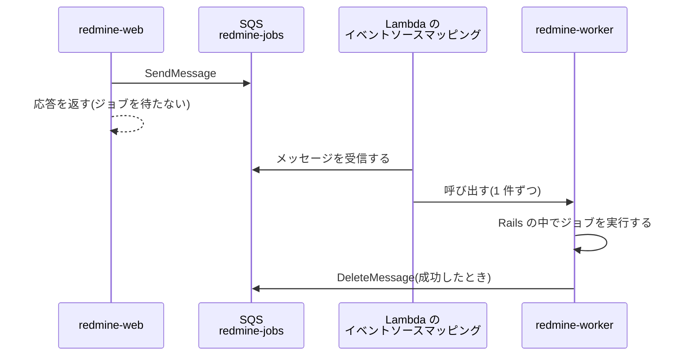
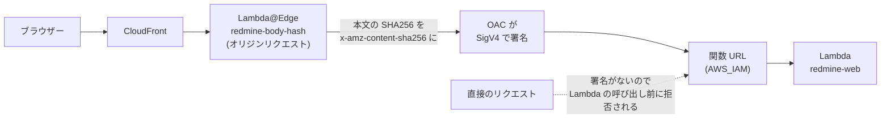
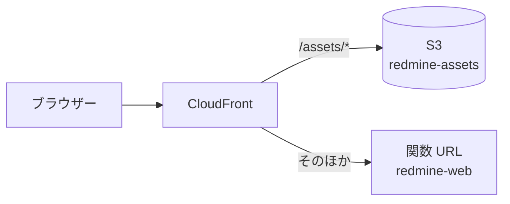

# Lambda Event Functions での Redmine の実行

Redmine (Rails と Puma) を、Lambda Event Functions で実行するための設計です。Event Functions は、イベントを 1 件ずつ受け取って処理する従来の Lambda です。HTTP リクエストは、Lambda Web Adapter が通常の HTTP に変換して Puma に渡します。

この資料の仕様は、2026-11-08 時点の公式情報と、Redmine 7.0.3 と Rails 8.1.4 のソースコードで確認したものです。出典は [sources.md](sources.md) にあります。

<a id="function-settings"></a>

## 関数設定

| 項目 | 値 | 理由 |
| --- | --- | --- |
| 関数 | `redmine-web` (画面と API)、`redmine-worker` (ActiveJob のジョブ。下の「バックグラウンドジョブ」)、`redmine-task` (rake とメールの取り込み。[tasks.md](tasks.md))。3 つとも同じイメージ | 画面は 60 秒、ジョブとタスクは 15 分まで実行する |
| パッケージタイプ | コンテナイメージ (ECR) | zip は展開後 250 MB まで。Redmine と gem と ImageMagick は収まらない見込み。イメージは 10 GB まで |
| アーキテクチャ | arm64 | x86 より実行時間の単価が安い (ap-northeast-1 で 1 GB 秒あたり 0.0000133334 ドルと 0.0000166667 ドル) |
| メモリ | 2,048 MB | CPU はメモリに比例して割り当てられる。Rails の起動とサムネイルの生成を速くする。実測で見直す |
| タイムアウト | 60 秒 (`redmine-web`)、900 秒 (`redmine-worker`、`redmine-task`) | CloudFront のオリジンの応答タイムアウトに合わせる (下記) |
| `/tmp` | 512 MB (デフォルト。追加料金なし) | 256 MB までの添付ファイルのキャッシュ ([attachments.md](https://redmine-kit.github.io/redmine_aws_s3/ja/attachments.html#the-tmp-cache))、PDF の出力。登録時に Lambda がファイル全体を読まず (SHA256 は S3 が確認する)、ダウンロードも Lambda を経由しないので、デフォルトで足りる |
| 予約された同時実行 | 10 (`redmine-web`) | 負荷と費用の上限にする |
| VPC | VPC のプライベートサブネット (2 つの AZ) | RDS には VPC 内からしか接続できない。S3 にはゲートウェイエンドポイントで、SES、SSM、SQS には VPC エンドポイントか NAT インスタンスで接続する ([rds.md](rds.md#routes-out-of-the-vpc)) |

<a id="image"></a>

## イメージ

Lambda の Ruby ベースイメージ `public.ecr.aws/lambda/ruby:4.0` をベースにし、Redmine 7.0.3 と、ImageMagick などの依存関係をインストールします。`redmine-web`、`redmine-worker`、`redmine-task` は同じイメージを使い、関数の環境変数 `REDMINE_ROLE` (`web`、`worker`、`task`) で、起動するプロセスを切り替えます ([tasks.md](tasks.md#how-one-image-runs-everything))。

<a id="choosing-the-base"></a>

### ベースイメージの選定

Redmine は、zip ではなくコンテナイメージで実行します。zip は展開後 250 MB までで、Redmine と gem に加えて、ImageMagick、Ghostscript、Pandoc の実行ファイルを含めるのが難しいためです。

| ベースイメージ | 利点 | 欠点 | 判断 |
| --- | --- | --- | --- |
| Lambda の Ruby ベースイメージ (`public.ecr.aws/lambda/ruby:4.0`) | Lambda 用のイメージで、Lambda と同じ OS (Amazon Linux 2023) と Ruby。ランタイムインターフェイスクライアントが含まれているので、タスク用の関数をそのまま作成できる。読み取り専用のファイルシステムと、権限の少ないユーザーでの実行を前提に作られている | Redmine と依存関係を自分でインストールし、Redmine の更新にも自分で追随する | 採用 |
| 公式の Redmine イメージ (`redmine:7.0.3`、Debian 13) | Redmine のリリースに合わせて更新され (7.0.3 は 2026-11-06)、依存関係がそろっている | Docker での実行を前提とした作り。起動のたびに設定ファイルを書き、migration を実行し、gem をインストールするエントリーポイントを外す必要がある。`HOME` が書き込めない場所にある。ランタイムインターフェイスクライアントがない。Pandoc がない。使わない Mercurial と Bazaar のクライアントも含まれている (docker-library/redmine の `7.0/trixie/Dockerfile`。2026-11-10 に確認) | 不採用 |

コンテナイメージの関数では、どちらのベースイメージでも、Lambda は OS を自動で更新しません。ベースイメージが更新されたら、イメージを再ビルドしてデプロイします。

<a id="what-was-checked-in-the-base-image"></a>

### ベースイメージの確認結果

2026-11-08 に、ローカルの Docker で arm64 のイメージを実行して確認しました。

| 項目 | 内容 |
| --- | --- |
| OS | Amazon Linux 2023 (2023.12.20261026) |
| Ruby | 4.0.9。Redmine の wiki は、wiki の描画が遅くなる 4.0.0〜4.0.3 を避け、4.0.4 以上を推奨している。`ruby:3.4` のイメージは 3.4.12 |
| エントリーポイント | `/lambda-entrypoint.sh`。ランタイムインターフェイスクライアントは `/var/runtime` にある |
| パッケージ管理 | `microdnf` (`dnf` もある) |

Amazon Linux 2023 の標準リポジトリで、次のパッケージをインストールできることを確認しました (`microdnf repoquery`)。

| 用途 | パッケージ | バージョン |
| --- | --- | --- |
| サムネイル、ガントチャートの PNG | `ImageMagick` | 6.9.13 (2026-11-09 にイメージにインストールされたもの)。Redmine が呼び出す `convert` がある |
| PDF のサムネイル | `ghostscript`<br>`urw-base35-fonts` | 9.56.1 |
| PostgreSQL への接続 | `libpq` (実行時)、`libpq-devel` (`pg` gem のビルド) | 15.0 |
| ガントチャートの PNG の日本語 | `ipa-gothic-fonts` | 003.03。Redmine の `minimagick_font_path` で指定する |
| リポジトリ ([下記](#repositories)) | `subversion`<br>`git-core` (イメージにはコマンドだけをコピーする) | 1.14.5<br>2.50.1 (2026-11-10) |
| gem のビルド | `gcc`<br>`make`<br>`libyaml-devel` | — |
| ファイルの展開 | `tar`<br>`gzip` | — |

Pandoc は Amazon Linux 2023 のリポジトリにないので (`microdnf repoquery` で検索)、Pandoc 公式の Linux arm64 用の実行ファイル (`pandoc-3.13-linux-arm64.tar.gz`、2026-10-26) を、SHA256 を確認してインストールします。Redmine 7.0 で xlsx と pptx をプレビューするには、3.8.3 以上が必要です。ImageMagick 6 には、Redmine がサムネイルの生成に使う `convert` コマンドがあるので (`lib/redmine/thumbnail.rb`)、そのまま使えます。

<a id="shape-of-the-dockerfile"></a>

### Dockerfile の構成

```dockerfile
FROM public.ecr.aws/lambda/ruby:4.0@sha256:<digest> AS build
# gcc、make、libpq-devel、libyaml-devel、tar、gzip を入れる
# Redmine 7.0.3 の tar.gz を redmine.org から取り、SHA256 を確認して /var/task/redmine に展開する
# config/database.yml、Gemfile.local を入れ、gem を vendor/bundle に入れる(開発用とテスト用は除く)
# アセットを書き出す(bin/rails assets:precompile)

FROM public.ecr.aws/lambda/ruby:4.0@sha256:<digest>
# ImageMagick、ghostscript、urw-base35-fonts、libpq、ipa-gothic-fonts を入れる
# subversion と git-core を入れたステージから、svn、svnadmin、git と、必要なライブラリをコピーする
# Pandoc の実行ファイルを入れる
# RDS の CA 証明書バンドル(global-bundle.pem)をダウンロードし、SHA256 を確認して /var/task/rds-global-bundle.pem に置く
# build ステージから /var/task/redmine を取る(gcc などのビルドツールは入れない)
# 設定ファイル、独自のプラグイン(plugins/)、起動スクリプト、タスクハンドラーを入れる
# tmp を /tmp/redmine へのシンボリックリンクにする
COPY --from=public.ecr.aws/awsguru/aws-lambda-adapter:1.1.0@sha256:<digest> /lambda-adapter /opt/lambda-web-adapter/lambda-adapter
COPY image/extensions/lambda-adapter /opt/extensions/lambda-adapter
ENTRYPOINT ["/var/task/bin/start"]
```

- **2 つのステージに分ける:** gem のビルドに使う gcc などは、実行用のイメージに含めません。イメージが小さくなり、起動時のイメージの取得も短くなる見込みです。
- **1 つのイメージ:** ビルドも push も 1 回で、3 つの関数で同じコードが動きます。
- **ファイル:** Dockerfile は `image/Dockerfile` で、`bin/build-image` でビルドします。gem のバージョンは `image/Gemfile.lock` で固定し、`bin/update-gems` が arm64 の Linux 用にだけ生成します。
- **エントリーポイント (`/var/task/bin/start`):** `REDMINE_ROLE=web` なら Puma を起動します。`worker` と `task` なら、ベースイメージの `/lambda-entrypoint.sh` で、それぞれのハンドラーを実行します。どれでもない場合は、エラーで終了します。
- **拡張機能 (`/opt/extensions/lambda-adapter`):** 小さなシェルスクリプトです。`REDMINE_ROLE=web` の場合だけ、`/opt/lambda-web-adapter/` に置いた実際の Lambda Web Adapter を起動します。`worker` と `task` の場合は、何もしない拡張機能として登録して待機します ([tasks.md](tasks.md#how-one-image-runs-everything))。
- **digest で固定する:** ベースイメージと Lambda Web Adapter は、タグではなく digest で参照します。Redmine、Pandoc、RDS の CA 証明書バンドルは、ダウンロードしたファイルの SHA256 を確認します。
- **シングルアーキテクチャのイメージにする:** Lambda は、マルチアーキテクチャのイメージを受け付けません。arm64 だけのイメージを push します。Docker の buildx は、デフォルトで来歴情報 (provenance) を付けて、イメージをインデックス形式にすることがあるので、付けない設定でビルドします (推測。最初のビルドで確認する)。
- **ECR イメージを削除しない:** Lambda は、関数が使っているイメージを ECR から定期的に再取得します。イメージが削除されていると、関数は `Failed` になります。ECR のライフサイクルポリシーでは、直近の数個のイメージを保持します。

<a id="adapting-redmine-to-lambda"></a>

### Lambda 向けの Redmine の調整

| 項目 | Lambda での構成 | 理由 |
| --- | --- | --- |
| 配置場所 | `/var/task/redmine` | Lambda のベースイメージは、関数のコードを `/var/task` (`LAMBDA_TASK_ROOT`) に置く |
| `config/database.yml` | ビルド時に追加する。`adapter:` はリテラルで `postgresql` と書く。接続先、データベース名、ユーザー名、パスワードは、環境変数から ERB で読む (`REDMINE_DB_HOST`、`REDMINE_DB_NAME`、`REDMINE_DB_USERNAME`、`REDMINE_DB_PASSWORD`)。TLS は、イメージ内の RDS の CA 証明書バンドルで `verify-full` にする (`sslrootcert: /var/task/rds-global-bundle.pem`) | Redmine の `Gemfile` は、`config/database.yml` の `adapter:` の値で、インストールするデータベースの gem を決める。`adapter:` の値を ERB にすると、Gemfile も ERB を評価するので、リテラルで書いておく方が確実。RDS for PostgreSQL なので、`pg` gem を使う |
| `Gemfile.local` | `puma` (Redmine はテスト用のグループにしか含めていない) と、GitHub Packages のプラグインの gem。Bundler が早い段階で読み込む (その `boot/` のファイル) `redmine_aws_ssm`、`redmine_aws_lambda`、`redmine_aws_sqs`、`redmine_aws_ses` と、`require: false` の `redmine_aws` (どのプラグインも必要とする) と `redmine_aws_s3` ([architecture.md](architecture.md#distribution)) | Redmine は `Gemfile.local` の gem も読み込む。プラグインが使う gem (`redmine_aws_sqs` の `aws-activejob-sqs`、`redmine_aws_ses` の `aws-actionmailer-ses`、`redmine_aws_s3` の `aws-sdk-s3` など) は、そのプラグインの gemspec の依存関係にする |
| 独自のプラグイン | `redmine_aws`、`redmine_aws_lambda`、`redmine_aws_s3`、`redmine_aws_ses`、`redmine_aws_sqs`、`redmine_aws_ssm`。どれも GitHub Packages の gem で、インストールしたディレクトリを、アセットのビルド前に `plugins/` にリンクし、プラグインのスクリプトがマニフェストに含まれるようにする | 拡張は独自のプラグインにする ([architecture.md](architecture.md#the-plugins)) |
| gem | ビルド時に `vendor/bundle` にインストールし、実行時にはインストールしない (`BUNDLE_DEPLOYMENT`、`BUNDLE_WITHOUT=development:test`) | 実行時には書き込めない |
| ファイルのアクセス権限 | どのユーザーからも読めるようにする | Lambda は、デフォルトの権限の少ないユーザーで実行する。このユーザーが、実行に必要なすべてのファイルを読める必要がある |
| `HOME` | `/tmp` | Bundler、ImageMagick、Pandoc がホームディレクトリに書き込むことがある (推測) |

<a id="lambda-web-adapter-settings"></a>

### Lambda Web Adapter の設定

Lambda Web Adapter は、AWS が公開している拡張機能です。Lambda のイベントを HTTP リクエストに変換し、イメージ内の HTTP サーバーに渡します。最新バージョンは 1.1.0 (2026-09-18) です。イメージには含めますが、起動するのは `redmine-web` だけです (上の「Dockerfile の構成」)。

| 環境変数 | 値 | 理由 |
| --- | --- | --- |
| `AWS_LWA_PORT` | `3000` | Puma が待ち受けるポート |
| `AWS_LWA_READINESS_CHECK_PROTOCOL` | `tcp` | Redmine には軽量なヘルスチェック用のパスがない。ポートが開いたら準備完了とみなす |
| `AWS_LWA_ASYNC_INIT` | `true` | 初期化の 10 秒を超えても、最初のリクエストの中で起動を待ち続ける (下記) |
| `AWS_LWA_INVOKE_MODE` | `buffered` (デフォルト) | Redmine の応答は、ストリーミングを必要としない。下の圧縮は `buffered` の場合だけ使える |
| `AWS_LWA_ENABLE_COMPRESSION` | `true` | 応答を gzip などで圧縮する (`buffered` の場合だけ使える)。画面の応答はキャッシュしない設定 (`CachingDisabled`) なので、CloudFront 側では圧縮されない見込み。Lambda の応答が小さくなり、6 MB の制限までの余裕が増え、画面の表示も速くなる。CloudFront を経由して、ブラウザーに圧縮されたまま配信されるかは、構築時に確認する |

<a id="start-up-script-and-puma"></a>

### 起動スクリプトと Puma

`REDMINE_ROLE=web` の場合、起動スクリプトは次の処理を行います。

1. `/tmp/redmine` の下に、`files`、`thumbnails`、`imports`、`cache`、`pids` のディレクトリを作成します。
2. `bundle exec puma` で Puma を起動します。

`REDMINE_ROLE` が `worker` か `task` の場合は、1 のあとで、Puma の代わりにハンドラーを実行します ([tasks.md](tasks.md#how-one-image-runs-everything))。

- **プロセスとスレッド:** ワーカープロセスは使わず (`-w 0`)、スレッドは 1 つにします (`-t 1:1`)。Event Functions の 1 つの環境は、同時に 1 件のリクエストしか受け付けないためです。
- **待ち受け:** `127.0.0.1:3000` で待ち受けます。
- **停止:** Lambda が環境を停止するときに、Puma を待たずに終了してもかまいません。リクエストの途中で停止することはなく、ジョブは SQS に送って `redmine-worker` が実行するためです。

<a id="waiting-for-start-up"></a>

## コールドスタート

使われていない環境は、Lambda が停止します。そのあとの最初のリクエストは、新しい環境の起動を待ちます。

起動にかかる時間は、まだ計測していません。Rails の読み込み、データベースへの接続、イメージの取得が含まれ、最初に計測する項目です。初期化は 10 秒までで、超えると、Lambda は最初の呼び出し時に、関数のタイムアウトまでの時間で初期化をやり直します。`AWS_LWA_ASYNC_INIT=true` にすると、Lambda Web Adapter が 9.8 秒で初期化を完了したことにし、最初のリクエストの中で Puma の起動を待ち続けます。

1 つの環境は 1 件ずつしか処理しないので、1 つの画面が同時に多くのリクエストを送ると、その数だけ環境が起動します。添付ファイルとサムネイルを S3 から直接読み込ませるのは、このためでもあります ([attachments.md](https://redmine-kit.github.io/redmine_aws_s3/ja/attachments.html#thumbnails))。

<a id="keeping-environments-warm"></a>

### ウォームアップ

一般的な方法は、この設計には合いません。SnapStart は Java、Python、.NET だけで、Ruby には対応していません。Provisioned Concurrency で 2 GB の環境を 1 つ確保し続けると、ap-northeast-1 の arm で月額約 23 ドルかかり (2 GB × 1 GB 秒あたり 0.0000043068 ドル × 2,628,000 秒 (730 時間))、予算に合いません。

代わりに、必要なら EventBridge Scheduler から、業務時間のあいだ 5 分ごとに `redmine-web` を呼び出します。HTTP ではないこのイベントは、Lambda Web Adapter が `/events` への POST として渡し、プラグインの Rack ミドルウェアが、データベースにアクセスせずに 204 を返します。環境が維持される時間は公式に記載されていないので、効果を計測してから決めます。

<a id="read-only-file-system"></a>

## 読み取り専用のファイルシステム

Event Functions で書き込めるのは `/tmp` だけです。Redmine が実行中に書き込む場所を、次のように振り分けます。

| Redmine の場所 | 用途 | 振り分け先 |
| --- | --- | --- |
| `files/` | 添付ファイル、Office のプレビューのキャッシュ (`files/derived_cache/`) | `/tmp/redmine/files`。S3 のキャッシュとして使う。`attachments_storage_path` で指定する |
| `tmp/thumbnails/` | サムネイルの作業 | `/tmp/redmine/thumbnails`。生成したサムネイルは S3 に置く |
| `tmp/imports/` | CSV インポートのファイル | `/tmp/redmine/imports`。S3 にも置き、別の環境では S3 から取得する |
| `tmp/` のほか (`tmp/cache/`、`tmp/pids/` など) | PDF 出力の一時ファイル | `/tmp/redmine` (環境ごと) |
| `log/` | ログ | 標準出力 (`RAILS_LOG_TO_STDOUT=1`)。CloudWatch Logs に送られる |
| `db/schema.rb` | migration 後のスキーマの書き出し | 書き出さない ([tasks.md](tasks.md#notes-on-the-read-only-file-system)) |
| `public/assets/` | CSS と JavaScript | ビルド時に書き出す (下記) |
| `config/` | 設定ファイル | ビルド時に追加する。値は環境変数から読む |

イメージの `tmp` は `/tmp/redmine` へのシンボリックリンクにし、起動スクリプトが `/tmp/redmine` を作成します。`Import#filepath` が `Rails.root/tmp/imports` に固定されているので、この構成にしています。アセットの書き出しが `tmp/` を使うことがあるので、リンクを作成するのは書き出しのあとです。添付ファイル、サムネイル、インポートファイルと S3 とのやり取りは [attachments.md](https://redmine-kit.github.io/redmine_aws_s3/ja/attachments.html) にあります。

Redmine は、起動時にアセットが古いと判断すると `public/assets` に書き出します (`config.assets.redmine_detect_update`)。この設計ではビルド時にアセットを書き出し、この確認は無効にします。書き出したアセットは S3 から配信します (下の「アセットの配信」)。

<a id="settings-and-secrets-ssm-parameter-store"></a>

## 設定とシークレット (SSM Parameter Store)

`SECRET_KEY_BASE` などのシークレットは、SSM Parameter Store に保存し、Redmine が起動時に読み込みます。Lambda の環境変数には、シークレットを置きません。データベースパスワードも、ここに保存します。

<a id="parameters"></a>

### パラメーター

プラグインの [Redmine AWS SSM](https://redmine-kit.github.io/redmine_aws_ssm/ja/) が、Rails が `config/database.yml` と `SECRET_KEY_BASE` を読む前に、`/<instance>/env/` 直下のパラメーターを、すべて環境変数に読み込みます。読み込み方とタイミング、読み込まないものは、プラグインの資料にあります。パラメーターを追加すれば、コードを変更せずに環境変数が増えます。下の表は、インスタンス名が `redmine` の場合の例です。

| パラメーター | タイプ | 内容 | 書き込み元 |
| --- | --- | --- | --- |
| `/redmine/env/REDMINE_DB_HOST` | String | RDS のエンドポイント (`<インスタンスの ID>.<ランダムな文字>.ap-northeast-1.rds.amazonaws.com`)。シークレットではないが、Redmine の設定をまとめて読むためにここに置く | インスタンスのスタック |
| `/redmine/env/REDMINE_DB_PASSWORD` | SecureString | データベースユーザーのパスワード ([rds.md](rds.md#settings)) | 初回の `bin/deploy` ([deploy-config.md](deploy-config.md#secrets)) |
| `/redmine/env/SECRET_KEY_BASE` | SecureString | Rails のシークレットキー | 同上 |
| `/redmine/env/REDMINE_CLOUDFRONT_PRIVATE_KEY` | SecureString | 添付ファイルの署名付き URL の秘密鍵 ([Redmine AWS S3](https://redmine-kit.github.io/redmine_aws_s3/ja/setup.html#configuration)) | 同上 |

インスタンスのスタックが、3 つの関数に環境変数 `REDMINE_SSM_PATH=/<instance>/env/` を渡し、実行ロールには、そのパスだけに対する `ssm:GetParametersByPath` を許可します ([iam.md](iam.md#permissions-common-to-the-three-functions))。十分早く読み込まれるように、プラグインは gem でもあり、`image/Gemfile.local` が GitHub Packages から追加します。イメージテストでは、データベースのホストを SSM (moto) だけに置いても、`db:migrate`、web の画面、worker のジョブが成功するので、`config/database.yml` より前に読み込めていることが分かります (2026-11-09。[testing.md](testing.md#image-tests))。

秘密でない設定 (バケット名、ドメイン、リージョン、データベース名、データベースのユーザー名) は、CloudFormation から関数の環境変数で渡します。イメージは、`REDMINE_DB_NAME` (デフォルトは `redmine`)、`REDMINE_DB_USERNAME` (デフォルトは `redmine`)、`REDMINE_JOBS_QUEUE_URL` (ジョブキュー)、`REDMINE_HOST` (ドメイン) として読みます。`REDMINE_DB_PORT` と `REDMINE_DB_SSLMODE` (デフォルトは `verify-full`) は、ローカルのテストでだけ変更します。

SecureString は AWS マネージドキー (`aws/ssm`) で暗号化します。このキーで実行ロールに `kms:Decrypt` が必要かは、構築時に確認します。実行環境は起動時に 1 回だけパラメーターを読むので、値を変更したら、関数の設定を更新して新しい環境を起動させます。

<a id="how-they-reach-the-function"></a>

### 接続経路

`redmine-web`、`redmine-worker`、`redmine-task` は VPC 内にあるので、SSM の VPC エンドポイントか NAT インスタンスを経由し、HTTPS と IAM 認証で接続します ([rds.md](rds.md#routes-out-of-the-vpc))。

<a id="rails-and-redmine-settings"></a>

## Rails と Redmine の設定

Rails の設定は、どこに書くかで有効になるかどうかが変わります。

- **`production.rb` が設定している項目:** `config/additional_environment.rb` は `config/application.rb` の中で読み込まれ、そのあとで `production.rb` が読み込まれます。`production.rb` が設定している項目は、`additional_environment.rb` に書いても上書きされます。
- **初期化の早い段階で使う項目:** Rails は、`config/initializers/` を読み込む前にキャッシュを作成します (`initialize_cache`)。キャッシュの設定は、`config/initializers/` に書いても反映されません。

| 項目 | 説明 | 値 | 設定場所 |
| --- | --- | --- | --- |
| `config.cache_store` | Rails 8.1 のデフォルトは `tmp/cache/` のファイル。`production.rb` は設定していない。キャッシュするデータ、調整、共有キャッシュは [cache.md](cache.md)、セッションは [session.md](session.md) | `:memory_store` (環境ごと、上限 64 MB) | `additional_environment.rb` |
| `config.active_job.queue_adapter` | デフォルトの `:async` は、環境が停止するとジョブが失われる (下記)。`production.rb` は設定していない | `:inline`。`REDMINE_JOBS_QUEUE_URL` がある場合 (Lambda 上)、`redmine_aws_sqs` が `:sqs` にする | `additional_environment.rb` とプラグイン |
| `config.active_record.dump_schema_after_migration` | migration 後の `db/schema.rb` の書き出しを無効にする。`production.rb` ではコメントアウトされている | `false` | `additional_environment.rb` |
| `config.hosts` | Rails が受け付けるホスト名。Rails は `Host` と `X-Forwarded-Host` の両方をこれと照合する (下の「ホストとスキーム」) | Redmine のドメインだけ (`REDMINE_HOST`)。関数 URL のホスト名は入れない | `additional_environment.rb` |
| `config.filter_redirect` | 添付ファイルの署名付き URL へのリダイレクトを、ログに `[FILTERED]` と記録させる ([security.md](security.md#logs)) | CloudFront のドメインの `/files/` と `/tmp/` の下の URL | `additional_environment.rb` |
| `config.action_mailer.raise_delivery_errors` | `production.rb` が `false` にしている。送信エラーでジョブを失敗させ、再試行できるようにする ([sending.md](https://redmine-kit.github.io/redmine_aws_ses/ja/sending.html#raising-errors)) | `redmine-worker` でだけ `true` | プラグイン `redmine_aws_ses` |
| `config.assets.redmine_detect_update` | `production.rb` が `true` にしている | `false` | プラグイン `redmine_aws_lambda` ([その README](https://redmine-kit.github.io/redmine_aws_lambda/ja/#running-on-lambda)) |
| `attachments_storage_path` | [attachments.md](https://redmine-kit.github.io/redmine_aws_s3/ja/attachments.html#the-tmp-cache) | `/tmp/redmine/files` | `configuration.yml` |
| `email_delivery` | [mail.md](mail.md) | `:ses_v2` (SES の API) | `configuration.yml` |
| `webhook_blocklist` | webhook を、内部のアドレスや、メタデータサービスに使われるアドレス範囲に送らせない ([ai.md](ai.md#event-notifications-redmines-standard-webhooks))。VPC エンドポイント構成では、すべてのアドレスにする ([rds.md](rds.md)) | プライベートアドレス (`10.0.0.0/8`、`172.16.0.0/12`、`192.168.0.0/16`、`fc00::/7`)、ループバックアドレス (`127.0.0.0/8`、`::1/128`)、リンクローカルアドレス (`169.254.0.0/16`、`fe80::/10`) | `configuration.yml` |

| キー | 説明 | パラメーター |
| --- | --- | --- |
| `RAILS_ENV` | Rails の環境 | `production` |
| `RAILS_LOG_TO_STDOUT` | ログを標準出力に出力する。この変数があると `production.rb` が出力する | `1` |
| `SECRET_KEY_BASE` | セッションの Cookie などを暗号化するキー。Rails 8.1 は環境変数か credentials から読む。`config/secrets.yml` は読まれない | 起動時に SSM Parameter Store から読む (上の「設定とシークレット」) |
| `REDMINE_DB_HOST`<br>`REDMINE_DB_PASSWORD` | データベースの接続先とパスワード。`config/database.yml` が読む | 起動時に SSM Parameter Store から読む (上の「設定とシークレット」) |
| `RUBY_YJIT_ENABLE` | YJIT を有効にする。Lambda の Ruby のドキュメントが、Rails には YJIT を推奨している | `1` |

`configuration.yml` は ERB で評価されるので、値は環境変数から読めます。

<a id="settings-in-redmines-administration"></a>

### Redmine の管理画面の設定

| 項目 | 説明 | 値 |
| --- | --- | --- |
| ホスト名とパス、プロトコル | メール本文の URL に使う | Redmine のドメイン、HTTPS |
| 一括ダウンロードの合計ファイルサイズの上限 (`bulk_download_max_size`) | zip は S3 の一時ファイルにして返すので、6 MB の制限を受けない ([attachments.md](https://redmine-kit.github.io/redmine_aws_s3/ja/attachments.html#downloading-all-attachments))。生成時間が 60 秒に収まるかを計測する | Redmine のデフォルト (100 MB) のまま |
| 管理者のパスワード | 初期の管理者は `admin`、パスワードも `admin` | 初期データの投入後すぐに変更する |
| 認証が必要 (`login_required`) | Redmine を、ログインしていないユーザーに公開しない。Redmine の標準の `/robots.txt` も、検索エンジンにすべてを拒否する (`Disallow: /`) ようになる | 有効を推奨 |

<a id="background-jobs"></a>

### バックグラウンドジョブ

Redmine は、通知メール (`deliver_later`)、プロジェクトの削除 (`DestroyProjectJob`、`DestroyProjectsJob`)、webhook (`WebhookJob`) を ActiveJob で非同期に実行します。Redmine 7.0.3 のソースコードには、遅延実行の指定 (`set(wait: …)`) はありません。デフォルトのアダプター `:async` は同じプロセス内のスレッドで動くので、Lambda では、応答を返したあとに環境が停止するとジョブが失われます。

そこで、AWS 公式の gem `aws-activejob-sqs` で、ジョブを SQS キューに送り、ジョブ用の関数 (`redmine-worker`) で実行します。



| 項目 | 内容 |
| --- | --- |
| gem | `aws-activejob-sqs` 1.2.0 (2026-08-17)。AWS 公式。`activejob` 7.1 以上 |
| キュー | 標準キュー 1 つ (`redmine-jobs`)。デッドレターキュー (`redmine-jobs-dlq`) を設定し、3 回受信して失敗したメッセージを移動する |
| ジョブ用の関数 | `redmine-worker`。`redmine-web` と同じイメージで、`REDMINE_ROLE=worker`。Puma は起動しない |
| ハンドラー | gem のハンドラー (`redmine/config/environment.Aws::ActiveJob::SQS::LambdaHandler.job_handler`)。プラグインが、失敗を記録するためにラップする。Rails を読み込んでから、メッセージごとにジョブを実行し、成功したメッセージを削除する。gem は、イベントの ARN から組み立てたキューの URL で、メッセージを自分で削除する |
| プラグイン | `redmine_aws_sqs` が、キューアダプターを設定し (`REDMINE_JOBS_QUEUE_URL` がある場合だけ)、Redmine のキューを `redmine-jobs` に向け、Redmine とプラグインのジョブクラスだけを実行させ、最後に失敗したジョブを記録し、「ジョブ」画面を追加する ([プラグインの資料](https://redmine-kit.github.io/redmine_aws_sqs/ja/)) |
| バッチサイズ | 1。ハンドラーは、途中のジョブが失敗すると例外で終了するので、1 件ずつにして、失敗したものだけが再試行されるようにする |
| 可視性タイムアウト | 関数のタイムアウト (900 秒) より長くする |

`redmine-worker` は、環境が残っているあいだ Rails を読み込んだままにして、その中でジョブを実行します。ジョブのたびに Rails を再起動することはありません。画面のリクエストは、ジョブを SQS に送った時点で応答を返すので、通知メールの送信を待ちません。`redmine-worker` の予約された同時実行は 3 です。ジョブが一度に多く実行されて、データベースの接続数と費用が増えすぎないようにするためです。

ランタイムインターフェイスクライアントは、ハンドラーが Rails を読み込む前に、json や uri など Ruby に標準で含まれている gem を読み込みます。そのあとで Bundler が、Redmine の bundle の新しいバージョンを拒否します。そこで `redmine-worker` は、ランタイムが動き出す前に Redmine の bundle を準備します (`RUBYOPT=-rbundler/setup`。2026-11-09 にランタイムインターフェイスエミュレーターで確認)。

<a id="retries-and-duplicates"></a>

#### 再試行と重複

ジョブが失敗すると、SQS は可視性タイムアウトのあとでメッセージを再配信します。3 回失敗したらデッドレターキューに移動し、件数をアラームで通知します。プラグインは最後の受信でジョブを記録するので、管理画面から再送信できます ([admin.md](https://redmine-kit.github.io/redmine_aws_sqs/ja/admin.html#jobs))。

標準キューは、同じメッセージを 2 回配信することもあります。そのため通知メールがまれに 2 通配信されますが、この規模では許容します。gem は 15 分までの遅延実行の指定に対応していますが、Redmine 本体は使っていません。

<a id="webhooks"></a>

#### webhook

Redmine 7.0 は webhook をジョブ (`WebhookJob`) で送信するので、送信するのは `redmine-worker` です。`redmine-worker` は VPC 内で動くので、webhook を送信できるのは NAT インスタンス構成の場合だけです ([rds.md](rds.md#routes-out-of-the-vpc))。VPC エンドポイント構成では、すぐに失敗します (上の `webhook_blocklist`)。

webhook は、Redmine のデフォルトでは無効です (`webhooks_enabled` が 0)。管理者が有効にし、権限 (`use_webhooks`) を持つユーザーが自分の webhook を作成します。送信先がエラーを返すか、Redmine のタイムアウトの 60 秒以内に接続できないと、ジョブは失敗し、上の再試行を経て失敗の記録に残ります。管理画面の「ジョブ」から再送信できます。

Redmine は、送信前に送信先のホスト名を IP アドレスに名前解決し、`webhook_blocklist` の範囲なら送信しません。そのうえで解決したアドレスに直接接続するので、途中で DNS の応答を差し替える攻撃も防げます (`lib/webhook_endpoint_validator.rb`、`Webhook::Executor`)。この設計では、プライベートアドレスと、メタデータのアドレス `169.254.169.254` を含むリンクローカルアドレスを拒否します ([ai.md](ai.md#event-notifications-redmines-standard-webhooks))。

<a id="other-jobs-and-the-route-to-sqs"></a>

#### その他のジョブと SQS への接続経路

大きなプロジェクトの削除は `redmine-worker` で実行されるので、15 分まで使えます。Redmine の rake タスク (期日の通知など) は、メールをその場で送信する方式 (`Mailer.with_synched_deliveries`) に切り替えるので、ジョブをキューに入れません。`redmine-web` と `redmine-worker` は、SQS の VPC エンドポイントか NAT インスタンスを経由し、IAM 認証で SQS に接続します ([rds.md](rds.md#routes-out-of-the-vpc))。

<a id="other-options-considered"></a>

#### 検討したほかの方式

| 方式 | 利点 | 欠点 | 判断 |
| --- | --- | --- | --- |
| SQS だけ (この設計) | AWS 公式の gem で、独自のコードが不要。再試行、デッドレターキュー、遅延ジョブがそろう。Rails を読み込んだまま実行できる | VPC エンドポイント構成では、SQS のエンドポイントで月額約 10.2 ドルかかる | 採用 |
| S3 に書き込み、S3 のイベントを EventBridge で受けて関数を呼び出す | EventBridge が配信を再試行する。VPC エンドポイント構成でも、S3 のゲートウェイエンドポイント (無料) だけで済む | アダプターとジョブの実行を独自に実装する。遅延ジョブはできない。ジョブごとに Rails を起動する方式になりやすい | 不採用。費用を最優先する場合の代替案 |
| EventBridge の `PutEvents` に送る | ルールで送信先を選べる | アダプターを独自に実装する。キューの機能 (再受信、デッドレターキュー) は SQS の方がそろう | 不採用 |
| `:inline` (リクエストの中で実行する) | 何も追加しない | 画面のリクエストがメールの送信を待つ。失敗したメールを再試行しない。60 秒を超える削除が完了しない | 不採用 |

<a id="database-connections"></a>

## データベース接続

1 つの環境が 1 本の接続を持ちます (`pool: 1`)。予約された同時実行 (`redmine-web` で 10、`redmine-worker` で 3、`redmine-task` で 2) から、接続は合計 15 本ほどです。停止した環境の接続は環境が破棄されるまで残りますが、合計は予約された同時実行の範囲に収まります。小さな RDS インスタンスの最大接続数はメモリで決まります。上限と RDS Proxy の判断は [rds.md](rds.md) にあります。

3 つの関数は 1 つのデータベースユーザーを使い、そのパスワードは起動時に SSM Parameter Store から読みます (`REDMINE_DB_PASSWORD`。[rds.md](rds.md#settings))。接続は `sslmode=verify-full` にし、サーバー証明書を、イメージ内の RDS の CA 証明書バンドルで検証します。

<a id="cloudfront-and-function-urls"></a>

## CloudFront と関数 URL

関数 URL は、Lambda を HTTPS で直接呼び出せる URL です。カスタムドメインと証明書は、前段に置く CloudFront で設定します。関数 URL は IAM 認証にし、CloudFront の OAC (オリジンアクセスコントロール) で署名したリクエストだけを受け付けます。



- **関数 URL の認証:** `AuthType: AWS_IAM` にします。関数のリソースベースのポリシーで、CloudFront (`cloudfront.amazonaws.com`) に、`lambda:InvokeFunctionUrl` と `lambda:InvokeFunction` の両方を、このディストリビューションからのリクエスト (`AWS:SourceArn`) に限って許可します (CloudFront のドキュメント。[iam.md](iam.md#resource-based-policies))。署名のない直接のリクエストは、関数の呼び出し前に拒否されるので、費用も同時実行数も消費しません。
- **OAC:** オリジンタイプは Lambda、署名は常に行う (`SigningBehavior: always`、`sigv4`)。
- **本文のハッシュ:** 関数 URL は、署名のない本文 (`UNSIGNED-PAYLOAD`) を受け付けないので、PUT と POST では、本文の SHA256 を `x-amz-content-sha256` に入れて送る必要があります (CloudFront のドキュメント)。ブラウザーで表示する Redmine の画面のフォームは、このヘッダーを付けません。そこで、オリジンリクエストで実行される Lambda@Edge 関数 `redmine-body-hash` が、本文からハッシュを計算して追加します。そのあとで、OAC がリクエストに署名します。
- **CloudFront Functions では実装できない:** CloudFront Functions のリクエストのデータには、本文が含まれません (メソッド、URI、クエリ文字列、ヘッダー、Cookie だけ)。本文を読めるのは Lambda@Edge だけです。
- **`Host`:** 関数 URL には、ビューワーの `Host` を転送しません (オリジンリクエストポリシーは `AllViewerExceptHostHeader`)。OAC は関数 URL のホスト名で署名します。Redmine のドメインとスキームは、オリジンのカスタムヘッダー `X-Forwarded-Host` と `X-Forwarded-Proto` で渡します (下の「ホストとスキーム」)。
- **キャッシュ:** デフォルトのキャッシュビヘイビア (関数 URL) はキャッシュしません (`CachingDisabled`)。`/assets/*` は S3 から配信し、キャッシュします (下の「アセットの配信」)。添付ファイルは、`/files/*` と `/tmp/*` (サムネイル、zip、アップロード) のビヘイビアを使い、OAC で添付ファイル用のバケットに転送し、署名付き URL を必須にします ([attachments.md](https://redmine-kit.github.io/redmine_aws_s3/ja/attachments.html#download))。これらもキャッシュしません (`CachingDisabled`)。署名付き URL のファイル名と種類をキャッシュキーに含める、マネージドキャッシュポリシーがないためです (下記)。Redmine 7.1 のファビコンの `/favicons/*` は、関数 URL に転送し、キャッシュします (下の「ファビコン」)。
- **オリジンの応答タイムアウト:** CloudFront のデフォルトは 30 秒で、1〜120 秒に設定できます。60 秒にして、関数のタイムアウトと合わせます。

<a id="host-and-scheme"></a>

### ホストとスキーム

CloudFront は、関数 URL 自身のホスト名を `Host` として関数 URL に送ります (CloudFront のドキュメント。ビューワーの `Host` を転送しなければ、`Host` はオリジンのドメイン名になる)。関数 URL と OAC の署名にはこのホスト名が要るので、ビューワーの `Host` は転送できません。Redmine は、ドメインとスキームを、オリジン `redmine` (デフォルトのキャッシュビヘイビアと `/favicons/*`。`infra/instance.yaml`) の 2 つのオリジンカスタムヘッダーから受け取ります。

| ヘッダー | 値 | Redmine での用途 |
| --- | --- | --- |
| `X-Forwarded-Host` | ドメイン (パラメーター `Domain`、`redmine.json` の `domain`) | Rails が照合し (`config.hosts`)、URL の生成に使うホスト。リダイレクト、リンク、`request.base_url` |
| `X-Forwarded-Proto` | `https` | スキーム。`Secure` の Cookie ([session.md](session.md#the-secure-attribute-of-the-session-cookie)) と URL の `https://`。CloudFront はビューワーの `X-Forwarded-Proto` を削除するので (CloudFront のドキュメント)、このヘッダーがなければ、スキームは関数 URL が追加するものに左右される |

- **ビューワーが送るヘッダー:** ビューワーのリクエストに、オリジンカスタムヘッダーと同じ名前のヘッダーがあれば、CloudFront はオリジンに送る前にその値を上書きします (CloudFront のドキュメント、2026-11-10 に確認)。ビューワーは、これらのヘッダーで、Redmine から見えるホストやスキームを選べません。どちらのヘッダーも、CloudFront が追加できないヘッダーの一覧には入っていません。
- **Rails は `Host` も照合する:** Rails のホストの認可 (`ActionDispatch::HostAuthorization`) は、`Host` が `config.hosts` にないとき、または `X-Forwarded-Host` があってそれが `config.hosts` にないときに、リクエストを 403 でブロックします (Rails 8.1.4 の `blocked_hosts`)。`config.hosts` はドメインだけなので、`Host` が関数 URL のホスト名のままだと、CloudFront を通るリクエストがすべてブロックされます。Lambda では、`redmine_aws_lambda` の Rack のミドルウェアが、ホストの認可より前に、`X-Forwarded-Host` の最後の値を `Host` に入れます ([README](https://redmine-kit.github.io/redmine_aws_lambda/ja/#running-on-lambda))。これで Rails は、ドメインだけで照合し、URL を生成します。
- **関数 URL のホスト名は受け付けない:** `config.hosts` に入っていません。`X-Forwarded-Host` がないリクエスト、ほかのホストや関数 URL のホスト名が入ったリクエストは、Rails が 403 を返します。関数 URL への直接のリクエストは、関数の呼び出し前に IAM 認証で拒否されます (上記)。ホストの認可は、CloudFront を通らずに Redmine に届いたリクエストに対する 2 つ目の確認です。
- **`Forwarded` ヘッダー:** `AllViewerExceptHostHeader` は、標準の `Forwarded` を含め、ビューワーのほかのヘッダーを転送します。Rails はホストを `X-Forwarded-Host` と `Host` からだけ取るので、`Forwarded` でホストは変わりません。Rack はスキームを `X-Forwarded-Proto` より先に `Forwarded` から読むので (Rack 3.2.8 の `forwarded_priority`)、`Forwarded: proto=http` を送ったビューワーは、自分のリクエストだけを HTTP に見せることになります。そのリクエストにはセッション Cookie が付かず、ログインできません。
- **CSRF 対策:** Redmine は Rails のオリジンの確認を有効にしていません (Redmine は `load_defaults` を呼ばないので、`forgery_protection_origin_check` は `false` のまま。Rails 8.1.4)。CSRF 対策はセッションのトークンを確認し、ホストは関係しません。
- **メール:** メールの URL は、リクエストから作りません。Redmine は、設定「ホスト名とパス」と「プロトコル」(管理 › 設定 › 全般。`Mailer.default_url_options`) から作り、これらは `redmine.settings` で設定します ([deploy-config.md](deploy-config.md))。
- **テスト:** デプロイテストは、テンプレートのオリジンにある 2 つのヘッダーを確認します。イメージテストは、CloudFront と同じ形のリクエスト (`Host` に関数 URL のホスト名、`X-Forwarded-Host` にドメイン) を送り、200 になること、ヘッダーがないときとほかのホストのときに 403 になること、リダイレクト先がドメインになること、フォームの POST でログインできること、CSRF トークンが違えば 422 になることを確認します ([testing.md](testing.md))。

<a id="function-that-adds-the-body-hash-lambdaedge"></a>

### 本文のハッシュを追加する関数 (Lambda@Edge)

| 項目 | 値 | 理由 |
| --- | --- | --- |
| 関数 | `redmine-body-hash`。デフォルトのキャッシュビヘイビアのオリジンリクエスト (origin request) に、本文を含めて (`IncludeBody`) 関連付ける | 本文を読めるのは Lambda@Edge だけ。オリジンリクエストなら、本文を 1 MB まで読める (ビューワーリクエストでは 40 KB まで) |
| ランタイム | Node.js 24 (`nodejs24.x`。Lambda@Edge が対応する最新のもの)、x86_64、128 MB、5 秒。依存する npm パッケージは使わず、`node:crypto` だけで実装する。コードは `infra/shared-edge.yaml` に埋め込み、`bin/test-edge` でテストする ([testing.md](testing.md#edge-function-tests)) | Lambda@Edge は Node.js と Python だけで、コンテナイメージと arm64 には対応しない |
| アーキテクチャ、メモリ、タイムアウト | x86_64、128 MB、5 秒 | ハッシュの計算だけ |
| リージョン | us-east-1 | Lambda@Edge 関数は us-east-1 に作成する必要がある |
| 配置場所 | このリポジトリの `edge/body-hash/` | Redmine の外で動くので、プラグインにしない |

処理は次のとおりです。

1. 本文がないか空なら、空の本文の SHA256 (`e3b0c442…b855`) を入れます。
2. 本文が 1 MB を超えて切り詰められていたら (`inputTruncated`)、オリジンに転送せず、413 を返します。ハッシュが一致しないリクエストを転送しても、関数 URL で拒否されるだけだからです。
3. 本文を base64 からデコードしたバイト列のまま SHA256 を計算して、`x-amz-content-sha256` に入れます。文字列に変換してから計算すると、バイナリの本文で値が変わるので、バイト列のまま計算します。

この関数があるので、CloudFront を経由して Redmine に転送されるリクエスト本文は 1 MB までになります。画面からの添付ファイルは S3 に直接送るので、この制限を受けません。制限を受けるものは、下の[「6 MB の制限」](#the-6-mb-limit)にまとめました。

この関数はオリジンリクエストで実行されるので、キャッシュしない画面のリクエストごとに実行されます。添付ファイルのビヘイビアには関連付けません。アップロードの SHA256 は、Redmine がコピーするときに S3 が計算します ([attachments.md](https://redmine-kit.github.io/redmine_aws_s3/ja/attachments.html#upload))。ap-northeast-1 では 100 万件あたり 0.60 ドルと、1 GB 秒あたり 0.00005001 ドルで (料金表)、月 5 万件なら 0.1 ドル未満です。CloudFront の定額料金プランでも使え、料金はプランとは別にかかります (AWS のブログ、2026-03-24)。ログは、関数が実行されたエッジロケーションに近いリージョンの CloudWatch Logs に出力されます (`/aws/lambda/us-east-1.redmine-body-hash`)。

Lambda@Edge で本文のハッシュを追加してから OAC が署名する構成は、公式のドキュメントには記載されていません。動作したという実践の記録はあります (クラスメソッドの記事、2024-07-29。公式の情報ではありません)。最初に試して確認します。

<a id="the-events-path-of-lambda-web-adapter"></a>

### Lambda Web Adapter の `/events`

関数 URL を経由せずに関数を呼び出すイベント (業務時間のウォームアップなど) は、Lambda Web Adapter が `/events` への POST として Puma に渡します (`AWS_LWA_PASS_THROUGH_PATH`)。プラグイン `redmine_aws_lambda` が、データベースにアクセスせずに 204 を返します ([その README](https://redmine-kit.github.io/redmine_aws_lambda/ja/#running-on-lambda))。CloudFront から `/events` に来たリクエストにも、同じく 204 を返すだけです。

<a id="serving-assets"></a>

### アセットの配信

CSS、JavaScript、画像、フォント (`/assets/*`) は、Lambda ではなく S3 から配信します。前段の CloudFront が、パスで振り分けます。



| 項目 | 内容 |
| --- | --- |
| バケット | アセット専用のバケット (仮に `redmine-assets`)。添付ファイル用のバケットとは分け、アクセス権限を混在させない |
| CloudFront から S3 へ | OAC。バケットポリシーで、このディストリビューションの `cloudfront.amazonaws.com` だけに `s3:GetObject` を許可する |
| キャッシュ | `CachingOptimized` (マネージドキャッシュポリシー)。Propshaft はファイル名に内容の digest を付けるので、長期間キャッシュできる |
| 配置方法 | デプロイ時に、ビルドしたイメージの `public/assets/` を S3 に同期する (`.manifest.json` を含む) |
| 古いアセット | 削除せずに残す。デプロイの途中や、古い画面を開いたままのユーザーが、前のファイル名で読み込むため。ライフサイクルで、90 日より古いバージョンを削除する |
| 同一オリジン | Redmine と同じドメインで配信する。Redmine のアイコンは SVG スプライトを `<use href>` で参照しており、ブラウザーは別オリジンの `<use>` を読み込まないので、`config.asset_host` で別のドメインにはしない |

これで、画面を開くたびに読み込むファイルが Lambda を経由しなくなり、コールドスタートと同時リクエストの数が減ります。CloudFront のキャッシュが期限切れになっても、S3 から返ります。デプロイでは、アセットを S3 に配置してから `redmine-web` のイメージを更新するので、新しい HTML が参照するファイルは先に S3 にあります。

Rails 8.1 のデフォルトでは、Rails も `public/` のファイルを配信します (`public_file_server.enabled`)。CloudFront が `/assets/*` を S3 に転送するので、そのリクエストは Rails に到達しません。設定はそのままで問題ありません。

<a id="the-favicon"></a>

### ファビコン

Redmine 7.1 では、管理者がファビコンを設定できます (管理 › 設定 › 表示 の「カスタムファビコン」、PNG または ICO で 32 KB まで。7.1 はリリース前で、master ブランチ 7519645 で 2026-11-10 に確認)。Redmine は画像を添付ファイルではなく設定のテーブルに Base64 で保存し、`FaviconsController#show` が `/favicons/<SHA256 の先頭 16 進 8 桁>` で返します。ログインしていない訪問者にも返し、`Cache-Control: max-age=31556952, public, immutable` を付けます。ファビコンを置き換えると URL が変わります。どの画面もこの URL を参照するので、キャッシュしなければ、画面を開くたびにファビコンのためにも Lambda を呼び出すことになります。

| 項目 | 設定 | 理由 |
| --- | --- | --- |
| キャッシュビヘイビア | `/favicons/*`。関数 URL に転送する。GET と HEAD | Redmine には `/favicons` の下のルートがほかにない (master の `config/routes.rb`) |
| キャッシュポリシー | `CachingOptimized` | クエリ文字列、Cookie、ヘッダーを含めず、URL だけをキャッシュキーにする。Redmine の `Cache-Control` のとおり、ポリシーの上限の 1 年までキャッシュする |
| オリジンリクエストポリシー | なし | Cookie を Redmine に転送しないので、レスポンスは誰のリクエストかに左右されない。Cookie を転送しないとき、CloudFront はレスポンスから `Set-Cookie` を削除する (CloudFront のドキュメント「Cache content based on cookies」、2026-11-10 に確認) ので、キャッシュしたレスポンスにビューワーのセッションが入ることはない。関数 URL には、デフォルトのキャッシュビヘイビアと同じく、関数 URL 自身のホスト名を `Host` で渡す |
| 本文のハッシュ | 関連付けない | GET には本文がない。OAC で本文のハッシュが必要なのは PUT と POST だけ (上記) |
| レスポンスヘッダーポリシー | `SecurityHeadersPolicy` | すべてのキャッシュビヘイビアと同じ |

Redmine 7.0 にはこのパスがなく、Redmine が `404` を返します。ファビコンのアップロードは、デフォルトのキャッシュビヘイビアで設定のフォームから送ります。画像は 32 KB までで、本文のハッシュを追加する関数が読める 1 MB に収まります。WAF のルール `SizeRestrictions_BODY` は 8 KB を超えるフォームに一致しますが、カウントするだけです ([security.md](security.md#rules))。イメージのテストで、Redmine master で設定したファビコンをこの `Cache-Control` で返すことを、デプロイのテストで、テンプレートのキャッシュビヘイビアを確認します ([testing.md](testing.md))。

<a id="flat-rate-free-plan-and-waf"></a>

### 定額料金の無料プランと WAF

CloudFront は、定額料金プランの無料プラン (月 0 ドル) を使います。テンプレートは無料プランに含まれる機能だけを使うので、どのプランでも構成は同じです。月 100 万リクエストと 100 GB のデータ転送の範囲で、この規模なら収まる見込みです。WAF ルール (5 つまで) も含まれます。プランの違い、含まれないもの (ログなど)、WAF ルールは [security.md](security.md#aws-waf) にあります。

テンプレートが使う機能を、CloudFront のドキュメントにあるプラン別の機能の表 (「CloudFront flat-rate pricing plans」、2026-11-10 に確認) と照合しました。

| 機能 | 無料プラン | この設計での使用 |
| --- | --- | --- |
| キャッシュビヘイビア | 5 つまで | 5 つ (下記) |
| キャッシュポリシー | マネージドポリシーだけ (カスタムのキャッシュルールはビジネスプランから) | Redmine、`/files/*`、`/tmp/*` は `CachingDisabled`、`/assets/*` と `/favicons/*` は `CachingOptimized` |
| オリジンリクエストポリシー | マネージドポリシーだけ (カスタムポリシーはビジネスプランから) | Redmine は `AllViewerExceptHostHeader`、S3 と `/favicons/*` はなし |
| レスポンスヘッダーポリシー | マネージドポリシーだけ (カスタムポリシーはビジネスプランから) | すべてのビヘイビアに `SecurityHeadersPolicy`。添付ファイルの `nosniff` もこのポリシーで付く。sandbox の CSP とファイル名は CloudFront Functions で追加する |
| CloudFront Functions | 含まれる。ほかのディストリビューションが使う関数は関連付けられない | `<instance>-incoming-size` (ビューワーリクエスト) と `<instance>-attachment-headers` (ビューワーレスポンス)。インスタンスごと |
| Lambda@Edge | 使える。呼び出し料金はプランとは別 | `redmine-body-hash` (Redmine のビヘイビアのオリジンリクエスト)。インスタンス間で共有 |
| KeyValueStore | 含まれない | 使わない |
| オリジンアクセスコントロール、署名付き URL | 含まれる | 関数 URL と S3 のオリジン、添付ファイルのキーグループ |
| VPC オリジン | 含まれない | 使わない。関数 URL と S3 は VPC 外 |
| WAF | AWS マネージドルールを含めて 5 つまで。IP アドレスごとのレート制限と国別のブロックは含まれる。ヘッダーや正規表現のルール、CAPTCHA、ブロック時のレスポンスの変更は含まれない。ほかのディストリビューションが使う Web ACL は関連付けられない | 5 つ。文字列一致を使うレート制限 2 つと、AWS マネージドルールグループ 3 つ ([security.md](security.md#rules)) |
| アクセスログ、WAF ログ | 含まれない (プロプランから) | 設定しない |
| リアルタイムログ、継続的デプロイ、OAI、レガシーキャッシュ設定 (`ForwardedValues`) | どのプランでも使えない | 使わない |
| アカウントあたりの無料プラン | 3 つ | インスタンスごとに 1 つ |

エラーページ (`CustomErrorResponses`)、HTTP/3、IPv6、ACM 証明書は、表のプランの機能にはありません。AWS アカウントが AWS 無料利用枠 (Free Tier) を使っていないことも条件です。表では確認できない事項: AWS マネージドルールグループ 1 つがルール 1 つと数えられるか、AWS マネージドルールグループにスコープダウンステートメント (scope-down) を設定できるか ([security.md](security.md#to-verify))。

ディストリビューションのキャッシュビヘイビアは、デフォルトのものと `/files/*`、`/tmp/*`、`/assets/*`、`/favicons/*` の 5 つです。無料プランは 5 つまで (2026-11-10 に確認) なので、デフォルトのキャッシュビヘイビアを数に含めても含めなくても収まります。デフォルトのものを数に含めるなら、もう追加する余地はありません。5 つを超えていないことは、デプロイのテストで確認します。サムネイル、zip、アップロードが `/tmp/*` を共有するのは、このためです。S3 のキーは Redmine 自身の `tmp/` に合わせています ([attachments.md](https://redmine-kit.github.io/redmine_aws_s3/ja/attachments.html#bucket-layout))。

<a id="repositories"></a>

## リポジトリ

イメージには、Subversion のクライアント (`svn`) と Git のクライアント (`git`) があります。Lambda では、プラグイン `redmine_aws_lambda` が、「管理 › 設定 › リポジトリ」の「使用するバージョン管理システム」で、この 2 つだけを有効にできるようにします。ほかの種類は、クライアントがイメージにないので無効のままです ([admin.md](https://redmine-kit.github.io/redmine_aws_lambda/ja/admin.html#redmine-settings-that-cannot-work-on-lambda))。

コマンドは、ビルドステージでインストールした Amazon Linux のパッケージ `subversion` と `git-core` のものです。イメージには、コマンド (`svn`、`git` と、イメージテストがリポジトリの作成に使う `svnadmin`) と、それがリンクする共有ライブラリのうちイメージにないもの (Subversion のライブラリ、APR、serf など。`git` には不要) だけをコピーします。パッケージそのものをインストールすると、`git-core` が `openssh-clients` を必要とし、それが systemd、PAM なども追加するので、約 176 MB 増えます。Redmine が実行するのはコマンドだけで、Git の組み込みコマンド (Redmine 7.0.3 では `branch`、`tag`、`ls-tree`、`log`、`diff`、`show`、`blame`) だけを使います。そのため、`/usr/libexec/git-core` にある Git のヘルパー (HTTPS のリモートなどに使う) はコピーしません。Redmine は、リモートの Git のリポジトリから取得しません。

| 種類 | Redmine の読み方 | Lambda での扱い |
| --- | --- | --- |
| Subversion | リポジトリの URL を `svn` で読み、コピーを持たない。リモートのリポジトリ (`https://`、`svn://`) を使える | 使用できる。関数がインターネット上のサーバーに接続できるのは、NAT インスタンスの構成だけ。VPC エンドポイントの構成では、インターネットへのルートがない ([rds.md](rds.md#routes-out-of-the-vpc))。Redmine が Lambda のユーザーで Subversion のリポジトリを読めることは、イメージテストで確認する ([testing.md](testing.md#image-tests))。Lambda からリモートのサーバーを読むことは、まだ確認していない |
| Git | ローカルのディスクにあるベアリポジトリを `git` で読む。Redmine 自身は clone も pull もしない | 未決定の保存先を待つ。Lambda で書き込めるのは `/tmp` だけで、`/tmp` は実行環境ごとのものなので、`/tmp` に置いたリポジトリは実行環境が停止すると失われる。Redmine はプロジェクトに Git のリポジトリを登録できるが、置く場所はまだない |

Redmine は、ファイルと差分を毎回リポジトリから読み、コミット (チェンジセット) はデータベースに保存します。「リビジョン」の一覧や、チケットとコミットの関連付けは、データベースのものを使います。コミットは、Redmine が取得したときだけ追加されます。

| コミットの取得方法 | Lambda での扱い |
| --- | --- |
| 「コミットを自動取得する」(`autofetch_changesets`): リポジトリの画面の表示時 | プラグインが無効に固定する。画面がクライアントの処理を待ち、大きなリポジトリの最初の取得は、web の関数のタイムアウト (60 秒) までに終わらないことがある |
| 「リポジトリ管理用のWebサービスを有効にする」(`sys_api_enabled`): リポジトリのサーバーのフックと `reposman.rb` | プラグインが無効に固定する。`reposman.rb` はサーバーのディスクにリポジトリを作成するが、Lambda にはそのディスクがない |
| `redmine-task` の `rake redmine:fetch_changesets` | Subversion では今すぐ使える: `bin/rake redmine:fetch_changesets` ([tasks.md](tasks.md))。タスクのタイムアウト (900 秒) の範囲で動く (大きなリポジトリでは計測していない)。それより長い最初の取得は、15 分を超えるタスクとして扱う ([tasks.md](tasks.md#tasks-longer-than-15-minutes))。定期実行はまだ設定していない。スケジュール実行 ([tasks.md](tasks.md#scheduled-runs)) に追加するかは未決定。Git では保存先を待つ |

イメージのサイズは、クライアントなしで 1,353 MB、上のようにコマンドをコピーして 1,365 MB、パッケージをインストールすると 1,529 MB です (2026-11-10 に `docker image inspect` で計測。非圧縮)。コピーしたファイルのレイヤーは 11.7 MB で、gzip で圧縮すると 4.3 MB です。

<a id="features-that-cannot-be-used"></a>

## 使用できない機能

| 機能 | 理由 |
| --- | --- |
| Git のリポジトリ | Redmine はローカルのディスクから読むが、Lambda の `/tmp` は実行環境が停止すると失われる。保存先は未決定 ([リポジトリ](#repositories))。Subversion のリポジトリは使用できる。GitHub などとの連携は、このプロジェクトでは扱わず、ローカルのリポジトリを置き換える別のプラグインとして、別途検討する |
| 受信メール用の Web サービス | メールは SES で受信する。設定はプラグイン `redmine_aws_lambda` が無効に固定する ([admin.md](https://redmine-kit.github.io/redmine_aws_lambda/ja/admin.html#redmine-settings-that-cannot-work-on-lambda)) |
| 6 MB を超えるレスポンス、1 MB を超えるリクエスト本文 | 下記 |

<a id="the-6-mb-limit"></a>

### 6 MB の制限

Event Functions の同期呼び出しは、リクエストとレスポンスがそれぞれ 6 MB までです。関数 URL は、画像などのバイナリの本文を base64 にエンコードしてイベントに含めるので、実際に送れるファイルは約 4.5 MB です (推測)。さらに、CloudFront を経由するリクエスト本文は、本文のハッシュを追加する Lambda@Edge が読める 1 MB までになります (上の「本文のハッシュを追加する関数」)。

- **添付ファイル:** アップロードもダウンロードも Lambda を経由せず、CloudFront を通してブラウザーと S3 がやり取りします ([attachments.md](https://redmine-kit.github.io/redmine_aws_s3/ja/attachments.html))。REST API の `POST /uploads.json` は Lambda を経由するので、1 MB までです。大きなファイルは、CloudFront を経由するアップロード (`/s3_uploads/presign`、`/s3_uploads/complete`。API キーと OAuth でも使える) で送ります ([ai.md](ai.md))。
- **アバター (Redmine 7.1):** アバターのフォームも、同じ方法で画像を CloudFront 経由で S3 に送るので、数 MB の写真も使えます。Redmine は S3 から画像を読み、Redmine 自身のフォームで登録します。JavaScript がなければ、フォームがファイルを Redmine に送るので 1 MB までです。アバターは、Redmine が小さなサムネイルで返します ([attachments.md](https://redmine-kit.github.io/redmine_aws_s3/ja/attachments.html#avatars))。
- **CSV のインポート:** インポートファイルは、画面のフォームで Lambda に送るので、1 MB までです。大きな CSV は、分割してインポートします。
- **添付ファイルの一括ダウンロード (zip):** S3 の一時ファイルにして、CloudFront の署名付き URL にリダイレクトします ([attachments.md](https://redmine-kit.github.io/redmine_aws_s3/ja/attachments.html#downloading-all-attachments))。
- **エクスポート (CSV、PDF、wiki の HTML など):** Redmine から、そのまま返します。チケットの CSV と PDF は、デフォルトで 500 件まで (`issues_export_limit`) です。作業時間、ユーザー、プロジェクトなどの CSV には件数の上限がありませんが、この規模なら 6 MB に達しない見込みです。達した場合は、フィルター (期間など) で対象を絞り込んでエクスポートします。
- **画面と API:** 通常の画面と API の応答は、6 MB を超えない見込みです。一覧の 1 ページの件数は、デフォルトで 25、50、100 から選ぶ方式で (`per_page_options`)、REST API は 1 回に返す件数を 100 までに制限しています (`ApplicationController`)。さらに、応答を圧縮します (上の `AWS_LWA_ENABLE_COMPRESSION`)。万一 6 MB を超えると失敗します。

<a id="to-verify"></a>

## 未確認の事項

- 起動にかかる時間 (コンテナイメージの取得、Rails の読み込み、データベースへの接続)
- 1 件のリクエストにかかる時間とメモリ
- 業務時間のウォームアップで、コールドスタートの待ち時間がどれだけ減るか
- Amazon Linux 2023 の ImageMagick 6.9.13 で、Redmine のサムネイルとガントチャートの PNG を生成できるか
- Lambda のデフォルトのユーザーで、gem、アセット、ImageMagick の設定をすべて読めるか
- 関数 URL が、CloudFront からの `X-Forwarded-Host` と `X-Forwarded-Proto` をそのまま関数に渡すか。オリジンカスタムヘッダーのあるリクエストに OAC が署名し、関数 URL が受け付けるか。Lambda Web Adapter は、リクエストヘッダーをそのまま Puma に渡します (1.1.0 の `src/lib.rs`)。関数 URL でのこれらのヘッダーの扱いは、Lambda のドキュメントにありません
- CloudFront を通して、リダイレクトとログインがドメインで動くか (イメージテストは、CloudFront に設定したヘッダーで確認している)
- Lambda@Edge で `x-amz-content-sha256` を追加したあと、OAC の署名で、関数 URL が POST、PUT、PATCH、DELETE を受け付けるか。本文のない POST と、マルチパートのフォームでも成功するか
- Lambda@Edge の `inputTruncated` で 413 を返したときに、ブラウザーと API クライアントが理解できる応答になるか
- CloudFront が、関数 URL 自身の `Host` で `/favicons/*` を取得し、Redmine の `Cache-Control` のとおりにキャッシュし、`Set-Cookie` を返さないか
