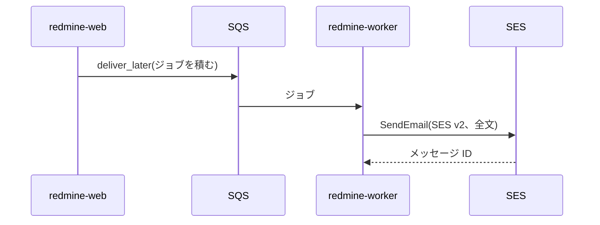
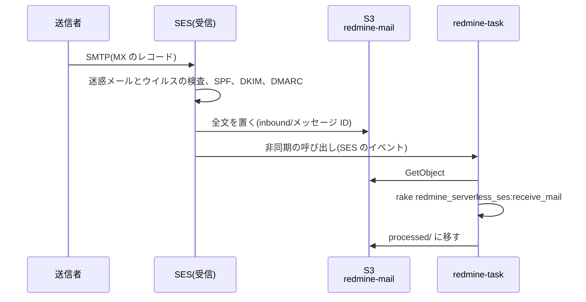

# メール

Redmine のメールの送信と受信の設計です。送信は、Rails の標準の仕組み(ActionMailer の送信方法)で、Amazon SES の API から送ります。送信方法には、AWS の公式の gem `aws-actionmailer-ses` を使います。受信は、SES で受けたメールを、タスク用の関数で Redmine に取り込みます。

この資料の仕様は、2026-11-08 時点の公式の情報と、Redmine 7.0.3 と `aws-actionmailer-ses` 1.2.0 のソースで確認したものです。出典は [sources.md](sources.md) にあります。

<a id="sending"></a>

## 送信

<a id="flow-of-sending"></a>

### 送信の流れ



1. Redmine は、通知のメールを `deliver_later` で送ります。ジョブは SQS に積まれ、`redmine-worker` が送ります([lambda.md](lambda.md#background-jobs))。画面の要求は、メールの送信を待ちません。
2. ActionMailer の送信方法 `:ses_v2` が、SES v2 の `SendEmail` を呼びます。メールの全文(MIME)を `content.raw` で渡し、宛先は To、Cc、Bcc に分けて渡します。
3. `redmine-worker` は VPC の外にあるので、SES の API の公開のエンドポイント(`email.ap-northeast-1.amazonaws.com`)に、HTTPS と IAM の認証で届きます。rake のタスク(期日の通知など)のメールは、`redmine-task` がその場で送ります。

<a id="gems"></a>

### gem

| 項目 | 内容 |
| --- | --- |
| gem | `aws-actionmailer-ses` 1.2.0(2026-05-21)。AWS の公式(aws/aws-actionmailer-ses-ruby) |
| 依存 | `actionmailer` 7.1 以上、`aws-sdk-sesv2` |
| インストール | プラグイン `redmine_serverless_ses` の依存で、イメージのビルドのときにいっしょにインストールする |
| 送信方法 | `:ses_v2`(SES v2 の API)。`:ses`(SES v1 の API)もあるが使わない |
| Bcc | gem が、メールの Bcc を SES の `bcc_addresses` に渡す。Bcc の宛先は、メールの本文には出ない |

<a id="redmine-settings"></a>

### Redmine の設定

Redmine は、`config/configuration.yml` の `email_delivery` の下の項目を、そのまま `ActionMailer::Base` に設定します。

```yaml
production:
  email_delivery:
    delivery_method: :ses_v2
    ses_v2_settings:
      region: ap-northeast-1
```

- **認証:** SES のクライアントは、Lambda の実行ロールの認証情報を使います。アクセスキーは置きません。
- **権限:** 実行ロールに `ses:SendEmail` と `ses:SendRawEmail` を付けます。対象は、Redmine のサブドメインの ID(たとえば `redmine.example.com`)だけにします。詳しくは [iam.md](iam.md) にあります。
- **送信元:** 管理画面の「メール通知」の「送信元メールアドレス」(`Setting.mail_from`)を、Redmine のサブドメインのアドレスにします(たとえば `redmine@redmine.example.com`)。プロジェクトの通知は、プロジェクトのアドレスから送ります(下の「プロジェクトごとの送信元」)。
- **送信を有効にする:** Redmine は、`email_delivery` を設定したときだけメールを送ります。

<a id="ses"></a>

### SES

- **ドメインの認証:** Redmine のサブドメインを、使うリージョンの SES の ID として確認し(DKIM)、本番での利用(サンドボックスの解除)を申請しておきます。SES の ID と本番での利用は、リージョンごとです([受信のドメイン](#receiving-domain))。
- **届く経路:** `redmine-web`、`redmine-worker`、`redmine-task` は VPC の中にあるので、SES の API 用のインターフェイスエンドポイントか NAT インスタンスを通って SES の API に届きます([rds.md](rds.md#routes-out-of-the-vpc))。`redmine-web` は、管理画面の「メールの送信」とテストのメールで SES の API を使います([admin.md](https://redmine-kit.github.io/redmine_serverless_ses/ja/admin.html#sending-email))。プラグインが呼ぶものと、その権限は、プラグインの[準備のページ](https://redmine-kit.github.io/redmine_serverless_ses/ja/setup.html#network)にあります。

<a id="when-sending-fails"></a>

### 送信に失敗したとき

SES の API の呼び出しに失敗したメールは、自動でやり直し、それでも送れないメールは記録して、管理画面から送り直せます。プラグイン `redmine_serverless_ses` が、`redmine-worker` でだけ配送のエラーを出し、SES のエラーを種類ごとに扱います。詳しいことと送り直しの手順は、プラグインの [sending.md](https://redmine-kit.github.io/redmine_serverless_ses/ja/sending.html) にあります。Serverless では、次のとおりです。

- **キューでのやり直し:** アカウントのエラーと、ジョブの中のやり直しを使い切った一時的なエラーは、例外を発生させます。SQS がメッセージを配り直し、3 回受け取ったあとにデッドレターキューに移し([lambda.md](lambda.md#background-jobs))、`redmine_serverless_sqs` が記録します。
- **通知を受ける:** デッドレターキューか失敗の記録が 1 件以上になると、CloudWatch のアラームが通知します。送信のエラーはログにも出し、メトリクスフィルターで数えます。
- **送り直す:** 管理画面の「メールの送信」(SES)と「ジョブ」(SQS)です。

<a id="cost"></a>

## 費用

| 項目 | 単価 | 月額 |
| --- | --- | --- |
| SES の送信 | 宛先 1 件あたり 0.0001 ドル | 1,000 通で 0.10 ドル |
| SES の受信 | 1 通あたり 0.0001 ドル、受信のチャンクあたり 0.00009 ドル | 1,000 通(1 通 1 チャンク)で約 0.19 ドル |
| S3、Lambda(取り込み) | — | 数セント |

SES の単価は、価格表(AmazonSES、2026-11-04 公開)の東京の値です。受信のチャンクの大きさは、価格表に書かれていないので、作るときに料金のページで確認します。

<a id="receiving"></a>

## 受信

メールでチケットを作る機能と、通知のメールへの返信でチケットに注記を足す機能に使います。プロジェクトごとに、受けるアドレスを持たせます。SES でメールを受け、S3 に置き、タスク用の関数(`redmine-task`)が Redmine に取り込みます。東京の SES は、メールの受信に対応しています(受信の宛先は `inbound-smtp.ap-northeast-1.amazonaws.com`)。



<a id="receiving-domain"></a>

### 受信のドメイン

Web とメールは、同じホスト名にします。Redmine のためのサブドメイン(たとえば `redmine.example.com`)を、Web の URL にも、メールのアドレスの `@` のあとにも使い、プロジェクトごとにアドレスを持たせます(下の「プロジェクトごとのアドレス」)。

- **CNAME にしない:** DNS では、CNAME のある名前に、MX などのほかのレコードを置けません。そこで、Web のレコードを、CloudFront の名前を書きつつ答えは A と AAAA になる別名の種類のレコードにし、同じ名前に MX を置きます。

DNS の置き方は、親のドメイン(`example.com`)の DNS のサービスに合わせて、次の 2 つの形から選びます。

| 形 | 当てはまるとき | Web のレコード | 費用 |
| --- | --- | --- | --- |
| 委任しない | 親のドメインがすでに Route 53 にある。または、親のドメインの DNS が、サブドメインで別名の種類のレコード(ALIAS、ANAME、CNAME の平坦化など)を使える | 親のドメインの DNS に、別名の種類のレコードで CloudFront の名前を書く | 親のドメインの DNS の費用のまま |
| Route 53 に委任する | 親のドメインの DNS が、サブドメインで別名の種類のレコードを使えない | 親のドメインの DNS に、`redmine.example.com` の NS のレコードを置き、サブドメインだけを Route 53 のホストゾーンに任せる。ホストゾーンに、CloudFront を向く別名のレコード(A と AAAA)を置く | ホストゾーンが月 0.50 ドル。CloudFront を向く別名のレコードへの問い合わせは無料、ほかは 100 万件あたり 0.40 ドル(価格表、2026-11-04 公開) |

- **親のドメインが Route 53 のとき:** 親のホストゾーンに、`redmine.example.com` の別名のレコード(A と AAAA)と MX を足すだけです。委任は要りません。
- **Cloudflare のとき:** 有料のプランでは、サブドメインの CNAME も、レコードごとに平坦化できます(Cloudflare の資料。無料のプランで平坦化されるのは、ドメインの頂点と、プロキシを通すレコードだけ)。平坦化した CNAME と同じ名前に MX を置けるかは、Cloudflare の資料に書かれていないので、作るときに確認します。プロキシを通すレコード(オレンジの雲)にすると、CloudFront の前にさらに Cloudflare が入るので、使いません。置けないときや、無料のプランのときは、Route 53 に委任します。
- **委任しても、親のドメインは変わらない:** 委任するのは Redmine のサブドメインだけで、親のドメインのほかのレコードとふだんのメールは、今のまま変わりません。
- **同じ DNS に置くもの:** どちらの形でも、Web のレコード、MX、SES の Easy DKIM の CNAME(`<トークン>._domainkey.redmine.example.com`)、証明書の検証の CNAME を、Redmine のサブドメインを持つ DNS に置きます。Route 53 なら、どれも CloudFormation で作れます。
- **MX のレコード:** サブドメインに MX(優先度 10、`inbound-smtp.ap-northeast-1.amazonaws.com`)を置きます。親のドメインの MX(ふだんのメール)は変えません。
- **SES の ID:** サブドメインそのものを、SES の ID として確認します(Easy DKIM の CNAME をサブドメインの下に置く)。SES は、確認済みの ID 宛てのメールだけを受けます。送信元もサブドメインのアドレスにするので、送信と受信の両方に、この ID を使います。DKIM の署名のドメインと差出人のドメインが同じになり、DMARC が確実に通ります。

<a id="addresses-per-project"></a>

### プロジェクトごとのアドレス

プロジェクトごとに、Redmine のサブドメインのアドレス(`<識別子>@redmine.example.com` か別名)を持たせ、そのプロジェクトのメールを受け取り、通知を送れます。プロジェクトに属さないメールは、Redmine 全体のアドレス(`redmine@redmine.example.com`)を使います。設定ファイルの `mail.perProjectAddresses` で有効にします。無効なら、Redmine の標準と同じに受け取ります(アドレスは 1 つで、プロジェクトはサブアドレスで決める)。アドレス、別名、送信元のしくみは、プラグインの [receiving.md](https://redmine-kit.github.io/redmine_serverless_ses/ja/receiving.html#addresses-per-project) と [sending.md](https://redmine-kit.github.io/redmine_serverless_ses/ja/sending.html#senders-per-project) にあります。

<a id="receipt-rules"></a>

### 受信のルール

SES の受信のルールは、ルールのセットにまとめ、リージョンごとに 1 つのセットだけが有効になります。使うアカウントのリージョンで、ほかに受信を使っていないかを、作るときに確認します。

| 項目 | 設定 |
| --- | --- |
| 宛先の条件 | Redmine のサブドメイン(たとえば `redmine.example.com`)。サブドメインのどのアドレスも受け、プロジェクトに当てはまるかは取り込みのときに決める |
| TLS | 必須にする |
| 迷惑メールとウイルスの検査 | 有効にする(既定) |
| 1 つ目の動作 | S3 に置く。バケット `redmine-mail`(仮)、プレフィックス `inbound/` |
| 2 つ目の動作 | `redmine-task` を非同期で呼ぶ |

- **S3 のバケット:** バケットポリシーで、このアカウントの受信のルールからの SES にだけ、`inbound/` への書き込みを許します。S3 に置けるメールは、ヘッダーを含めて 40 MB までです。
- **Lambda の権限:** `redmine-task` のリソースベースのポリシーで、受信のルールからの SES の呼び出しを許します。SES のルールから呼ぶ Lambda は、SES と同じリージョンに置く必要があります(同じ東京)。
- **実行ロール:** `redmine-task` の実行ロールに、メールのバケットの読み書きを付けます。
- **権限の詳しい内容:** [iam.md](iam.md) にあります。
- **残す期間:** `processed/` に移したメールも、`inbound/` に残ったメール(捨てたもの、失敗したもの)も、ライフサイクルで 30 日後に消します([security.md](security.md#retention-periods))。取り込み直しは、この期間のうちに行います。取り込み直しは、管理画面の「メールの受信」から行うか(ジョブとして `redmine-worker` で動く。[admin.md](https://redmine-kit.github.io/redmine_serverless_ses/ja/admin.html#receiving-email))、手元から次のコマンドで行います(`redmine-task` で動く)。

  ```sh
  bin/rake redmine_serverless_ses:receive_mail MESSAGE_ID=<メッセージ ID>
  ```

<a id="importing"></a>

### 取り込み

受信のルールは、SES のイベントを付けて `redmine-task` を非同期で呼びます。そのハンドラーが、イベントのメッセージ ID、エンベロープの宛先、SES の判定を付けて、rake のタスク `redmine_serverless_ses:receive_mail` を動かします([tasks.md](tasks.md#kinds-of-events))。タスクは、メールのバケットからメッセージを読み、宛先からプロジェクトを決め、Redmine の `MailHandler` に渡し、`processed/` に移します。手順とオプションは、プラグインの [receiving.md](https://redmine-kit.github.io/redmine_serverless_ses/ja/receiving.html#importing) にあります。

- **添付ファイル:** メールの添付ファイルは Redmine の添付ファイルとして保存し、プラグイン `redmine_serverless_s3` が S3 に置きます([attachments.md](https://redmine-kit.github.io/redmine_serverless_s3/ja/attachments.html#uploads-through-lambda))。
- **失敗したとき:** SES は Lambda を非同期で呼ぶので、失敗すると Lambda が 2 回までやり直します。それでも失敗したイベントは、失敗の送り先(SQS)に入れ、件数をアラームで通知します。

<a id="spoofing-and-spam"></a>

### なりすましと迷惑メール

Redmine は差出人のアドレスで利用者を決めるので、取り込みは、イベントの SES の判定を確認します(送信者が決められるメールのヘッダーからは取りません)。ウイルスのあるメールはいつも取り込まず、迷惑メールと DMARC が通らないメールは、受信の設定で取り込むようにしない限り取り込みません(`import_spam`、`import_without_dmarc_pass`。`redmine.json` の `pluginSettings`。[deploy-config.md](deploy-config.md#fields-of-redminejson))。決まりは、プラグインの [receiving.md](https://redmine-kit.github.io/redmine_serverless_ses/ja/receiving.html#spoofing-and-spam) にあります。SES が判定を出すように、受信のルールでは、迷惑メールとウイルスの検査を有効にしておきます。

<a id="settings-for-receiving-replies"></a>

### 返信を受けるための設定

Redmine の管理画面で、「送信元メールアドレス」を Redmine 全体のアドレスに、「この行以降を切り捨てる」を引用の前の行にします([receiving.md](https://redmine-kit.github.io/redmine_serverless_ses/ja/receiving.html#settings-for-receiving-replies))。

<a id="to-verify"></a>

## 未確認の事項

- Redmine が `configuration.yml` の `ses_v2_settings` を `ActionMailer::Base` に渡したときに、gem の送信方法がすでに登録されているか(gem の Railtie が登録する)
- 送信元の名前(`Setting.mail_from` の表示名)が、メールの差出人に出るか
- 親のドメインの DNS で、サブドメインに別名の種類のレコードと MX を同じ名前に置けるか(置けなければ、NS のレコードで Route 53 に委任する)
- 宛先(`receipt.recipients`)に、Redmine のサブドメインでないアドレスが入ったときの扱い
- Microsoft 365 から送ったメールで、DMARC が通るか
