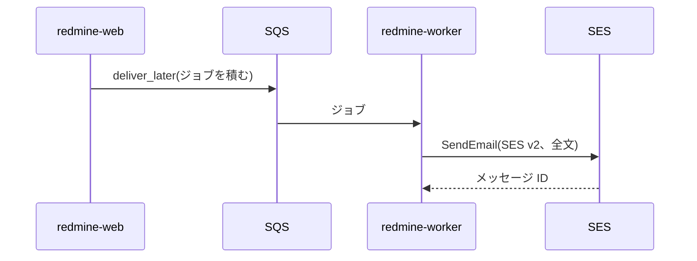
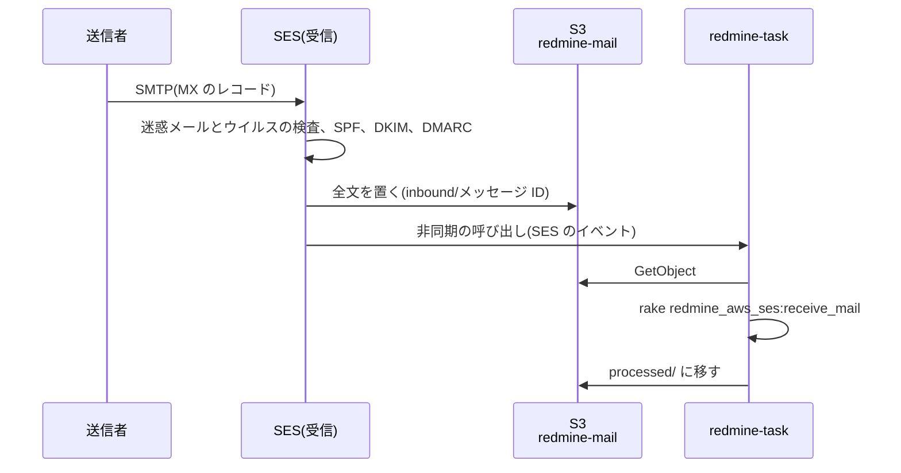

# メール

Redmine のメール送信と受信の設計です。送信は、Rails の標準の仕組み (ActionMailer の配信方法) で、Amazon SES の API から行います。配信方法には、AWS 公式の gem `aws-actionmailer-ses` を使います。受信は、SES で受信したメールを、タスク用の関数で Redmine に取り込みます。

この資料の仕様は、2026-11-08 時点の公式情報と、Redmine 7.0.3 と `aws-actionmailer-ses` 1.2.0 のソースで確認したものです。出典は [sources.md](sources.md) にあります。

<a id="sending"></a>

## 送信

<a id="flow-of-sending"></a>

### 送信の流れ



1. Redmine は、通知メールを `deliver_later` で送信します。ジョブは SQS キューに追加され、`redmine-worker` が送信します ([lambda.md](lambda.md#background-jobs))。画面のリクエストは、メール送信の完了を待ちません。
2. ActionMailer の配信方法 `:ses_v2` が、SES v2 の `SendEmail` を呼び出します。メールの全文 (MIME) を `content.raw` で渡し、宛先は To、Cc、Bcc に分けて渡します。
3. `redmine-worker` は VPC のプライベートサブネットで動作し、SES の API (`email.ap-northeast-1.amazonaws.com`) を HTTPS と IAM 認証で呼び出します。`network.mode: endpoints` では、この名前が VPC 内の SES のインターフェイスエンドポイントを指します (プライベート DNS)。`network.mode: nat` では、NAT インスタンスを経由して外部に接続します ([rds.md](rds.md#routes-out-of-the-vpc))。rake タスク (期日の通知など) のメールは、`redmine-task` がその場で送信します。

<a id="gems"></a>

### gem

| 項目 | 内容 |
| --- | --- |
| gem | `aws-actionmailer-ses` 1.2.0 (2026-05-21)。AWS 公式 (aws/aws-actionmailer-ses-ruby) |
| 依存関係 | `actionmailer` 7.1 以上、`aws-sdk-sesv2` |
| インストール | プラグイン `redmine_aws_ses` の依存関係として、イメージのビルド時に一緒にインストールする |
| 配信方法 | `:ses_v2` (SES v2 の API)。`:ses` (SES v1 の API) もあるが使わない |
| Bcc | gem が、メールの Bcc を SES の `bcc_addresses` に渡す。Bcc の宛先は、メールの本文には表示されない |

<a id="redmine-settings"></a>

### Redmine の設定

Redmine は、`config/configuration.yml` の `email_delivery` の下の項目を、そのまま `ActionMailer::Base` に設定します。

```yaml
production:
  email_delivery:
    delivery_method: :ses_v2
    ses_v2_settings:
      region: ap-northeast-1
```

- **認証:** SES のクライアントは、Lambda の実行ロールの認証情報を使います。アクセスキーは保存しません。
- **権限:** 実行ロールに `ses:SendEmail` と `ses:SendRawEmail` を付与します。対象は、Redmine のサブドメインの ID (たとえば `redmine.example.com`) だけにします。詳細は [iam.md](iam.md) にあります。
- **送信元:** 管理画面の「メール通知」の「送信元メールアドレス」(`Setting.mail_from`) を、Redmine のサブドメインのアドレスにします (たとえば `redmine@redmine.example.com`)。プロジェクトの通知は、プロジェクトのアドレスから送信します (下の「プロジェクトごとの送信元」)。
- **送信の有効化:** Redmine は、`email_delivery` を設定したときだけメールを送信します。

<a id="ses"></a>

### SES

Redmine のサブドメインを、使用するリージョンの SES の ID として検証し (DKIM)、本番稼働 (サンドボックスの解除) を事前に申請します。SES の ID と本番稼働は、どちらもリージョンごとです ([受信ドメイン](#receiving-domain))。

`redmine-web`、`redmine-worker`、`redmine-task` は VPC 内にあるので、SES の API 用のインターフェイスエンドポイントか NAT インスタンスを経由して SES の API に接続します ([rds.md](rds.md#routes-out-of-the-vpc))。管理画面の「メール送信」と「メール受信」のタブは、`redmine_aws_ses:refresh` が保存した SES の状態を表示し、開いたときには SES を呼び出しません。`redmine-task` が 1 時間ごとに読み込み ([tasks.md](tasks.md#scheduled-runs))、`redmine-web` は、タブの「最新の情報に更新」のリンクでの読み込み直し、サプレッションリストからの削除、テストメールで SES の API を使います ([admin.md](https://redmine-kit.github.io/redmine_aws_ses/ja/admin.html#sending-email))。プラグインが呼び出す API と必要な権限は、プラグインの[導入のページ](https://redmine-kit.github.io/redmine_aws_ses/ja/setup.html#network)にあります。

<a id="when-sending-fails"></a>

### 送信の失敗

SES の API の呼び出しに失敗したメールは、自動で再試行し、それでも送信できないメールは記録して、管理画面から再送信できます。プラグイン `redmine_aws_ses` が、`redmine-worker` でだけ配信エラーを発生させ、SES のエラーを種類別に処理します。詳細と再送信の手順は、プラグインの [sending.md](https://redmine-kit.github.io/redmine_aws_ses/ja/sending.html) にあります。Serverless では、次のとおりです。

- **キューでの再試行:** アカウントのエラーと、ジョブ内の再試行を使い切った一時的なエラーは、例外を発生させます。SQS がメッセージを再配信し、3 回受信したあとにデッドレターキューに移動し ([lambda.md](lambda.md#background-jobs))、`redmine_aws_sqs` が記録します。
- **通知:** デッドレターキューか失敗の記録が 1 件以上になると、CloudWatch アラームが通知します。送信エラーはログにも出力し、メトリクスフィルターでカウントします。
- **再送信:** 管理画面の「メール送信」(SES) と「ジョブ」(SQS) で行います。

<a id="cost"></a>

## 費用

| 項目 | 単価 | 月額 |
| --- | --- | --- |
| SES の送信 | 宛先 1 件あたり 0.0001 ドル | 1,000 通で 0.10 ドル |
| SES の受信 | 1 通あたり 0.0001 ドル、受信チャンクあたり 0.00009 ドル | 1,000 通 (1 通 1 チャンク) で約 0.19 ドル |
| S3、Lambda (取り込み) | — | 数セント |

SES の単価は、料金表 (AmazonSES、2026-11-04 公開) の ap-northeast-1 の値です。受信チャンクのサイズは、料金表に記載されていないので、構築時に料金ページで確認します。

<a id="receiving"></a>

## 受信

メールでチケットを作成する機能と、通知メールへの返信でチケットに注記を追加する機能に使います。プロジェクトごとに、受信用のアドレスを持たせます。SES でメールを受信して S3 に保存し、タスク用の関数 (`redmine-task`) が Redmine に取り込みます。ap-northeast-1 の SES は、メール受信に対応しています (受信エンドポイントは `inbound-smtp.ap-northeast-1.amazonaws.com`)。



<a id="receiving-domain"></a>

### 受信ドメイン

Web とメールは、同じホスト名にします。Redmine 用のサブドメイン (たとえば `redmine.example.com`) を、Web の URL にも、メールアドレスの `@` のあとにも使い、プロジェクトごとにアドレスを持たせます (下の「プロジェクト別のアドレス」)。

Web のレコードは CNAME にできません。DNS では、CNAME のある名前に MX などのほかのレコードを置けないためです。そこで Web のレコードを、CloudFront のドメイン名を指定しつつ応答は A と AAAA になるエイリアス型のレコードにし、同じ名前に MX を置きます。

DNS の構成は、親ドメイン (`example.com`) の DNS サービスに合わせて、次の 2 つから選びます。

| 構成 | 適用する場合 | Web のレコード | 費用 |
| --- | --- | --- | --- |
| 委任しない | 親ドメインがすでに Route 53 にある。または、親ドメインの DNS が、サブドメインでエイリアス型のレコード (ALIAS、ANAME、CNAME フラット化など) を使える | 親ドメインの DNS に、エイリアス型のレコードで CloudFront のドメイン名を指定する | 親ドメインの DNS の費用のまま |
| Route 53 に委任する | 親ドメインの DNS が、サブドメインでエイリアス型のレコードを使えない | 親ドメインの DNS に、`redmine.example.com` の NS レコードを追加し、サブドメインだけを Route 53 ホストゾーンに委任する。ホストゾーンに、CloudFront を指すエイリアスレコード (A と AAAA) を作成する | ホストゾーンが月額 0.50 ドル。CloudFront を指すエイリアスレコードへのクエリは無料、ほかは 100 万件あたり 0.40 ドル (料金表、2026-11-04 公開) |

親ドメインが Route 53 にある場合は、親のホストゾーンに `redmine.example.com` のエイリアスレコード (A と AAAA) と MX を追加するだけで、委任は不要です。Cloudflare では、有料プランなら、サブドメインの CNAME もレコードごとにフラット化できます (Cloudflare のドキュメント。無料プランでフラット化されるのは、ゾーンの頂点とプロキシを経由するレコードだけ)。フラット化した CNAME と同じ名前に MX を置けるかは Cloudflare のドキュメントに記載されていないので、構築時に確認します。プロキシを経由するレコード (オレンジの雲) にすると、CloudFront の前にさらに Cloudflare が入るので、使いません。MX を置けない場合や無料プランの場合は、Route 53 に委任します。委任するのは Redmine のサブドメインだけで、親ドメインのほかのレコードと通常のメールは変わりません。

どちらの構成でも、Web のレコード、MX、SES の Easy DKIM の CNAME (`<トークン>._domainkey.redmine.example.com`)、証明書の検証用の CNAME を、Redmine のサブドメインを管理する DNS に作成します。Route 53 なら、どれも CloudFormation で作成できます。サブドメインの MX は、優先度 10 で `inbound-smtp.ap-northeast-1.amazonaws.com` を指します。親ドメインの MX (通常のメール) は変更しません。

SES は検証済み ID 宛てのメールだけを受信するので、サブドメインそのものを SES の ID として検証し、Easy DKIM の CNAME をサブドメインの下に作成します。送信元もサブドメインのアドレスにするので、送信と受信の両方に、この 1 つの ID を使います。DKIM 署名のドメインと送信者のドメインが一致するので、DMARC に確実に合格します。

<a id="addresses-per-project"></a>

### プロジェクト別のアドレス

プロジェクトごとに、Redmine のサブドメインのアドレス (`<識別子>@redmine.example.com`) を持たせ、そのプロジェクトのメールを受信し、通知を送信できます。プロジェクトに属さないメールは、デフォルトアドレス (変更しなければ `noreply@redmine.example.com`) を使います。設定ファイルの `mail.perProjectAddresses` で有効にします。無効なら、Redmine の標準と同じに受信します (アドレスは 1 つで、プロジェクトはサブアドレスで決める)。アドレスと送信元の仕組みは、プラグインの [receiving.md](https://redmine-kit.github.io/redmine_aws_ses/ja/receiving.html#addresses-per-project) と [sending.md](https://redmine-kit.github.io/redmine_aws_ses/ja/sending.html#senders-per-project) にあります。

<a id="receipt-rules"></a>

### 受信ルール

SES の受信ルールは受信ルールセットにまとめ、リージョンごとに 1 つのルールセットだけが有効になります。使用するアカウントのリージョンで、ほかにメール受信を使っていないかを、構築時に確認します。

| 項目 | 設定 |
| --- | --- |
| 受信者の条件 | Redmine のサブドメイン (たとえば `redmine.example.com`)。サブドメインのどのアドレスも受信し、プロジェクトに該当するかは取り込み時に決める |
| TLS | 必須にする |
| スパムとウイルスのスキャン | 有効にする (デフォルト) |
| 1 つ目のアクション | S3 に保存する。バケット `redmine-mail` (仮)、プレフィックス `inbound/` |
| 2 つ目のアクション | `redmine-task` を非同期で呼び出す |

- **S3 バケット:** バケットポリシーで、このアカウントの受信ルールからの SES にだけ、`inbound/` への書き込みを許可します。S3 に保存できるメールは、ヘッダーを含めて 40 MB までです。
- **Lambda の権限:** `redmine-task` のリソースベースのポリシーで、受信ルールからの SES による呼び出しを許可します。SES のルールから呼び出す Lambda は、SES と同じリージョンに置く必要があります (どちらも ap-northeast-1)。
- **実行ロール:** `redmine-task` の実行ロールに、メール用バケットの読み書きの権限を付与します。
- **権限の詳細:** [iam.md](iam.md) にあります。
- **保持期間:** `processed/` に移動したメールも、`inbound/` に残ったメール (破棄したもの、失敗したもの) も、ライフサイクルで 30 日後に削除します ([security.md](security.md#retention-periods))。取り込みのやり直しは、この期間内に行います。やり直しは、管理画面の「メールの受信」から行うか (ジョブとして `redmine-worker` で実行される。[admin.md](https://redmine-kit.github.io/redmine_aws_ses/ja/admin.html#receiving-email))、ローカルから次のコマンドで行います (`redmine-task` で実行される)。

  ```sh
  bin/rake redmine_aws_ses:receive_mail MESSAGE_ID=<メッセージ ID>
  ```

<a id="importing"></a>

### 取り込み

受信ルールは、SES のイベントを付けて `redmine-task` を非同期で呼び出します。そのハンドラーが、イベントのメッセージ ID、エンベロープの宛先、エンベロープの送信者、SES の判定結果を付けて、rake タスク `redmine_aws_ses:receive_mail` を実行します ([tasks.md](tasks.md#kinds-of-events))。タスクは、メール用バケットからメッセージを読み、宛先からプロジェクトを決め、Redmine の `MailHandler` に渡し、`processed/` に移動します。手順とオプションは、プラグインの [receiving.md](https://redmine-kit.github.io/redmine_aws_ses/ja/receiving.html#importing) にあります。

メールの添付ファイルは Redmine の添付ファイルとして保存し、プラグイン `redmine_aws_s3` が S3 に保存します ([attachments.md](https://redmine-kit.github.io/redmine_aws_s3/ja/attachments.html#uploads-through-lambda))。SES は Lambda を非同期で呼び出すので、失敗すると Lambda が 2 回まで再試行します。それでも失敗したイベントは失敗時の送信先 (SQS) に送り、件数をアラームで通知します。

<a id="spoofing-and-spam"></a>

### なりすましと迷惑メール

Redmine は送信者のアドレスでユーザーを特定するので、取り込みでは、イベントに含まれる SES の判定結果を確認します (送信者が操作できるメールのヘッダーからは取得しません)。ウイルスを含むメールは常に取り込まず、迷惑メールと DMARC に合格しないメールは、受信設定で取り込むようにしない限り取り込みません (`import_spam`、`import_without_dmarc_pass`。`redmine.json` の `pluginSettings`。[deploy-config.md](deploy-config.md#fields-of-redminejson))。判定の規則は、プラグインの [receiving.md](https://redmine-kit.github.io/redmine_aws_ses/ja/receiving.html#spoofing-and-spam) にあります。SES が判定結果を出すように、受信ルールでは、スパムとウイルスのスキャンを有効にしておきます。

<a id="settings-for-receiving-replies"></a>

### 返信を受信するための設定

Redmine の管理画面で、「送信元メールアドレス」をデフォルトアドレスに、「この行以降を切り捨てる」を引用の前の行にします ([receiving.md](https://redmine-kit.github.io/redmine_aws_ses/ja/receiving.html#settings-for-receiving-replies))。

<a id="to-verify"></a>

## 未確認の事項

- Redmine が `configuration.yml` の `ses_v2_settings` を `ActionMailer::Base` に渡したときに、gem の配信方法がすでに登録されているか (gem の Railtie が登録する)
- 送信元の名前 (`Setting.mail_from` の表示名) が、メールの送信者に表示されるか
- 親ドメインの DNS で、サブドメインにエイリアス型のレコードと MX を同じ名前で置けるか (置けなければ、NS レコードで Route 53 に委任する)
- 受信者 (`receipt.recipients`) に、Redmine のサブドメインでないアドレスが含まれたときの扱い
- Microsoft 365 から送信したメールで、DMARC に合格するか
