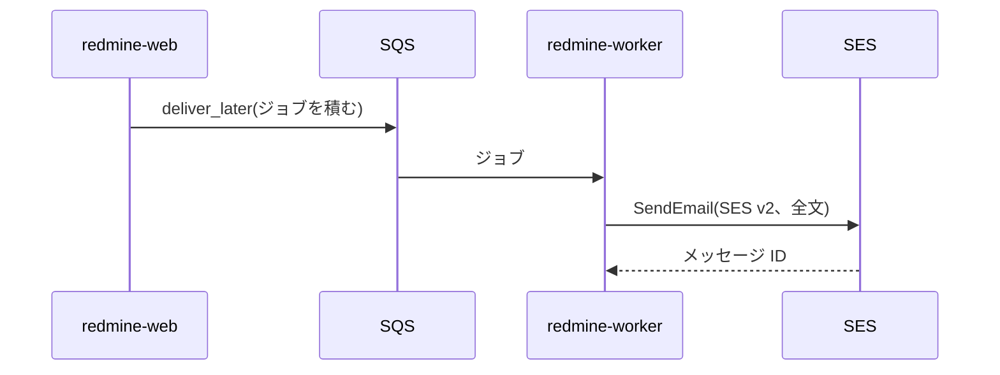
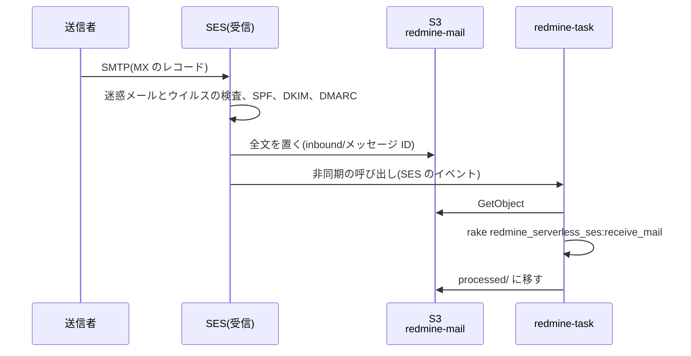

# メール

Redmine のメールの送信と受信の設計です。送信は、Rails の標準の仕組み(ActionMailer の送信方法)で、Amazon SES の API から送ります。送信方法には、AWS の公式の gem `aws-actionmailer-ses` を使います。受信は、SES で受けたメールを、タスク用の関数で Redmine に取り込みます。

この資料の仕様は、2026-11-08 時点の公式の情報と、Redmine 7.0.3 と `aws-actionmailer-ses` 1.2.0 のソースで確認したものです。出典は [sources.md](sources.md) にあります。

<a id="sending"></a>

## 送信

<a id="flow-of-sending"></a>

### 送信の流れ



1. Redmine は、通知のメールを `deliver_later` で送ります。ジョブは SQS に積まれ、`redmine-worker` が送ります([lambda.md](lambda.md#background-jobs))。画面の要求は、メールの送信を待ちません。
2. ActionMailer の送信方法 `:ses_v2` が、SES v2 の `SendEmail` を呼びます。メールの全文(MIME)を `content.raw` で渡し、宛先は To、Cc、Bcc に分けて渡します。
3. `redmine-worker` は VPC の外にあるので、SES の API の公開のエンドポイント(`email.ap-northeast-1.amazonaws.com`)に、HTTPS と IAM の認証で届きます。rake のタスク(期日の通知など)のメールは、`redmine-task` がその場で送ります。

<a id="gems"></a>

### gem

| 項目 | 内容 |
| --- | --- |
| gem | `aws-actionmailer-ses` 1.2.0(2026-05-21)。AWS の公式(aws/aws-actionmailer-ses-ruby) |
| 依存 | `actionmailer` 7.1 以上、`aws-sdk-sesv2` |
| インストール | Redmine の `Gemfile.local` に書き、イメージのビルドのときに入れる |
| 送信方法 | `:ses_v2`(SES v2 の API)。`:ses`(SES v1 の API)もあるが使わない |
| Bcc | gem が、メールの Bcc を SES の `bcc_addresses` に渡す。Bcc の宛先は、メールの本文には出ない |

<a id="redmine-settings"></a>

### Redmine の設定

Redmine は、`config/configuration.yml` の `email_delivery` の下の項目を、そのまま `ActionMailer::Base` に設定します。

```yaml
production:
  email_delivery:
    delivery_method: :ses_v2
    ses_v2_settings:
      region: ap-northeast-1
```

- **認証:** SES のクライアントは、Lambda の実行ロールの認証情報を使います。アクセスキーは置きません。
- **権限:** 実行ロールに `ses:SendEmail` と `ses:SendRawEmail` を付けます。対象は、Redmine のサブドメインの ID(たとえば `redmine.example.com`)だけにします。詳しくは [iam.md](iam.md) にあります。
- **送信元:** 管理画面の「メール通知」の「送信元メールアドレス」(`Setting.mail_from`)を、Redmine のサブドメインのアドレスにします(たとえば `redmine@redmine.example.com`)。プロジェクトの通知は、プロジェクトのアドレスから送ります(下の「プロジェクトごとの送信元」)。
- **送信を有効にする:** Redmine は、`email_delivery` を設定したときだけメールを送ります。

<a id="ses"></a>

### SES

- **ドメインの認証:** Redmine のサブドメインを、使うリージョンの SES の ID として確認し(DKIM)、本番での利用(サンドボックスの解除)を申請しておきます。SES の ID と本番での利用は、リージョンごとです([受信のドメイン](#receiving-domain))。
- **届く経路:** `redmine-web`、`redmine-worker`、`redmine-task` は VPC の中にあるので、SES の API 用のインターフェイスエンドポイントか NAT インスタンスを通って SES の API に届きます([rds.md](rds.md#routes-out-of-the-vpc))。`redmine-web` は、管理画面の「メールの送信」とテストのメールで SES の API を使います([admin.md](https://redmine-kit.github.io/redmine_serverless_ses/ja/admin.html#sending-email))。プラグインが呼ぶものと、その権限は、プラグインの[準備のページ](https://redmine-kit.github.io/redmine_serverless_ses/ja/setup.html#network)にあります。

<a id="when-sending-fails"></a>

### 送信に失敗したとき

SES の API が失敗したメールは、自動でやり直し、それでも送れなかったものは記録して、管理画面から送り直せるようにします。

<a id="raising-errors"></a>

#### エラーを例外にする

Redmine の本番の設定(`production.rb`)は `raise_delivery_errors = false` で、SES の API のエラーは、メールの送信の中で握りつぶされます。Rails のメールのジョブ(`ActionMailer::MailDeliveryJob`。Redmine は `Mailer::DeliveryJob` で継いでいる)は、例外が出ればジョブを失敗させますが、握りつぶされると成功になり、SQS のやり直しが効きません。

そこで、プラグイン `redmine_serverless_ses` が、`redmine-worker`(`REDMINE_ROLE=worker`)でだけ `raise_delivery_errors` を `true` にします。プラグインは `production.rb` のあとで読み込まれるので、上書きできます。`redmine-task` の rake のタスク(期日の通知など)は、1 通の失敗でタスク全体が止まらないよう、`false` のままにします。

<a id="handling-by-kind-of-error"></a>

#### エラーの種類ごとの扱い

SES v2 の `SendEmail` のエラー(API リファレンスの一覧)を、3 つに分けます。

| エラー | 意味 | 扱い |
| --- | --- | --- |
| `TooManyRequestsException`(429)、SES の 5xx、ネットワークのエラー | 一時的なもの | ジョブの中でやり直す(下記) |
| `SendingPausedException`、`AccountSuspendedException`、`MailFromDomainNotVerifiedException`、`NotFoundException`、`LimitExceededException` | アカウントや設定の問題。直すまで、何度送っても失敗する | やり直さずに失敗として記録し、デッドレターキューに送る |
| `MessageRejected`、`BadRequestException` | そのメールの中身や宛先の問題 | やり直さずに失敗として記録し、ジョブを捨てる |

- **ジョブの中でのやり直し:** Redmine の `Mailer::DeliveryJob` に、ActiveJob の `retry_on` を足します。待ち時間は `:polynomially_longer` で、5 回までです。待ち時間は 3 秒、18 秒、83 秒、258 秒、627 秒ほどで、SQS で時間を置ける上限(15 分)に収まります。
- **SDK のやり直し:** AWS の SDK も、429 や 5xx では、ジョブより前に自分でやり直します(既定のやり直しの設定)。
- **使い切ったとき:** `retry_on` を使い切ると、例外がそのまま上がり、SQS がメッセージを届け直します。3 回届け直しても失敗したら、デッドレターキューに移ります。
- **記録:** 最後に失敗したときに、プラグインのテーブル(`serverless_job_failures`)に、ジョブの中身とエラーを残します([admin.md](https://redmine-kit.github.io/redmine_serverless/ja/admin.html#jobs))。
- **2 通届くことがある:** SES がメールを受け付けたあとで応答が途切れると、やり直しで同じメールを 2 回送ることがあります。この規模では受け入れます。

<a id="sending-again"></a>

#### 送り直し

1. **知る:** デッドレターキューの件数と、失敗の記録の件数が 1 以上になったら、CloudWatch のアラームで通知します。
2. **原因を直す:** 管理画面の「メールの送信」で、SES のアカウントの状態、送信元のドメイン、サプレッションリストを確認して直します([admin.md](https://redmine-kit.github.io/redmine_serverless_ses/ja/admin.html#sending-email))。
3. **送り直す:** 管理画面の「ジョブ」で、失敗したメールを選んで送り直します。デッドレターキューに残っているものは、元のキューに戻します。

- **CloudWatch Logs:** 送信のエラーは、ログにも残ります。メトリクスフィルターで数え、アラームの材料にします。
- **SES が受け付けたあとの失敗:** SES が受け付けたあとで、相手のメールサーバーに断られたもの(バウンス)は、API のエラーにはなりません。SES は、そのアドレスをサプレッションリストに入れ、以後の送信を止めます。管理画面の「メールの送信」で、サプレッションリストを確認できます。

<a id="cost"></a>

## 費用

| 項目 | 単価 | 月額 |
| --- | --- | --- |
| SES の送信 | 宛先 1 件あたり 0.0001 ドル | 1,000 通で 0.10 ドル |
| SES の受信 | 1 通あたり 0.0001 ドル、受信のチャンクあたり 0.00009 ドル | 1,000 通(1 通 1 チャンク)で約 0.19 ドル |
| S3、Lambda(取り込み) | — | 数セント |

SES の単価は、価格表(AmazonSES、2026-11-04 公開)の東京の値です。受信のチャンクの大きさは、価格表に書かれていないので、作るときに料金のページで確認します。

<a id="receiving"></a>

## 受信

メールでチケットを作る機能と、通知のメールへの返信でチケットに注記を足す機能に使います。プロジェクトごとに、受けるアドレスを持たせます。SES でメールを受け、S3 に置き、タスク用の関数(`redmine-task`)が Redmine に取り込みます。東京の SES は、メールの受信に対応しています(受信の宛先は `inbound-smtp.ap-northeast-1.amazonaws.com`)。



<a id="receiving-domain"></a>

### 受信のドメイン

Web とメールは、同じホスト名にします。Redmine のためのサブドメイン(たとえば `redmine.example.com`)を、Web の URL にも、メールのアドレスの `@` のあとにも使い、プロジェクトごとにアドレスを持たせます(下の「プロジェクトごとのアドレス」)。

- **CNAME にしない:** DNS では、CNAME のある名前に、MX などのほかのレコードを置けません。そこで、Web のレコードを、CloudFront の名前を書きつつ答えは A と AAAA になる別名の種類のレコードにし、同じ名前に MX を置きます。

DNS の置き方は、親のドメイン(`example.com`)の DNS のサービスに合わせて、次の 2 つの形から選びます。

| 形 | 当てはまるとき | Web のレコード | 費用 |
| --- | --- | --- | --- |
| 委任しない | 親のドメインがすでに Route 53 にある。または、親のドメインの DNS が、サブドメインで別名の種類のレコード(ALIAS、ANAME、CNAME の平坦化など)を使える | 親のドメインの DNS に、別名の種類のレコードで CloudFront の名前を書く | 親のドメインの DNS の費用のまま |
| Route 53 に委任する | 親のドメインの DNS が、サブドメインで別名の種類のレコードを使えない | 親のドメインの DNS に、`redmine.example.com` の NS のレコードを置き、サブドメインだけを Route 53 のホストゾーンに任せる。ホストゾーンに、CloudFront を向く別名のレコード(A と AAAA)を置く | ホストゾーンが月 0.50 ドル。CloudFront を向く別名のレコードへの問い合わせは無料、ほかは 100 万件あたり 0.40 ドル(価格表、2026-11-04 公開) |

- **親のドメインが Route 53 のとき:** 親のホストゾーンに、`redmine.example.com` の別名のレコード(A と AAAA)と MX を足すだけです。委任は要りません。
- **Cloudflare のとき:** 有料のプランでは、サブドメインの CNAME も、レコードごとに平坦化できます(Cloudflare の資料。無料のプランで平坦化されるのは、ドメインの頂点と、プロキシを通すレコードだけ)。平坦化した CNAME と同じ名前に MX を置けるかは、Cloudflare の資料に書かれていないので、作るときに確認します。プロキシを通すレコード(オレンジの雲)にすると、CloudFront の前にさらに Cloudflare が入るので、使いません。置けないときや、無料のプランのときは、Route 53 に委任します。
- **委任しても、親のドメインは変わらない:** 委任するのは Redmine のサブドメインだけで、親のドメインのほかのレコードとふだんのメールは、今のまま変わりません。
- **同じ DNS に置くもの:** どちらの形でも、Web のレコード、MX、SES の Easy DKIM の CNAME(`<トークン>._domainkey.redmine.example.com`)、証明書の検証の CNAME を、Redmine のサブドメインを持つ DNS に置きます。Route 53 なら、どれも CloudFormation で作れます。
- **MX のレコード:** サブドメインに MX(優先度 10、`inbound-smtp.ap-northeast-1.amazonaws.com`)を置きます。親のドメインの MX(ふだんのメール)は変えません。
- **SES の ID:** サブドメインそのものを、SES の ID として確認します(Easy DKIM の CNAME をサブドメインの下に置く)。SES は、確認済みの ID 宛てのメールだけを受けます。送信元もサブドメインのアドレスにするので、送信と受信の両方に、この ID を使います。DKIM の署名のドメインと差出人のドメインが同じになり、DMARC が確実に通ります。

<a id="addresses-per-project"></a>

### プロジェクトごとのアドレス

| アドレス | 使い道 |
| --- | --- |
| `<プロジェクトの識別子>@redmine.example.com` | そのプロジェクトのアドレス。届いたメールはそのプロジェクトのチケットになり、そのプロジェクトの通知はこのアドレスから送る |
| プロジェクトの別名(たとえば `support@redmine.example.com`) | 識別子とは別の、覚えやすいアドレス。プロジェクトの設定で足す |
| `redmine@redmine.example.com`(全体用) | プロジェクトに属さないメール(パスワードの再設定、アカウント、期日の通知など)の送信元。下の「全体用のアドレス」 |

- **識別子とアドレス:** Redmine のプロジェクトの識別子は、英小文字、数字、`-`、`_` で作るので、そのままアドレスの `@` の前に使えます。アドレスの `@` の前は 64 文字までなので、それより長い識別子のプロジェクトは、別名を付けます。
- **受けるかどうか:** プロジェクトごとに、メールを受けるかを選べます(既定は受けない)。受けないプロジェクトのアドレスに届いたメールは、取り込まずに捨て、記録に残します。
- **別名の重なり:** 別名は、ほかのプロジェクトの識別子とも、ほかの別名とも重ならないようにします。`redmine`、`postmaster`、`abuse` などは予約します。
- **プロジェクトの設定:** プロジェクトの設定に「メール」のタブを足し、受けるか、別名、既定の値(トラッカー、カテゴリー、優先度、担当者、プライベートにするか)を設定します。設定できるのは、Redmine の管理者と、プラグインが足す権限(「メールの設定の管理」)を持つ人です([admin.md](https://redmine-kit.github.io/redmine_serverless_ses/ja/admin.html#project-email-settings))。
- **記録:** プロジェクトごとの設定は、プラグインのテーブル(`serverless_project_mail_settings`)に入れます。

<a id="without-addresses-per-project"></a>

### プロジェクトごとのアドレスを使わないとき

設定のファイルの `mail.perProjectAddresses` が `false`(既定)か、プラグインの設定で無効のときは、Redmine の標準と同じ形で受けます。

- **受けるアドレス:** 全体用のアドレス(たとえば `redmine@redmine.example.com`)だけです。
- **プロジェクトの選び方:** Redmine の標準のサブアドレス(`redmine+<識別子>@redmine.example.com`。`MailHandler` の `project_from_subaddress`)で選びます。サブアドレスがないメールは、プラグインの設定の既定のプロジェクトに入れるか、捨てます([admin.md](https://redmine-kit.github.io/redmine_serverless_ses/ja/admin.html#receiving-email))。
- **送信元:** すべての通知を、全体用のアドレスから送ります。

<a id="address-for-the-whole-redmine"></a>

### 全体用のアドレス

プロジェクトに属さないメールは、全体用のアドレス(たとえば `redmine@redmine.example.com`)から送ります。Redmine の管理画面の「送信元メールアドレス」(`Setting.mail_from`)が、このアドレスです。

| 全体用のアドレスから送るメール | Redmine のメーラーのメソッド |
| --- | --- |
| パスワードの再設定(パスワードリマインダー) | `lost_password` |
| アカウントの登録の確認、有効化の依頼、有効化の通知 | `register`、`account_activation_request`、`account_activated` |
| アカウントの情報(管理者が作ったアカウント) | `account_information` |
| 期日の通知(複数のプロジェクトのチケットをまとめる) | `reminder` |
| セキュリティの通知、設定の変更の通知 | `security_notification`、`settings_updated` |
| テストのメール | `test_email` |

上のメソッドは、Redmine 7.0.3 のメーラーのうち、プロジェクトのヘッダー(`X-Redmine-Project`)を付けないものです(`app/models/mailer.rb`)。

- **アドレスを選べる:** `@` の前は、プラグインの設定で変えられます(既定は `redmine`。`noreply` なども選べる)。プロジェクトの識別子と別名には使えないよう、予約します。
- **届いたメールの扱い:** 全体用のアドレスに届いたメールは、プラグインの設定で、既定のプロジェクトに入れるか、取り込まずに捨てるかを選びます(既定は捨てる)。パスワードの再設定などのメールへの返信は、ふつうは取り込む必要がないためです。
- **送信の ID:** 全体用のアドレスも、Redmine のサブドメインの SES の ID で送ります。

<a id="receipt-rules"></a>

### 受信のルール

SES の受信のルールは、ルールのセットにまとめ、リージョンごとに 1 つのセットだけが有効になります。使うアカウントのリージョンで、ほかに受信を使っていないかを、作るときに確認します。

| 項目 | 設定 |
| --- | --- |
| 宛先の条件 | Redmine のサブドメイン(たとえば `redmine.example.com`)。サブドメインのどのアドレスも受け、プロジェクトに当てはまるかは取り込みのときに決める |
| TLS | 必須にする |
| 迷惑メールとウイルスの検査 | 有効にする(既定) |
| 1 つ目の動作 | S3 に置く。バケット `redmine-mail`(仮)、プレフィックス `inbound/` |
| 2 つ目の動作 | `redmine-task` を非同期で呼ぶ |

- **S3 のバケット:** バケットポリシーで、このアカウントの受信のルールからの SES にだけ、`inbound/` への書き込みを許します。S3 に置けるメールは、ヘッダーを含めて 40 MB までです。
- **Lambda の権限:** `redmine-task` のリソースベースのポリシーで、受信のルールからの SES の呼び出しを許します。SES のルールから呼ぶ Lambda は、SES と同じリージョンに置く必要があります(同じ東京)。
- **実行ロール:** `redmine-task` の実行ロールに、メールのバケットの読み書きを付けます。
- **権限の詳しい内容:** [iam.md](iam.md) にあります。
- **残す期間:** `processed/` に移したメールも、`inbound/` に残ったメール(捨てたもの、失敗したもの)も、ライフサイクルで 30 日後に消します([security.md](security.md#retention-periods))。取り込み直しは、この期間のうちに行います。取り込み直しは、手元から `bin/rake redmine_serverless_ses:receive_mail MESSAGE_ID=<メッセージ ID>`(`redmine-task` で動く)か、管理画面の「メールの受信」(ジョブとして `redmine-worker` で動く。[admin.md](https://redmine-kit.github.io/redmine_serverless_ses/ja/admin.html#receiving-email))で行います。

<a id="importing"></a>

### 取り込み

プラグイン `redmine_serverless_ses` の rake のタスク `redmine_serverless_ses:receive_mail` が、次のことをします。

1. S3 から全文を取ります。
2. SES が付けたヘッダーを見て、取り込むかを決めます(下の「なりすましと迷惑メール」)。
3. 宛先から、プロジェクトを決めます(下記)。
4. Redmine の `MailHandler.safe_receive` に、全文とオプションを渡します。Redmine の `rake redmine:email:read` と同じ処理です。
5. 成功したら、`processed/` に移します。

**宛先からプロジェクトを決める:**

- **宛先は SES のイベントから取る:** メールの `To` と `Cc` のヘッダーではなく、SES のイベントの宛先(SMTP の `RCPT TO`。`receipt.recipients`)を使います。Bcc で届いたメールも、正しく見分けられます。取り込み直しのために、宛先は取り込みの記録にも残します。
- **当てはめ方:** 宛先のうち Redmine のサブドメインのアドレスを順に見て、識別子か別名に当てはまる最初のプロジェクトにします。当てはまるものがなければ、取り込まずに捨て、記録に残します。
- **Redmine に渡す:** 決めたプロジェクトの識別子と、プロジェクトの既定の値を、`MailHandler` のオプション(`issue[:project]` など)で渡します。Redmine の標準の決め方では、本文の `Project:` のキーワードの方が強いので、キーワードでプロジェクトを変えられないよう、`allow_override` にプロジェクトを入れません。
- **返信:** 通知のメールへの返信は、Redmine が `In-Reply-To` と `References` のヘッダーから、元のチケットに注記として付けます(`MailHandler#dispatch`)。どのアドレスに返信しても、元のチケットに付きます。

| オプション | 値 | 意味 |
| --- | --- | --- |
| `unknown_user` | プロジェクトの設定(既定は `ignore`) | Redmine に登録のないアドレスからのメールの扱い |
| `no_permission_check` | `0` | 送信者の権限を確認する |
| `issue[:project]` | 宛先から決めたプロジェクト | 上記 |
| `issue[:tracker]` など | プロジェクトの既定の値 | 作るチケットの既定 |

- **自動応答:** Redmine は、`Auto-Submitted`(`auto-replied` と `auto-generated`)と `X-Autoreply: yes` のヘッダーがあるメールを取り込みません(`MailHandler.ignored_emails_headers`)。自動応答のメールで、通知と取り込みが繰り返されることを防ぎます。
- **添付ファイル:** メールの添付ファイルは、Redmine の添付として保存され、プラグイン `redmine_serverless_s3` が S3 に置きます([attachments.md](https://redmine-kit.github.io/redmine_serverless_s3/ja/attachments.html#uploads-through-lambda))。
- **失敗したとき:** SES は Lambda を非同期で呼ぶので、失敗すると Lambda が 2 回までやり直します。それでも失敗したイベントは、失敗の送り先(SQS)に入れ、件数をアラームで通知します。

<a id="spoofing-and-spam"></a>

### なりすましと迷惑メール

Redmine は、メールの差出人(`From`)のアドレスで、どのユーザーからのメールかを決めます。差出人を偽ったメールを取り込むと、そのユーザーとしてチケットが作られます。そこで、SES が付けたヘッダーを見て、次のメールは取り込まずに捨て、ログに残します。

| ヘッダー | 捨てる条件 |
| --- | --- |
| `X-SES-Virus-Verdict` | `PASS` でない |
| `X-SES-Spam-Verdict` | `PASS` でない |
| `Authentication-Results` | `dmarc=pass` がない |

- **DMARC を求める理由:** DMARC が通っていれば、差出人のドメインが SPF か DKIM で確認されています。Microsoft 365 や Gmail から送ったメールは、ふつうは通ります。
- **ヘッダーの信用:** これらのヘッダーは、SES が受信のときに付けたものを読みます。送信者が同じ名前のヘッダーを付けて送ってくることもあるので、SES が付けた位置(いちばん上)のものだけを使います(作るときに、SES が既存の同じ名前のヘッダーをどう扱うかを確認する)。

<a id="senders-per-project"></a>

### プロジェクトごとの送信元

Redmine は、すべての通知のメールを、全体の設定の送信元(`Setting.mail_from`)から送ります。プラグインが、プロジェクトの通知だけ、送信元をそのプロジェクトのアドレスに替えます。

- **見分け方:** Redmine は、プロジェクトの通知(チケット、ニュース、文書、ファイル、フォーラム、wiki)に、`X-Redmine-Project` のヘッダーでプロジェクトの識別子を付けます(`Mailer#redmine_headers`)。プラグインは、ActionMailer のインターセプター(送る前にメールを書き換える Rails の標準の仕組み)で、このヘッダーを見て、送信元を `<識別子>@redmine.example.com`(別名があれば別名)に替えます。
- **表示名:** Redmine は、送信元に表示名がなければ、書いた人の名前を表示名にします。この表示名はそのまま使います。
- **ヘッダーのないメール:** パスワードの再設定やアカウントなど、プロジェクトに属さないメールは、全体用のアドレスのままです([全体用のアドレス](#address-for-the-whole-redmine))。
- **メールを受けないプロジェクト:** 送信元はプロジェクトのアドレスにしますが、返信は取り込まれないので、`Reply-To` を全体の送信元にします。
- **選べるようにする:** プラグインの設定で、プロジェクトごとの送信元を使うかを選べるようにします。使わないときは、Redmine の標準と同じです。

<a id="settings-for-receiving-replies"></a>

### 返信を受けるための設定

| 設定 | 値 | 理由 |
| --- | --- | --- |
| 管理画面の「送信元メールアドレス」 | 全体用のアドレス(たとえば `redmine@redmine.example.com`) | プロジェクトに属さないメールの送信元([全体用のアドレス](#address-for-the-whole-redmine)) |
| 管理画面の「メール本文の区切り」 | 引用の前の行(「--- 返信は、この行より上に書いてください ---」など) | 返信の引用の部分を、注記に入れない |

<a id="to-verify"></a>

## 確認すること

- Redmine が `configuration.yml` の `ses_v2_settings` を `ActionMailer::Base` に渡したときに、gem の送信方法がすでに登録されているか(gem の Railtie が登録する)
- 送信元の名前(`Setting.mail_from` の表示名)が、メールの差出人に出るか
- 親のドメインの DNS で、サブドメインに別名の種類のレコードと MX を同じ名前に置けるか(置けなければ、NS のレコードで Route 53 に委任する)
- 宛先(`receipt.recipients`)に、Redmine のサブドメインでないアドレスが入ったときの扱い
- SES の受信のヘッダー(`X-SES-*`、`Authentication-Results`)と、送信者が付けた同じ名前のヘッダーの見分け方
- Microsoft 365 から送ったメールで、DMARC が通るか
