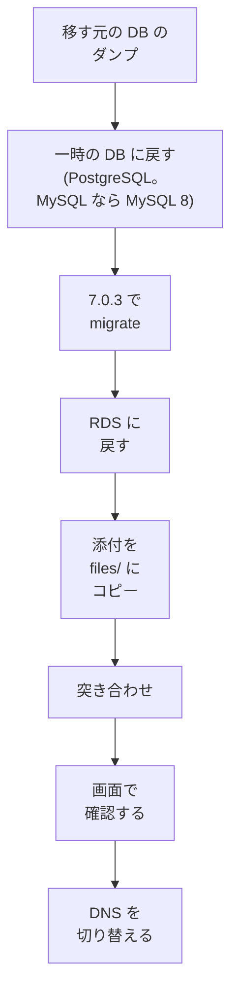
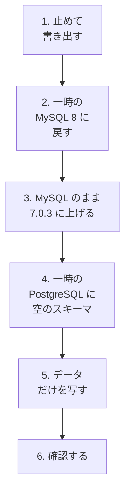

# 古い Redmine からの移行

ほかの環境で動いている古い Redmine(たとえば 3 系から 6 系)から、データを移す場合の進め方です。

## 移す前に確認すること

| 項目 | 確認すること | 影響 |
| --- | --- | --- |
| Redmine のバージョン | 移す元のバージョン | migration の長さ。3 系からだと長くなる |
| データベース | エンジン(MySQL、PostgreSQL など)とバージョン、大きさ | 移す先は RDS for PostgreSQL([rds.md](rds.md))。MySQL からなら変換が要る(下の「MySQL から移すとき」) |
| 添付ファイル | 置き場所(ディスクか S3 のプラグインか)、件数と大きさ、キーの形 | S3 へのコピーの手順 |
| プラグイン | 入れているプラグインと、そのテーブル | 移したあとに使えなくなる機能 |
| テーマ | 標準でないテーマか | 標準のテーマになる |

## 移す手順

1. **データベース:** 移す元のデータベースのダンプから、一時の PostgreSQL に戻します。移す元が PostgreSQL なら、変換は要りません。MySQL なら、下の「MySQL から移すとき」の手順で変換します。
2. **migration:** 一時の PostgreSQL の上で、Redmine 7.0.3 の `db:migrate` と `redmine:plugins:migrate` を実行します。古いバージョンから 7.0 まで、まとめて進めることになります。途中のバージョンを経る必要があるかは、Redmine の更新の手順(RedmineUpgrade の wiki)で確認します。一時の PostgreSQL は Lambda の外なので、`redmine-task` の 15 分には当たりません。
3. **RDS に戻す:** migration を当てたデータベースを書き出し(`pg_dump`)、空の RDS のデータベースに戻します(`pg_restore`)。RDS には VPC の中からしか届かないので、Session Manager のポートフォワーディングを通して行います([rds.md](rds.md#managing-it-with-systems-manager))。
4. **添付ファイル:** 移す元のファイル(ディスクの `files/` か、S3 のプラグインのバケット)を、新しいバケットの `files/` の下に、Redmine の `disk_directory` と `disk_filename` に合う形でコピーします。新しい設計のキーは `files/<disk_directory>/<disk_filename>` の形で、`disk_directory` が空の古い添付は `files/<disk_filename>` になります([attachments.md](https://redmine-kit.github.io/redmine_serverless_s3/ja/attachments.html#bucket-layout))。
5. **突き合わせ:** 管理画面の「添付ファイルの S3」で、データベースと S3 を突き合わせ、漏れがないかを確認します([admin.md](https://redmine-kit.github.io/redmine_serverless_s3/ja/admin.html#attachments-in-s3))。サムネイルは、画面で開いたときに作られるので、移すときに作らなくてもかまいません。
6. **digest:** 古い Redmine の添付の digest は MD5 のことがあります。Redmine には、SHA256 に作り直す rake のタスク(`redmine:attachments:update_digests`)があります。実行するかは、件数を見て決めます。

## MySQL から移すとき

移す元の Redmine が MySQL で動いているときの進め方です。下の 1〜6 のあと、一時の PostgreSQL の書き出しを RDS に戻します(上の「手順」の 3)。

MySQL のまま移す先(RDS for MySQL、Aurora MySQL)は、この設計では使いません([rds.md](rds.md#why-not-other-databases))。

1. **止めて書き出す:** 移す元の Redmine を止め(書き込みを止める)、データベースを書き出します(`mysqldump` に `--single-transaction`、`--default-character-set=utf8mb4`、`--hex-blob` を付ける)。止めたあとに入った変更は移らないので、止めてから書き出します。
2. **一時の MySQL 8 に戻す:** 書き出したものを、一時の MySQL 8.0 か 8.4(Docker か、スナップショットから作った一時の RDS for MySQL)に戻します。移す元が MySQL 5.7 なら、ここで 8 に上がります。文字コードが `utf8`(3 バイト)のテーブルは、`utf8mb4` に替えます。
3. **MySQL のまま 7.0.3 に上げる:** 一時の MySQL の上で、Redmine 7.0.3 の `db:migrate` を実行します。Redmine 7.0 は MySQL 8.0〜8.4 に対応しているので、古い Redmine を動かさずに、新しい Redmine で上げられます。古いバージョンから一気に上げてよいかは、Redmine の更新の手順(RedmineUpgrade の wiki)で確認します。
4. **一時の PostgreSQL に空のスキーマ:** 一時の PostgreSQL に、Redmine 7.0.3 の標準の `db:migrate` と `redmine:plugins:migrate` で、空のスキーマを作ります(初めのデータは入れない)。スキーマは、変換のツールに作らせず、Redmine の migration で作ります。
5. **データだけを写す:** 一時の MySQL(7.0.3 のスキーマ)から、一時の PostgreSQL の空のスキーマに、データだけを写します(下の「写し方」)。
6. **確認する:** 下の「確認すること」を通します。

写す前に、一時の MySQL で、ログイン名が大文字と小文字だけ違う利用者がいないかを調べます(`SELECT LOWER(login), COUNT(*) FROM users GROUP BY LOWER(login) HAVING COUNT(*) > 1`)。Redmine 7.0 は、PostgreSQL に `lower(login)` の一意の索引を作る(migration `20260319062845`)ので、そういう利用者がいると、写すときに失敗します。いれば、移す前に、どちらかのログイン名を変えるか、片方をまとめます。

### 写し方

| 項目 | 決まり |
| --- | --- |
| ツール | Embulk(`embulk-input-mysql`、`embulk-output-postgresql`)を候補にする。テーブルごとに、PostgreSQL の側のテーブルを空にしてから入れる(`truncate_insert`)。pgloader の最後のリリースは 3.6.9(2022-10)で、Redmine での実践の記録では上手くいかなかったとされている(下の「参考」) |
| 写さないテーブル | `schema_migrations` と `ar_internal_metadata`(手順 4 の migration で作られている)、入れないプラグインのテーブル(プラグインのデータは移らない) |
| バイナリの列 | `wiki_content_versions.data`(圧縮した wiki の本文)は、MySQL で base64 の文字にして写し、PostgreSQL で戻す |
| 真偽値 | MySQL の `tinyint(1)` の 0 と 1 を、PostgreSQL の `boolean` に入れる |
| 時刻 | Redmine は時刻を UTC で保存する。ツールの時刻の扱いで、写したあとに時刻がずれないようにする(写したあとに、いくつかの行の `created_on` を比べる) |
| 0 の日付 | `0000-00-00` のような値があれば、`NULL` にする |
| ID の続き | 写したあと、ID を持つテーブルごとに、ID の続きの番号(シーケンス)を、ID の最大に合わせる(`setval`) |
| 順番 | 外部キーのあるテーブル(OAuth の表など)は、参照される側を先に写す |

### 確認すること

- テーブルごとの行の数が、MySQL と PostgreSQL で同じか
- 時刻、真偽値、日本語の文字、wiki の本文(圧縮したもの)が、いくつかの行で同じか
- Redmine の管理の「情報」の画面と、チケット、wiki、添付ファイルの画面が開けるか
- 大文字と小文字だけが違う値の扱い: MySQL の照合順序は、大文字と小文字を同じとみなすことが多い。PostgreSQL では違う値になる。ログイン名やプロジェクトの識別子で、表示や検索が変わらないか

### 参考

Redmine 6.1 を MySQL 8.0 から PostgreSQL 18 に移した記録があります(@SKYS 氏「Redmine の DB を MySQL から PostgreSQL へ移行」、Qiita、2026-08-09。公式の情報ではありません)。スキーマを Redmine の migration で作り、Embulk でデータだけを写し、`schema_migrations` を除き、シーケンスを直し、`wiki_content_versions.data` を base64 で写す、という進め方です。この資料の「写し方」は、これを参考にしています。

## プラグインとテーマ

- **プラグイン:** 外部のプラグインは入れません。PostgreSQL から移すときは、移す元のデータベースをそのまま戻すので、プラグインのテーブルが残りますが、画面には出ません。MySQL から移すときは、新しく作ったスキーマにデータだけを入れるので、プラグインのテーブルとデータは移りません(移す元の書き出しに残ります)。どちらでも、そのプラグインの機能はなくなります。
- **テーマ:** 標準のテーマになります。

## 確認すること

- 古いバージョンから 7.0 へ、まとめて migration できるか
- Embulk で、Redmine のすべてのテーブルを写せるか(バイナリの列、時刻、真偽値)
- S3 のプラグインのバケットのキーの形と、新しいキーの形への写し方
