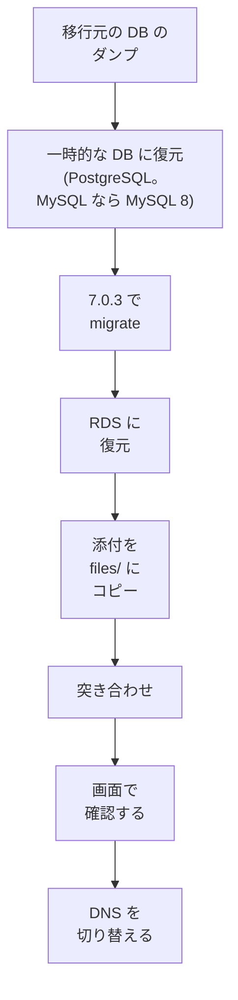
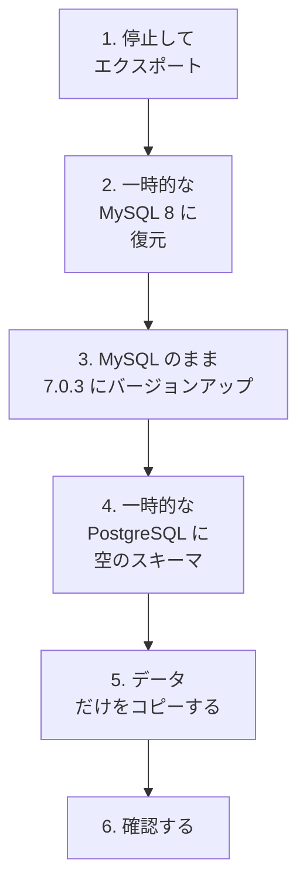

# 古い Redmine からの移行

ほかの環境で動いている古い Redmine (たとえば 3 系から 6 系) から、データを移行する場合の進め方です。

## 移行前の確認事項

| 項目 | 確認内容 | 影響 |
| --- | --- | --- |
| Redmine のバージョン | 移行元のバージョン | migration の長さ。3 系からだと長くなる |
| データベース | エンジン (MySQL、PostgreSQL など) とバージョン、データ量 | 移行先は RDS for PostgreSQL ([rds.md](rds.md))。MySQL からなら変換が必要 (下の「MySQL からの移行」) |
| 添付ファイル | 保存場所 (ディスクか S3 のプラグインか)、件数とサイズ、キーの形式 | S3 へのコピーの手順 |
| プラグイン | インストールしているプラグインと、そのテーブル | 移行後に使えなくなる機能 |
| テーマ | 標準でないテーマか | 標準テーマになる |

## 移行手順

1. **データベース:** 移行元のデータベースのダンプを、一時的な PostgreSQL に復元します。移行元が PostgreSQL なら、変換は不要です。MySQL なら、下の「MySQL からの移行」の手順で変換します。
2. **migration:** 一時的な PostgreSQL 上で、Redmine 7.0.3 の `db:migrate` と `redmine:plugins:migrate` を実行します。古いバージョンから 7.0 まで、まとめて進めることになります。途中のバージョンを経由する必要があるかは、Redmine の更新手順 (RedmineUpgrade の wiki) で確認します。一時的な PostgreSQL は Lambda の外にあるので、`redmine-task` の 15 分の制限には当たりません。
3. **RDS への復元:** migration を適用したデータベースをエクスポートし (`pg_dump`)、空の RDS のデータベースに復元します (`pg_restore`)。RDS には VPC 内からしか接続できないので、Session Manager のポートフォワーディングを通して行います ([rds.md](rds.md#managing-it-with-systems-manager))。
4. **添付ファイル:** 移行元のファイル (ディスクの `files/` か、S3 プラグインのバケット) を、新しいバケットの `files/` の下に、Redmine の `disk_directory` と `disk_filename` に合う形式でコピーします。新しい設計のキーは `files/<disk_directory>/<disk_filename>` の形式で、`disk_directory` が空の古い添付ファイルは `files/<disk_filename>` になります ([attachments.md](https://redmine-kit.github.io/redmine_serverless_s3/ja/attachments.html#bucket-layout))。
5. **整合性チェック:** 管理画面の「S3」のタブで、データベースと S3 の整合性チェックを実行し、漏れがないかを確認します ([admin.md](https://redmine-kit.github.io/redmine_serverless_s3/ja/admin.html#attachments-in-s3))。サムネイルは、画面で開いたときに生成されるので、移行時に生成しなくてもかまいません。
6. **digest:** 古い Redmine の添付ファイルの digest は MD5 の場合があります。Redmine には、SHA256 で再作成する rake タスク (`redmine:attachments:update_digests`) があります。実行するかは、件数を見て決めます。

## MySQL からの移行

移行元の Redmine が MySQL で動いているときの進め方です。下の 1〜6 の後、一時的な PostgreSQL のエクスポートを RDS に復元します (上の「移行手順」の 3)。

MySQL のままの移行先 (RDS for MySQL、Aurora MySQL) は、この設計では使いません ([rds.md](rds.md#why-not-other-databases))。

1. **停止とエクスポート:** 移行元の Redmine を停止し (書き込みを止める)、データベースをエクスポートします (`mysqldump` に `--single-transaction`、`--default-character-set=utf8mb4`、`--hex-blob` を付ける)。停止後に発生した変更は移行されないので、停止してからエクスポートします。
2. **一時的な MySQL 8 への復元:** エクスポートしたデータを、一時的な MySQL 8.0 か 8.4 (Docker か、スナップショットから作成した一時的な RDS for MySQL) に復元します。移行元が MySQL 5.7 なら、ここで 8 になります。文字コードが `utf8` (3 バイト) のテーブルは、`utf8mb4` に変更します。
3. **MySQL のままでの 7.0.3 へのバージョンアップ:** 一時的な MySQL 上で、Redmine 7.0.3 の `db:migrate` を実行します。Redmine 7.0 は MySQL 8.0〜8.4 に対応しているので、古い Redmine を動かさずに、新しい Redmine でバージョンアップできます。古いバージョンから一度にバージョンアップしてよいかは、Redmine の更新手順 (RedmineUpgrade の wiki) で確認します。
4. **一時的な PostgreSQL に空のスキーマを作成:** 一時的な PostgreSQL に、Redmine 7.0.3 の標準の `db:migrate` と `redmine:plugins:migrate` で、空のスキーマを作成します (初期データは投入しない)。スキーマは、変換ツールに作らせず、Redmine の migration で作成します。
5. **データだけのコピー:** 一時的な MySQL (7.0.3 のスキーマ) から、一時的な PostgreSQL の空のスキーマに、データだけをコピーします (下の「コピー方法」)。
6. **確認:** 下の「確認項目」を順に確認します。

コピーする前に、一時的な MySQL で、ログイン名が大文字と小文字だけ違うユーザーがいないかを調べます (`SELECT LOWER(login), COUNT(*) FROM users GROUP BY LOWER(login) HAVING COUNT(*) > 1`)。Redmine 7.0 は、PostgreSQL に `lower(login)` の一意インデックスを作成する (migration `20260319062845`) ので、該当するユーザーがいると、コピー時に失敗します。いれば、移行前に、どちらかのログイン名を変更するか、片方に統合します。

### コピー方法

| 項目 | 規則 |
| --- | --- |
| ツール | Embulk (`embulk-input-mysql`、`embulk-output-postgresql`) を候補にする。テーブルごとに、PostgreSQL 側のテーブルを空にしてから投入する (`truncate_insert`)。pgloader の最新リリースは 3.6.9 (2022-10) で、Redmine での実践の記録ではうまくいかなかったとされている (下の「参考」) |
| コピーしないテーブル | `schema_migrations` と `ar_internal_metadata` (手順 4 の migration で作成済み)、インストールしないプラグインのテーブル (プラグインのデータは移行されない) |
| バイナリの列 | `wiki_content_versions.data` (圧縮した wiki の本文) は、MySQL で base64 の文字列にしてコピーし、PostgreSQL でデコードする |
| 真偽値 | MySQL の `tinyint(1)` の 0 と 1 を、PostgreSQL の `boolean` に変換する |
| 時刻 | Redmine は時刻を UTC で保存する。ツールの時刻の扱いで、コピー後に時刻がずれないようにする (コピー後に、いくつかの行の `created_on` を比較する) |
| ゼロの日付 | `0000-00-00` のような値があれば、`NULL` にする |
| ID のシーケンス | コピー後、ID を持つテーブルごとに、シーケンスの値を ID の最大値に合わせる (`setval`) |
| 順序 | 外部キーのあるテーブル (OAuth のテーブルなど) は、参照される側を先にコピーする |

### 確認項目

- テーブルごとの行数が、MySQL と PostgreSQL で一致するか
- 時刻、真偽値、日本語の文字、wiki の本文 (圧縮したもの) が、いくつかの行で一致するか
- Redmine の管理の「情報」画面と、チケット、wiki、添付ファイルの画面を開けるか
- 大文字と小文字だけが違う値の扱い: MySQL の照合順序は、大文字と小文字を区別しないことが多い。PostgreSQL では別の値になる。ログイン名やプロジェクトの識別子で、表示や検索が変わらないか

### 参考

Redmine 6.1 を MySQL 8.0 から PostgreSQL 18 に移行した記録があります (@SKYS 氏「Redmine の DB を MySQL から PostgreSQL へ移行」、Qiita、2026-08-09。公式の情報ではありません)。スキーマを Redmine の migration で作成し、Embulk でデータだけをコピーし、`schema_migrations` を除き、シーケンスを修正し、`wiki_content_versions.data` を base64 でコピーする、という進め方です。この資料の「コピー方法」は、これを参考にしています。

## プラグインとテーマ

- **プラグイン:** 外部のプラグインはインストールしません。PostgreSQL から移行するときは、移行元のデータベースをそのまま復元するので、プラグインのテーブルが残りますが、画面には表示されません。MySQL から移行するときは、新しく作成したスキーマにデータだけを投入するので、プラグインのテーブルとデータは移行されません (移行元のエクスポートには残ります)。どちらの場合も、そのプラグインの機能はなくなります。
- **テーマ:** 標準テーマになります。

## 未確認の事項

- 古いバージョンから 7.0 へ、まとめて migration できるか
- Embulk で、Redmine のすべてのテーブルをコピーできるか (バイナリの列、時刻、真偽値)
- S3 プラグインのバケットのキーの形式と、新しいキーの形式へのコピー方法
