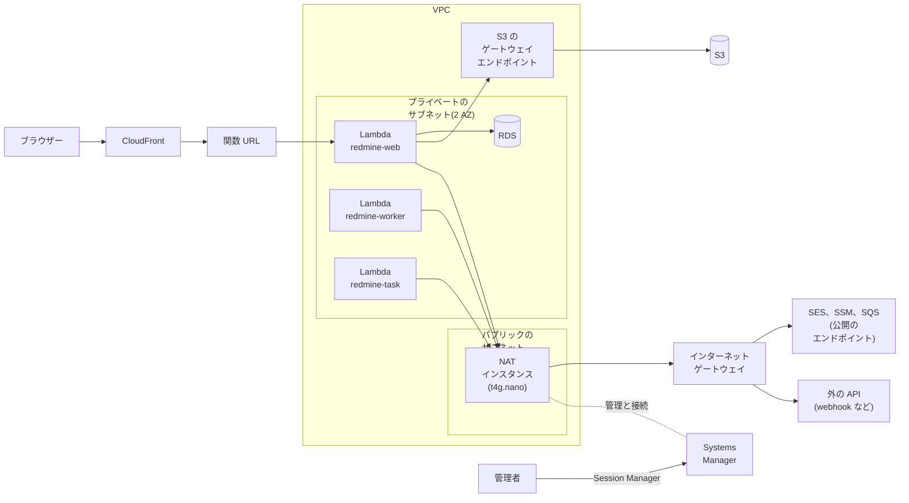

# データベース(RDS for PostgreSQL)

データベースは、VPC の中の Amazon RDS for PostgreSQL です。Lambda の関数は、同じ VPC のプライベートのサブネットで動き、VPC のエンドポイントか NAT インスタンスで AWS のサービスに届きます(下の「VPC から外への経路」)。

この資料の単価は、AWS の価格表(Price List API)の東京のファイルから取りました(AmazonRDS は 2026-10-29 公開)。月額は 730 時間で計算しています。出典は [sources.md](sources.md) にあります。

## 構成図

VPC のエンドポイントで AWS のサービスに届く形です。NAT インスタンスで届く形は、下の「形 2: NAT インスタンス」にあります。

`redmine-web`、`redmine-worker`、`redmine-task` は同じイメージです。3 つとも、データベースと各エンドポイントを使います(図では線を省いています)。

## Rails からの接続

| 項目 | 決めたこと |
| --- | --- |
| アダプター | ActiveRecord の標準の PostgreSQL のアダプター(`pg` の gem)。`config/database.yml` は `adapter: postgresql` |
| 設定 | 環境変数の `REDMINE_DB_HOST`、`REDMINE_DB_NAME`(既定は `redmine`)、`REDMINE_DB_USERNAME`(既定は `redmine`)、`REDMINE_DB_PASSWORD`、`REDMINE_DB_PORT`(既定は `5432`)、`REDMINE_DB_SSLMODE`(既定は `verify-full`) |
| パスワード | SSM Parameter Store の `/<instance>/env/REDMINE_DB_PASSWORD`(SecureString)に置き、起動のときにほかの設定と一緒に読む([lambda.md](lambda.md#settings-and-secrets-ssm-parameter-store))。ホストなど、秘密でない値は、同じパスの下の String のパラメーターにする |
| TLS | `verify-full`。イメージに RDS のグローバルの CA のバンドル(`https://truststore.pki.rds.amazonaws.com/global/global-bundle.pem`。イメージを作るときに取得し、決めた SHA256 で確認する)を `/var/task/rds-global-bundle.pem` として入れ、`config/database.yml` が `sslrootcert` に渡す。`disable` を使うのは手元のテストだけ |
| 接続の数 | 環境ごとに 1 つ(`pool: 1`) |
| データベースのユーザー | 表を持つユーザー 1 つ。3 つの関数が使う |

## migration

- **Redmine の標準の migration:** `redmine-task` が、`db:migrate` と `redmine:plugins:migrate` をそのまま実行します([tasks.md](tasks.md#migrations-during-deployment))。migration を書き換えたり、差し替えたりはしません。
- **新しく始めるとき:** migration のあとに、`redmine-task` で `redmine:load_default_data` を実行します。言語は、設定のファイルの `redmine.settings.default_language` です(なければ英語)。
- **Redmine を上げるとき:** 新しい migration は、デプロイの前に読み、PostgreSQL のコンテナで実行して確認します([upgrade.md](upgrade.md))。

## セキュリティ

- **外から届かない:** RDS は、パブリックアクセスのないプライベートのサブネットに置きます。セキュリティグループは、3 つの関数のセキュリティグループ(と、管理者のための NAT インスタンスのもの。下の「Systems Manager で管理する」)からの 5432 番だけを許します。
- **パスワード:** SSM Parameter Store の SecureString と RDS にだけ置きます。変えるときは、新しい値を RDS と SSM に設定してから、関数を更新して、新しい環境が読むようにします。
- **暗号化:** 保存時は AWS の管理する鍵で暗号化し、接続には TLS を強制します(`rds.force_ssl`)。関数は、サーバーの証明書を確認します(`verify-full`)。
- **管理者:** Session Manager のポートフォワーディングでつなぎます。インターネットに向けて、入るポートは開けません。

## データベース

Amazon RDS for PostgreSQL の db.t4g.micro を、VPC の中に置きます。

| 項目 | 単価 | 月額 |
| --- | --- | --- |
| db.t4g.micro(2 vCPU、メモリ 1 GiB)、Single-AZ | 1 時間 0.025 ドル | 18.25 ドル |
| gp3、20 GB | 1 GB あたり月 0.138 ドル | 2.76 ドル |
| 自動バックアップ | 確保したストレージの量までは無料 | 0 ドル |
| 合計 | | 21.01 ドル |

- **費用が予測できる:** 使われない時間も同じ費用ですが、Aurora のように、接続が残っていて止まらないことで費用が膨らむことがありません。
- **CPU のクレジット:** T4g は Unlimited モードで動きます。CPU を長く使い続けると、1 vCPU 時間あたり 0.075 ドルが加わります。
- **止めておく運用はしない:** RDS は 7 日まで止められますが、開始に「数分から数時間」かかることがあると公式が書いています。業務時間の外も使えるように、止めずに動かします。
- **エンジン:** PostgreSQL(RDS の最新のメジャーバージョン。作るときに確認する)。Redmine 7.0 は PostgreSQL 14 以上に対応しています(RedmineInstall の wiki)。

### 設定

| 項目 | 値 | 理由 |
| --- | --- | --- |
| サブネット | プライベートのサブネット 2 つ(2 AZ) | RDS のサブネットグループに 2 AZ が要る |
| パブリックアクセス | なし | — |
| セキュリティグループ | `redmine-web`、`redmine-worker`、`redmine-task` のセキュリティグループからの 5432 番だけ | — |
| 暗号化 | 保存時の暗号化あり(AWS の管理する鍵) | — |
| TLS | 強制する(パラメーターグループの `rds.force_ssl`) | 関数は `verify-full` でつなぐ(上の「Rails からの接続」) |
| 認証 | パスワード | IAM のデータベース認証は、データベースに 300〜1,000 MiB の追加のメモリが要る。メモリ 1 GiB の t4g.micro では厳しい |
| 自動バックアップ | 7 日 | 確保したストレージの量までは無料 |
| 削除の保護 | あり | — |
| Multi-AZ | なし | 費用が 2 倍になる。少人数の用途なので、止まったときはバックアップから戻す |

## VPC から外への経路

VPC の中の Lambda が、AWS のサービスとインターネットに届く経路です。VPC のエンドポイントで届く形と、NAT インスタンスで届く形があります。

### 共通の部分

| 項目 | 内容 |
| --- | --- |
| VPC | 1 つ。2 つの AZ に、プライベートのサブネットを 1 つずつ |
| Lambda | `redmine-web`、`redmine-worker`、`redmine-task` を、プライベートのサブネットに置く |
| RDS | プライベートのサブネット。パブリックアクセスなし |
| S3 | ゲートウェイエンドポイント(無料)で届く。どちらの形でも置く |
| 外から VPC の中へ | 入れない。画面は CloudFront から関数 URL(VPC の外の Lambda の入口)に届く |
| 作る場所 | VPC、サブネット、エンドポイントか NAT インスタンスは、共有の土台に入れる([deploy-config.md](deploy-config.md#shared-base-and-per-instance-resources)) |
| 権限 | 実行ロールに、VPC の中で動くための権限を付ける([iam.md](iam.md#permissions-common-to-the-three-functions)) |

### 形 1: VPC のエンドポイント

上の構成図の形です。

| 届く先 | 経路 | 月額 |
| --- | --- | --- |
| S3 | ゲートウェイエンドポイント | 0 ドル |
| SES の API | インターフェイスエンドポイント(1 AZ) | 約 10.2 ドル |
| SSM | インターフェイスエンドポイント(1 AZ) | 約 10.2 ドル |
| SQS | インターフェイスエンドポイント(1 AZ) | 約 10.2 ドル |
| インターネット | 届かない | — |

- **良いところ:** AWS が管理するので、運用の手間がありません。インターネットに出られないので、外への通信の誤りや漏れが起きません。
- **足りないところ:** 届く先を足すたびに、エンドポイントが 1 つ月約 10.2 ドル増えます。webhook や、外の API を呼ぶ機能が使えません。webhook が時間切れを待たずにすぐ失敗するように、`webhook_blocklist` をすべてのアドレスにします([lambda.md](lambda.md#background-jobs))。

### 形 2: NAT インスタンス

`redmine-worker` と `redmine-task` も、`redmine-web` と同じく RDS と S3 のゲートウェイエンドポイントを使います(図では線を省いています)。

| 届く先 | 経路 | 月額 |
| --- | --- | --- |
| S3 | ゲートウェイエンドポイント(NAT を通さない) | 0 ドル |
| SES、SSM、SQS | NAT インスタンス → インターネットゲートウェイ → 公開のエンドポイント | NAT インスタンスの費用に含む |
| インターネット | 同上 | 同上 |
| NAT インスタンス | t4g.nano 1 台(1 時間 0.0054 ドル)、パブリック IPv4(1 時間 0.005 ドル)、ディスク | 約 8.4 ドル |

- **良いところ:** 3 つのインターフェイスエンドポイント(月約 30.7 ドル)が要らなくなり、月約 22 ドル下がります。webhook や外の API(AI の機能など。[ai.md](ai.md))も使えます。
- **足りないところ:** 1 台なので、止まると SES、SSM、SQS に届かなくなります。Lambda の起動(SSM の読み込み)、ジョブ、メールの送信が止まります。OS の更新と、止まったときの立て直しを自分で行います(下記)。
- **S3 は NAT を通さない:** 添付ファイルの読み書きは量が多いので、ゲートウェイエンドポイントのまま、NAT インスタンスを通しません。

#### NAT インスタンスの作り

| 項目 | 内容 |
| --- | --- |
| インスタンス | t4g.nano(arm64)、Amazon Linux 2023 |
| 置き場所 | パブリックのサブネット 1 つ。Elastic IP を付ける |
| 転送 | 送信元と宛先の確認(source/destination check)を外し、IP の転送と、送信元の付け替え(`iptables` の MASQUERADE)を有効にする |
| 経路 | プライベートのサブネットの経路表で、`0.0.0.0/0` を NAT インスタンスのネットワークインターフェイスに向ける |
| セキュリティグループ | VPC の中からの通信だけを受ける。外からは何も受けない(SSH の 22 番も開けない) |
| 立て直し | 台数 1 の Auto Scaling グループにし、止まったら新しいインスタンスが立ち上がるようにする。立ち上がったインスタンスが、自分で経路表とネットワークインターフェイスを付け替える(起動のスクリプト) |

#### Systems Manager で管理する

NAT インスタンスは、Systems Manager で管理し、接続も Systems Manager で行います。SSH の鍵は作らず、外から入るポートも開けません。

| すること | 使用する機能 |
| --- | --- |
| シェルで入る | Session Manager。操作のログを CloudWatch Logs に残す |
| OS の更新 | Patch Manager。メンテナンスウィンドウで、利用の少ない時間に当てる。再起動のあいだは外に出られなくなるので、業務時間の外にする |
| 状態を見る | Fleet Manager、インベントリ |
| データベースにつなぐ | Session Manager のポートフォワーディング(リモートのホストへ。`AWS-StartPortForwardingSessionToRemoteHost`)で、NAT インスタンスを経由して RDS の 5432 番を手元に転送する |

- **インスタンスの権限:** インスタンスのロールに、AWS の管理ポリシー `AmazonSSMManagedInstanceCore` を付けます([iam.md](iam.md#role-of-the-nat-instance-only-with-a-nat-instance))。
- **Systems Manager に届く経路:** NAT インスタンス自身が外に出られるので、Systems Manager のエンドポイントは要りません。
- **データベースへの接続:** RDS のセキュリティグループで、NAT インスタンスのセキュリティグループからの 5432 番を許します。管理者は、手元の `psql` などで、転送したポートにつなぎます。データベースのパスワードは、SSM Parameter Store から読みます。
- **形 1 のときのデータベースへの接続:** NAT インスタンスがないので、`bin/rails runner` で確認するか、必要なときだけ、Systems Manager で管理する小さなインスタンスを立てて、同じポートフォワーディングでつなぎます。

### どちらにするか

| 重く見ること | 向いている形 |
| --- | --- |
| 運用の手間を減らす、外への通信をなくす | 形 1(エンドポイント) |
| 月の費用を抑える、webhook や外の API を使う | 形 2(NAT インスタンス) |

どちらの形でも、Redmine とプラグインのコードは同じです。設定のファイルの `network.mode` で切り替えます。

## 費用

| 項目 | 月額 |
| --- | --- |
| RDS for PostgreSQL(上の「データベース」) | 21.01 ドル |
| 経路: SES、SSM、SQS のインターフェイスエンドポイント(1 AZ、1 つ 1 時間 0.014 ドル、1 GB あたり 0.01 ドル) | 約 30.7 ドル |
| 経路: NAT インスタンス(エンドポイントの代わり。インスタンス 3.9 ドル、パブリック IPv4 3.65 ドル、ディスク約 0.8 ドル) | 約 8.4 ドル |

| 形 | 月額 | 内訳 |
| --- | --- | --- |
| RDS と、SES、SSM、SQS のエンドポイント | 約 55.3 ドル | RDS 約 21.0 ドル、エンドポイント約 30.7 ドル、そのほか(Lambda、S3 など。[cost.md](cost.md))約 3.6 ドル |
| RDS と、NAT インスタンス | 約 33.0 ドル | RDS 約 21.0 ドル、NAT インスタンス約 8.4 ドル、そのほか約 3.6 ドル |

| 足すもの | 月額 | 足すとき |
| --- | --- | --- |
| RDS の Multi-AZ | 約 21 ドル(2 倍) | 止まる時間を短くしたいとき |
| SES のエンドポイントを 2 AZ に | 約 10 ドル | エンドポイントの形で、エンドポイントの AZ が止まったときも、メールを送りたいとき |
| NAT Gateway | 約 45 ドル + 1 GB あたり 0.062 ドル | NAT インスタンスの代わりに、AWS が管理する経路で外に出たいとき |
| RDS Proxy | 約 26 ドル | 接続の数が足りなくなったとき |

NAT インスタンスのディスクの単価は、価格表で確認していません。

## ほかのデータベースを使わない理由

| 選択肢 | 使わない理由 |
| --- | --- |
| RDS、パブリック | データベースをインターネットに開けることになる。パスワードだけで守ることになる |
| Aurora PostgreSQL Serverless v2(最小 0 ACU) | 止まったあとの再開に約 15 秒(24 時間を超えて止まると 30 秒以上)かかり、Lambda の起動待ちと重なる。接続が 1 本でも開いていると止まらず、費用が読めない |
| MySQL(RDS for MySQL、Aurora MySQL Serverless v2) | この設計と、テストと、移す手順は、PostgreSQL に合わせて書いている。古い Redmine のデータが MySQL でも、PostgreSQL に移す手順で移す([migration.md](migration.md#migrating-from-mysql)) |
| SQLite(EFS か S3 Files の上) | Lambda は同時の要求に応じて環境を増やすので、複数の環境が 1 つのファイルに書く。SQLite の公式は、ネットワークのファイルシステムの上での利用は、ロックの問題でデータベースが壊れた例があるとしている |
| Lightsail のデータベース | 暗号化がなく、パブリックにする必要がある |

## 確認すること

- 15 本ほどの接続と Redmine の負荷で、db.t4g.micro のメモリと CPU のクレジットが足りるか
- RDS の PostgreSQL の最新のメジャーバージョンで、Redmine 7.0.3 が動くか(wiki に書かれているのは最低のバージョンだけ)
- NAT インスタンスを、台数 1 の Auto Scaling グループで立て直すときに、経路表の付け替えにかかる時間
- Patch Manager の再起動のあいだに、Lambda の要求がどうなるか(SSM の読み込みの失敗と、ジョブのやり直し)
- Session Manager とポートフォワーディングに、追加の料金がかかるか(AWS の料金のページで確認する)
- RDS のグローバルの CA のバンドルで、RDS のエンドポイントの名前に対して `verify-full` が通るか
- データベースのユーザーが 1 つで足りるか。web の関数には DDL のできないユーザーを分けるか(`redmine-task` は表を持つユーザーのまま)
