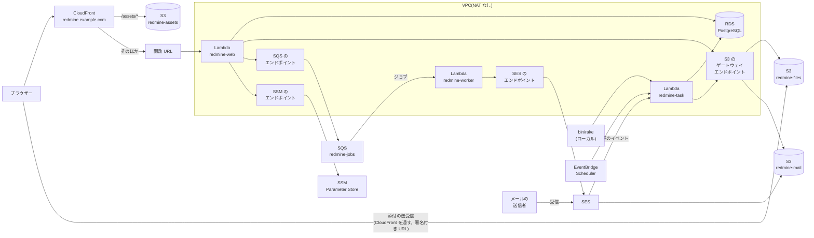
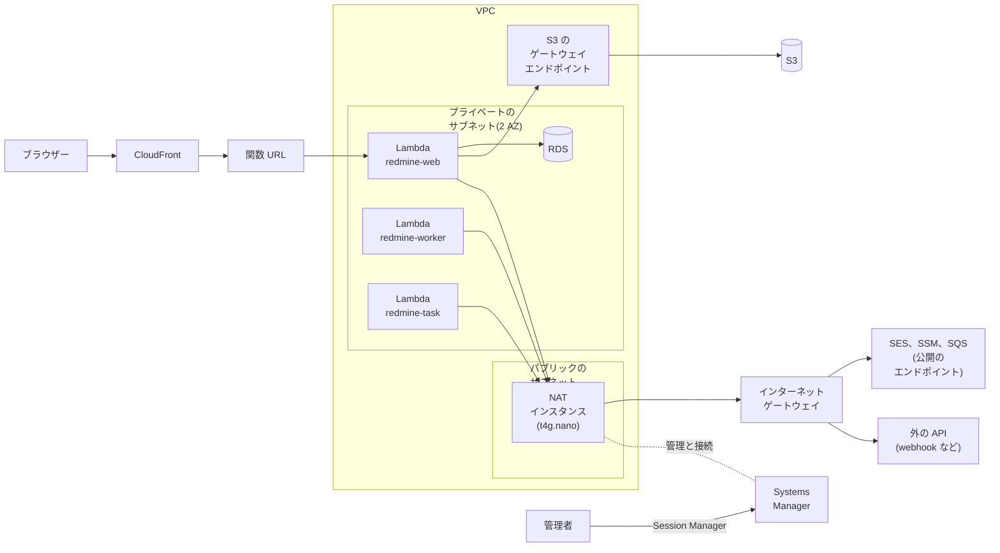

# データベース (RDS for PostgreSQL)

データベースは、VPC 内の Amazon RDS for PostgreSQL です。Lambda 関数は同じ VPC のプライベートサブネットで動き、VPC エンドポイントか NAT インスタンスを経由して AWS サービスに接続します (下の「VPC 外への経路」)。

この資料の単価は、AWS の料金表 (Price List API) の ap-northeast-1 の料金表ファイルから取得しました (AmazonRDS は 2026-10-29 公開)。月額は 730 時間で計算しています。出典は [sources.md](sources.md) にあります。

## 構成図

VPC エンドポイントで AWS サービスに接続する構成です。NAT インスタンスで接続する構成は、下の「構成 2: NAT インスタンス」にあります。

`redmine-web`、`redmine-worker`、`redmine-task` は同じイメージです。3 つとも、データベースと各エンドポイントを使います (図では線を省いています)。

## Rails からの接続

| 項目 | 決定事項 |
| --- | --- |
| アダプター | ActiveRecord 標準の PostgreSQL アダプター (gem `pg`)。`config/database.yml` は `adapter: postgresql` |
| 設定 | 環境変数 `REDMINE_DB_HOST`、`REDMINE_DB_NAME` (デフォルトは `redmine`)、`REDMINE_DB_USERNAME` (デフォルトは `redmine`)、`REDMINE_DB_PASSWORD`、`REDMINE_DB_PORT` (デフォルトは `5432`)、`REDMINE_DB_SSLMODE` (デフォルトは `verify-full`) |
| パスワード | SSM Parameter Store の `/<instance>/env/REDMINE_DB_PASSWORD` (SecureString) に保存し、起動時にほかの設定と一緒に読み込む ([lambda.md](lambda.md#settings-and-secrets-ssm-parameter-store))。ホストなど、シークレットでない値は、同じパスの下の String パラメーターにする |
| TLS | `verify-full`。RDS のグローバル CA バンドル (`https://truststore.pki.rds.amazonaws.com/global/global-bundle.pem`。イメージのビルド時に取得し、固定した SHA256 で確認する) を `/var/task/rds-global-bundle.pem` としてイメージに含め、`config/database.yml` が `sslrootcert` に渡す。`disable` を使うのはローカルのテストだけ |
| 接続数 | 実行環境ごとに 1 つ (`pool: 1`) |
| データベースユーザー | テーブルを所有するユーザー 1 つ。3 つの関数が使う |

## migration

- **Redmine 標準の migration:** `redmine-task` が `db:migrate` と `redmine:plugins:migrate` をそのまま実行します ([tasks.md](tasks.md#migrations-during-deployment))。migration の書き換えや置き換えはしません。
- **新規インストール:** migration の後に、`redmine-task` で `redmine:load_default_data` を実行します。言語は設定ファイルの `redmine.settings.default_language` です (未設定なら英語)。
- **Redmine のバージョンアップ:** 新しい migration は、デプロイ前に内容を読み、PostgreSQL コンテナで実行して確認します ([upgrade.md](upgrade.md))。

## セキュリティ

- **外部から接続できない:** RDS は、パブリックアクセスのないプライベートサブネットに配置します。セキュリティグループは、3 つの関数のセキュリティグループ (と、管理者用に NAT インスタンスのセキュリティグループ。下の「Systems Manager による管理」) からの 5432 番ポートだけを許可します。
- **パスワード:** SSM Parameter Store の SecureString と RDS にだけ保存します。変更するときは、新しい値を RDS と SSM に設定してから関数を更新し、新しい実行環境が読み込むようにします。
- **暗号化:** 保存時は AWS マネージドキーで暗号化し、接続には TLS を強制します (`rds.force_ssl`)。関数はサーバー証明書を検証します (`verify-full`)。
- **管理者:** Session Manager のポートフォワーディングで接続します。インターネットに向けたインバウンドのポートは開けません。

## データベース

Amazon RDS for PostgreSQL の db.t4g.micro を VPC 内に配置します。

| 項目 | 単価 | 月額 |
| --- | --- | --- |
| db.t4g.micro (2 vCPU、メモリ 1 GiB)、Single-AZ | 1 時間 0.025 ドル | 18.25 ドル |
| gp3、20 GB | 1 GB あたり月 0.138 ドル | 2.76 ドル |
| 自動バックアップ | プロビジョニングしたストレージ容量までは無料 | 0 ドル |
| 合計 | | 21.01 ドル |

エンジンは PostgreSQL で、RDS で使える最新のメジャーバージョンを使います (構築時に確認する)。Redmine 7.0 は PostgreSQL 14 以上に対応しています (wiki の RedmineInstall)。

費用は予測できます。使われない時間も同じ費用がかかりますが、Aurora のように、接続が残ってデータベースが停止せず費用が膨らむことはありません。T4g は Unlimited モードで動くので、CPU を長時間使い続けると、1 vCPU 時間あたり 0.075 ドルが加算されます。

業務時間外もインスタンスは停止しません。RDS は最大 7 日間停止できますが、公式ドキュメントによると開始に「数分から数時間」かかることがあり、Redmine はいつでも使える状態にしておくためです。

### 設定

| 項目 | 値 | 理由 |
| --- | --- | --- |
| サブネット | プライベートサブネット 2 つ (2 AZ) | RDS の DB サブネットグループには 2 AZ が必要 |
| パブリックアクセス | なし | — |
| セキュリティグループ | `redmine-web`、`redmine-worker`、`redmine-task` のセキュリティグループからの 5432 番ポートだけ | — |
| 暗号化 | 保存時の暗号化あり (AWS マネージドキー) | — |
| TLS | 強制する (パラメーターグループの `rds.force_ssl`) | 関数は `verify-full` で接続する (上の「Rails からの接続」) |
| 認証 | パスワード | IAM データベース認証には、データベース側で 300〜1,000 MiB の追加メモリが必要。メモリ 1 GiB の t4g.micro では厳しい |
| 自動バックアップ | 7 日 | プロビジョニングしたストレージ容量までは無料 |
| 削除保護 | あり | — |
| Multi-AZ | なし | 費用が 2 倍になる。少人数の用途なので、障害時はバックアップから復元する |

## VPC 外への経路

VPC 内の Lambda が AWS サービスとインターネットに接続する経路です。VPC エンドポイントを使う構成と、NAT インスタンスを使う構成があります。

### 共通項目

| 項目 | 内容 |
| --- | --- |
| VPC | 1 つ。2 つの AZ に、プライベートサブネットを 1 つずつ |
| Lambda | `redmine-web`、`redmine-worker`、`redmine-task` をプライベートサブネットに配置する |
| RDS | プライベートサブネット。パブリックアクセスなし |
| S3 | ゲートウェイエンドポイント (無料) で接続する。どちらの構成でも作成する |
| 外部から VPC 内へ | 接続できない。画面へのリクエストは CloudFront から関数 URL (VPC 外にある Lambda のエンドポイント) に到達する |
| 作成場所 | VPC、サブネット、エンドポイントか NAT インスタンスは、共有基盤に含める ([deploy-config.md](deploy-config.md#shared-base-and-per-instance-resources)) |
| 権限 | 実行ロールに、VPC 内で動くための権限を付与する ([iam.md](iam.md#permissions-common-to-the-three-functions)) |

### 構成 1: VPC エンドポイント

上の構成図の構成です。

| 接続先 | 経路 | 月額 |
| --- | --- | --- |
| S3 | ゲートウェイエンドポイント | 0 ドル |
| SES の API | インターフェイスエンドポイント (1 AZ) | 約 10.2 ドル |
| SSM | インターフェイスエンドポイント (1 AZ) | 約 10.2 ドル |
| SQS | インターフェイスエンドポイント (1 AZ) | 約 10.2 ドル |
| インターネット | 接続できない | — |

- **利点:** AWS が管理するので、運用の手間がかかりません。インターネットに接続できないので、外部への誤った通信や情報の漏洩が起きません。
- **欠点:** 接続先を追加するたびに、エンドポイント 1 つにつき月約 10.2 ドル増えます。webhook や、外部の API を呼ぶ機能は使えません。webhook がタイムアウトを待たずにすぐ失敗するように、`webhook_blocklist` にすべてのアドレスを指定します ([lambda.md](lambda.md#background-jobs))。

### 構成 2: NAT インスタンス

`redmine-worker` と `redmine-task` も、`redmine-web` と同じく RDS と S3 ゲートウェイエンドポイントを使います (図では線を省いています)。

| 接続先 | 経路 | 月額 |
| --- | --- | --- |
| S3 | ゲートウェイエンドポイント (NAT を経由しない) | 0 ドル |
| SES、SSM、SQS | NAT インスタンス → インターネットゲートウェイ → パブリックエンドポイント | NAT インスタンスの費用に含む |
| インターネット | 同上 | 同上 |
| NAT インスタンス | t4g.nano 1 台 (1 時間 0.0054 ドル)、パブリック IPv4 (1 時間 0.005 ドル)、ディスク | 約 8.4 ドル |

- **利点:** 3 つのインターフェイスエンドポイント (月約 30.7 ドル) が不要になり、月約 22 ドル安くなります。webhook や外部の API (AI 機能など。[ai.md](ai.md)) も使えます。
- **欠点:** 1 台なので、停止すると SES、SSM、SQS に接続できなくなります。Lambda の起動 (SSM からの読み込み)、ジョブ、メール送信が止まります。OS の更新と、障害時の復旧は自分で行います (下記)。

添付ファイルの読み書きは量が多いので、S3 はゲートウェイエンドポイントのままにし、NAT インスタンスを経由させません。

#### NAT インスタンスの構築

| 項目 | 内容 |
| --- | --- |
| インスタンス | t4g.nano (arm64)、Amazon Linux 2023 |
| 配置 | パブリックサブネット 1 つ。Elastic IP を割り当てる |
| 転送 | 送信元/送信先チェック (source/destination check) を無効にし、IP 転送と送信元 NAT (`iptables` の MASQUERADE) を有効にする |
| 経路 | プライベートサブネットのルートテーブルで、`0.0.0.0/0` を NAT インスタンスのネットワークインターフェイスに向ける |
| セキュリティグループ | VPC 内からの通信だけを受け付ける。外部からは何も受け付けない (SSH の 22 番ポートも開けない) |
| 復旧 | 台数 1 の Auto Scaling グループにし、停止したら新しいインスタンスが起動するようにする。起動したインスタンスが、自分でルートテーブルとネットワークインターフェイスを付け替える (起動スクリプト) |

#### Systems Manager による管理

NAT インスタンスは Systems Manager で管理し、接続も Systems Manager で行います。SSH キーは作成せず、外部からのインバウンドのポートも開けません。

| 操作 | 使用する機能 |
| --- | --- |
| シェルへのログイン | Session Manager。操作ログを CloudWatch Logs に保存する |
| OS の更新 | Patch Manager。メンテナンスウィンドウで、利用の少ない時間帯に適用する。再起動中は外部に接続できなくなるので、業務時間外にする |
| 状態の確認 | Fleet Manager、インベントリ |
| データベースへの接続 | Session Manager のリモートホストへのポートフォワーディング (`AWS-StartPortForwardingSessionToRemoteHost`) で、NAT インスタンスを経由して RDS の 5432 番ポートをローカルに転送する |

- **インスタンスの権限:** インスタンスロールに、AWS 管理ポリシー `AmazonSSMManagedInstanceCore` をアタッチします ([iam.md](iam.md#role-of-the-nat-instance-only-with-a-nat-instance))。
- **Systems Manager への経路:** NAT インスタンス自身が外部に接続できるので、Systems Manager のエンドポイントは不要です。
- **データベースへの接続:** RDS のセキュリティグループで、NAT インスタンスのセキュリティグループからの 5432 番ポートを許可します。管理者は、ローカルの `psql` などで転送したポートに接続します。データベースパスワードは SSM Parameter Store から読み取ります。
- **構成 1 でのデータベースへの接続:** NAT インスタンスがないので、`bin/rails runner` で確認するか、必要なときだけ Systems Manager で管理する小さなインスタンスを起動し、同じポートフォワーディングで接続します。

### 構成の選び方

| 重視すること | 適した構成 |
| --- | --- |
| 運用の手間を減らす、外部への通信をなくす | 構成 1 (エンドポイント) |
| 月額費用を抑える、webhook や外部の API を使う | 構成 2 (NAT インスタンス) |

どちらの構成でも、Redmine とプラグインのコードは同じです。設定ファイルの `network.mode` で切り替えます。

## 費用

| 項目 | 月額 |
| --- | --- |
| RDS for PostgreSQL (上の「データベース」) | 21.01 ドル |
| 経路: SES、SSM、SQS のインターフェイスエンドポイント (1 AZ、1 つ 1 時間 0.014 ドル、1 GB あたり 0.01 ドル) | 約 30.7 ドル |
| 経路: NAT インスタンス (エンドポイントの代わり。インスタンス 3.9 ドル、パブリック IPv4 3.65 ドル、ディスク約 0.8 ドル) | 約 8.4 ドル |

| 構成 | 月額 | 内訳 |
| --- | --- | --- |
| RDS と、SES、SSM、SQS のエンドポイント | 約 55.3 ドル | RDS 約 21.0 ドル、エンドポイント約 30.7 ドル、そのほか (Lambda、S3 など。[cost.md](cost.md)) 約 3.6 ドル |
| RDS と NAT インスタンス | 約 33.0 ドル | RDS 約 21.0 ドル、NAT インスタンス約 8.4 ドル、そのほか約 3.6 ドル |

| 追加するもの | 月額 | 追加する場合 |
| --- | --- | --- |
| RDS の Multi-AZ | 約 21 ドル (2 倍) | 停止時間を短くしたいとき |
| SES エンドポイントを 2 AZ に | 約 10 ドル | エンドポイント構成で、エンドポイントの AZ が停止したときもメールを送信したいとき |
| NAT ゲートウェイ | 約 45 ドル + 1 GB あたり 0.062 ドル | NAT インスタンスの代わりに、AWS が管理する経路で外部に接続したいとき |
| RDS Proxy | 約 26 ドル | 接続数が足りなくなったとき |

NAT インスタンスのディスクの単価は、料金表で確認していません。

## ほかのデータベースを使わない理由

| 選択肢 | 使わない理由 |
| --- | --- |
| RDS (パブリック) | データベースをインターネットに公開することになる。保護がパスワードだけになる |
| Aurora PostgreSQL Serverless v2 (最小 0 ACU) | 一時停止からの再開に約 15 秒 (24 時間を超えて停止していると 30 秒以上) かかり、Lambda のコールドスタートと重なる。接続が 1 本でも開いていると停止せず、費用を予測できない |
| MySQL (RDS for MySQL、Aurora MySQL Serverless v2) | この設計、テスト、移行手順は PostgreSQL を前提にしている。古い Redmine のデータが MySQL でも、PostgreSQL への移行手順で移行する ([migration.md](migration.md#migrating-from-mysql)) |
| SQLite (EFS か S3 Files 上) | Lambda は同時リクエストに応じて実行環境を増やすので、複数の実行環境が 1 つのファイルに書き込む。SQLite の公式ドキュメントは、ネットワークファイルシステム上での利用では、ロックの問題でデータベースが破損した例があるとしている |
| Lightsail のデータベース | 暗号化がなく、パブリックにする必要がある |

## 未確認の事項

- 15 本ほどの接続と Redmine の負荷で、db.t4g.micro のメモリと CPU クレジットが足りるか
- RDS for PostgreSQL の最新のメジャーバージョンで Redmine 7.0.3 が動くか (wiki に書かれているのは最低バージョンだけ)
- NAT インスタンスを台数 1 の Auto Scaling グループで復旧するときに、ルートテーブルの付け替えにかかる時間
- Patch Manager による再起動中に、Lambda へのリクエストがどうなるか (SSM からの読み込みの失敗と、ジョブの再試行)
- Session Manager とポートフォワーディングに追加料金がかかるか (AWS の料金ページで確認する)
- RDS のグローバル CA バンドルで、RDS エンドポイントのホスト名に対して `verify-full` が成功するか
- データベースユーザーが 1 つで足りるか。web の関数には DDL を実行できない別のユーザーを使うか (`redmine-task` はテーブルを所有するユーザーのまま)
