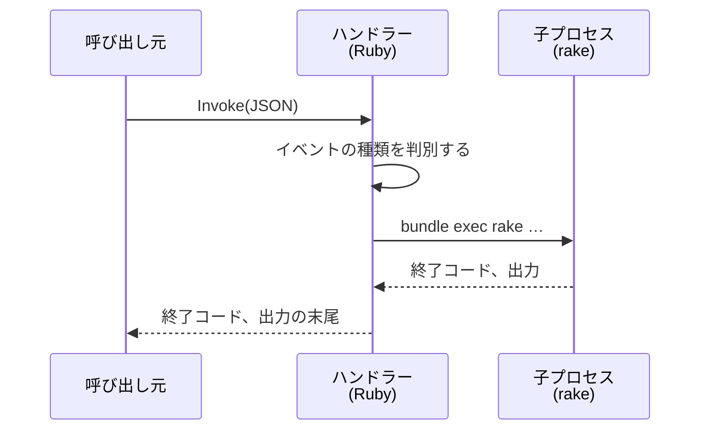

# マイグレーション、rake、メールの取り込み

Redmine の migration、rake タスク、受信したメールの取り込みを、タスク用の Lambda (`redmine-task`) で実行する設計です。`redmine-task` は `redmine-web` と同じイメージを使い、Puma は起動せずに、rake を実行します。

この資料の仕様は、2026-11-08 時点の公式情報と、Redmine 7.0.3 と Rails 8.1.4 のソースで確認したものです。出典は [sources.md](sources.md) にあります。

<a id="usage-planned"></a>

## 使い方 (予定)

```sh
# migration(Redmine 本体とプラグイン)
bin/rake db:migrate
bin/rake redmine:plugins:migrate

# 初期データ(日本語)
bin/rake redmine:load_default_data REDMINE_LANG=ja

# 任意の rake タスク
bin/rake redmine:attachments:prune
bin/rake -T

# 受信したメールを取り込み直す(S3 に残っているメールの ID)
bin/rake redmine_serverless_ses:receive_mail MESSAGE_ID=<メッセージ ID>

# rails runner(1 行のコード)
bin/rails runner 'puts User.count'
```

`bin/rake` と `bin/rails` は、このリポジトリに置くスクリプトです。AWS CLI で `redmine-task` を同期で呼び出し、出力と終了コードを表示します。AWS は SSO の管理者ロールで操作します。

- **常にデプロイした Redmine が対象:** このリポジトリの `bin/rake` と `bin/rails` は、ローカルの Redmine では動きません。ローカルで使うのはテストだけで、テストは `bin/test` で実行します ([testing.md](testing.md))。
- **`bin/rails` は `runner` だけ:** `bin/rails` が受け付けるのは `runner` だけです。
- **環境変数:** rake の標準の書き方 (`REDMINE_LANG=ja`) で渡します。渡せるのは、決められた名前 (`REDMINE_LANG`、`MESSAGE_ID` など) だけです。
- **送信先の表示:** 実行の前に、送信先 (AWS アカウント、リージョン、関数名) を表示します。データを変更するタスク (`db:migrate`、`runner` など) は、確認してから送信します。

<a id="how-one-image-runs-everything"></a>

## 同じイメージで動かす仕組み

`redmine-task` は `redmine-web` と同じイメージを使います。関数の環境変数 `REDMINE_ROLE` で、起動するものを切り替えます。`redmine-task` では Puma を起動しません。

| | `redmine-web` (`REDMINE_ROLE=web`) | `redmine-worker` (`REDMINE_ROLE=worker`) | `redmine-task` (`REDMINE_ROLE=task`) |
| --- | --- | --- | --- |
| 役割 | 画面と API | ActiveJob のジョブ ([lambda.md](lambda.md#background-jobs)) | rake、`rails runner`、メールの取り込み |
| 拡張機能 (`/opt/extensions/lambda-adapter`) | Lambda Web Adapter を起動する | 何もしない拡張機能として登録し、待機するだけ | 同左 |
| エントリポイント (`/var/task/bin/start`) | Puma を起動する | `/lambda-entrypoint.sh` で、`aws-activejob-sqs` のハンドラーを実行する (Rails を読み込む) | `/lambda-entrypoint.sh` で、独自のハンドラー (`handler.TaskHandler.process`) を実行する (Rails を読み込まない) |
| Lambda とのやり取り | Lambda Web Adapter | ベースイメージのランタイムインターフェイスクライアント | 同左 |
| 呼び出し元 | CloudFront (関数 URL)、EventBridge Scheduler (業務時間のウォームアップ。使う場合だけ) | SQS (イベントソースマッピング) | ローカルのコマンド、デプロイ、SES、EventBridge Scheduler |
| タイムアウト | 60 秒 | 900 秒 | 900 秒 |
| 予約された同時実行 | 10 | 3 | 2 |
| 関数 URL | あり | なし | なし |



`redmine-worker` と `redmine-task` は、実行の方式が違うので関数を分けます。`redmine-worker` は、ジョブを速く実行するために Rails を読み込んだまま使います。`redmine-task` は、rake ごとに新しい子プロセスで実行し、前のタスクの状態を残しません。そのハンドラーは Rails を読み込まず、受け取った内容を確認して子プロセスを起動するだけで、Rails の処理は子プロセスの rake の中で行います。メールの取得も、プラグイン `redmine_serverless_ses` の rake タスクです ([mail.md](mail.md#receiving))。

Lambda は、`/opt/extensions` にあるファイルをすべて拡張機能として起動します。Lambda Web Adapter は、拡張機能として登録したうえで Lambda とのやり取り (Runtime API) も自分で行うので、`redmine-task` でも起動するとハンドラーと競合します。そこで、`/opt/extensions/lambda-adapter` を小さなシェルスクリプトにし、実際の Lambda Web Adapter は `/opt/lambda-web-adapter/` に置きます。スクリプトは、`REDMINE_ROLE=web` のときだけ実際の Lambda Web Adapter を起動します。

`redmine-task` では、スクリプトは代わりに、受け取るイベントのない拡張機能として登録し (`{"events": []}`)、次のイベントを待ち続けます。Lambda Web Adapter 自身も同じ方法で登録しています (`src/lib.rs` の `register_extension_internal`)。拡張機能が失敗すると Lambda が実行環境を作り直すので、登録せずに終了してはいけません。登録名はファイル名と同じにし (`Lambda-Extension-Name: lambda-adapter`)、ベースイメージにある `curl` で記述します。

<a id="kinds-of-events"></a>

## イベントの種類

| 呼び出し元 | イベント | 処理 |
| --- | --- | --- |
| `bin/rake`、デプロイ | `{"command": "rake", "args": ["redmine:load_default_data"], "env": {"REDMINE_LANG": "ja"}}` | rake を実行する |
| `bin/rails` | `{"command": "runner", "args": ["puts User.count"]}` | `rails runner` を実行する |
| `bin/rake` | `{"command": "rake", "args": ["redmine_serverless_ses:receive_mail"], "env": {"MESSAGE_ID": "<メッセージ ID>"}}` | S3 のメールを取り込む ([mail.md](mail.md#receiving)) |
| SES の受信ルール | SES イベント (`Records[0].ses`) | 同上。イベントから、メッセージ ID (`mail.messageId` → `MESSAGE_ID`)、宛先 (`receipt.recipients` → `SES_RECIPIENTS`。カンマ区切り)、判定 (`receipt.spamVerdict.status`、`virusVerdict`、`dmarcVerdict`、`spfVerdict`、`dkimVerdict` → `SES_SPAM_VERDICT`、`SES_VIRUS_VERDICT`、`SES_DMARC_VERDICT`、`SES_SPF_VERDICT`、`SES_DKIM_VERDICT`。`receipt.dmarcPolicy` → `SES_DMARC_POLICY`) を取得する。形式が正しくない値は設定しない。コマンドのイベントでは、これらの変数を渡せない ([mail.md](mail.md#spoofing-and-spam)) |
| EventBridge Scheduler | `{"command": "rake", "args": ["redmine:attachments:prune"]}` | 定期タスク (下記) |

- **`command`:** `rake` と `runner` だけを受け付けます。SES イベントは、形式で判別します。
- **`env`:** 決められた名前 (`REDMINE_LANG` など) だけを受け付け、`REDMINE_DB_HOST` やデータベースユーザー名などの設定を上書きさせません。
- **実行:** rake と `rails runner` は、`bundle exec` で子プロセスとして実行します。タスクごとに新しいプロセスで実行するので、前のタスクの状態が残りません。子プロセスも Rails の環境を読み込むときに、SSM Parameter Store から設定を読みます ([lambda.md](lambda.md#settings-and-secrets-ssm-parameter-store))。ハンドラーは、ランタイムの `RUBYLIB`、`GEM_HOME`、`GEM_PATH` を子プロセスの環境から除き、子プロセスが Redmine の bundle だけを使うようにします (2026-11-09 にランタイムインターフェイスエミュレーターで確認)。
- **出力:** 標準出力と標準エラー出力は、そのまま CloudWatch Logs に送られます。応答には、終了コードと、出力の末尾 (256 KB まで。文字の区切りで切る) を含めます。同期呼び出しの応答は 6 MB までなので、全文は含めません。
- **時間:** 関数のタイムアウトは 900 秒 (Lambda の上限) です。これを超えるタスクは実行できません (下記)。
- **予約された同時実行:** 2 にします。migration と、メールの取り込みが重なっても実行できるようにし、それ以上は増やしません。

<a id="permissions"></a>

## 権限

`redmine-task` を呼び出せるのは、SSO の管理者ロール、デプロイ用ロール (migration と初期データのため)、SES (メール受信のため)、EventBridge Scheduler だけで、関数 URL は付けません。rake と `rails runner` はデータベースと S3 のすべてを読み書きできるので、呼び出せるユーザーを絞ることでデータを保護します。権限の詳細は [iam.md](iam.md) にあります。

<a id="migrations-during-deployment"></a>

## デプロイ時の migration

デプロイ手順は [deploy-config.md](deploy-config.md#deployment-commands) にあります。migration は、`redmine-task` のイメージを先に新しいものにしてから実行し、成功したら `redmine-web` と `redmine-worker` を更新します (手順 7、9)。初回の構築時は、同じ migration が空のデータベースにスキーマを作成し、その後 `redmine-task` が初期データを投入します (手順 8)。

migration から `redmine-web` の更新までの間は、古いコードが新しいスキーマで動きます。Redmine のバージョンアップは、利用の少ない時間帯に行います。バージョンアップの前に、増えた migration をこのプロジェクトで確認します ([upgrade.md](upgrade.md))。

<a id="notes-on-the-read-only-file-system"></a>

## 読み取り専用のファイルシステムでの注意点

Rails は、`db:migrate` の後に `db/schema.rb` を書き出します (`ActiveRecord.dump_schema_after_migration` のデフォルトは `true`)。Redmine の `production.rb` はこの設定をコメントアウトしたままなので、Lambda では書き込みに失敗します。`additional_environment.rb` で `false` にします。

`redmine:attachments:move_to_subdirectories` など、`files/` の下のファイルを移動するタスクは、S3 のファイルを移動しないので使いません。`redmine:attachments:update_digests` など、添付ファイルを読むタスクは、`/tmp` のキャッシュの仕組み ([attachments.md](https://redmine-kit.github.io/redmine_serverless_s3/ja/attachments.html#the-tmp-cache)) で S3 から取得して読みます。

<a id="scheduled-runs"></a>

## 定期実行

EventBridge Scheduler から、上の形式の入力で `redmine-task` を呼び出します。

| タスク | 周期 |
| --- | --- |
| `redmine:attachments:prune` | 毎日 |
| `redmine:send_reminders` (期日の通知) | 使う場合は、平日の朝 |
| `redmine_serverless_costexplorer:refresh` (プラグインを追加したイメージ、つまり派生イメージで。管理画面のために、Cost Explorer からアカウントの費用を取得する) | 毎日。`costExplorer.enabled` のときだけ ([deploy-config.md](deploy-config.md#fields-of-redminejson)) |
| `redmine_serverless_sqs:prune_records[<日数>]` と `redmine_serverless_ses:prune_records[<日数>]` (プラグインの記録のうち、保持期間 `retention.recordsDays` より古いものを削除する。失敗したジョブと受信したメール。[security.md](security.md#retention-periods)) | 毎日 |

<a id="stopping-unused-functions"></a>

## 使われない関数の停止

Lambda は、数週間呼び出されないコンテナイメージの関数を `Inactive` にします。次の最初の呼び出しは失敗し、関数はイメージの最適化が終わるまで `Pending` になります。`redmine-task` は毎日の定期実行で呼び出されるので、通常は `Inactive` になりません。`bin/rake` と `bin/rails` は、念のため、呼び出す前に関数の状態を確認し、`Active` になるまで待ちます。

<a id="tasks-longer-than-15-minutes"></a>

## 15 分を超えるタスク

多数の添付ファイルの digest の再作成 (`redmine:attachments:update_digests`) のように、15 分を超えるおそれのあるタスクは、Lambda では実行できません。分割して呼び出せるタスクは分割します。分割できないときは、同じイメージを ECS の Fargate タスク (`RunTask`) で 1 回だけ実行します。タスクは、RDS と同じプライベートサブネットで実行します ([rds.md](rds.md))。イメージの取得とログの書き込みに、ECR と CloudWatch Logs への経路が必要なので、併せて用意します。古い Redmine からの移行の migration は、一時的な PostgreSQL 上で行うので、Lambda の 15 分の制限には当たりません ([migration.md](migration.md))。エントリポイントは差し替えて、rake を直接実行します。料金は使った時間の分だけです。必要になったときに用意します。

<a id="to-verify"></a>

## 未確認の事項

- 何もしない拡張機能を登録した状態で、Lambda の停止時に実行環境が正しく終了するか (ランタイムインターフェイスエミュレーターでは、拡張機能が登録され、ハンドラーが動くことを 2026-11-09 に確認)
- 初期データの投入 (`redmine:load_default_data`) と、空のデータベースへの migration の所要時間
