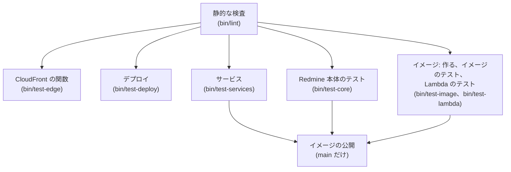

# テストの計画

Serverless のテストの計画です。自前のプラグイン、Redmine 本体への影響、コンテナイメージ、インフラ、デプロイしたあとの動きを、段階ごとに確認します。

この資料の仕様は、2026-11-08 時点の公式の情報と、Redmine 7.0.3 のソースで確認したものです。出典は [sources.md](sources.md) にあります。

<a id="approach"></a>

## 方針

- **差し替えた処理には、すべてテストを付ける:** [attachments.md](https://redmine-kit.github.io/redmine_serverless_s3/ja/attachments.html#replaced-code) の表の 1 行ごとに、テストを 1 つ以上書きます。表とテストは、同じコミットで直します。
- **Redmine の標準のテストの仕組みを使う:** Redmine は Rails の Minitest と mocha で、ユニット、機能、統合、システム(Capybara と Selenium)のテストを持っています。プラグインのテストも、同じ仕組みで書き、`rake redmine:plugins:test` で実行します。
- **AWS は手元で代わりのものを使う:** テストの中では、本物の AWS に接続しません。AWS の SDK の応答の差し替え(`stub_responses`)、AWS の API を手元で再現する moto(Apache-2.0)と LocalStack を使います(下の「代わりの道具の使い分け」)。
- **LocalStack はこのプロジェクトでだけ使う:** Serverless は、redmine-kit の組織の非商用のオープンソースのプロジェクトとして公開しています。LocalStack の無料の Hobby のプランは、非商用の利用に限って使えるので、このプロジェクトのテストと CI で使います。Serverless を使う側(会社の業務の Redmine など)のテストは商用の利用に当たるので、Hobby の LocalStack は使いません。使う側は、このプロジェクトの CI の結果と、自分のデプロイしたあとの確認で確認します(2026-11-09 に LocalStack の料金のページで確認)。
- **本物の AWS では、デプロイしたあとに確認する:** Lambda、CloudFront、SES の受信など、手元で再現できないものは、デプロイしたあとの確認で確認します。
- **`bin/test` にまとめるまで:** ここまでに作った段は、別々のスクリプトです。`bin/lint`(静的な検査)、`bin/test-services`(PostgreSQL、moto、LocalStack を立て、それぞれ応答するか確認する)、`bin/build-image`、`bin/test-image`(イメージのテスト)、`bin/test-core`(Redmine 本体のテスト)、`bin/update-gems`(`image/Gemfile.lock` を書く)です。
- **プラグインも同時に直すとき:** イメージは、プラグインを、`image/Gemfile.lock` のバージョンの gem として、GitHub Packages から入れます([architecture.md](architecture.md#distribution))。`REDMINE_SERVERLESS_SSM_DIR` か `REDMINE_SERVERLESS_S3_DIR` にプラグインのチェックアウトを指定すると、イメージを作るスクリプトは、入れた gem を、その作業ツリーで置き換えます(`bin/lib/plugin.sh`)。たとえば `REDMINE_SERVERLESS_SSM_DIR=../redmine_serverless_ssm bin/test-image` です。スクリプトは、GitHub Packages のための Bundler の認証情報を、`gh` のログインか、`BUNDLE_RUBYGEMS__PKG__GITHUB__COM` から取ります(CI はそれを `GITHUB_TOKEN` から設定します)。
- **手元のテストは `bin/test`:** 手元のテストは、このリポジトリの `bin/test` で実行します。Makefile は置きません。`bin/test` は、Docker で、テスト用のイメージと、PostgreSQL、moto、LocalStack のコンテナを立てて動かすので、手元に Ruby や PostgreSQL が無くても実行できます。このリポジトリの `bin/rake` と `bin/rails` は、デプロイした Redmine に向けて動くので、テストには使いません([tasks.md](tasks.md#usage-planned))。

```sh
bin/test            # 静的な検査から、Lambda の結合のテストまで、CI と同じ順に全部
bin/test lint       # 静的な検査(RuboCop、ShellCheck、actionlint、cfn-lint、cfn-guard)
bin/test plugin     # プラグインのユニット、機能、統合のテスト
bin/test core       # Redmine 本体のテスト(プラグインを入れた状態)
bin/test system     # システムのテスト(ヘッドレスの Chrome)
bin/test image      # イメージのテスト(読み取り専用、権限の少ないユーザー、3 つの役割)
bin/test lambda     # LocalStack の上で、3 つの関数を Lambda として呼ぶ結合のテスト
bin/test plugin test/unit/attachment_patch_test.rb   # ファイルを指定する
```

- **CI も同じ:** GitHub Actions も、同じ `bin/test` の段を順に呼びます。手元と CI で、テストのやり方を変えません。
- **テストが通らないものはデプロイしない:** CI の順番(下記)の途中で失敗したら、そこで止めます。

<a id="kinds-of-tests"></a>

## テストの種類

| 種類 | 何を確認するか | 道具 | いつ |
| --- | --- | --- | --- |
| 静的な検査 | Ruby の書き方、シェルのスクリプト、ワークフロー、CloudFormation、依存の知られた弱点 | RuboCop(Redmine の設定)、ShellCheck、actionlint、cfn-lint、cfn-guard、`bundler-audit` | コミットのたび |
| イメージの弱点の検査 | イメージの中の OS のパッケージと gem の、知られた重い弱点 | Trivy など | イメージを作るたび |
| プラグインのユニットと機能のテスト | 差し替えた処理、足した画面、rake のタスク | Minitest、mocha、SDK の `stub_responses` | コミットのたび |
| プラグインの統合のテスト | S3、SQS、SSM と実際にやり取りする流れ | Minitest、moto | コミットのたび |
| Redmine 本体のテスト | プラグインを入れても、本体の動きが壊れていないか | Redmine のテスト(ユニット、機能、統合) | コミットのたび |
| システムのテスト | ブラウザーでのアップロード、ダウンロード、サムネイル | Capybara、Selenium(ヘッドレスの Chrome)、moto | コミットのたび |
| イメージのテスト | 読み取り専用のファイルシステムと権限の少ないユーザーで、3 つの役割が起動するか | Docker、Lambda のランタイムインターフェイスエミュレーター | イメージを作るたび |
| CloudFront の関数のテスト | Lambda@Edge の関数と CloudFront Function、テンプレートが同じコードを持つこと | node:test(Node.js の標準) | コミットのたび |
| デプロイのテスト | 設定のスキーマ、スタックのパラメーター、`bin/deploy` の段 | check-jsonschema、偽の AWS CLI、Minitest | コミットのたび |
| Lambda の結合のテスト | 同じイメージを 3 つの関数として作り、関数 URL、SQS からのジョブ、`redmine-task` の呼び出しが、SQS、SSM と一緒に動くか | LocalStack(Hobby) | イメージを作るたび |
| デプロイしたあとの確認 | 本物の AWS の上での動き | `bin/smoke-test`(自前) | デプロイのたび |
| 計測 | 起動にかかる時間、メモリ、要求の時間 | CloudWatch のログとメトリクス | 初めのデプロイと、Redmine のバージョンアップのとき |

<a id="plugin-tests"></a>

## プラグインのテスト

プラグインの機能ごとに、テストを書きます。Lambda での実行は `redmine_serverless`([機能](https://redmine-kit.github.io/redmine_serverless/ja/#features))、S3 の添付ファイルは `redmine_serverless_s3`([資料](https://redmine-kit.github.io/redmine_serverless_s3/ja/))、SES でのメールの送信と受信は `redmine_serverless_ses`([資料](https://redmine-kit.github.io/redmine_serverless_ses/ja/))です。テストは、それぞれのプラグインが持ちます。機能の有効にする条件がそろわないときに、Redmine の標準のままに動くことも確認します。

<a id="attachments-in-s3-redmine_serverless_s3"></a>

### S3 の添付ファイル(`redmine_serverless_s3`)

プラグインは、置き換えるコードと AWS への呼び出しを、すべて自分のリポジトリと CI でテストします。S3 の答えごとのスタブ、要求のための moto、テストが付ける GuardDuty のタグ、公開鍵で検証する CloudFront の署名付き URL を使います。テストで確認すること、手元で再現できないこと(CloudFront、GuardDuty、合わないチェックサムを S3 が断ること)は、プラグインの [setup.md](https://redmine-kit.github.io/redmine_serverless_s3/ja/setup.html#what-the-tests-check) にあります。Serverless は、デプロイしたあとの動きを確認します(下記)。

<a id="running-on-lambda-redmine_serverless"></a>

### Lambda で動かす(`redmine_serverless`)

プラグインは、`/events`、アセットの設定、固定する設定、管理画面を、自分のリポジトリと CI で、Redmine のすべてのテストといっしょにテストします([その README](https://redmine-kit.github.io/redmine_serverless/ja/#tests))。

<a id="email-redmine_serverless_ses"></a>

### メール(`redmine_serverless_ses`)

プラグインは、SES v2 での送信、SES のそれぞれのエラー、SES のイベントの判定と宛先を使うメールのバケットからの取り込み、プロジェクトのアドレス、画面を、自分のリポジトリと CI で、LocalStack(トークンがなければ moto)に対してテストします([sending.md](https://redmine-kit.github.io/redmine_serverless_ses/ja/sending.html#tests)、[receiving.md](https://redmine-kit.github.io/redmine_serverless_ses/ja/receiving.html#tests))。

<a id="jobs-redmine_serverless_sqs"></a>

### ジョブ(`redmine_serverless_sqs`)

プラグインは、`aws-activejob-sqs` を通した SQS でのジョブ、許可の一覧、失敗の記録、送り直し、デッドレターキューの戻しを、自分のリポジトリと CI で、LocalStack(トークンがなければ moto)に対してテストします([setup.md](https://redmine-kit.github.io/redmine_serverless_sqs/ja/setup.html#tests))。

<a id="settings-and-code-outside-the-plugins"></a>

### 設定と、プラグインの外のコード

| 対象 | 確認すること | 道具 |
| --- | --- | --- |
| SSM の読み込み(`redmine_serverless_ssm`) | `/<instance>/env/` の下を読み、10 件を超えても続きを読み、SecureString を復号する。すでにある環境変数を上書きしない。環境変数にできない名前と、下の階層は読まない。SSM につながらなければ失敗する。イメージのテストでは、3 つの役割が、データベースのホスト、そのパスワード、`SECRET_KEY_BASE` を SSM だけから読み、`config/database.yml` より前に読めていることを確認する | Minitest、moto(プラグインの `test/loader_test.rb`、`bin/test-image`) |
| タスクのハンドラー | 決めた `command` と `env` だけを受け付ける。SES のイベントを見分け、メッセージ ID、宛先、判定を渡す。形の正しくない値は入れず、コマンドのイベントでは SES の変数を渡せない。子プロセスの終了コードと出力の末尾を返す。日本語を文字の途中で切らない | Minitest |
| 拡張機能のスクリプト | `REDMINE_ROLE` ごとに、本物の Lambda Web Adapter を起動するか、何もしない拡張機能として登録するかが変わる | ShellCheck、イメージのテスト |
| webhook | `webhook_blocklist` の範囲(プライベート、リンクローカル)の送り先に送らない。送り先のエラーでジョブが失敗し、届け直される | Minitest、moto |
| 本文のハッシュを入れる関数(`edge/body-hash/`) | 本文のない要求と空の本文に、空の本文の SHA256 を入れる。base64 の本文を、バイト列のまま SHA256 にする(バイナリの本文とマルチパートのフォームで、手元で計算した値と同じ)。`inputTruncated` の要求に 413 を返し、オリジンに送らない | Node.js の `node:test`。依存の npm のパッケージは使わない |

<a id="redmines-own-tests"></a>

## Redmine 本体のテスト

プラグインは、`prepend` で Redmine の処理を差し替えます。本体の動きを壊していないかを、Redmine のテストで確認します。

- **実行のしかた:** `bin/test-core` は、イメージの Dockerfile の `core-test` の段で実行します。この段は、イメージと同じ Redmine のソース、`config/` のファイル、`Gemfile.lock` に、テスト用の gem と ImageMagick を足したものです。データベースは `bin/test-services` の PostgreSQL で、プロセッサーの数だけのワーカーで並列に実行します(数は `PARALLEL_WORKERS` で変えられます)。イメージは、Lambda のファイルシステムが読み取り専用なので、migration のあとに `db/schema.rb` を書きません。並列のテストはこのファイルを読むので、`bin/test-core` が、Redmine とプラグインの migration(デプロイと同じく `redmine:plugins:migrate` も)のあと、テストの前に書きます。SCM のリポジトリや LDAP のサーバーが要るテストは、この段で用意しないので、Redmine が飛ばします。テストは、イメージのプラグインを入れた状態で実行します。`redmine_serverless`、`redmine_serverless_s3`、`redmine_serverless_ses`、`redmine_serverless_sqs`、`redmine_serverless_ssm` です。
- **理由の分かっている失敗は、理由と一緒に一覧にする:** このイメージのせいではなく、gem のせいで失敗するテストは、理由と一緒に `test/core/known_failures.txt` に載せ、`bin/test-core` はそれを外して実行します。原因が上流で直ったら、その行を消します。新しいバージョンにはセキュリティの修正が入ることがあるので、テストを通すために gem を古いバージョンに留めることはしません。たとえば、Nokogiri 1.19.5 で CSS のセレクターの読み方が変わり、rails-dom-testing 2.3.0 で正規表現を渡す `:match` が当たらなくなりました([rails/rails-dom-testing#136](https://github.com/rails/rails-dom-testing/issues/136))。
- **プラグインが動かないときは、本体のテストがそのまま通る:** プラグインは、有効にする条件がそろわないとき(S3 のバケットの設定、`REDMINE_ROLE`、SES の設定がない)は、差し替えを有効にしません。プラグインを入れた状態で、Redmine のユニット、機能、統合のテストを実行し、すべて通ることを確認します。
- **`redmine_serverless_s3` が動くときは、添付ファイルのテストを S3 の形で通す:** Redmine の添付ファイルのテスト(`test/unit/attachment_test.rb`、`test/unit/attachment_transaction_test.rb`、`test/functional/attachments_controller_test.rb`、`test/functional/attachments_visibility_test.rb`、`test/integration/attachments_test.rb`)のうち、ローカルのファイルを前提にしないものを、プラグインを有効にして moto の上で実行します。ローカルのファイルを前提にするもの(ディスクの上のパスを直接確認するもの)は、外す理由を書いて外します。
- **差し替えた元のコードを見張る:** 差し替えた Redmine のメソッドごとに、元のコードの SHA256 を記録しておき、テストで今のコードと比べます。Redmine のバージョンアップで元のコードが変わったら、テストが失敗するので、差し替えを見直すきっかけになります。

<a id="which-substitute-to-use"></a>

## 代わりの道具の使い分け

| 道具 | 使うところ | 使わないところと理由 |
| --- | --- | --- |
| SDK の `stub_responses` | ユニットと機能のテスト。SES のエラーを 1 つずつ起こすテスト | — |
| moto | プラグインの統合のテストとシステムのテスト(S3、SQS、SSM)。SES v2 の `SendEmail` は、moto が再現できるかを確認してから使い、それまでは SDK の `stub_responses` で代える | — |
| LocalStack(Hobby) | Lambda の結合のテスト。同じイメージの 3 つの関数、関数 URL、SQS のイベントソースマッピング | SES v2、ECR、CloudFront、RDS は Hobby にない。SES v2 は moto、CloudFront はデプロイしたあとの確認で確認し、データベースは PostgreSQL のコンテナにする。イメージは、ECR を通さず、手元の Docker から LocalStack の Lambda に渡す |

<a id="administration-pages"></a>

## 管理画面

| 確認すること | 種類 |
| --- | --- |
| 管理者でない人が、どの画面も開けない(403) | 機能のテスト |
| 秘密の値(SSM の値、`SECRET_KEY_BASE`、データベースのパスワード)が、画面の HTML に出ない | 機能のテスト |
| SES、SQS、S3 の状態が、SDK の応答の差し替えのとおりに表示される。API がエラーのときも画面が開ける | 機能のテスト |
| 送り直し、削除、デッドレターキューを戻す、サプレッションリストから外す、の操作が、確認のあとで実行され、ログに残る | 機能のテスト、システムのテスト |
| 受信の設定を変えると、`redmine_serverless_ses:receive_mail` が次の実行から新しい設定を使う | 機能のテスト |
| 突き合わせが、ジョブとして積まれ、結果が画面に出る | 機能のテスト、統合のテスト(moto) |

<a id="system-tests"></a>

## システムのテスト

ブラウザーでの動きを、Capybara とヘッドレスの Chrome で確認します。S3 は moto で再現します。CloudFront を通るアップロードの PUT と署名付き URL は、デプロイのあとに確認します。

| 確認すること | 理由 |
| --- | --- |
| ファイルを選んで添付し、チケットを保存できる | `uploadBlob` の差し替えの基本の流れ |
| ドラッグ・アンド・ドロップ、画像の貼り付けで添付できる | 標準の UI の流れを壊していない |
| 送信中の進み具合が表示され、終わるまで保存のボタンが押せない | 同上 |
| 上限を超えるファイルで、エラーが表示される | presign での Redmine の上限 |
| 添付をクリックすると、S3 からダウンロードされる | リダイレクト |
| wiki の本文の画像と、添付の一覧のサムネイルが表示される | 署名付き URL へのリダイレクト。サムネイルの多い画面で、同時実行数の予約を超えないか |

<a id="image-tests"></a>

## イメージのテスト

イメージを作るたびに、本番と同じ条件の Docker で起動します。

- **条件:** arm64、読み取り専用のファイルシステム(`--read-only`)、書けるのは `/tmp` だけ(`--tmpfs /tmp`)、権限の少ないユーザー(`--user` で、root でない任意の番号)。データベースは、RDS と同じメジャーバージョンの PostgreSQL のコンテナ、AWS は moto です。コンテナは、PostgreSQL と moto にしか届かない Docker の内部のネットワークで動かすので、テストから AWS には届きません。
- **`web`:** Puma が起動し、ログインの画面が 200 を返し、セッションの Cookie に `Secure` が付くこと([session.md](session.md#the-secure-attribute-of-the-session-cookie))、アセットの `.manifest.json` があること、起動のあとに `/tmp` の外に書いていないことを確認します。Puma は `127.0.0.1` でだけ待ち受けるので、画面はコンテナの中から開きます。エミュレーターは要求を Lambda Web Adapter に通さないので、その経路は Lambda の結合のテストで確認します。
- **`task`:** 土台のイメージにあるランタイムインターフェイスエミュレーター(`aws-lambda-rie`)でハンドラーを呼び、`rake db:migrate`、`redmine:load_default_data`、`rake -T`、`rails runner` が動くこと、失敗したタスクが終了コードを返すこと、許可していないコマンドと `env` の名前を拒否することを確認します。メールの取り込みは、プラグインと一緒に足します。
- **`worker`:** 同じくエミュレーターで、SQS の形のイベントを渡し、ジョブが実行されること(プロジェクトが消え、その通知のメールが SQS に積まれる)と、許可していないジョブのクラスが実行されないことを確認します。gem は、ジョブが成功したあと、イベントの ARN から組み立てたキューの URL(`https://sqs.<region>.amazonaws.com/...`)でメッセージを消します。この URL は moto に向けられないので、ここではその削除の失敗だけを認め、削除は Lambda の結合のテストで確認します。
- **中身:** ImageMagick の `convert`、Ghostscript、Pandoc(3.8.3 以上)が動くこと、`/var/task` と `/opt` のすべてを権限の少ないユーザーが読めること、ビルドしたアセットがあることを確認します。タスクのハンドラーの単体テストも、イメージの中で動かします。push したマニフェストが arm64 だけで、インデックスの形になっていないかは、イメージを push するときに確認します。

<a id="edge-function-tests"></a>

## CloudFront の関数のテスト

`bin/test-edge` が、Node.js のイメージの中で、`node:test` で `edge/` のテストを実行します。npm のパッケージは使いません。

- **`redmine-body-hash`(Lambda@Edge):** 空の本文のハッシュ、base64 の本文の元のバイト列でのハッシュ(フォーム、バイナリー、multipart)、テキストの本文のハッシュ。偽の `x-amz-content-sha256` を置き換えること、切り詰められた本文(1 MB を超えるもの)に 413 を返すこと、要求のほかの項目を変えないこと。
- **`<instance>-incoming-size`(CloudFront Function):** CloudFront と同じく、上限を書き込んだただのスクリプトとして実行します。上限までの PUT は通り、超えると 413、正しい `Content-Length` がないと 411、ほかのメソッドは通ること。
- **テンプレート:** コードはテンプレート(`infra/shared-edge.yaml`、`infra/instance.yaml`)に埋め込むので、テンプレートがファイルと同じ行を持つことも確認します。

<a id="deployment-tests"></a>

## デプロイのテスト

`bin/test-deploy` が、AWS を使わずに、`bin/deploy` の道具のイメージの中で `bin/deploy` をテストします。

- **スキーマ:** [deploy-config.md](deploy-config.md#example) の例と、`test/deploy/valid/` のファイルが通ること。`test/deploy/invalid/` のファイルが、どれも通らないこと(項目がない、`route53` なのにホストゾーンがない、digest のないイメージ、知らない項目など)。
- **スタックのパラメーター:** 正しい設定のそれぞれで、`deploy/params.jq` がテンプレートごとに作るパラメーターが、そのテンプレートのパラメーターであり、既定の値のないパラメーターがすべて渡されること。既定の値と、渡した値も比べます。
- **段:** すべての呼び出しを記録する偽の `aws`、`crane`、`curl`(`test/deploy/fake/`)に対して、`deploy/deploy.sh` を動かします。初めてのときと 2 回目からの段の順番(Web と worker が新しいイメージになる前に、タスクがマイグレーションをする)、`--dry-run`(何も実行せず、書かず、呼ばない)、`--code-only`、`--account`、変更のないスタック、デプロイを止めるマイグレーションの失敗、確認の失敗、どの呼び出しより前に止まる正しくない設定。秘密の値は、形、SecureString であること、スタックの公開鍵が秘密鍵と合うこと、コマンドラインにも出力にも出ないことを確認します。
- **設定のコード:** 設定を入れる Ruby のコードを、Redmine の `Setting` の代わりの物に対して Ruby で実行します(`initial` と `enforce`、プラグインの設定を足し合わせること)。

<a id="lambda-integration-tests"></a>

## Lambda の結合のテスト

`bin/test-lambda` が、LocalStack の上で、イメージを Lambda として動かします(専用の Compose のプロジェクト、`test/lambda/compose.yml`)。`LOCALSTACK_AUTH_TOKEN` が要り、なければ飛ばします。CI では、Redmine のリリースのイメージのジョブで実行します。

- **ライセンス:** LocalStack は、コンテナイメージの関数を Pro のライセンスでだけ動かします。CI の Hobby のライセンスは「Container images are a Pro feature」と答えるので(2026-11-09)、`bin/test-lambda` は SSM の秘密の値を確認し、関数の確認は飛ばしたと表示します。Pro のライセンスか本物のアカウントで動かすまで、worker がメッセージを消すことは、どこでも確認できていません。
- **イメージ:** ライセンスに含まれていれば LocalStack の ECR に置きます。含まれていなければ、手元で ECR の名前のタグを付け、LocalStack の Lambda が同じ Docker から起動します。
- **秘密の値:** `deploy/lib.sh` の `create_secrets` が SSM に秘密の値を作り、2 回目は変えないこと。
- **`redmine-task`:** `bin/deploy` と同じく、`deploy/lib.sh` の `task` で呼びます。`db:migrate`、`redmine:load_default_data`、`SECRET_KEY_BASE` を SSM から読むこと、失敗したコマンドが失敗になること、設定のコード。
- **`redmine-worker`:** SQS のイベントソースマッピングから動かします。タスクが `DestroyProjectJob` を積み、worker が実行し、可視性タイムアウトのあとも、ジョブが 1 回しか実行されないことで、メッセージが消えたことを確認します(イメージのテストでは、moto のためにこれを確認できません)。通知のメールは、ライセンスに SES v2 が含まれるときに確認します。
- **`redmine-web`:** 関数 URL を通した `/login`。Lambda Web Adapter を通る経路です。

<a id="infrastructure-checks"></a>

## インフラの検査

| 対象 | 道具 | 確認すること |
| --- | --- | --- |
| CloudFormation | cfn-lint | テンプレートの書き方と、リソースの設定の誤り |
| CloudFormation | cfn-guard | S3 のパブリックアクセスのブロック、暗号化、TLS の強制。RDS のパブリックアクセスなしと、削除の保護 |
| CloudFormation | `aws cloudformation validate-template`、変更セット | 本番に当てる前の差分 |
| ワークフロー | actionlint | GitHub Actions の書き方 |

<a id="checks-after-deployment"></a>

## デプロイしたあとの確認

デプロイのたびに、`bin/smoke-test` で、本物の AWS の上の動きを確認します。確認用のプロジェクトとユーザーを用意し、ふだんのデータに触れないようにします。`bin/smoke-test` はまだ作っていません。今は、`bin/deploy` の最後の段が、ログインの画面(`Strict-Transport-Security` 付きの 200)と、署名のない `/files/` が断られることを確認します([deploy-config.md](deploy-config.md#deployment-commands))。

| 確認すること | 期待する結果 |
| --- | --- |
| ログインの画面 | CloudFront 経由で 200。`Strict-Transport-Security` などのセキュリティのヘッダーが付く。`http://` は `https://` にリダイレクトされる |
| アセット | `/assets/` の CSS が S3 から返る(Lambda のログに出ない) |
| 関数 URL への直接の要求 | 署名がないので 403。関数のログに出ない(関数が呼ばれない) |
| CloudFront を通る POST | ログインとチケットの作成が通る(Lambda@Edge が入れたハッシュと OAC の署名で、関数 URL が受ける) |
| 1 MB を超える本文の POST | CloudFront が 413 を返す |
| アップロードとダウンロード | 確認用のプロジェクトで、CloudFront を通して PUT したファイルを、署名付き URL で取れる。取ったファイルの SHA256 が送ったものと同じ。中身が申告の SHA256 と合わない PUT は断られる |
| 添付ファイルのヘッダー | `/files/` の下の応答に、`Content-Security-Policy: default-src 'none'; style-src 'unsafe-inline'; sandbox` と `X-Content-Type-Options: nosniff` が付き、署名のない同じ URL は断られる。添付ファイルは Redmine のオリジンにあるので、ディストリビューションを変えるたびに、これが成り立つ必要がある |
| 権限のない人のダウンロード | 署名付き URL が出ない |
| メールの受信 | 確認用のアドレスから受信のアドレスに送ったメールが、確認用のプロジェクトのチケットになる |
| タスク | `bin/rake -T` が成功する |

<a id="measurements"></a>

## 計測

| 項目 | 見るところ | 使い道 |
| --- | --- | --- |
| 起動にかかる時間 | Lambda のログの初期化の時間と、最初の要求の時間 | 温めの呼び出しが要るか、メモリの大きさ |
| メモリ | Lambda のログの最大メモリ | メモリの大きさ |
| 要求の時間 | Lambda のログの実行時間 | 費用の見込みの見直し([cost.md](cost.md)) |
| ブラウザーでの SHA256 の計算 | 大きなファイルを、アップロードの前にハッシュする時間 | 添付ファイルの大きさの上限 |

<a id="coverage"></a>

## カバレッジ

このリポジトリでテストするものの網羅率を、CI が Codecov に送ります。部分ごとにフラグを分けます。プラグインの網羅率は、それぞれのリポジトリから送ります。

| フラグ | 測るもの | 方法 |
| --- | --- | --- |
| `edge` | CloudFront で動く関数(`edge/`) | `bin/test-edge` で、Node.js の標準の機能で測る(`--experimental-test-coverage`、LCOV)。npm のパッケージは使わない |
| `image` | イメージに入れる自前の Ruby のファイル(`image/*.rb`。いまはタスクのハンドラー) | `bin/test-image` のハンドラーの単体テストで、Ruby の `Coverage` で測る(`test/image/coverage.rb`、LCOV)。イメージに gem は足さない |

- **送り方:** `codecov/codecov-action` で、OIDC のトークンを使って送ります。シークレットは要りません。リポジトリに Codecov の GitHub App を入れるまでは、送るのに失敗しても CI を失敗にしません。
- **測らないもの:** `bin/deploy` などのシェルスクリプト(`bin/test-deploy` が偽の AWS CLI でテストします。[デプロイのテスト](#deployment-tests))。イメージの中の Redmine とプラグイン。

<a id="order-in-ci"></a>

## CI の順番

GitHub Actions(`.github/workflows/ci.yml`)で、次の順にジョブを実行します。arm64 のイメージは、arm64 のランナーで作ります。プラグインのテストは、それぞれのリポジトリで実行します。



デプロイは CI に含めません。`bin/deploy` は、管理者がデプロイを決めたときに動かします([deploy-config.md](deploy-config.md#deployment-commands))。

- **Redmine のバージョン(matrix):** イメージのテストと Redmine 本体のテストは、2 通りで実行します。イメージが使う Redmine のリリース(今は 7.0.3。SHA256 を確認したリリースの tar.gz と `image/Gemfile.lock`)と、次のリリース(7.1)になる Redmine の `master` のブランチです(`7.1-stable` のブランチはまだない。2026-11-09 に確認)。`master` は GitHub から固定せずに取り(`bin/build-image` と `bin/test-core` に `REDMINE_BRANCH=master`)、gem は lock を使わずに解決し、そのジョブは失敗しても実行全体を失敗にしません(`continue-on-error`)。次のリリースで壊れるところを、早めに見るためです。そのために、CI は毎週も動かします。`master` から作ったイメージは、デプロイしません。7.1 が出たら、matrix を 7.1(固定)と次の `master` に移します。
- **更新:** Dependabot が、Actions(`.github/workflows/actions.lock` も)、Docker のイメージ、検査用の gem について、公開から 3 日(パッチ)か 7 日(ほか)たったバージョンへの更新の PR を毎週作ります。`image/Gemfile.lock` は、Dependabot では更新できません。このリポジトリにない Redmine の Gemfile に、`image/Gemfile.local` とプラグインの Gemfile を合わせて、イメージの中で解決するためです。毎週のワークフロー(`.github/workflows/update-gems.yml`)が、Bundler の `--cooldown=7` で `bin/update-gems --update` を実行して PR を作り、そのブランチで CI を動かします。lock をコミットしておくのは、どの組み立ても、確認済みの同じバージョンの gem を、チェックサムと一緒に入れるためです。
- **データベース:** プラグイン、Redmine 本体、イメージのテストは、RDS と同じメジャーバージョンの PostgreSQL のコンテナで実行します(バージョンは作るときに確認する。[rds.md](rds.md#database))。
- **Redmine のバージョンアップ:** 増えた migration の読み分けと、試験用のデータベースでの実行を、別のワークフローで行います([upgrade.md](upgrade.md))。
- **AWS:** コミットのたびのテストは、AWS の認証情報を使いません。AWS に接続するのは、デプロイとデプロイしたあとの確認だけで、本番のアカウントのロールを OIDC で引き受けます([iam.md](iam.md#role-for-deploying-code-github-actions))。
- **LocalStack の認証のトークン:** LocalStack は、`LOCALSTACK_AUTH_TOKEN` に認証のトークンが必要です。トークンはリポジトリに書きません。手元ではシェルで設定し(macOS のキーチェーンから読むなど)、CI ではリポジトリのシークレット `LOCALSTACK_AUTH_TOKEN` に置きます。トークンがないとき、`bin/test-services` は LocalStack を飛ばします。フォークからのプルリクエストにはシークレットが渡されないので、そこでも LocalStack を飛ばします。
- **失敗したら止める:** どこかで失敗したら、それより後は実行しません。デプロイしたあとの確認で失敗したら、前のイメージに戻します。

<a id="to-verify"></a>

## 確認すること

- moto が、`x-amz-checksum-sha256` を付けた PUT で `ChecksumSHA256` を保存して返し、合わない中身を断るか
- moto が、SES v2 の `SendEmail`(全文での送信)を再現できるか
- Pro のライセンスの LocalStack か本物のアカウントでの、`bin/test-lambda` の関数の確認(コンテナイメージの関数、関数 URL、SQS のイベントソースマッピング、メッセージを消すこと)。Hobby はコンテナイメージの関数を動かさない(2026-11-09)
- CI での Hobby の利用の決まり(Fair Use)と、Hobby で CI Auth Token を使えるか
- Lambda Web Adapter を、ランタイムインターフェイスエミュレーターの上で動かせるか
- Redmine の添付ファイルのテストのうち、S3 の形で通せるものの数
