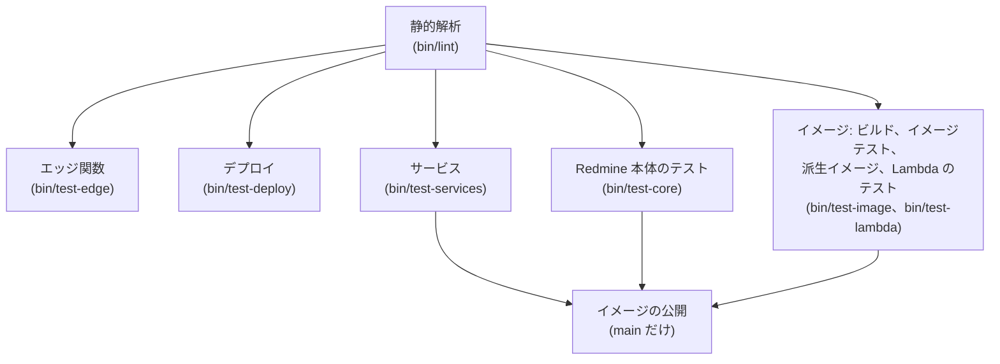

# テスト計画

Serverless のテスト計画です。独自のプラグイン、Redmine 本体への影響、コンテナイメージ、インフラ、デプロイ後の動作を、段階ごとに確認します。

この資料の仕様は、2026-11-08 時点の公式情報と、Redmine 7.0.3 のソースで確認したものです。出典は [sources.md](sources.md) にあります。

<a id="approach"></a>

## 方針

テストは、次の 4 つの規則で作ります。

- 差し替えた処理には、すべてテストを付けます。[attachments.md](https://redmine-kit.github.io/redmine_serverless_s3/ja/attachments.html#replaced-code) の表の 1 行ごとにテストを 1 つ以上書き、表とテストは同じコミットで修正します。
- Redmine 標準のテストの仕組みを使います。Redmine は Rails の Minitest と mocha で、ユニットテスト、機能テスト、統合テスト、システムテスト (Capybara と Selenium) を持っています。プラグインのテストも同じ仕組みで書き、`rake redmine:plugins:test` で実行します。
- テストでは、実際の AWS に接続しません。AWS SDK の応答のスタブ (`stub_responses`) と、AWS の API をローカルで再現する moto (Apache-2.0) と LocalStack を使います (下の「代替ツールの使い分け」)。
- Lambda、CloudFront、SES の受信など、ローカルで再現できないものは、デプロイ後のチェックで確認します。

このプロジェクトの CI は、redmine-kit Organization の LocalStack ライセンス (2026-11-09 から Ultimate) を使い、シークレット `LOCALSTACK_AUTH_TOKEN` でジョブに渡します。Serverless のアダプタがテストを実行するときは、その用途を認める自分の LocalStack ライセンスが必要です。ない場合は、このプロジェクトの CI の結果と、自分の環境でのデプロイ後のチェックで確認します。

<a id="running-the-tests"></a>

### テストの実行

ローカルのテストは、このリポジトリの `bin/test` で実行します。Makefile は置きません。`bin/test` は、Docker でテスト用のイメージと PostgreSQL、moto、LocalStack のコンテナを起動して実行するので、ローカルに Ruby や PostgreSQL がなくても実行できます。このリポジトリの `bin/rake` と `bin/rails` は、デプロイした Redmine を対象に動くので、テストには使いません ([tasks.md](tasks.md#usage-planned))。

```sh
bin/test            # 静的解析から Lambda の結合テストまで、CI と同じ順にすべて
bin/test lint       # 静的解析(RuboCop、ShellCheck、actionlint、cfn-lint、cfn-guard)
bin/test plugin     # プラグインのユニットテスト、機能テスト、統合テスト
bin/test core       # Redmine 本体のテスト(プラグインをインストールした状態)
bin/test system     # システムテスト(ヘッドレス Chrome)
bin/test image      # イメージテスト(読み取り専用、非特権ユーザー、3 つの役割)
bin/test lambda     # LocalStack 上で 3 つの関数を Lambda として呼び出す結合テスト
bin/test plugin test/unit/attachment_patch_test.rb   # ファイルを指定する
```

GitHub Actions も同じ `bin/test` の手順を順に呼び出すので、ローカルと CI でテストの方法は変わりません。CI の実行順序 (下記) の途中で失敗したらそこで止まり、テストに通らないものはデプロイしません。

`bin/test` にまとめるまでは、ここまでに作った手順は個別のスクリプトです。`bin/lint` (静的解析)、`bin/test-services` (PostgreSQL、moto、LocalStack を起動し、それぞれが応答するか確認する)、`bin/build-image`、`bin/test-image` (イメージテスト)、`bin/build-derived-image` (プラグインとテーマを追加した派生イメージ)、`bin/test-core` (Redmine 本体のテスト)、`bin/update-gems` (`image/Gemfile.lock` を書き出す) です。

<a id="working-on-a-plugin-at-the-same-time"></a>

### プラグインの同時修正

イメージは、プラグインを `image/Gemfile.lock` のバージョンの gem として、GitHub Packages からインストールします ([architecture.md](architecture.md#distribution))。`REDMINE_SERVERLESS_SSM_DIR` か `REDMINE_SERVERLESS_S3_DIR` にプラグインのチェックアウトを指定すると、イメージをビルドするスクリプトは、インストールした gem をその作業ツリーで置き換えます (`bin/lib/plugin.sh`)。たとえば、このリポジトリの隣にある SSM プラグインのチェックアウトでイメージをテストするときは、次のようにします。

```sh
REDMINE_SERVERLESS_SSM_DIR=../redmine_serverless_ssm bin/test-image
```

スクリプトは、GitHub Packages 用の Bundler の認証情報を、`gh` のログインか `BUNDLE_RUBYGEMS__PKG__GITHUB__COM` から取得します (CI はそれを `GITHUB_TOKEN` から設定します)。

<a id="kinds-of-tests"></a>

## テストの種類

| 種類 | 確認内容 | ツール | タイミング |
| --- | --- | --- | --- |
| 静的解析 | Ruby のコーディングスタイル、シェルスクリプト、ワークフロー、CloudFormation、依存関係の既知の脆弱性 | RuboCop (Redmine の設定)、ShellCheck、actionlint、cfn-lint、cfn-guard、`bundler-audit` | コミットごと |
| イメージの脆弱性スキャン | イメージ内の OS パッケージと gem の、既知の重大な脆弱性 | Trivy など | イメージのビルドごと |
| プラグインのユニットテストと機能テスト | 差し替えた処理、追加した画面、rake タスク | Minitest、mocha、SDK の `stub_responses` | コミットごと |
| プラグインの統合テスト | S3、SQS、SSM と実際にやり取りする処理の流れ | Minitest、moto | コミットごと |
| Redmine 本体のテスト | プラグインをインストールしても、本体の動作が壊れていないか | Redmine のテスト (ユニット、機能、統合) | コミットごと |
| システムテスト | ブラウザーでのアップロード、ダウンロード、サムネイル | Capybara、Selenium (ヘッドレス Chrome)、moto | コミットごと |
| イメージテスト | 読み取り専用のファイルシステムと非特権ユーザーで、3 つの役割が起動するか | Docker、Lambda ランタイムインターフェイスエミュレーター | イメージのビルドごと |
| エッジ関数のテスト | Lambda@Edge 関数と CloudFront Functions の関数、テンプレートが同じコードを持つこと | node:test (Node.js 標準) | コミットごと |
| デプロイテスト | 設定のスキーマ、スタックパラメーター、`bin/deploy` の手順 | check-jsonschema、フェイクの AWS CLI、Minitest | コミットごと |
| Lambda 結合テスト | 同じイメージから 3 つの関数を作成し、関数 URL、SQS からのジョブ、`redmine-task` の呼び出しが、SQS、SSM と連携して動くか | LocalStack | イメージのビルドごと |
| デプロイ後のチェック | 実際の AWS 上での動作 | `bin/smoke-test` (独自) | デプロイごと |
| 計測 | 起動時間、メモリ、リクエストの処理時間 | CloudWatch のログとメトリクス | 初回のデプロイと、Redmine のバージョンアップ時 |

<a id="plugin-tests"></a>

## プラグインテスト

プラグインの機能ごとに、テストを書きます。Lambda での実行は `redmine_serverless` ([機能](https://redmine-kit.github.io/redmine_serverless/ja/#features))、S3 の添付ファイルは `redmine_serverless_s3` ([資料](https://redmine-kit.github.io/redmine_serverless_s3/ja/))、SES でのメールの送信と受信は `redmine_serverless_ses` ([資料](https://redmine-kit.github.io/redmine_serverless_ses/ja/)) です。テストは、それぞれのプラグインが持ちます。機能を有効にする条件がそろわないときに、Redmine 標準のまま動くことも確認します。

<a id="attachments-in-s3-redmine_serverless_s3"></a>

### S3 の添付ファイル (`redmine_serverless_s3`)

プラグインは、置き換えるコードと AWS への呼び出しを、すべて自分のリポジトリと CI でテストします。S3 の応答ごとのスタブ、リクエスト用の moto、テストが付ける GuardDuty のタグ、公開鍵で検証する CloudFront 署名付き URL を使います。テストで確認すること、ローカルで再現できないこと (CloudFront、GuardDuty、一致しないチェックサムを S3 が拒否すること) は、プラグインの [setup.md](https://redmine-kit.github.io/redmine_serverless_s3/ja/setup.html#what-the-tests-check) にあります。Serverless は、デプロイ後の動作を確認します (下記)。

<a id="running-on-lambda-redmine_serverless"></a>

### Lambda での実行 (`redmine_serverless`)

プラグインは、`/events`、アセットの設定、固定する設定、管理画面を、自分のリポジトリと CI で、Redmine のすべてのテストと一緒にテストします ([その README](https://redmine-kit.github.io/redmine_serverless/ja/#tests))。

<a id="email-redmine_serverless_ses"></a>

### メール (`redmine_serverless_ses`)

プラグインは、SES v2 での送信、SES の各エラー、SES イベントの判定と宛先を使うメールバケットからの取り込み、プロジェクトのアドレス、画面を、自分のリポジトリと CI で、LocalStack (トークンがなければ moto) に対してテストします ([sending.md](https://redmine-kit.github.io/redmine_serverless_ses/ja/sending.html#tests)、[receiving.md](https://redmine-kit.github.io/redmine_serverless_ses/ja/receiving.html#tests))。

<a id="jobs-redmine_serverless_sqs"></a>

### ジョブ (`redmine_serverless_sqs`)

プラグインは、`aws-activejob-sqs` を通した SQS でのジョブ、許可リスト、失敗の記録、再送信、デッドレターキューの再処理を、自分のリポジトリと CI で、LocalStack (トークンがなければ moto) に対してテストします ([setup.md](https://redmine-kit.github.io/redmine_serverless_sqs/ja/setup.html#tests))。

<a id="settings-and-code-outside-the-plugins"></a>

### 設定と、プラグイン外のコード

| 対象 | 確認内容 | ツール |
| --- | --- | --- |
| SSM の読み込み (`redmine_serverless_ssm`) | `/<instance>/env/` の下を読み、10 件を超えても続きを読み、SecureString を復号する。既存の環境変数を上書きしない。環境変数にできない名前と、下の階層は読まない。SSM に接続できなければ失敗する。イメージテストでは、3 つの役割が、データベースホスト、そのパスワード、`SECRET_KEY_BASE` を SSM だけから読み、`config/database.yml` より前に読めていることを確認する | Minitest、moto (プラグインの `test/loader_test.rb`、`bin/test-image`) |
| タスクハンドラー | 決められた `command` と `env` だけを受け付ける。SES イベントを判別し、メッセージ ID、宛先、判定を渡す。形式が正しくない値は設定せず、コマンドのイベントでは SES の変数を渡せない。子プロセスの終了コードと出力の末尾を返す。日本語を文字の途中で切らない | Minitest |
| 拡張機能のスクリプト | `REDMINE_ROLE` によって、実際の Lambda Web Adapter を起動するか、何もしない拡張機能として登録するかが変わる | ShellCheck、イメージテスト |
| webhook | `webhook_blocklist` の範囲 (プライベート、リンクローカル) の送信先に送らない。送信先のエラーでジョブが失敗し、再配信される | Minitest、moto |
| リクエスト本文のハッシュを設定する関数 (`edge/body-hash/`) | 本文のないリクエストと空の本文に、空の本文の SHA256 を設定する。base64 の本文を、バイト列のまま SHA256 にする (バイナリの本文とマルチパートのフォームで、ローカルで計算した値と一致する)。`inputTruncated` のリクエストに 413 を返し、オリジンに送らない | Node.js の `node:test`。npm パッケージには依存しない |

<a id="redmines-own-tests"></a>

## Redmine 本体のテスト

プラグインは、`prepend` で Redmine の処理を差し替えます。本体の動作を壊していないかを、Redmine のテストで確認します。

<a id="how-they-run"></a>

### 実行方法

`bin/test-core` は、イメージの Dockerfile の `core-test` ステージで実行します。このステージは、イメージと同じ Redmine のソース、`config/` のファイル、`Gemfile.lock` に、テスト用の gem、ImageMagick、Subversion クライアントを追加したものです。Redmine の `master` は、クライアントがインストールされているリポジトリの種類だけを有効にし ([#43209](https://www.redmine.org/issues/43209))、Redmine のテストのフィクスチャのリポジトリは Subversion です。イメージ自体には SCM のクライアントはありません。テストは、イメージのプラグイン (`redmine_serverless`、`redmine_serverless_s3`、`redmine_serverless_ses`、`redmine_serverless_sqs`、`redmine_serverless_ssm`) をインストールした状態で実行します。データベースは `bin/test-services` の PostgreSQL で、プロセッサー数と同じ数のワーカーで並列に実行します (数は `PARALLEL_WORKERS` で変更できます)。

イメージは、Lambda のファイルシステムが読み取り専用なので、migration の後に `db/schema.rb` を書き出しません。しかし並列テストはこのファイルを読むので、`bin/test-core` が、Redmine とプラグインの migration (デプロイと同じく `redmine:plugins:migrate` も) の後、テストの前に書き出します。SCM リポジトリや LDAP サーバーが必要なテストは、このステージで用意しないので、Redmine がスキップします。

<a id="known-failures"></a>

### 既知の失敗

このイメージではなく gem が原因で失敗するテストは、理由と一緒に `test/core/known_failures.txt` に記載し、`bin/test-core` はそれを除外して実行します。原因が上流で修正されたら、その行を削除します。新しいバージョンにはセキュリティ修正が含まれることがあるので、テストを通すために gem を古いバージョンに固定することはしません。たとえば、Nokogiri 1.19.5 で CSS セレクターの解釈が変わり、rails-dom-testing 2.3.0 で正規表現を渡す `:match` が一致しなくなりました ([rails/rails-dom-testing#136](https://github.com/rails/rails-dom-testing/issues/136))。

<a id="with-the-plugins-inactive-and-active"></a>

### プラグインの無効時と有効時

プラグインは、有効にする条件がそろわないとき (S3 バケットの設定、`REDMINE_ROLE`、SES の設定がない) は、差し替えを有効にしません。そのため、プラグインをインストールした状態でも、Redmine のユニットテスト、機能テスト、統合テストがすべて通る必要があります。

`redmine_serverless_s3` を有効にしたときは、Redmine の添付ファイルのテスト (`test/unit/attachment_test.rb`、`test/unit/attachment_transaction_test.rb`、`test/functional/attachments_controller_test.rb`、`test/functional/attachments_visibility_test.rb`、`test/integration/attachments_test.rb`) を moto 上で実行します。ローカルファイルを前提にするもの (ディスク上のパスを直接確認するもの) は、除外する理由を書いて除外します。

<a id="watching-the-replaced-code"></a>

### 差し替え元のコードの監視

差し替えた Redmine のメソッドごとに、元のコードの SHA256 を記録しておき、テストで現在のコードと比較します。Redmine のバージョンアップで元のコードが変わるとテストが失敗するので、差し替えを見直すきっかけになります。

<a id="which-substitute-to-use"></a>

## 代替ツールの使い分け

| ツール | 用途 | 使わない場面と理由 |
| --- | --- | --- |
| SDK の `stub_responses` | ユニットテストと機能テスト。SES のエラーを 1 つずつ発生させるテスト | — |
| moto | プラグインの統合テストとシステムテスト (S3、SQS、SSM)。SES v2 の `SendEmail` は、moto が再現できるかを確認してから使い、それまでは SDK の `stub_responses` で代替する | — |
| LocalStack (CI では Organization の Ultimate ライセンス) | Lambda 結合テスト。LocalStack の ECR にある同じイメージから作る 3 つの関数、関数 URL、SQS のイベントソースマッピング、ジョブのメールのための SES v2 | CloudFront と RDS は使わない。CloudFront はデプロイ後のチェックで確認し、データベースは PostgreSQL コンテナにする |

<a id="administration-pages"></a>

## 管理画面

| 確認内容 | 種類 |
| --- | --- |
| 管理者でないユーザーが、どの画面も開けない (403) | 機能テスト |
| シークレット (SSM の値、`SECRET_KEY_BASE`、データベースパスワード) が、画面の HTML に出力されない | 機能テスト |
| SES、SQS、S3 の状態が、SDK の応答のスタブのとおりに表示される。API がエラーのときも画面を開ける | 機能テスト |
| 再送信、削除、デッドレターキューの再処理、サプレッションリストからの削除の操作が、確認の後で実行され、ログに記録される | 機能テスト、システムテスト |
| 受信設定を変更すると、`redmine_serverless_ses:receive_mail` が次の実行から新しい設定を使う | 機能テスト |
| 突き合わせがジョブとしてキューに追加され、結果が画面に表示される | 機能テスト、統合テスト (moto) |

<a id="system-tests"></a>

## システムテスト

ブラウザーでの動作を、Capybara とヘッドレス Chrome で確認します。S3 は moto で再現します。CloudFront を経由するアップロードの PUT と署名付き URL は、デプロイ後に確認します。

| 確認内容 | 理由 |
| --- | --- |
| ファイルを選択して添付し、チケットを保存できる | `uploadBlob` の差し替えの基本の流れ |
| ドラッグアンドドロップ、画像の貼り付けで添付できる | 標準の UI の流れを壊していない |
| 送信中に進捗が表示され、完了するまで保存ボタンを押せない | 同上 |
| 上限を超えるファイルで、エラーが表示される | presign での Redmine の上限 |
| 添付ファイルをクリックすると、S3 からダウンロードされる | リダイレクト |
| wiki 本文の画像と、添付ファイル一覧のサムネイルが表示される | 署名付き URL へのリダイレクト。サムネイルの多い画面で、予約された同時実行を超えないか |

<a id="image-tests"></a>

## イメージテスト

イメージをビルドするたびに、本番と同じ条件の Docker で起動します。

- **条件:** arm64、読み取り専用のファイルシステム (`--read-only`)、書き込めるのは `/tmp` だけ (`--tmpfs /tmp`)、非特権ユーザー (`--user` で、root 以外の任意の番号)。データベースは、RDS と同じメジャーバージョンの PostgreSQL コンテナです。AWS (SSM と SQS) は、CI のように `LOCALSTACK_AUTH_TOKEN` があれば LocalStack、なければ moto です (フォークからのプルリクエストや、トークンのないローカル環境)。トークンがあるのに LocalStack が起動しなければ、テストは失敗します。モックは使いません。テストが使う API は、LocalStack にも moto にもすべてあります。コンテナは、PostgreSQL と AWS の代替にしか接続できない Docker の内部ネットワークで動かすので、テストから AWS には接続できません。
- **`web`:** Puma が起動し、ログイン画面が 200 を返し、セッション Cookie に `Secure` が付くこと ([session.md](session.md#the-secure-attribute-of-the-session-cookie))、アセットの `.manifest.json` があること、起動後に `/tmp` 以外に書き込んでいないことを確認します。Puma は `127.0.0.1` だけで待ち受けるので、画面はコンテナ内から開きます。エミュレーターはリクエストを Lambda Web Adapter に通さないので、その経路は Lambda 結合テストで確認します。
- **`task`:** ベースイメージにあるランタイムインターフェイスエミュレーター (`aws-lambda-rie`) でハンドラーを呼び出し、`rake db:migrate`、`redmine:load_default_data`、`rake -T`、`rails runner` が動くこと、失敗したタスクが終了コードを返すこと、許可していないコマンドと `env` の名前を拒否することを確認します。メールの取り込みは、プラグインと一緒に追加します。
- **`worker`:** 同じくエミュレーターで実行します。ジョブをキューに送信して受信し、そのメッセージの受信ハンドルを付けた SQS 形式のイベントで worker に渡します。呼び出しが成功すること、ジョブが実行されること (プロジェクトが削除され、その通知メールが SQS に追加される)、worker がメッセージを削除すること (処理中のメッセージが残らない。`redmine_serverless_sqs` は `REDMINE_JOBS_QUEUE_URL` で削除する。[setup.md](https://redmine-kit.github.io/redmine_serverless_sqs/ja/setup.html))、許可していないジョブクラスが実行されないことを確認します。
- **内容:** ImageMagick の `convert`、Ghostscript、Pandoc (3.8.3 以上) が動くこと、`/var/task` と `/opt` のすべてを非特権ユーザーが読めること、ビルドしたアセットがあることを確認します。タスクハンドラーの単体テストも、イメージ内で実行します。push したマニフェストが arm64 だけで、インデックス形式になっていないかは、イメージを push するときに確認します。
- **派生イメージ:** `bin/test-image <イメージ> <redmine.json>` は、`image.plugins` と `image.themes` の派生イメージ ([architecture.md](architecture.md#derived-images)) に同じテストを実行し、追加したプラグインが読み込まれてマイグレーション済みであること、追加したテーマが見つかり、そのアセットがコンパイル済みであることも確認します。`bin/deploy` は、派生イメージをプッシュする前にこれを実行します。CI では、Redmine のリリースのイメージのジョブが、ビルドしたばかりのイメージをベースに `test/derived/redmine.json` の派生イメージをビルドしてテストします。GitHub Packages の gem、コミットを指定した Git のプラグイン、ディレクトリのプラグインとテーマ (`test/derived/`)、プラグインの設定を含みます。

<a id="edge-function-tests"></a>

## エッジ関数のテスト

`bin/test-edge` が、Node.js のイメージ内で、`node:test` で `edge/` のテストを実行します。npm パッケージは使いません。

- **`redmine-body-hash` (Lambda@Edge):** 空の本文のハッシュ、base64 の本文の元のバイト列でのハッシュ (フォーム、バイナリー、multipart)、テキストの本文のハッシュ。偽の `x-amz-content-sha256` を置き換えること、切り詰められた本文 (1 MB を超えるもの) に 413 を返すこと、リクエストのほかの項目を変更しないこと。
- **`<instance>-incoming-size` (CloudFront Function):** CloudFront と同じく、上限を埋め込んだ通常のスクリプトとして実行します。`/tmp/incoming/` への上限以内の PUT は通過し、超えると 413、正しい `Content-Length` がないと 411、ほかのメソッドとパス (サムネイルと zip の署名付き GET) は通過すること。
- **`<instance>-attachment-headers` (CloudFront Function):** 通常のスクリプトとして実行します。すべての応答に sandbox の CSP が付くこと、成功の応答では、デコードした `response-content-disposition` と `response-content-type` が `Content-Disposition` と `Content-Type` になること、それがなければ S3 のヘッダーのままであること、不正な値、印字可能な ASCII 以外の値 (改行など)、エラー応答では上書きしないこと。
- **テンプレート:** コードはテンプレート (`infra/shared-edge.yaml`、`infra/instance.yaml`) に埋め込むので、テンプレートがファイルと同じ行を持つことも確認します。

<a id="deployment-tests"></a>

## デプロイテスト

`bin/test-deploy` が、AWS を使わずに、`bin/deploy` のツールイメージ内で `bin/deploy` をテストします。

- **スキーマ:** [deploy-config.md](deploy-config.md#example) の例、`test/deploy/valid/` のファイル、`test/derived/redmine.json` が検証に通ること。`test/deploy/invalid/` のファイルが、どれも通らないこと (項目がない、`route53` なのにホストゾーンがない、digest のないイメージ、未知の項目、取得元が 2 つあるプラグイン、`ref` のない Git の取得元、URL 内の認証情報など)。
- **スタックパラメーター:** 正しい設定のそれぞれで、`deploy/params.jq` がテンプレートごとに作るパラメーターが、そのテンプレートのパラメーターであり、デフォルト値のないパラメーターがすべて渡されること。デフォルト値と、渡した値も比較します。
- **手順:** すべての呼び出しを記録するフェイクの `aws`、`crane`、`curl` (`test/deploy/fake/`) に対して、`deploy/deploy.sh` を実行します。初回と 2 回目以降の手順の順序 (web と worker が新しいイメージになる前に、タスクがマイグレーションを実行する)、`--dry-run` (何も実行せず、書き込まず、呼び出さない)、`--code-only`、`--account`、変更のないスタック、デプロイを止めるマイグレーションの失敗、確認の失敗、どの呼び出しよりも前に止まる不正な設定。`image.plugins` と `image.themes` があれば、レジストリからコピーする代わりに派生イメージの tarball を digest でプッシュすること、tarball がなければ手順を実行しないこと。秘密の値は、形式、SecureString であること、スタックの公開鍵が秘密鍵と一致すること、コマンドラインにも出力にも表示されないことを確認します。
- **設定のコード:** 設定を適用する Ruby のコードを、Redmine の `Setting` の代替オブジェクトに対して Ruby で実行します (`initial` と `enforce`、プラグインの設定のマージ)。

<a id="lambda-integration-tests"></a>

## Lambda 結合テスト

`bin/test-lambda` が、LocalStack 上で、イメージを Lambda として実行します (専用の Compose プロジェクト、`test/lambda/compose.yml`)。`LOCALSTACK_AUTH_TOKEN` が必要で、なければスキップします。CI では、Redmine のリリースから作るイメージのジョブで実行します。

- **ライセンス:** テストには、ECR、コンテナイメージの関数、SES v2 が必要です。CI で使う Organization の Ultimate ライセンスには、これらが含まれます。トークンはあるのにライセンスにどれかが含まれないときは、`bin/test-lambda` はスキップせずに失敗します。スキップするのは、トークンがないときだけです。モックは使いません。テストが使う API は、すべて LocalStack にあります。
- **イメージ:** LocalStack の ECR に push し、LocalStack の Lambda がそこから実行します。
- **シークレット:** `deploy/lib.sh` の `create_secrets` が SSM にシークレットを作成し、2 回目は変更しないこと。
- **`redmine-task`:** `bin/deploy` と同じく、`deploy/lib.sh` の `task` で呼び出します。`db:migrate`、`redmine:load_default_data`、`SECRET_KEY_BASE` を SSM から読むこと、失敗したコマンドが失敗になること、設定のコード。
- **`redmine-worker`:** SQS のイベントソースマッピングから実行します。タスクが `DestroyProjectJob` をキューに追加し、worker が実行し、可視性タイムアウトの後もジョブが 1 回しか実行されないことで、メッセージが削除されたことを確認します (イメージテストでは、moto のためこれを確認できません)。ジョブの通知メールは、worker が SES v2 で送信します。
- **`redmine-web`:** 関数 URL を通した `/login`。Lambda Web Adapter を通る経路です。

<a id="infrastructure-checks"></a>

## インフラの検査

| 対象 | ツール | 確認内容 |
| --- | --- | --- |
| CloudFormation | cfn-lint | テンプレートの構文と、リソース設定の誤り |
| CloudFormation | cfn-guard | S3 のパブリックアクセスブロック、暗号化、TLS の強制。RDS のパブリックアクセスなしと、削除保護 |
| CloudFormation | `aws cloudformation validate-template`、変更セット | 本番に適用する前の差分 |
| ワークフロー | actionlint | GitHub Actions の構文 |

<a id="checks-after-deployment"></a>

## デプロイ後のチェック

デプロイのたびに、`bin/smoke-test` で、実際の AWS 上の動作を確認します。確認用のプロジェクトとユーザーを用意し、通常のデータに影響しないようにします。`bin/smoke-test` はまだ作っていません。現在は、`bin/deploy` の最後の手順が、ログイン画面 (`Strict-Transport-Security` 付きの 200) と、署名のない `/files/` が拒否されることを確認します ([deploy-config.md](deploy-config.md#deployment-commands))。

| 確認内容 | 期待する結果 |
| --- | --- |
| ログイン画面 | CloudFront 経由で 200。`Strict-Transport-Security` などのセキュリティヘッダーが付く。`http://` は `https://` にリダイレクトされる |
| アセット | `/assets/` の CSS が S3 から返る (Lambda のログに出ない) |
| 関数 URL への直接リクエスト | 署名がないので 403。関数のログに出ない (関数が呼び出されない) |
| CloudFront を経由する POST | ログインとチケットの作成が成功する (Lambda@Edge が設定したハッシュと OAC 署名で、関数 URL が受け付ける) |
| 1 MB を超える本文の POST | CloudFront が 413 を返す |
| アップロードとダウンロード | 確認用のプロジェクトで、CloudFront を経由して PUT したファイルを、署名付き URL で取得できる。取得したファイルの SHA256 が、送信したものと、添付ファイルのダイジェストに一致する。申告と違うサイズのアップロードは登録されない |
| 添付ファイルのヘッダー | `/files/` の下の応答に、`Content-Security-Policy: default-src 'none'; style-src 'unsafe-inline'; sandbox`、`X-Content-Type-Options: nosniff`、`Content-Disposition` の署名付き URL のファイル名 (日本語の名前も) が付き、署名のない同じ URL は拒否される。添付ファイルは Redmine のオリジンにあるので、ディストリビューションを変更するたびに、これが成り立つ必要がある |
| 権限のないユーザーのダウンロード | 署名付き URL が発行されない |
| メール受信 | 確認用のアドレスから受信アドレスに送ったメールが、確認用のプロジェクトのチケットになる |
| タスク | `bin/rake -T` が成功する |

<a id="measurements"></a>

## 計測

| 項目 | 参照先 | 用途 |
| --- | --- | --- |
| 起動時間 | Lambda のログの初期化時間と、最初のリクエストの処理時間 | ウォームアップの呼び出しが必要か、メモリサイズ |
| メモリ | Lambda のログの最大メモリ | メモリサイズ |
| リクエストの処理時間 | Lambda のログの実行時間 | 費用の見積もりの見直し ([cost.md](cost.md)) |
| 大きなアップロードの登録 | 登録時の S3 でのコピーの時間 | 添付ファイルのサイズの上限 |

<a id="coverage"></a>

## カバレッジ

このリポジトリでテストするもののカバレッジを、CI が Codecov に送信します。部分ごとにフラグを分けます。プラグインのカバレッジは、それぞれのリポジトリから送信します。

| フラグ | 計測対象 | 方法 |
| --- | --- | --- |
| `edge` | CloudFront で動く関数 (`edge/`) | `bin/test-edge` で、Node.js の標準機能で計測する (`--experimental-test-coverage`、LCOV)。npm パッケージは使わない |
| `image` | イメージに含める独自の Ruby ファイル (`image/*.rb`。現在はタスクハンドラー) | `bin/test-image` のハンドラーの単体テストで、Ruby の `Coverage` で計測する (`test/image/coverage.rb`、LCOV)。イメージに gem は追加しない |

カバレッジは、`codecov/codecov-action` で OIDC トークンを使って送信するので、シークレットは不要です。リポジトリに Codecov の GitHub App をインストールするまでは、送信に失敗しても CI を失敗にしません。`bin/deploy` などのシェルスクリプト (`bin/test-deploy` がフェイクの AWS CLI でテストします。[デプロイテスト](#deployment-tests)) と、イメージ内の Redmine とプラグインは、計測しません。

<a id="order-in-ci"></a>

## CI の実行順序

GitHub Actions (`.github/workflows/ci.yml`) で、次の順にジョブを実行します。arm64 のイメージは、arm64 のランナーでビルドします。プラグインのテストは、それぞれのリポジトリで実行します。



デプロイは CI に含めません。`bin/deploy` は、管理者がデプロイを決めたときに実行します ([deploy-config.md](deploy-config.md#deployment-commands))。

どこかのジョブで失敗したら、それ以降は実行しません。デプロイ後のチェックで失敗したら、前のイメージに戻します。

<a id="redmine-versions"></a>

### Redmine のバージョン

イメージテストと Redmine 本体のテストは、2 通り (matrix) で実行します。イメージが使う Redmine のリリース (現在は 7.0.3。SHA256 を確認したリリースの tar.gz と `image/Gemfile.lock`) と、次のリリース (7.1) になる Redmine の `master` ブランチです (`7.1-stable` ブランチはまだない。2026-11-09 に確認)。

`master` は GitHub から固定せずに取得し (`bin/build-image` と `bin/test-core` に `REDMINE_BRANCH=master`)、gem は lock を使わずに解決し、そのジョブは失敗しても実行全体を失敗にしません (`continue-on-error`)。次のリリースで壊れる箇所を早めに見つけるためで、CI を毎週も実行するのはそのためです。`master` からビルドしたイメージは、デプロイしません。7.1 がリリースされたら、matrix を 7.1 (固定) と次の `master` に移します。バージョンアップで増えた migration の分類と、試験用データベースでの実行は、別のワークフローで行います ([upgrade.md](upgrade.md))。

<a id="updates"></a>

### 更新

Dependabot が、Actions (`.github/workflows/actions.lock` も)、Docker イメージ、検査用の gem について、公開から 3 日 (パッチ) か 7 日 (その他) 経過したバージョンへの更新の PR を毎週作成します。

`image/Gemfile.lock` は Dependabot では更新できません。このリポジトリにない Redmine の Gemfile に、`image/Gemfile.local` とプラグインの Gemfile を合わせて、イメージ内で解決するためです。代わりに、毎週のワークフロー (`.github/workflows/update-gems.yml`) が、Bundler の `--cooldown=7` で `bin/update-gems --update` を実行して PR を作成し、そのブランチで CI を実行します。lock をコミットしておくのは、どのビルドも、確認済みの同じバージョンの gem をチェックサムと一緒にインストールするためです。

<a id="services-and-credentials"></a>

### サービスと認証情報

プラグイン、Redmine 本体、イメージのテストは、RDS と同じメジャーバージョンの PostgreSQL コンテナで実行します (バージョンは構築時に確認する。[rds.md](rds.md#database))。コミットごとのテストは、AWS 認証情報を使いません。AWS に接続するのはデプロイとデプロイ後のチェックだけで、本番アカウントのロールを OIDC で引き受けます ([iam.md](iam.md#role-for-deploying-code-github-actions))。

LocalStack は、`LOCALSTACK_AUTH_TOKEN` に認証トークンが必要です。トークンはリポジトリに書きません。ローカルではシェルで設定し (macOS のキーチェーンから読むなど)、CI ではシークレット `LOCALSTACK_AUTH_TOKEN` に保存します。トークンがないとき、`bin/test-services` は LocalStack をスキップします。フォークからのプルリクエストにはシークレットが渡されないので、その場合も LocalStack をスキップします。

<a id="to-verify"></a>

## 未確認の事項

- moto が、`ChecksumAlgorithm` に `SHA256` を指定したコピーで `ChecksumSHA256` を返すか
- moto が、SES v2 の `SendEmail` (全文での送信) を再現できるか
- Lambda Web Adapter を、ランタイムインターフェイスエミュレーター上で実行できるか
- Redmine の添付ファイルのテストのうち、S3 構成で通せるものの数
