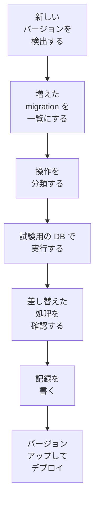

# Redmine のバージョンアップ

Redmine の新しいバージョンがリリースされたときに、このプロジェクトで確認してからバージョンアップする手順です。増えた migration、プラグインが差し替えている処理、Rails のバージョンの変更を、バージョンアップの前に確認し、結果をバージョンごとに記録します。

## 流れ

0. **リリース前:** CI の matrix で、次のリリースになる Redmine の `master` でも、イメージテストと Redmine 本体のテストを実行しているので、壊れる箇所がリリース前に分かります ([testing.md](testing.md#order-in-ci))。
1. **検出:** 毎週、GitHub Actions の定期ワークフローが、Redmine の最新の安定バージョン (redmine.org のダウンロードと、GitHub の `redmine/redmine` のタグ) と、このプロジェクトが使っているバージョンを比較します。新しいバージョンがあれば、Issue を作成します。
2. **一覧の作成:** 現在のバージョンと新しいバージョンの `db/migrate/` を比較し、増えた migration を一覧にします。
3. **分類:** migration ごとに、使っている操作から、次の扱いに分類します (下の「migration の分類」)。
4. **実行:** 試験用データベースで、増えた migration を実行します (下の「試験用データベース」)。
5. **差し替えた処理の確認:** プラグインが差し替えている Redmine のメソッドの、元のコードが変わっていないかを確認します ([testing.md](testing.md#redmines-own-tests))。
6. **記録:** 結果を `docs/upgrades/<バージョン>.md` に書きます (下の「記録」)。
7. **バージョンアップ:** 記録と、テストの CI ([testing.md](testing.md#order-in-ci)) が通ったら、バージョンアップの PR を作成し、デプロイします。

## バージョンの固定

Redmine のバージョンと、ダウンロードするファイルの SHA256 を、`redmine.lock` に書きます。イメージをビルドするときは、この値だけを使います。バージョンアップの PR は、このファイルを変更します。

## migration の分類

増えた migration を、使っている操作から次のように分類します。分類は、このプロジェクトのスクリプト (`bin/check-migrations`) が、migration のファイルを読んで行います。スクリプトで判定できないものは、人が読みます。

| 扱い | 該当する操作 | 確認内容 |
| --- | --- | --- |
| 軽い | データだけの変更 (行が少ない)、列の追加と削除、デフォルト値の変更、ほかのデータベースのときだけ動くもの | 実行するだけでよい |
| テーブルのロックか書き換え | インデックスの作成、列の型の変更、`NOT NULL` を付ける変更、外部キーの追加 | PostgreSQL は、実行中はテーブルへの書き込みをロックし、型の変更ではテーブルを書き換える。実際のデータ量で時間を計測し、長ければ利用の少ない時間帯にバージョンアップする |
| 多数の行の変更 | 1 つの文で多数の行を変更するデータの変更 (`update_all` など) | 時間を計測する。migration は `redmine-task` で実行するので、15 分に収まる必要がある ([tasks.md](tasks.md#tasks-longer-than-15-minutes)) |
| 人が読む | `execute` で書いた SQL、データベースの種類ごとの分岐 | スクリプトで判定できないもの |

Redmine の migration は、RDS for PostgreSQL では標準のまま通ります ([rds.md](rds.md))。分類は、時間のかかる migration と、プラグインの差し替えへの影響を見つけるために行います。

## 試験用データベース

| データベース | 使い方 |
| --- | --- |
| PostgreSQL (CI のコンテナ。RDS と同じメジャーバージョン) | 現在のバージョンのスキーマと試験用データを投入し、増えた migration を実行する。`down` も実行して、ロールバックできるかを確認する |

- **試験用データ:** 本番のデータは使いません。行数を本番に近づけて生成したデータを使います。大きなテーブル (`journals`、`custom_values`、`attachments` など) は、本番の行数を記録から取得して、同程度にします。時間のかかる migration を、実際のデータ量で計測するためです。
- **所要時間:** migration ごとに、所要時間を計測します。記録の「メンテナンス時間」の見積もりの基になります。

## 記録

バージョンごとに `docs/upgrades/<バージョン>.md` を書き、`docs/upgrades/README.md` の一覧に追加します。

| 項目 | 内容 |
| --- | --- |
| バージョン | バージョンアップの前と後のバージョン、リリース日、Rails と Ruby のバージョンの変更 |
| 増えた migration | ファイル名と、分類の結果 |
| 試験の結果 | PostgreSQL で通ったか、所要時間、変更したテーブルの行数 |
| プラグインへの影響 | 元のコードが変わった差し替え (`redmine_serverless`、`redmine_serverless_s3`、`redmine_serverless_ses`) と、その修正 |
| メンテナンス時間 | 本番を停止する時間の見積もり |
| 本番での結果 | バージョンアップした日、実際の所要時間、発生した問題 |

## 古いバージョンからの移行

古い Redmine (ほかの環境で動いているもの) から移行するときは、この手順ではなく、[migration.md](migration.md) の手順で移行します。

## 未確認の事項

- `bin/check-migrations` で、Ruby の構文木から操作を分類するか、文字列のパターンで分類するか (条件分岐で、データベースの種類ごとに違う操作をする migration があるため)
- 大きなテーブルの migration が、`redmine-task` の 15 分に収まるか
