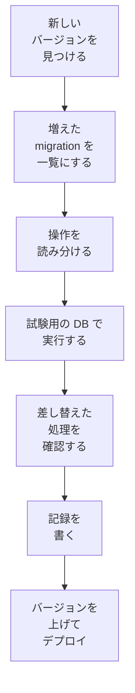

# Redmine を上げるとき

Redmine の新しいバージョンが出たときに、このプロジェクトで確認してから上げる手順です。増えた migration、プラグインが差し替えている処理、Rails のバージョンの変化を、上げる前に確認し、結果をバージョンごとに記録します。

## 流れ

0. **リリースの前:** CI の matrix で、次のリリースになる Redmine の `master` でも、イメージのテストと Redmine 本体のテストを実行しているので、壊れるところがリリースの前に分かります([testing.md](testing.md#order-in-ci))。
1. **見つける:** 毎週、GitHub Actions の定期のワークフローが、Redmine の最新の安定バージョン(redmine.org のダウンロードと、GitHub の `redmine/redmine` のタグ)と、このプロジェクトが使っているバージョンを比べます。新しいバージョンがあれば、Issue を作ります。
2. **一覧にする:** 今のバージョンと新しいバージョンの `db/migrate/` を比べ、増えた migration を一覧にします。
3. **読み分ける:** migration ごとに、使っている操作から、次の扱いに分けます(下の「読み分け」)。
4. **実行する:** 試験用のデータベースで、増えた migration を実行します(下の「試験用のデータベース」)。
5. **差し替えた処理を確認する:** プラグインが差し替えている Redmine のメソッドの、元のコードが変わっていないかを確認します([testing.md](testing.md#redmines-own-tests))。
6. **記録を書く:** 結果を `docs/upgrades/<バージョン>.md` に書きます(下の「記録」)。
7. **上げる:** 記録と、テストの CI([testing.md](testing.md#order-in-ci))が通ったら、使うバージョンを上げる PR を作り、デプロイします。

## 使うバージョンの固定

Redmine のバージョンと、ダウンロードするファイルの SHA256 を、`redmine.lock` に書きます。イメージを作るときは、この値だけを使います。バージョンを上げる PR は、このファイルを変えます。

## 読み分け

増えた migration を、使っている操作から次のように分けます。読み分けは、このプロジェクトのスクリプト(`bin/check-migrations`)が、migration のファイルを読んで行います。スクリプトで決めきれないものは、人が読みます。

| 扱い | 当てはまる操作 | 確認すること |
| --- | --- | --- |
| 軽い | データだけの変更(行が少ない)、列の追加と削除、既定の値の変更、ほかのデータベースのときだけ動くもの | 実行するだけでよい |
| テーブルを止めるか書き直す | 索引の作成、列の型の変更、`NOT NULL` を付ける変更、外部キーの追加 | PostgreSQL は、実行のあいだテーブルへの書き込みを止め、型の変更ではテーブルを書き直す。実際の大きさで時間を測り、長ければ利用の少ない時間に上げる |
| 多くの行を変える | 1 つの文で多くの行を変えるデータの変更(`update_all` など) | 時間を測る。migration は `redmine-task` で動くので、15 分に収まる必要がある([tasks.md](tasks.md#tasks-longer-than-15-minutes)) |
| 人が読む | `execute` で書いた SQL、データベースの種類ごとの分岐 | スクリプトで決めきれないもの |

Redmine の migration は、RDS for PostgreSQL では標準のまま通ります([rds.md](rds.md))。読み分けは、時間のかかる migration と、プラグインの差し替えへの影響を見つけるために行います。

## 試験用のデータベース

| データベース | 使い方 |
| --- | --- |
| PostgreSQL(CI のコンテナ。RDS と同じメジャーバージョン) | 今のバージョンのスキーマと、試験用のデータを入れ、増えた migration を実行する。`down` も実行して、戻せるかを確認する |

- **試験用のデータ:** 本番のデータは使いません。行の数を本番に近づけた、作ったデータを使います。大きなテーブル(`journals`、`custom_values`、`attachments` など)は、本番の行の数を記録から取って、同じくらいにします。時間のかかる migration を、実際の大きさで測るためです。
- **かかる時間:** migration ごとに、かかった時間を測ります。記録の「保守の時間」の見積もりのもとになります。

## 記録

バージョンごとに `docs/upgrades/<バージョン>.md` を書き、`docs/upgrades/README.md` の一覧に足します。

| 書くこと | 内容 |
| --- | --- |
| バージョン | 上げる前と後のバージョン、リリースの日、Rails と Ruby のバージョンの変化 |
| 増えた migration | ファイルの名前と、読み分けの結果 |
| 試験の結果 | PostgreSQL で通ったか、かかった時間、変えたテーブルの行の数 |
| プラグインへの影響 | 元のコードが変わった差し替え(`redmine_serverless`、`redmine_serverless_s3`、`redmine_serverless_ses`)と、直したこと |
| 保守の時間 | 本番で止める時間の見積もり |
| 本番での結果 | 上げた日、実際にかかった時間、起きた問題 |

## 古いバージョンからの移行

古い Redmine(ほかの環境で動いているもの)から移すときは、この手順ではなく、[migration.md](migration.md) の手順で移します。

## 確認すること

- `bin/check-migrations` で、Ruby の構文木から操作を読み分けるか、文字の並びで読み分けるか(条件の分岐で、データベースの種類ごとに違う操作をする migration があるため)
- 大きなテーブルの migration が、`redmine-task` の 15 分に収まるか
