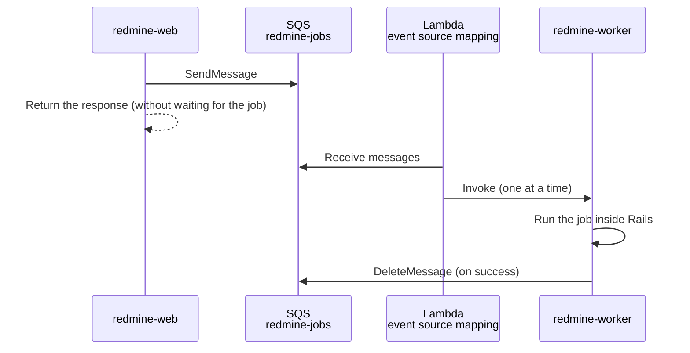
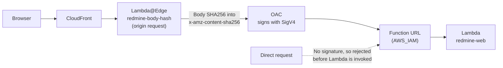
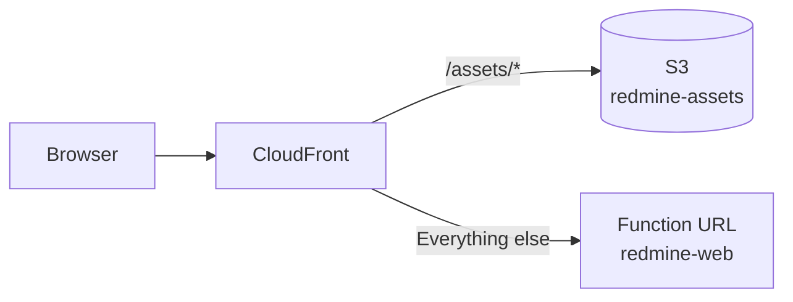

# Running Redmine on Lambda Event Functions

This is the design for running Redmine (Rails and Puma) on Lambda Event Functions. Event Functions are the traditional Lambda that receives and processes one event at a time. Lambda Web Adapter turns HTTP requests back into plain HTTP and passes them to Puma.

The specifications on this page were checked against official information as of 2026-11-08 and against the source of Redmine 7.0.3 and Rails 8.1.4. Sources are in [sources.md](sources.md).

## Function settings

| Item | Value | Reason |
| --- | --- | --- |
| Functions | `redmine-web` (web pages and API), `redmine-worker` (ActiveJob jobs; see "Background jobs" below), `redmine-task` (rake and mail import; [tasks.md](tasks.md)). All three use the same image | The web function runs up to 60 seconds; jobs and tasks run up to 15 minutes |
| Package | Container image (ECR) | A zip is limited to 250 MB unpacked. Redmine, the gems and ImageMagick are not expected to fit. An image can be up to 10 GB |
| Architecture | arm64 | Lower unit price for run time than x86 (in ap-northeast-1, $0.0000133334 versus $0.0000166667 per GB-second) |
| Memory | 2,048 MB | CPU is allocated in proportion to memory. Speeds up Rails start-up and thumbnail generation. To be revised after measurement |
| Timeout | 60 seconds (`redmine-web`), 900 seconds (`redmine-worker`, `redmine-task`) | Matches the CloudFront origin response timeout (below) |
| `/tmp` | 512 MB (the default, no extra charge) | The attachment cache, up to 256 MB ([attachments.md](https://redmine-kit.github.io/redmine_serverless_s3/attachments.html#the-tmp-cache)), PDF output. Lambda reads no whole file at registration (S3 checks the SHA256) and downloads do not pass through Lambda, so the default is enough |
| Reserved concurrency | 10 (`redmine-web`) | Caps load and cost |
| VPC | Private subnets of a VPC (two AZs) | RDS is reached only from inside the VPC. S3 is reached through a gateway endpoint, and SES, SSM and SQS through VPC endpoints or a NAT instance ([rds.md](rds.md#routes-out-of-the-vpc)) |

## Image

The image is based on the Lambda Ruby base image `public.ecr.aws/lambda/ruby:4.0`, with Redmine 7.0.3 and dependencies such as ImageMagick installed. `redmine-web`, `redmine-worker` and `redmine-task` use the same image and switch what starts with the function environment variable `REDMINE_ROLE` (`web`, `worker`, `task`) ([tasks.md](tasks.md#how-one-image-runs-everything)).

### Choosing the base

Redmine runs as a container image, not a zip. A zip is limited to 250 MB unpacked, which makes it hard to include the ImageMagick, Ghostscript and Pandoc executables in addition to Redmine and the gems.

| Base | Strengths | Weaknesses | Decision |
| --- | --- | --- | --- |
| Lambda Ruby base image (`public.ecr.aws/lambda/ruby:4.0`) | Built for Lambda, with the same OS as Lambda (Amazon Linux 2023) and Ruby. Includes the runtime interface client, so the task function can be built directly. Designed to run on a read-only file system as a low-privilege user | Redmine and its dependencies must be installed by hand, and Redmine updates must be followed by hand | Use |
| Official Redmine image (`redmine:7.0.3`, Debian 13) | Updated with each Redmine release (7.0.3 on 2026-11-06), with dependencies in place | Built to run under Docker. Its entry point writes the configuration file, runs migrations and installs gems on every start, and must be removed. `HOME` is in an unwritable location. No runtime interface client. No Pandoc. Also includes the Mercurial and Bazaar clients, which are not used (`7.0/trixie/Dockerfile` of docker-library/redmine, checked on 2026-11-10) | Do not use |

With either base, Lambda does not update the OS of a container image function automatically. When the base image is updated, the image is rebuilt and deployed.

### What was checked in the base image

Checked on 2026-11-08 by running the arm64 image in local Docker.

| Item | Details |
| --- | --- |
| OS | Amazon Linux 2023 (2023.12.20261026) |
| Ruby | 4.0.9. The Redmine wiki recommends 4.0.4 or later, avoiding 4.0.0–4.0.3, which make wiki rendering slow. The `ruby:3.4` image has 3.4.12 |
| Entry point | `/lambda-entrypoint.sh`. The runtime interface client is in `/var/runtime` |
| Package management | `microdnf` (`dnf` is also available) |

The following packages were confirmed to be installable from the standard Amazon Linux 2023 repositories (`microdnf repoquery`).

| Purpose | Package | Version |
| --- | --- | --- |
| Thumbnails, Gantt PNG | `ImageMagick` | 6.9.13 (installed in the image on 2026-11-09). Includes `convert`, which Redmine calls |
| PDF thumbnails | `ghostscript`<br>`urw-base35-fonts` | 9.56.1 |
| PostgreSQL connections | `libpq` (runtime), `libpq-devel` (building the `pg` gem) | 15.0 |
| Japanese text in Gantt PNG | `ipa-gothic-fonts` | 003.03. Set with Redmine's `minimagick_font_path` |
| Repositories ([below](#repositories)) | `subversion`<br>`git-core` (only the commands are copied into the image) | 1.14.5<br>2.50.1 (2026-11-10) |
| Building gems | `gcc`<br>`make`<br>`libyaml-devel` | — |
| Unpacking files | `tar`<br>`gzip` | — |

Pandoc is not in the Amazon Linux 2023 repositories (searched with `microdnf repoquery`), so the official Pandoc Linux arm64 executable (`pandoc-3.13-linux-arm64.tar.gz`, 2026-10-26) is installed after checking its SHA256; Redmine 7.0 needs 3.8.3 or later to preview xlsx and pptx. ImageMagick 6 has the `convert` command that Redmine uses for thumbnails (`lib/redmine/thumbnail.rb`), so it works as is.

### Shape of the Dockerfile

```dockerfile
FROM public.ecr.aws/lambda/ruby:4.0@sha256:<digest> AS build
# Install gcc, make, libpq-devel, libyaml-devel, tar, gzip
# Download the Redmine 7.0.3 tar.gz from redmine.org, check its SHA256 and unpack it to /var/task/redmine
# Add config/database.yml and Gemfile.local, and install gems into vendor/bundle (excluding development and test)
# Compile assets (bin/rails assets:precompile)

FROM public.ecr.aws/lambda/ruby:4.0@sha256:<digest>
# Install ImageMagick, ghostscript, urw-base35-fonts, libpq, ipa-gothic-fonts
# Copy svn, svnadmin and git, and the libraries they need, from a stage with subversion and git-core
# Install the Pandoc executable
# Download the RDS CA bundle (global-bundle.pem), check its SHA256 and place it at /var/task/rds-global-bundle.pem
# Copy /var/task/redmine from the build stage (build tools such as gcc are not included)
# Add the configuration files, the project's own plugins (plugins/), the start-up script and the task handler
# Make tmp a symbolic link to /tmp/redmine
COPY --from=public.ecr.aws/awsguru/aws-lambda-adapter:1.1.0@sha256:<digest> /lambda-adapter /opt/lambda-web-adapter/lambda-adapter
COPY image/extensions/lambda-adapter /opt/extensions/lambda-adapter
ENTRYPOINT ["/var/task/bin/start"]
```

- **Two stages:** gcc and other tools used to build gems are not included in the runtime image. The image is smaller, and fetching it at start-up is expected to be shorter.
- **One image:** One build and one push; the same code runs in all three functions.
- **The files:** The Dockerfile is `image/Dockerfile`, built with `bin/build-image`. The gem versions are fixed in `image/Gemfile.lock`, which `bin/update-gems` writes for arm64 Linux only.
- **Entry point (`/var/task/bin/start`):** With `REDMINE_ROLE=web`, it starts Puma. With `worker` or `task`, it runs the corresponding handler through the base image's `/lambda-entrypoint.sh`. With any other value, it exits with an error.
- **Extension (`/opt/extensions/lambda-adapter`):** A small shell script. Only with `REDMINE_ROLE=web` does it start the real Lambda Web Adapter placed in `/opt/lambda-web-adapter/`. With `worker` or `task`, it registers as an extension that does nothing and waits ([tasks.md](tasks.md#how-one-image-runs-everything)).
- **Pin by digest:** The base image and Lambda Web Adapter are referenced by digest, not by tag. For Redmine, Pandoc and the RDS CA bundle, the SHA256 of the downloaded file is checked.
- **Single-architecture image:** Lambda does not accept multi-architecture images. Only an arm64 image is pushed. Docker buildx may add provenance information by default and turn the image into an index, so the build disables it (an assumption; to be checked on the first build).
- **Do not delete images in ECR:** Lambda periodically re-fetches the image a function uses from ECR. If the image has been deleted, the function becomes `Failed`. The ECR lifecycle policy keeps the most recent few images.

### Adapting Redmine to Lambda

| Item | On Lambda | Reason |
| --- | --- | --- |
| Location | `/var/task/redmine` | The Lambda base image places function code in `/var/task` (`LAMBDA_TASK_ROOT`) |
| `config/database.yml` | Added at build time. `adapter:` is written literally as `postgresql`. The host, database name, user name and password are read from environment variables with ERB (`REDMINE_DB_HOST`, `REDMINE_DB_NAME`, `REDMINE_DB_USERNAME`, `REDMINE_DB_PASSWORD`). TLS is `verify-full` against the RDS CA bundle in the image (`sslrootcert: /var/task/rds-global-bundle.pem`) | Redmine's `Gemfile` chooses the database gem from the `adapter:` value in `config/database.yml`. If `adapter:` were ERB, the Gemfile would also have to evaluate ERB, so writing it literally is more reliable. RDS for PostgreSQL uses the `pg` gem |
| `Gemfile.local` | `puma` (Redmine lists it only in its test group), and the plugin gems from GitHub Packages: `redmine_serverless_ssm`, `redmine_serverless`, `redmine_serverless_sqs` and `redmine_serverless_ses`, which Bundler loads early (their `boot/` files), and `redmine_serverless_s3`, with `require: false` ([architecture.md](architecture.md#distribution)) | Redmine also loads the gems in `Gemfile.local`. Gems used by a plugin (such as `aws-activejob-sqs` for `redmine_serverless_sqs`, `aws-actionmailer-ses` for `redmine_serverless_ses`, `aws-sdk-s3` for `redmine_serverless_s3`) are dependencies in that plugin's gemspec |
| The project's own plugins | `redmine_serverless`, `redmine_serverless_s3`, `redmine_serverless_ses`, `redmine_serverless_sqs` and `redmine_serverless_ssm`. Each is a gem from GitHub Packages, linked from its installed directory into `plugins/` before the assets are compiled, so that the plugins' scripts are in the manifest | Extensions are the project's own plugins ([architecture.md](architecture.md#the-plugins)) |
| Gems | Installed into `vendor/bundle` at build time, never at run time (`BUNDLE_DEPLOYMENT`, `BUNDLE_WITHOUT=development:test`) | Nothing can be written at run time |
| File permissions | Readable by every user | Lambda runs as a default low-privilege user, which must be able to read every file needed at run time |
| `HOME` | `/tmp` | Bundler, ImageMagick and Pandoc may write to the home directory (an assumption) |

### Lambda Web Adapter settings

Lambda Web Adapter is an extension published by AWS. It turns Lambda events back into HTTP requests and passes them to the HTTP server in the image. The latest version is 1.1.0 (2026-09-18). It is included in the image, but only `redmine-web` starts it (see "Shape of the Dockerfile" above).

| Environment variable | Value | Reason |
| --- | --- | --- |
| `AWS_LWA_PORT` | `3000` | The port Puma listens on |
| `AWS_LWA_READINESS_CHECK_PROTOCOL` | `tcp` | Redmine has no lightweight health check path. The app is considered ready when the port opens |
| `AWS_LWA_ASYNC_INIT` | `true` | Keeps waiting for start-up within the first request even past the 10-second initialization (below) |
| `AWS_LWA_INVOKE_MODE` | `buffered` (default) | Redmine responses do not need streaming. The compression below works only with `buffered` |
| `AWS_LWA_ENABLE_COMPRESSION` | `true` | Compresses responses with gzip or similar (only with `buffered`). Page responses are not cached (`CachingDisabled`), so CloudFront is not expected to compress them. Lambda responses become smaller, leaving more room below the 6 MB limit, and pages load faster. Whether responses reach the browser still compressed through CloudFront will be checked when building |

### Start-up script and Puma

With `REDMINE_ROLE=web`, the start-up script does the following.

1. Creates the directories `files`, `thumbnails`, `imports`, `cache` and `pids` under `/tmp/redmine`.
2. Starts Puma with `bundle exec puma`.

When `REDMINE_ROLE` is `worker` or `task`, it runs the handler instead of Puma after step 1 ([tasks.md](tasks.md#how-one-image-runs-everything)).

- **Processes and threads:** No worker processes (`-w 0`) and one thread (`-t 1:1`). One Event Functions environment receives only one request at a time.
- **Listening:** Listens on `127.0.0.1:3000`.
- **Shutdown:** When Lambda shuts down an environment, it may exit without waiting for Puma. No request is cut off midway, and jobs are queued in SQS and run by `redmine-worker`.

## Waiting for start-up

Lambda shuts down environments that are not in use. The next first request waits for a new environment to start.

How long the start takes has not been measured yet; it includes loading Rails, connecting to the database and fetching the image, and it is the first thing to measure. Initialization is limited to 10 seconds. If it takes longer, Lambda retries initialization at the first invocation, within the function timeout. With `AWS_LWA_ASYNC_INIT=true`, Lambda Web Adapter reports initialization as done at 9.8 seconds and keeps waiting for Puma to start within the first request.

One environment handles one request at a time, so when a page makes many requests at once, that many environments start. This is another reason why attachments and thumbnails are read directly from S3 ([attachments.md](https://redmine-kit.github.io/redmine_serverless_s3/attachments.html#thumbnails)).

### Keeping environments warm

The usual remedies do not fit. SnapStart supports only Java, Python and .NET, not Ruby. Provisioned Concurrency for one 2 GB environment costs about $23 per month on arm in ap-northeast-1 (2 GB × $0.0000043068 per GB-second × 2,628,000 seconds (730 hours)), which does not fit the budget.

If needed, EventBridge Scheduler invokes `redmine-web` every 5 minutes during business hours instead. Lambda Web Adapter passes such non-HTTP events as a POST to `/events`, and the plugin's Rack middleware answers them with 204 without touching the database. How long an environment stays alive is not documented officially, so the effect will be measured before deciding.

## Read-only file system

In Event Functions, only `/tmp` is writable. The places Redmine writes to at run time are redirected as follows.

| Redmine location | Use | Redirected to |
| --- | --- | --- |
| `files/` | Attachments, the Office preview cache (`files/derived_cache/`) | `/tmp/redmine/files`, used as a cache of S3. Set with `attachments_storage_path` |
| `tmp/thumbnails/` | Thumbnail work | `/tmp/redmine/thumbnails`. Finished thumbnails are stored in S3 |
| `tmp/imports/` | CSV import files | `/tmp/redmine/imports`. Also stored in S3; other environments fetch them from S3 |
| Rest of `tmp/` (`tmp/cache/`, `tmp/pids/` and so on) | Temporary files for PDF output | `/tmp/redmine` (per environment) |
| `log/` | Logs | Standard output (`RAILS_LOG_TO_STDOUT=1`), which goes to CloudWatch Logs |
| `db/schema.rb` | Schema dump after migrations | Not written ([tasks.md](tasks.md#notes-on-the-read-only-file-system)) |
| `public/assets/` | CSS and JavaScript | Compiled at build time (below) |
| `config/` | Configuration files | Added at build time. Values are read from environment variables |

`tmp` in the image is a symbolic link to `/tmp/redmine`, which the start-up script creates. This approach is used because `Import#filepath` is fixed to `Rails.root/tmp/imports`. Asset compilation may use `tmp/`, so the link is created after compilation. How attachments, thumbnails and import files move to and from S3 is in [attachments.md](https://redmine-kit.github.io/redmine_serverless_s3/attachments.html).

When Redmine decides at start-up that assets are outdated, it writes them to `public/assets` (`config.assets.redmine_detect_update`). Here the assets are compiled at build time and this check is disabled; the compiled assets are served from S3 ("Serving assets" below).

## Settings and secrets (SSM Parameter Store)

Secrets such as `SECRET_KEY_BASE` are stored in SSM Parameter Store and read by Redmine at start-up. Secrets are not placed in Lambda environment variables. The database password is stored there too.

### Parameters

The plugin [Redmine Serverless SSM](https://redmine-kit.github.io/redmine_serverless_ssm/) reads every parameter directly under `/<instance>/env/` into environment variables, before Rails reads `config/database.yml` and `SECRET_KEY_BASE`; how and when it reads, and what it skips, are on its pages. Adding a parameter adds an environment variable without code changes. The table is an example for the instance name `redmine`.

| Parameter | Type | Contents | Written by |
| --- | --- | --- | --- |
| `/redmine/env/REDMINE_DB_HOST` | String | The RDS endpoint (`<instance ID>.<random>.ap-northeast-1.rds.amazonaws.com`). Not a secret, but kept here so that Redmine's settings are read together | The instance stack |
| `/redmine/env/REDMINE_DB_PASSWORD` | SecureString | The password of the database user ([rds.md](rds.md#settings)) | `bin/deploy`, the first time ([deploy-config.md](deploy-config.md#secrets)) |
| `/redmine/env/SECRET_KEY_BASE` | SecureString | The Rails secret key | Same as above |
| `/redmine/env/REDMINE_CLOUDFRONT_PRIVATE_KEY` | SecureString | The private key for signed attachment URLs ([Redmine Serverless S3](https://redmine-kit.github.io/redmine_serverless_s3/setup.html#configuration)) | Same as above |

The instance stack gives the three functions `REDMINE_SSM_PATH=/<instance>/env/` as an environment variable, and their execution roles may call `ssm:GetParametersByPath` only on that path ([iam.md](iam.md#permissions-common-to-the-three-functions)). The plugin is a gem as well as a plugin, so that it is loaded early enough; `image/Gemfile.local` adds it from GitHub Packages. In the image tests, the database host is only in SSM (moto), and `db:migrate`, the web page and the worker job pass, which shows the parameters are read before `config/database.yml` (2026-11-09; [testing.md](testing.md#image-tests)).

Settings that are not secret, such as the bucket names, domain, region, database name and database user name, are passed from CloudFormation as function environment variables. The image reads them as `REDMINE_DB_NAME` (default `redmine`), `REDMINE_DB_USERNAME` (default `redmine`), `REDMINE_JOBS_QUEUE_URL` (the job queue) and `REDMINE_HOST` (the domain). `REDMINE_DB_PORT` and `REDMINE_DB_SSLMODE` (default `verify-full`) are changed only in local tests.

SecureString parameters are encrypted with the SSM default key (`aws/ssm`); whether the execution role needs `kms:Decrypt` with this key will be checked when building. Each execution environment reads the parameters once, when it starts, so after changing a value, update the function configuration so that new environments start.

### How they reach the function

`redmine-web`, `redmine-worker` and `redmine-task` are in the VPC, so they reach SSM over HTTPS with IAM authentication through the SSM VPC endpoint or the NAT instance ([rds.md](rds.md#routes-out-of-the-vpc)).

## Rails and Redmine settings

Whether a Rails setting takes effect depends on where it is written.

- **Settings that `production.rb` sets:** `config/additional_environment.rb` is loaded inside `config/application.rb`, and `production.rb` is loaded after it. Settings that `production.rb` sets are overwritten even if written in `additional_environment.rb`.
- **Settings used early in initialization:** Rails creates the cache before reading `config/initializers/` (`initialize_cache`). Cache settings written in `config/initializers/` have no effect.

| Item | Description | Value | Where |
| --- | --- | --- | --- |
| `config.cache_store` | The Rails 8.1 default is files in `tmp/cache/`. `production.rb` does not set it. What is cached, tuning and a shared cache: [cache.md](cache.md); sessions: [session.md](session.md) | `:memory_store` (per environment, up to 64 MB) | `additional_environment.rb` |
| `config.active_job.queue_adapter` | With the default `:async`, jobs are lost when the environment shuts down (below). `production.rb` does not set it | `:inline`; `redmine_serverless_sqs` makes it `:sqs` when `REDMINE_JOBS_QUEUE_URL` is set (on Lambda) | `additional_environment.rb` and the plugin |
| `config.active_record.dump_schema_after_migration` | Stops writing `db/schema.rb` after migrations. Commented out in `production.rb` | `false` | `additional_environment.rb` |
| `config.hosts` | The host names Rails accepts | The Redmine domain | `additional_environment.rb` |
| `config.filter_redirect` | Makes redirects to attachment signed URLs appear as `[FILTERED]` in logs ([security.md](security.md#logs)) | URLs on the CloudFront domain under `/files/` and `/tmp/` | `additional_environment.rb` |
| `config.action_mailer.raise_delivery_errors` | `production.rb` sets it to `false`. Sending errors fail the job so that it can be retried ([sending.md](https://redmine-kit.github.io/redmine_serverless_ses/sending.html#raising-errors)) | `true` only in `redmine-worker` | The plugin `redmine_serverless_ses` |
| `config.assets.redmine_detect_update` | `production.rb` sets it to `true` | `false` | The plugin `redmine_serverless` ([its README](https://redmine-kit.github.io/redmine_serverless/#running-on-lambda)) |
| `attachments_storage_path` | [attachments.md](https://redmine-kit.github.io/redmine_serverless_s3/attachments.html#the-tmp-cache) | `/tmp/redmine/files` | `configuration.yml` |
| `email_delivery` | [mail.md](mail.md) | `:ses_v2` (the SES API) | `configuration.yml` |
| `webhook_blocklist` | Prevents webhooks from being sent to internal addresses or to address ranges used by metadata services ([ai.md](ai.md#event-notifications-redmines-standard-webhooks)). In the VPC endpoint setup, all addresses are blocked ([rds.md](rds.md)) | Private addresses (`10.0.0.0/8`, `172.16.0.0/12`, `192.168.0.0/16`, `fc00::/7`), loopback addresses (`127.0.0.0/8`, `::1/128`), link-local addresses (`169.254.0.0/16`, `fe80::/10`) | `configuration.yml` |

| Key | Description | Parameter |
| --- | --- | --- |
| `RAILS_ENV` | The Rails environment | `production` |
| `RAILS_LOG_TO_STDOUT` | Sends logs to standard output: `production.rb` does so when this variable exists | `1` |
| `SECRET_KEY_BASE` | The key that encrypts the session cookie and more. Rails 8.1 reads it from an environment variable or credentials. `config/secrets.yml` is not read | Read from SSM Parameter Store at start-up (see "Settings and secrets" above) |
| `REDMINE_DB_HOST`<br>`REDMINE_DB_PASSWORD` | The database host and password, which `config/database.yml` reads | Read from SSM Parameter Store at start-up (see "Settings and secrets" above) |
| `RUBY_YJIT_ENABLE` | Turns YJIT on. The Lambda Ruby documentation recommends YJIT for Rails | `1` |

`configuration.yml` is evaluated as ERB, so values can be read from environment variables.

### Settings in Redmine's administration

| Item | Description | Value |
| --- | --- | --- |
| Host name and path, protocol | Used for URLs in mail | The Redmine domain, HTTPS |
| Maximum size for downloading all attachments (`bulk_download_max_size`) | The zip is returned as a temporary file in S3, so it does not hit the 6 MB limit ([attachments.md](https://redmine-kit.github.io/redmine_serverless_s3/attachments.html#downloading-all-attachments)). Measure whether creating it fits in 60 seconds | Redmine's default (100 MB) |
| Administrator password | The initial administrator is `admin`, with the password `admin` | Change it right after loading the initial data |
| Authentication required (`login_required`) | Redmine is not shown to people who are not logged in. Redmine's standard `/robots.txt` also starts denying everything to search engines (`Disallow: /`) | Enabling it is recommended |

### Background jobs

Redmine defers notification mail (`deliver_later`), project deletion (`DestroyProjectJob`, `DestroyProjectsJob`) and webhooks (`WebhookJob`) with ActiveJob. The Redmine 7.0.3 source has no delayed scheduling (`set(wait: …)`). The default adapter `:async` runs jobs in threads inside the same process, so on Lambda they are lost if the environment shuts down after the response is returned.

Therefore, jobs are queued in SQS with the official AWS gem `aws-activejob-sqs` and run in the worker function (`redmine-worker`).



| Item | Details |
| --- | --- |
| Gem | `aws-activejob-sqs` 1.2.0 (2026-08-17). Official AWS gem. `activejob` 7.1 or later |
| Queue | One standard queue (`redmine-jobs`), with a dead-letter queue (`redmine-jobs-dlq`) that receives messages that failed after 3 receives |
| Worker function | `redmine-worker`. Same image as `redmine-web`, with `REDMINE_ROLE=worker`. Puma is not started |
| Handler | The gem's handler (`redmine/config/environment.Aws::ActiveJob::SQS::LambdaHandler.job_handler`), which the plugin wraps to record failures. Loads Rails, then runs the job for each message and deletes the messages that succeeded. The gem deletes each message itself, at the queue URL it builds from the event's ARN |
| Plugin | `redmine_serverless_sqs` sets the queue adapter (only with `REDMINE_JOBS_QUEUE_URL`), sends Redmine's queues to `redmine-jobs`, allows only Redmine's and the plugins' job classes to run, records the jobs that fail for the last time and adds the "Jobs" page ([its documentation](https://redmine-kit.github.io/redmine_serverless_sqs/)) |
| Batch size | 1. The handler ends with an exception when a job in the batch fails, so messages are processed one at a time and only the failed one is retried |
| Visibility timeout | Longer than the function timeout (900 seconds) |

While its environment stays alive, `redmine-worker` keeps Rails loaded and runs each job in it; Rails is not restarted per job. A page request returns as soon as its job is in SQS, so it never waits for notification mail to be sent. The reserved concurrency of `redmine-worker` is 3, so that a burst of jobs doesn't use too many database connections or cost too much.

The runtime interface client loads default gems such as json and uri before the handler loads Rails, and Bundler then refuses the newer versions in Redmine's bundle. So `redmine-worker` sets up Redmine's bundle before the runtime starts (`RUBYOPT=-rbundler/setup`; checked on the Runtime Interface Emulator on 2026-11-09).

#### Retries and duplicates

When a job fails, SQS delivers the message again after the visibility timeout. After 3 failures it moves to the dead-letter queue, and an alarm reports the count. The plugin records the job on its last receive so that it can be resent from the administration pages ([admin.md](https://redmine-kit.github.io/redmine_serverless_sqs/admin.html#jobs)).

A standard queue may also deliver the same message twice, so a notification mail can occasionally arrive twice; that is acceptable at this scale. The gem supports delays of up to 15 minutes, but Redmine itself doesn't use them.

#### Webhooks

Redmine 7.0 sends webhooks in a job (`WebhookJob`), so `redmine-worker` sends them. It runs in the VPC, so webhooks can be sent only in the NAT instance setup ([rds.md](rds.md#routes-out-of-the-vpc)); in the VPC endpoint setup they fail at once (`webhook_blocklist` above).

Webhooks are off by default (`webhooks_enabled` is 0). An administrator turns them on, and people with the `use_webhooks` permission create their own. If the destination returns an error or can't be reached within Redmine's 60-second timeout, the job fails and follows the retries above, ending in the failure records, where it can be resent from "Jobs".

Before sending, Redmine resolves the destination name and refuses addresses in the `webhook_blocklist` ranges. It then connects to the resolved address directly, which also defeats DNS answers swapped in between (`lib/webhook_endpoint_validator.rb`, `Webhook::Executor`). This design blocks private and link-local addresses, including the metadata address `169.254.169.254` ([ai.md](ai.md#event-notifications-redmines-standard-webhooks)).

#### Other jobs and the route to SQS

Deleting a large project runs in `redmine-worker`, so it can take up to 15 minutes. Redmine's rake tasks (such as due-date reminders) send mail immediately (`Mailer.with_synched_deliveries`) and don't queue jobs. `redmine-web` and `redmine-worker` reach SQS with IAM authentication through the SQS VPC endpoint or the NAT instance ([rds.md](rds.md#routes-out-of-the-vpc)).

#### Other options considered

| Option | Strengths | Weaknesses | Decision |
| --- | --- | --- | --- |
| SQS only (this design) | Official AWS gem; no custom code needed. Retries, a dead-letter queue and delayed jobs are all available. Jobs run with Rails kept loaded | In the VPC endpoint setup, the SQS endpoint costs about $10.2 per month | Use |
| Write to S3, receive the S3 event with EventBridge and invoke a function | EventBridge retries delivery. Even in the VPC endpoint setup, the S3 gateway endpoint (free) is enough | The adapter and job execution must be written by hand. No delayed jobs. Tends toward starting Rails for each job | Do not use. An alternative proposal when cost comes first |
| Send to EventBridge `PutEvents` | Rules can choose the destination | The adapter must be written by hand. SQS has more complete queue features (re-receiving, dead-letter queue) | Do not use |
| `:inline` (run within the request) | Adds nothing | Page requests wait for mail to be sent. Failed mail is not retried. Deletions longer than 60 seconds do not finish | Do not use |

## Database connections

Each environment holds one connection (`pool: 1`). With the reserved concurrency (10 for `redmine-web`, 3 for `redmine-worker`, 2 for `redmine-task`), there are about 15 connections in total. The connection of a stopped environment remains until the environment is removed, but the total stays within the reserved concurrency. The connection limit of a small RDS instance depends on its memory; the limit and the decision on RDS Proxy are in [rds.md](rds.md).

The three functions use one database user, with its password read from SSM Parameter Store at start-up (`REDMINE_DB_PASSWORD`; [rds.md](rds.md#settings)). Connections use `sslmode=verify-full` and check the server certificate against the RDS CA bundle in the image.

## CloudFront and function URLs

A function URL is a URL that invokes Lambda directly over HTTPS. The custom domain and certificate are provided by CloudFront in front. The function URL uses IAM authentication and accepts only requests signed by CloudFront OAC (origin access control).



- **Function URL authentication:** `AuthType: AWS_IAM`. The function's resource-based policy allows CloudFront (`cloudfront.amazonaws.com`) both `lambda:InvokeFunctionUrl` and `lambda:InvokeFunction`, only for requests from this distribution (`AWS:SourceArn`) (CloudFront documentation; [iam.md](iam.md#resource-based-policies)). Direct requests without a signature are rejected before the function is invoked, so they use neither cost nor concurrency.
- **OAC:** Type Lambda, always sign (`SigningBehavior: always`, `sigv4`).
- **Body hash:** Function URLs do not accept unsigned bodies (`UNSIGNED-PAYLOAD`), so PUT and POST must send the body's SHA256 in `x-amz-content-sha256` (CloudFront documentation). Forms in Redmine pages in the browser do not add it. So the Lambda@Edge function `redmine-body-hash`, which runs at the origin request, computes the hash from the body and adds it. OAC then signs the request.
- **Not possible with CloudFront Functions:** The request data in CloudFront Functions has no body (only the method, URI, query string, headers and cookies). Only Lambda@Edge can read the body.
- **`Host`:** The viewer's `Host` is not forwarded to the function URL (the origin request policy is `AllViewerExceptHostHeader`). OAC signs with the function URL's host name. The Redmine domain is passed in the origin custom header `X-Forwarded-Host`. Rails builds URLs from `X-Forwarded-Host`.
- **Caching:** The default behavior (the function URL) is not cached (`CachingDisabled`). `/assets/*` is served from S3 and cached (see "Serving assets" below). Attachments use the behaviors `/files/*` and `/tmp/*` (thumbnails, zips and uploads), which go to the attachments bucket through OAC and require signed URLs ([attachments.md](https://redmine-kit.github.io/redmine_serverless_s3/attachments.html#download)). They are not cached either (`CachingDisabled`), because no AWS-managed cache policy keeps the file name and type of the signed URL in the cache key (below).
- **Origin response timeout:** The CloudFront default is 30 seconds, configurable from 1 to 120 seconds. It is set to 60 seconds to match the function timeout.

### Function that adds the body hash (Lambda@Edge)

| Item | Value | Reason |
| --- | --- | --- |
| Function | `redmine-body-hash`, attached to the origin request of the default behavior, with the body included (`IncludeBody`) | Only Lambda@Edge can read the body. At the origin request it can read up to 1 MB of the body (up to 40 KB at the viewer request) |
| Runtime | Node.js 24 (`nodejs24.x`, the latest Lambda@Edge supports), x86_64, 128 MB, 5 seconds. Written with `node:crypto` only, without npm package dependencies. The code is inline in `infra/shared-edge.yaml` and is tested by `bin/test-edge` ([testing.md](testing.md#edge-function-tests)) | Lambda@Edge supports only Node.js and Python, and does not support container images or arm64 |
| Architecture, memory, timeout | x86_64, 128 MB, 5 seconds | It only computes a hash |
| Region | us-east-1 | Lambda@Edge functions must be created in us-east-1 |
| Location | `edge/body-hash/` in this repository | It runs outside Redmine, so it is not part of the plugin |

The processing is as follows.

1. If there is no body or the body is empty, add the SHA256 of an empty body (`e3b0c442…b855`).
2. If the body is over 1 MB and was truncated (`inputTruncated`), return 413 without sending it to the origin. A request with a mismatched hash would only be rejected by the function URL.
3. Compute the SHA256 over the body as bytes decoded from base64 and put it in `x-amz-content-sha256`. Computing it after converting to a string would change the value for binary bodies, so it is computed over the bytes.

Because of this function, request bodies that reach Redmine through CloudFront are limited to 1 MB. Attachments from pages go directly to S3, so they are not affected; what is affected is listed under ["The 6 MB limit"](#the-6-mb-limit) below.

The function runs on the origin request, so it runs for every uncached page request. It is not attached to the attachments' behaviors: S3 computes the SHA256 of an upload itself when Redmine copies it ([attachments.md](https://redmine-kit.github.io/redmine_serverless_s3/attachments.html#upload)). In ap-northeast-1 it costs $0.60 per million requests and $0.00005001 per GB-second (price list), which comes to less than $0.1 at 50,000 requests a month. It also works with the CloudFront flat-rate plans and is charged separately from the plan (AWS blog, 2026-03-24). Its logs go to CloudWatch Logs in the region near the edge where it ran (`/aws/lambda/us-east-1.redmine-body-hash`).

Adding the body hash with Lambda@Edge and then signing with OAC is not described in the official documentation. A practical report says it works (a Classmethod article, 2024-07-29; not official information); it is the first thing to try.

### The `/events` path of Lambda Web Adapter

Events that invoke the function from outside the function URL (such as warming during business hours) are passed to Puma by Lambda Web Adapter as a POST to `/events` (`AWS_LWA_PASS_THROUGH_PATH`). The plugin `redmine_serverless` answers them with 204 without touching the database ([its README](https://redmine-kit.github.io/redmine_serverless/#running-on-lambda)). Requests to `/events` that come from CloudFront also just get 204.

### Serving assets

CSS, JavaScript, images and fonts (`/assets/*`) are served from S3, not Lambda. CloudFront in front routes by path.



| Item | Details |
| --- | --- |
| Bucket | A bucket only for assets (tentatively `redmine-assets`). Separate from the attachment bucket so that permissions do not mix |
| CloudFront to S3 | OAC. The bucket policy allows `s3:GetObject` only to `cloudfront.amazonaws.com` for this distribution |
| Caching | `CachingOptimized` (a managed policy provided by AWS). Propshaft adds a digest of the contents to file names, so assets can be cached for a long time |
| Upload | At deployment, `public/assets/` of the built image is synced to S3 (including `.manifest.json`) |
| Old assets | Kept, not deleted, because people may read the previous file names during a deployment or while an old page stays open. A lifecycle rule deletes versions older than 90 days |
| Same origin | Served from the same domain as Redmine. Redmine's icons reference an SVG sprite with `<use href>`, and browsers do not load `<use>` from another origin, so `config.asset_host` is not set to a different domain |

Files loaded on every page then never go through Lambda, which cuts start-up waits and concurrent requests; when the CloudFront cache expires, S3 still serves them. At deployment the assets go to S3 before the `redmine-web` image is updated, so the files the new HTML refers to are already there.

By default in Rails 8.1, Rails also serves `public/` (`public_file_server.enabled`). CloudFront sends `/assets/*` to S3, so those requests never reach Rails, and the setting can stay as it is.

### Flat-rate Free plan and WAF

CloudFront uses the flat-rate Free plan ($0 per month). The templates use only what Free includes, so the configuration is the same on every plan. Free includes 1 million requests and 100 GB of transfer per month, which is expected to be enough at this scale. It also includes WAF rules (up to 5). The plan differences, what is not included (such as logs) and the WAF rules are in [security.md](security.md#aws-waf).

The features the templates use, against the table of features per plan in the CloudFront documentation ("CloudFront flat-rate pricing plans", checked 2026-11-10):

| Feature | Free | How this design uses it |
| --- | --- | --- |
| Cache behaviors | Up to 5 | 4 (below) |
| Cache policies | AWS-managed only ("custom caching rules" from Business) | `CachingDisabled` on Redmine, `/files/*` and `/tmp/*`; `CachingOptimized` on `/assets/*` |
| Origin request policies | AWS-managed only ("custom origin request rules" from Business) | `AllViewerExceptHostHeader` on Redmine; none on S3 |
| Response headers policies | AWS-managed only ("custom response header rules" from Business) | `SecurityHeadersPolicy` on every behavior; it also gives the attachments `nosniff`. Their sandbox CSP and file name come from a CloudFront Function |
| CloudFront Functions | Included. A function used by another distribution cannot be attached | `<instance>-incoming-size` (viewer request) and `<instance>-attachment-headers` (viewer response), per instance |
| Lambda@Edge | Can be used, charged per invocation outside the plan | `redmine-body-hash` (origin request of Redmine's behavior), shared by the instances |
| KeyValueStore | Not included | Not used |
| Origin access control, signed URLs | Included | Function URL and S3 origins; the key group of the attachments |
| Origins inside a VPC | Not included | Not used: the function URL and S3 are outside a VPC |
| WAF | Up to 5 rules, including AWS managed rules. IP rate limits and country blocking included; header-based and regular-expression rules, CAPTCHA and custom responses not included. A web ACL used by another distribution cannot be attached | 5 rules: two rate limits with string matches and three AWS managed rule groups ([security.md](security.md#rules)) |
| Access logs, WAF logs | Not included (from Pro) | Not configured |
| Real-time logs, continuous deployment, OAI, legacy cache settings (`ForwardedValues`) | Cannot be used with any plan | Not used |
| Free plans per account | 3 | One per instance |

The custom error pages (`CustomErrorResponses`), HTTP/3, IPv6 and the ACM certificate are not plan features in the table. The AWS account must not be on the AWS Free Tier. Not confirmed by the table: whether each AWS managed rule group counts as one of the 5 rules, and whether a scope-down statement on a managed rule group is allowed ([security.md](security.md#to-verify)).

The distribution has 4 cache behaviors: the default one and `/files/*`, `/tmp/*` and `/assets/*`. Free allows 5 (checked 2026-11-10), so it fits whether or not the default behavior counts. Thumbnails, zips and uploads share `/tmp/*` for this reason; their S3 keys follow Redmine's own `tmp/` ([attachments.md](https://redmine-kit.github.io/redmine_serverless_s3/attachments.html#bucket-layout)).

## Repositories

The image has the Subversion client (`svn`) and the Git client (`git`). On Lambda, the plugin `redmine_serverless` lets only these two types be enabled in Administration › Settings › Repositories ("Enabled SCM"); the other types stay disabled, because their clients are not in the image ([admin.md](https://redmine-kit.github.io/redmine_serverless/admin.html#redmine-settings-that-cannot-work-on-lambda)). This comes with the next version of `redmine_serverless`; version 0.1.0, in the image now, still fixes the setting to none, so repositories stay disabled on Lambda until the image has the new version.

The commands come from the Amazon Linux packages `subversion` and `git-core`, installed in a build stage. Only the commands (`svn`, `git`, and `svnadmin`, which the image tests use to create a repository) and the shared libraries they link to that the image lacks (Subversion's libraries, APR, serf and a few others; `git` needs none) are copied into the image. Installing the packages themselves would add about 176 MB, because `git-core` requires `openssh-clients`, which brings in systemd, PAM and more. Redmine runs only the commands, and only git's built-in commands (`branch`, `tag`, `ls-tree`, `log`, `diff`, `show` and `blame` in Redmine 7.0.3), so git's helpers in `/usr/libexec/git-core` (for example for HTTPS remotes) are not copied; Redmine never fetches from a remote Git repository.

| Type | How Redmine reads it | On Lambda |
| --- | --- | --- |
| Subversion | With `svn`, at the repository's URL, without keeping a copy. A remote repository (`https://`, `svn://`) can be used | Usable. The functions reach a server on the internet only in the NAT instance setup; with VPC endpoints they have no route to the internet ([rds.md](rds.md#routes-out-of-the-vpc)). The image tests check that Redmine reads a Subversion repository as Lambda's user ([testing.md](testing.md#image-tests)); reading a remote server from Lambda has not been checked yet |
| Git | With `git`, from a bare repository on the local disk. Redmine does not clone or pull by itself | Waits for storage that has not been decided. On Lambda only `/tmp` is writable; it belongs to one execution environment, and a repository under `/tmp` is lost when the environment stops. Redmine accepts a Git repository in a project, but there is no place to keep it yet |

Redmine reads files and diffs from the repository each time, and keeps the commits (changesets) in the database, from where the revision list and the links between issues and commits come. Commits are added only when Redmine fetches them:

| Way to fetch commits | On Lambda |
| --- | --- |
| "Fetch commits automatically" (`autofetch_changesets`): while showing the repository page | Fixed to disabled by the plugin. The page would wait for the client, and a first fetch of a large repository may not finish within the web function's timeout (60 seconds) |
| "Enable WS for repository management" (`sys_api_enabled`): hooks of the repository server and `reposman.rb` | Fixed to disabled by the plugin. `reposman.rb` creates repositories on the server's disk, which Lambda does not have |
| `rake redmine:fetch_changesets` on `redmine-task` | Works for Subversion now: `bin/rake redmine:fetch_changesets` ([tasks.md](tasks.md)). It runs within the task's timeout (900 seconds; a large repository has not been measured); a longer first fetch is a task longer than 15 minutes ([tasks.md](tasks.md#tasks-longer-than-15-minutes)). No schedule runs it yet; adding it to the scheduled runs ([tasks.md](tasks.md#scheduled-runs)) has not been decided. For Git, it waits for the storage |

Image size, measured on 2026-11-10 with `docker image inspect` (uncompressed): 1,353 MB without the clients, 1,365 MB with the commands copied as above, and 1,529 MB with the packages installed. The layer of the copied files is 11.7 MB, and 4.3 MB compressed with gzip.

## Features that cannot be used

| Feature | Reason |
| --- | --- |
| Git repositories | Redmine reads them from the local disk, and Lambda's `/tmp` is lost when the execution environment stops. Where to keep them has not been decided ([Repositories](#repositories)). Subversion repositories can be used. Integration with GitHub and similar services is not handled in this project; it will be considered separately, as another plugin that replaces local repositories |
| Web service for incoming mail | Mail is received by SES. The plugin `redmine_serverless` fixes the setting to disabled ([admin.md](https://redmine-kit.github.io/redmine_serverless/admin.html#redmine-settings-that-cannot-work-on-lambda)) |
| Responses over 6 MB, request bodies over 1 MB | Below |

### The 6 MB limit

Synchronous invocations of Event Functions are limited to 6 MB each for the request and the response. Function URLs put binary bodies such as images into the event as base64, so the file that can actually be sent is about 4.5 MB (an assumption). In addition, request bodies through CloudFront are limited to the 1 MB that the Lambda@Edge function adding the body hash can read (see "Function that adds the body hash" above).

- **Attachments:** Both uploads and downloads go between the browser and S3 through CloudFront, not through Lambda ([attachments.md](https://redmine-kit.github.io/redmine_serverless_s3/attachments.html)). The REST API `POST /uploads.json` goes through Lambda, so it is limited to 1 MB. Large files are sent with the upload through CloudFront (`/s3_uploads/presign`, `/s3_uploads/complete`; also usable with API keys and OAuth) ([ai.md](ai.md)).
- **CSV import:** Import files are sent to Lambda through a page form, so they are limited to 1 MB. Large CSV files are split and imported in parts.
- **Downloading all attachments (zip):** Created as a temporary file in S3, with a redirect to a CloudFront signed URL ([attachments.md](https://redmine-kit.github.io/redmine_serverless_s3/attachments.html#downloading-all-attachments)).
- **Exports (CSV, PDF, wiki HTML and so on):** Returned directly from Redmine. Issue CSV and PDF are limited to 500 issues by default (`issues_export_limit`). CSV exports of spent time, users, projects and so on have no row limit, but at this scale they are not expected to reach 6 MB. If one does, narrow the filter (such as the period) and export again.
- **Pages and API:** Ordinary page and API responses are not expected to exceed 6 MB. The number of items per list page is chosen from 25, 50 and 100 by default (`per_page_options`), and the REST API limits the number of items returned per call to 100 (`ApplicationController`). Responses are also compressed (`AWS_LWA_ENABLE_COMPRESSION` above). If a response does exceed 6 MB, it fails.

## To verify

- Start-up time (fetching the container, loading Rails, connecting to the database)
- Time and memory for one request
- How much warming during business hours reduces waits for start-up
- Whether ImageMagick 6.9.13 on Amazon Linux 2023 can create Redmine thumbnails and Gantt PNG files
- Whether Lambda's default user can read all of the gems, assets and ImageMagick settings
- Whether redirects and URLs in mail use the correct domain with `X-Forwarded-Host`
- Whether, after Lambda@Edge adds `x-amz-content-sha256` and OAC signs the request, the function URL accepts POST, PUT, PATCH and DELETE. Whether POST without a body and multipart forms also pass
- Whether returning 413 on Lambda@Edge `inputTruncated` gives a response that browsers and API clients can understand
