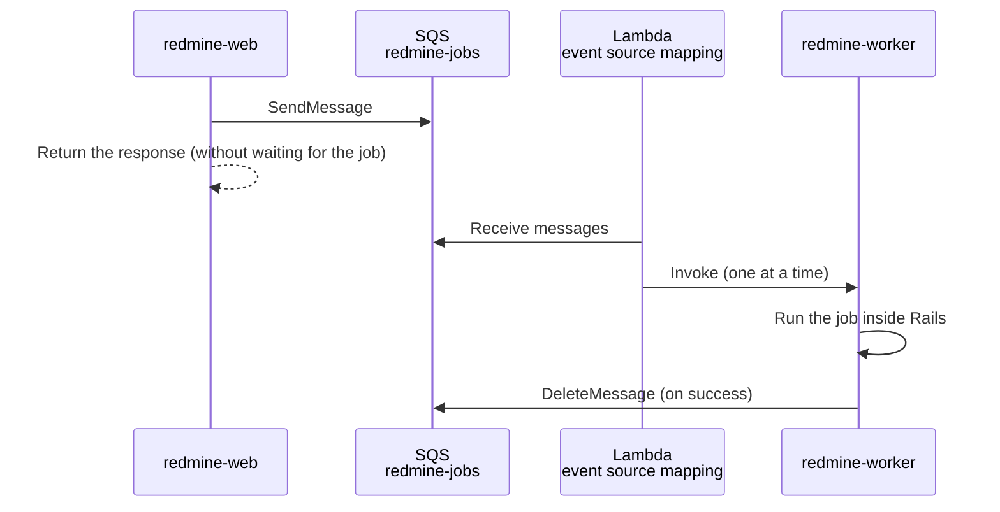
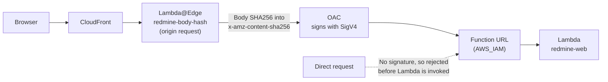
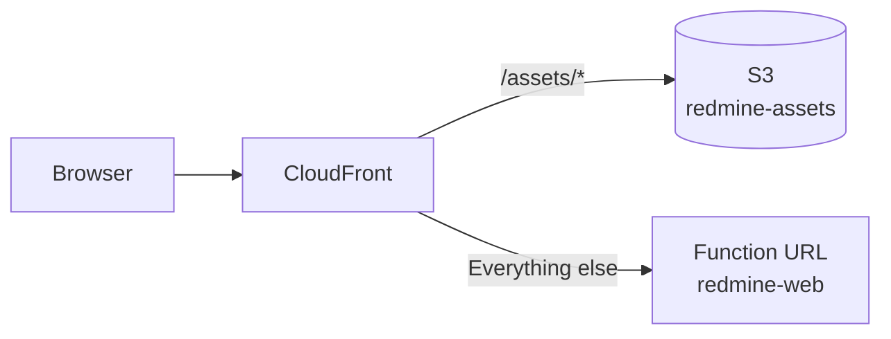

# Running Redmine on Lambda Event Functions

This is the design for running Redmine (Rails and Puma) on Lambda Event Functions. Event Functions are the traditional Lambda that receives and processes one event at a time. Lambda Web Adapter turns HTTP requests back into plain HTTP and passes them to Puma.

The specifications on this page were checked against official information as of 2026-11-08 and against the source of Redmine 7.0.3 and Rails 8.1.4. Sources are in [sources.md](sources.md).

## Function settings

| Item | Value | Reason |
| --- | --- | --- |
| Functions | `redmine-web` (web pages and API), `redmine-worker` (ActiveJob jobs; see "Background jobs" below), `redmine-task` (rake and mail import; [tasks.md](tasks.md)). All three use the same image | The web function runs up to 60 seconds; jobs and tasks run up to 15 minutes |
| Package | Container image (ECR) | A zip is limited to 250 MB unpacked. Redmine, the gems and ImageMagick are not expected to fit. An image can be up to 10 GB |
| Architecture | arm64 | Lower unit price for run time than x86 (in Tokyo, $0.0000133334 versus $0.0000166667 per GB-second) |
| Memory | 2,048 MB | CPU is allocated in proportion to memory. Speeds up Rails start-up and thumbnail generation. To be revised after measurement |
| Timeout | 60 seconds (`redmine-web`), 900 seconds (`redmine-worker`, `redmine-task`) | Matches the CloudFront origin response timeout (below) |
| `/tmp` | 2,048 MB | The attachment cache ([attachments.md](https://redmine-kit.github.io/redmine_serverless_s3/attachments.html#the-tmp-cache)), PDF output, the Rails cache. Selectable from 512 to 10,240 MB |
| Reserved concurrency | 10 (`redmine-web`) | Caps load and cost |
| VPC | Private subnets of a VPC (two AZs) | RDS is reached only from inside the VPC. S3 is reached through a gateway endpoint, and SES, SSM and SQS through VPC endpoints or a NAT instance ([rds.md](rds.md#routes-out-of-the-vpc)) |

## Image

The image is based on the Lambda Ruby base image `public.ecr.aws/lambda/ruby:4.0`, with Redmine 7.0.3 and dependencies such as ImageMagick installed. `redmine-web`, `redmine-worker` and `redmine-task` use the same image and switch what starts with the function environment variable `REDMINE_ROLE` (`web`, `worker`, `task`) ([tasks.md](tasks.md#how-one-image-runs-everything)).

### Choosing the base

Redmine runs as a container image, not a zip. A zip is limited to 250 MB unpacked, which makes it hard to include the ImageMagick, Ghostscript and Pandoc executables in addition to Redmine and the gems.

| Base | Strengths | Weaknesses | Decision |
| --- | --- | --- | --- |
| Lambda Ruby base image (`public.ecr.aws/lambda/ruby:4.0`) | Built for Lambda, with the same OS as Lambda (Amazon Linux 2023) and Ruby. Includes the runtime interface client, so the task function can be built directly. Designed to run on a read-only file system as a low-privilege user | Redmine and its dependencies must be installed by hand, and Redmine updates must be followed by hand | Use |
| Official Redmine image (`redmine:7.0.3`, Debian 13) | Updated with each Redmine release (7.0.3 on 2026-11-06), with dependencies in place | Built to run under Docker. Its entry point writes the configuration file, runs migrations and installs gems on every start, and must be removed. `HOME` is in an unwritable location. No runtime interface client. No Pandoc. Also includes unused Git, Subversion and so on | Do not use |

With either base, Lambda does not update the OS of a container image function automatically. When the base image is updated, the image is rebuilt and deployed.

### What was checked in the base image

Checked on 2026-11-08 by running the arm64 image in local Docker.

| Item | Details |
| --- | --- |
| OS | Amazon Linux 2023 (2023.12.20261026) |
| Ruby | 4.0.9. The Redmine wiki recommends 4.0.4 or later, avoiding 4.0.0–4.0.3, which make wiki rendering slow. The `ruby:3.4` image has 3.4.12 |
| Entry point | `/lambda-entrypoint.sh`. The runtime interface client is in `/var/runtime` |
| Package management | `microdnf` (`dnf` is also available) |

The following packages were confirmed to be installable from the standard Amazon Linux 2023 repositories (`microdnf repoquery`).

| Purpose | Package | Version |
| --- | --- | --- |
| Thumbnails, Gantt PNG | `ImageMagick` | 6.9.13 (installed in the image on 2026-11-09). Includes `convert`, which Redmine calls |
| PDF thumbnails | `ghostscript`, `urw-base35-fonts` | 9.56.1 |
| PostgreSQL connections | `libpq` (runtime), `libpq-devel` (building the `pg` gem) | 15.0 |
| Japanese text in Gantt PNG | `ipa-gothic-fonts` | 003.03. Set with Redmine's `minimagick_font_path` |
| Building gems | `gcc`, `make`, `libyaml-devel` | — |
| Unpacking files | `tar`, `gzip` | — |

- **Pandoc:** Not in the Amazon Linux 2023 repositories (searched with `microdnf repoquery`). The official Pandoc Linux arm64 executable (`pandoc-3.13-linux-arm64.tar.gz`, 2026-10-26) is installed after checking its SHA256. Redmine 7.0 needs 3.8.3 or later to preview xlsx and pptx.
- **ImageMagick 6:** Redmine creates thumbnails with the `convert` command (`lib/redmine/thumbnail.rb`). ImageMagick 6 has `convert`, so it works as is.

### Shape of the Dockerfile

```dockerfile
FROM public.ecr.aws/lambda/ruby:4.0@sha256:<digest> AS build
# Install gcc, make, libpq-devel, libyaml-devel, tar, gzip
# Download the Redmine 7.0.3 tar.gz from redmine.org, check its SHA256 and unpack it to /var/task/redmine
# Add config/database.yml and Gemfile.local, and install gems into vendor/bundle (excluding development and test)
# Compile assets (bin/rails assets:precompile)

FROM public.ecr.aws/lambda/ruby:4.0@sha256:<digest>
# Install ImageMagick, ghostscript, urw-base35-fonts, libpq, ipa-gothic-fonts
# Install the Pandoc executable
# Download the RDS CA bundle (global-bundle.pem), check its SHA256 and place it at /var/task/rds-global-bundle.pem
# Copy /var/task/redmine from the build stage (build tools such as gcc are not included)
# Add the configuration files, the project's own plugins (plugins/), the start-up script and the task handler
# Make tmp a symbolic link to /tmp/redmine
COPY --from=public.ecr.aws/awsguru/aws-lambda-adapter:1.1.0@sha256:<digest> /lambda-adapter /opt/lambda-web-adapter/lambda-adapter
COPY image/extensions/lambda-adapter /opt/extensions/lambda-adapter
ENTRYPOINT ["/var/task/bin/start"]
```

- **Two stages:** gcc and other tools used to build gems are not included in the runtime image. The image is smaller, and fetching it at start-up is expected to be shorter.
- **One image:** One build and one push; the same code runs in all three functions.
- **The files:** The Dockerfile is `image/Dockerfile`, built with `bin/build-image`. The gem versions are fixed in `image/Gemfile.lock`, which `bin/update-gems` writes for arm64 Linux only.
- **Entry point (`/var/task/bin/start`):** With `REDMINE_ROLE=web`, it starts Puma. With `worker` or `task`, it runs the corresponding handler through the base image's `/lambda-entrypoint.sh`. With any other value, it exits with an error.
- **Extension (`/opt/extensions/lambda-adapter`):** A small shell script. Only with `REDMINE_ROLE=web` does it start the real Lambda Web Adapter placed in `/opt/lambda-web-adapter/`. With `worker` or `task`, it registers as an extension that does nothing and waits ([tasks.md](tasks.md#how-one-image-runs-everything)).
- **Pin by digest:** The base image and Lambda Web Adapter are referenced by digest, not by tag. For Redmine, Pandoc and the RDS CA bundle, the SHA256 of the downloaded file is checked.
- **Single-architecture image:** Lambda does not accept multi-architecture images. Only an arm64 image is pushed. Docker buildx may add provenance information by default and turn the image into an index, so the build disables it (an assumption; to be checked on the first build).
- **Do not delete images in ECR:** Lambda periodically re-fetches the image a function uses from ECR. If the image has been deleted, the function becomes `Failed`. The ECR lifecycle policy keeps the most recent few images.

### Adapting Redmine to Lambda

| Item | On Lambda | Reason |
| --- | --- | --- |
| Location | `/var/task/redmine` | The Lambda base image places function code in `/var/task` (`LAMBDA_TASK_ROOT`) |
| `config/database.yml` | Added at build time. `adapter:` is written literally as `postgresql`. The host, database name, user name and password are read from environment variables with ERB (`REDMINE_DB_HOST`, `REDMINE_DB_NAME`, `REDMINE_DB_USERNAME`, `REDMINE_DB_PASSWORD`). TLS is `verify-full` against the RDS CA bundle in the image (`sslrootcert: /var/task/rds-global-bundle.pem`) | Redmine's `Gemfile` chooses the database gem from the `adapter:` value in `config/database.yml`. If `adapter:` were ERB, the Gemfile would also have to evaluate ERB, so writing it literally is more reliable. RDS for PostgreSQL uses the `pg` gem |
| `Gemfile.local` | `puma` (Redmine lists it only in its test group), `aws-sdk-ssm` (settings and secrets), `aws-actionmailer-ses` (mail), `aws-activejob-sqs` (jobs) | Redmine also loads the gems in `Gemfile.local`. Gems used by a plugin (such as `aws-sdk-s3` for `redmine_serverless_s3`) go in that plugin's `Gemfile` |
| The project's own plugins | `plugins/redmine_serverless`, `plugins/redmine_serverless_s3`, `plugins/redmine_serverless_ses` and `plugins/redmine_serverless_ssm`, each installed from its own repository at a pinned commit (`redmine_serverless_ssm` also as a gem by path in `Gemfile.local`) | Extensions are the project's own plugins ([architecture.md](architecture.md#the-plugins)) |
| Gems | Installed into `vendor/bundle` at build time, never at run time (`BUNDLE_DEPLOYMENT`, `BUNDLE_WITHOUT=development:test`) | Nothing can be written at run time |
| File permissions | Readable by every user | Lambda runs as a default low-privilege user, which must be able to read every file needed at run time |
| `HOME` | `/tmp` | Bundler, ImageMagick and Pandoc may write to the home directory (an assumption) |

### Lambda Web Adapter settings

Lambda Web Adapter is an extension published by AWS. It turns Lambda events back into HTTP requests and passes them to the HTTP server in the image. The latest version is 1.1.0 (2026-09-18). It is included in the image, but only `redmine-web` starts it (see "Shape of the Dockerfile" above).

| Environment variable | Value | Reason |
| --- | --- | --- |
| `AWS_LWA_PORT` | `3000` | The port Puma listens on |
| `AWS_LWA_READINESS_CHECK_PROTOCOL` | `tcp` | Redmine has no lightweight health check path. The app is considered ready when the port opens |
| `AWS_LWA_ASYNC_INIT` | `true` | Keeps waiting for start-up within the first request even past the 10-second initialization (below) |
| `AWS_LWA_INVOKE_MODE` | `buffered` (default) | Redmine responses do not need streaming. The compression below works only with `buffered` |
| `AWS_LWA_ENABLE_COMPRESSION` | `true` | Compresses responses with gzip or similar (only with `buffered`). Page responses are not cached (`CachingDisabled`), so CloudFront is not expected to compress them. Lambda responses become smaller, leaving more room below the 6 MB limit, and pages load faster. Whether responses reach the browser still compressed through CloudFront will be checked when building |

### Start-up script and Puma

With `REDMINE_ROLE=web`, the start-up script does the following.

1. Creates the directories `files`, `thumbnails`, `imports`, `cache` and `pids` under `/tmp/redmine`.
2. Starts Puma with `bundle exec puma`.

When `REDMINE_ROLE` is `worker` or `task`, it runs the handler instead of Puma after step 1 ([tasks.md](tasks.md#how-one-image-runs-everything)).

- **Processes and threads:** No worker processes (`-w 0`) and one thread (`-t 1:1`). One Event Functions environment receives only one request at a time.
- **Listening:** Listens on `127.0.0.1:3000`.
- **Shutdown:** When Lambda shuts down an environment, it may exit without waiting for Puma. No request is cut off midway, and jobs are queued in SQS and run by `redmine-worker`.

## Waiting for start-up

Lambda shuts down environments that are not in use. The next first request waits for a new environment to start.

- **Initialization limit:** Initialization is limited to 10 seconds. If it takes longer, Lambda retries initialization at the first invocation, within the function timeout. With `AWS_LWA_ASYNC_INIT=true`, Lambda Web Adapter reports initialization as done at 9.8 seconds and keeps waiting for Puma to start within the first request.
- **Start-up time:** Not measured yet. It includes loading Rails, connecting to the database and fetching the image. This is the first thing to measure.
- **SnapStart cannot be used:** SnapStart supports only Java, Python and .NET, not Ruby.
- **No Provisioned Concurrency:** Keeping one 2 GB environment provisioned costs about $23 per month on arm in Tokyo (2 GB × $0.0000043068 per GB-second × 2,628,000 seconds (730 hours)). This does not fit the budget.
- **Warming during business hours:** If needed, EventBridge Scheduler invokes `redmine-web` every 5 minutes during business hours. Lambda Web Adapter passes non-HTTP events as a POST to `/events`. The plugin's Rack middleware returns 204 for requests to `/events` without touching the database. How long an environment stays alive is not documented officially, so the effect will be measured before deciding.
- **Concurrent requests:** One environment handles one request at a time, so when a page makes many requests at once, that many environments start. This is another reason attachments and thumbnails are read directly from S3 ([attachments.md](https://redmine-kit.github.io/redmine_serverless_s3/attachments.html#thumbnails)).

## Read-only file system

In Event Functions, only `/tmp` is writable. The places Redmine writes to at run time are redirected as follows.

| Redmine location | Use | Redirected to |
| --- | --- | --- |
| `files/` | Attachments, the Office preview cache (`files/derived_cache/`) | `/tmp/redmine/files`, used as a cache of S3. Set with `attachments_storage_path` |
| `tmp/thumbnails/` | Thumbnail work | `/tmp/redmine/thumbnails`. Finished thumbnails are stored in S3 |
| `tmp/imports/` | CSV import files | `/tmp/redmine/imports`. Also stored in S3; other environments fetch them from S3 |
| Rest of `tmp/` (`tmp/cache/`, `tmp/pids/` and so on) | Temporary files for PDF output | `/tmp/redmine` (per environment) |
| `log/` | Logs | Standard output (`RAILS_LOG_TO_STDOUT=1`), which goes to CloudWatch Logs |
| `db/schema.rb` | Schema dump after migrations | Not written ([tasks.md](tasks.md#notes-on-the-read-only-file-system)) |
| `public/assets/` | CSS and JavaScript | Compiled at build time (below) |
| `config/` | Configuration files | Added at build time. Values are read from environment variables |

- **Symbolic link:** `tmp` in the image is a symbolic link to `/tmp/redmine`, and the start-up script creates `/tmp/redmine`. `Import#filepath` is fixed to `Rails.root/tmp/imports`, which is why this approach is used. Asset compilation may use `tmp/`, so the symbolic link is created after compilation.
- **Moving files to and from S3:** How attachments, thumbnails and import files move to and from S3 is in [attachments.md](https://redmine-kit.github.io/redmine_serverless_s3/attachments.html).
- **Assets:** When Redmine decides at start-up that assets are outdated, it writes them to `public/assets` (`config.assets.redmine_detect_update`). Assets are compiled at build time, and this check is disabled. The compiled assets are served from S3 (see "Serving assets" below).

## Settings and secrets (SSM Parameter Store)

Secrets such as `SECRET_KEY_BASE` are stored in SSM Parameter Store and read by Redmine at start-up. Secrets are not placed in Lambda environment variables. The database password is stored there too.

### Parameters

Parameters under `/<instance>/env/` are loaded, with the last part of each name used as the environment variable name (the table below is an example for the instance name `redmine`). Adding a parameter adds an environment variable without code changes.

| Parameter | Type | Contents |
| --- | --- | --- |
| `/redmine/env/REDMINE_DB_HOST` | String | The RDS endpoint (`<instance ID>.<random>.ap-northeast-1.rds.amazonaws.com`). Not a secret, but kept here so that Redmine's settings are read together |
| `/redmine/env/REDMINE_DB_PASSWORD` | SecureString | The password of the database user, generated when the database is created ([rds.md](rds.md#settings)) |
| `/redmine/env/SECRET_KEY_BASE` | SecureString | The Rails secret key (generated with `bin/rails secret`) |

- **Non-secret settings:** The bucket names, domain, region, database name and database user name are passed from CloudFormation as function environment variables. The image reads them as `REDMINE_DB_NAME` (default `redmine`), `REDMINE_DB_USERNAME` (default `redmine`), `REDMINE_JOBS_QUEUE_URL` (the job queue) and `REDMINE_HOST` (the domain). `REDMINE_DB_PORT` and `REDMINE_DB_SSLMODE` (default `verify-full`) are changed only in local tests.
- **Encryption:** SecureString parameters are encrypted with the SSM default key (`aws/ssm`). Whether the execution role needs `kms:Decrypt` with this key will be checked when building.

### Loading

1. Before Rails reads the configuration, the plugin `redmine_serverless_ssm` calls SSM `GetParametersByPath` (with decryption) on the path in the function's environment variable `REDMINE_SSM_PATH` (`/<instance>/env/`). It returns up to 10 parameters per call, so the remaining ones are read with further calls. Without `REDMINE_SSM_PATH`, as in local Docker, nothing is read.
2. Put the values into `ENV`. Names that already exist as environment variables are not overwritten, so that values can be passed as environment variables when testing in local Docker. Only names that can be environment variables (capital letters, digits and `_`) are read, and paths below the one given are not.

- **Code:** The plugin [Redmine Serverless SSM](https://redmine-kit.github.io/redmine_serverless_ssm/) does the reading, from its Railtie's `before_configuration` (before the class body of `config/application.rb`, which includes `additional_environment.rb`). A plugin's `init.rb` runs too late, so the plugin is also a gem, added by path in `image/Gemfile.local`. If SSM cannot be reached, start-up fails instead of continuing without the secrets.
- **Timing checked:** In the image tests, the database host is only in SSM (moto), and `db:migrate`, the web page and the worker job pass, so the parameters are read before `config/database.yml` (2026-11-09).
3. After that, Rails reads `config/database.yml` and connects to the database.

- **Where it is read:** `additional_environment.rb` is loaded inside `config/application.rb`. `config/database.yml` is evaluated and `SECRET_KEY_BASE` is read after that, so setting the values here is early enough. Redmine's `Gemfile` looks only at the literal `adapter:`, so the gem can be chosen without `REDMINE_DB_HOST`.
- **Task function:** rake and `rails runner` also load the Rails environment, so they read the parameters the same way.
- **How often:** Only once, when an environment starts. After changing a value, update the function configuration to switch to new environments.
- **Permissions:** The execution role gets `ssm:GetParametersByPath`, limited to `/<instance>/env/` ([iam.md](iam.md#permissions-common-to-the-three-functions)).

### How they reach the function

`redmine-web`, `redmine-worker` and `redmine-task` are in the VPC, so they reach SSM over HTTPS with IAM authentication through the SSM VPC endpoint or the NAT instance ([rds.md](rds.md#routes-out-of-the-vpc)).

## Rails and Redmine settings

Whether a Rails setting takes effect depends on where it is written.

- **Settings that `production.rb` sets:** `config/additional_environment.rb` is loaded inside `config/application.rb`, and `production.rb` is loaded after it. Settings that `production.rb` sets are overwritten even if written in `additional_environment.rb`.
- **Settings used early in initialization:** Rails creates the cache before reading `config/initializers/` (`initialize_cache`). Cache settings written in `config/initializers/` have no effect.

| Setting | Value | Where | Reason |
| --- | --- | --- | --- |
| `config.cache_store` | `:memory_store` (per environment, up to 64 MB) | `additional_environment.rb` | The Rails 8.1 default is files in `tmp/cache/`. `production.rb` does not set it. What is cached, tuning and a shared cache: [cache.md](cache.md); sessions: [session.md](session.md) |
| `config.active_job.queue_adapter` | `:sqs` on Lambda (when `REDMINE_ROLE` exists), `:inline` locally | `additional_environment.rb` | With the default `:async`, jobs are lost when the environment shuts down (below). `production.rb` does not set it |
| `config.active_record.dump_schema_after_migration` | `false` | `additional_environment.rb` | Stops writing `db/schema.rb` after migrations. Commented out in `production.rb` |
| `config.hosts` | The Redmine domain | `additional_environment.rb` | — |
| `config.filter_redirect` | The S3 host name | `additional_environment.rb` | Makes redirects to attachment presigned URLs appear as `[FILTERED]` in logs ([security.md](security.md#logs)) |
| `config.action_mailer.raise_delivery_errors` | `true` only in `redmine-worker` | `init.rb` of the plugin `redmine_serverless_ses` | `production.rb` sets it to `false`. Sending errors fail the job so that it can be retried ([mail.md](mail.md#when-sending-fails)) |
| `config.assets.redmine_detect_update` | `false` | `init.rb` of the plugin `redmine_serverless` | `production.rb` sets it to `true`. The value is read after initialization (`after_initialize`), so overwriting it when the plugin loads is early enough (an assumption; to be checked when building) |
| `RAILS_ENV` | `production` | Environment variable | — |
| `RAILS_LOG_TO_STDOUT` | `1` | Environment variable | When this variable exists, `production.rb` sends logs to standard output |
| `SECRET_KEY_BASE` | Read from SSM Parameter Store at start-up (see "Settings and secrets" above) | Environment variable | Rails 8.1 reads it from an environment variable or credentials. `config/secrets.yml` is not read |
| `REDMINE_DB_HOST`, `REDMINE_DB_PASSWORD` | Same as above | Environment variable | `config/database.yml` reads the host and the password from them |
| `RUBY_YJIT_ENABLE` | `1` | Environment variable | The Lambda Ruby documentation recommends YJIT for Rails |
| `attachments_storage_path` | `/tmp/redmine/files` | `configuration.yml` | [attachments.md](https://redmine-kit.github.io/redmine_serverless_s3/attachments.html#the-tmp-cache) |
| `email_delivery` | `:ses_v2` (the SES API) | `configuration.yml` | [mail.md](mail.md) |
| `webhook_blocklist` | Private addresses (`10.0.0.0/8`, `172.16.0.0/12`, `192.168.0.0/16`, `fc00::/7`), loopback addresses (`127.0.0.0/8`, `::1/128`), link-local addresses (`169.254.0.0/16`, `fe80::/10`) | `configuration.yml` | Prevents webhooks from being sent to internal addresses or to address ranges used by metadata services ([ai.md](ai.md#event-notifications-redmines-standard-webhooks)). In the VPC endpoint setup, all addresses are blocked ([rds.md](rds.md)) |

`configuration.yml` is evaluated as ERB, so values can be read from environment variables.

### Settings in Redmine's administration

| Setting | Value | Reason |
| --- | --- | --- |
| Host name and path, protocol | The Redmine domain, HTTPS | Used for URLs in mail |
| Maximum size for downloading all attachments (`bulk_download_max_size`) | Redmine's default (100 MB) | The zip is returned as a temporary file in S3, so it does not hit the 6 MB limit ([attachments.md](https://redmine-kit.github.io/redmine_serverless_s3/attachments.html#downloading-all-attachments)). Measure whether creating it fits in 60 seconds |
| Administrator password | Change it right after loading the initial data | The initial administrator is `admin`, with the password `admin` |
| Authentication required (`login_required`) | Enabling it is recommended | Redmine is not shown to people who are not logged in. Redmine's standard `/robots.txt` also starts denying everything to search engines (`Disallow: /`) |

### Background jobs

Redmine defers notification mail (`deliver_later`), project deletion (`DestroyProjectJob`, `DestroyProjectsJob`) and webhooks (`WebhookJob`) with ActiveJob. The Redmine 7.0.3 source has no delayed scheduling (`set(wait: …)`). The default adapter `:async` runs jobs in threads inside the same process, so on Lambda they are lost if the environment shuts down after the response is returned.

Therefore, jobs are queued in SQS with the official AWS gem `aws-activejob-sqs` and run in the worker function (`redmine-worker`).



| Item | Details |
| --- | --- |
| Gem | `aws-activejob-sqs` 1.2.0 (2026-08-17). Official AWS gem. `activejob` 7.1 or later |
| Adapter | `config.active_job.queue_adapter = :sqs`, only when `REDMINE_ROLE` exists (on Lambda). `:inline` locally |
| Queue | One standard queue (`redmine-jobs`), with a dead-letter queue (`redmine-jobs-dlq`) that receives messages that failed after 3 receives |
| Worker function | `redmine-worker`. Same image as `redmine-web`, with `REDMINE_ROLE=worker`. Puma is not started |
| Handler | The gem's handler (`redmine/config/environment.Aws::ActiveJob::SQS::LambdaHandler.job_handler`). Loads Rails, then runs the job for each message and deletes the messages that succeeded. The gem deletes each message itself, at the queue URL it builds from the event's ARN |
| Queues | Redmine's ActiveJob queues (`default`, and `mailers` for mail) both go to `redmine-jobs` (`config/aws_active_job_sqs.yml`) |
| Jobs that may run | Only Redmine's jobs (`ActionMailer::MailDeliveryJob`, `DestroyProjectJob`, `DestroyProjectsJob`, `WebhookJob`), with the gem's `job_class_allowlist`. A message naming another class is rejected before the class is looked up. Jobs added by the plugins are added to this list |
| Batch size | 1. The handler ends with an exception when a job in the batch fails, so messages are processed one at a time and only the failed one is retried |
| Visibility timeout | Longer than the function timeout (900 seconds) |

- **Fast:** While the environment stays alive, `redmine-worker` reuses the loaded Rails. Rails is not restarted for each job.
- **Redmine's bundle first:** The runtime interface client loads default gems such as json and uri before the handler loads Rails, and Bundler then refuses the newer versions in Redmine's bundle. So `redmine-worker` sets up Redmine's bundle before the runtime starts (`RUBYOPT=-rbundler/setup`) (checked on the Runtime Interface Emulator on 2026-11-09).
- **Retries:** When a job fails, the message is delivered again after the visibility timeout. After 3 failures, it moves to the dead-letter queue, and an alarm reports the count.
- **May run twice:** An SQS standard queue may deliver the same message twice. A notification mail may arrive twice, which is acceptable at this scale.
- **Delayed jobs:** The gem supports delays of up to 15 minutes. Redmine itself does not use them.
- **Faster requests:** A page request returns its response as soon as the job is queued in SQS. It does not wait for notification mail to be sent.
- **Concurrency:** The reserved concurrency of `redmine-worker` is 3, so that too many jobs running at once do not use too many database connections and cost too much.
- **Webhooks:** Redmine 7.0 sends webhooks in a job (`WebhookJob`), so `redmine-worker` sends them. `redmine-worker` is in the VPC, so webhooks can be sent only in the NAT instance setup ([rds.md](rds.md#routes-out-of-the-vpc)). In the VPC endpoint setup, they fail at once (`webhook_blocklist` above).
  - **Enabling:** Disabled by default in Redmine (`webhooks_enabled` is 0). An administrator enables it, and people with the permission (`use_webhooks`) create their own webhooks.
  - **On failure:** If the destination returns an error or cannot be reached (Redmine's timeout is 60 seconds), the job fails. SQS delivers it again; after 3 failures it moves to the dead-letter queue and is kept in the failure records. It can be resent from "Jobs" in the administration pages ([admin.md](https://redmine-kit.github.io/redmine_serverless/admin.html#jobs)).
  - **Destination restrictions:** Before sending, Redmine resolves the destination name to an IP address and does not send if it is in the `webhook_blocklist` ranges. It connects directly to the resolved IP address, which also protects against attacks that swap the DNS answer in between (`lib/webhook_endpoint_validator.rb`, `Webhook::Executor`). This design rejects private addresses and link-local addresses (including the metadata address `169.254.169.254`) ([ai.md](ai.md#event-notifications-redmines-standard-webhooks)).
- **Deleting large projects:** This runs in `redmine-worker`, so it can take up to 15 minutes.
- **Mail in rake tasks:** Redmine's rake tasks (such as due-date reminders) switch to sending mail immediately (`Mailer.with_synched_deliveries`), so they do not queue jobs.
- **Route:** `redmine-web` and `redmine-worker` reach SQS with IAM authentication through the SQS VPC endpoint or the NAT instance ([rds.md](rds.md#routes-out-of-the-vpc)).

#### Other options considered

| Option | Strengths | Weaknesses | Decision |
| --- | --- | --- | --- |
| SQS only (this design) | Official AWS gem; no custom code needed. Retries, a dead-letter queue and delayed jobs are all available. Jobs run with Rails kept loaded | In the VPC endpoint setup, the SQS endpoint costs about $10.2 per month | Use |
| Write to S3, receive the S3 event with EventBridge and invoke a function | EventBridge retries delivery. Even in the VPC endpoint setup, the S3 gateway endpoint (free) is enough | The adapter and job execution must be written by hand. No delayed jobs. Tends toward starting Rails for each job | Do not use. An alternative proposal when cost comes first |
| Send to EventBridge `PutEvents` | Rules can choose the destination | The adapter must be written by hand. SQS has more complete queue features (re-receiving, dead-letter queue) | Do not use |
| `:inline` (run within the request) | Adds nothing | Page requests wait for mail to be sent. Failed mail is not retried. Deletions longer than 60 seconds do not finish | Do not use |

## Database connections

- **Number of connections:** Each environment holds one connection (`pool: 1`). With the reserved concurrency (10 for `redmine-web`, 3 for `redmine-worker`, 2 for `redmine-task`), there are about 15 connections in total. The connection limit of a small RDS instance depends on its memory; the limit, the password and the decision on RDS Proxy are in [rds.md](rds.md).
- **Authentication:** The password of the database user, read from SSM Parameter Store at start-up (`REDMINE_DB_PASSWORD`). One database user is used by the three functions ([rds.md](rds.md#settings)).
- **TLS:** Connections use `sslmode=verify-full` and check the server certificate against the RDS CA bundle in the image.
- **Connections of stopped environments:** The connection of a stopped environment remains until the environment is removed. The total stays within the reserved concurrency.

## CloudFront and function URLs

A function URL is a URL that invokes Lambda directly over HTTPS. The custom domain and certificate are provided by CloudFront in front. The function URL uses IAM authentication and accepts only requests signed by CloudFront OAC (origin access control).



- **Function URL authentication:** `AuthType: AWS_IAM`. The function's resource-based policy allows CloudFront (`cloudfront.amazonaws.com`) both `lambda:InvokeFunctionUrl` and `lambda:InvokeFunction`, only for requests from this distribution (`AWS:SourceArn`) (CloudFront documentation; [iam.md](iam.md#resource-based-policies)). Direct requests without a signature are rejected before the function is invoked, so they use neither cost nor concurrency.
- **OAC:** Type Lambda, always sign (`SigningBehavior: always`, `sigv4`).
- **Body hash:** Function URLs do not accept unsigned bodies (`UNSIGNED-PAYLOAD`), so PUT and POST must send the body's SHA256 in `x-amz-content-sha256` (CloudFront documentation). Forms in Redmine pages in the browser do not add it. So the Lambda@Edge function `redmine-body-hash`, which runs at the origin request, computes the hash from the body and adds it. OAC then signs the request.
- **Not possible with CloudFront Functions:** The request data in CloudFront Functions has no body (only the method, URI, query string, headers and cookies). Only Lambda@Edge can read the body.
- **`Host`:** The viewer's `Host` is not forwarded to the function URL (the origin request policy is `AllViewerExceptHostHeader`). OAC signs with the function URL's host name. The Redmine domain is passed in the origin custom header `X-Forwarded-Host`. Rails builds URLs from `X-Forwarded-Host`.
- **Caching:** The default behavior (the function URL) is not cached (`CachingDisabled`). `/assets/*` is served from S3 and cached (see "Serving assets" below).
- **Origin response timeout:** The CloudFront default is 30 seconds, configurable from 1 to 120 seconds. It is set to 60 seconds to match the function timeout.

### Function that adds the body hash (Lambda@Edge)

| Item | Value | Reason |
| --- | --- | --- |
| Function | `redmine-body-hash`, attached to the origin request of the default behavior, with the body included (`IncludeBody`) | Only Lambda@Edge can read the body. At the origin request it can read up to 1 MB of the body (up to 40 KB at the viewer request) |
| Runtime | Node.js (the latest version Lambda@Edge supports). Written with `node:crypto` only, without npm package dependencies | Lambda@Edge supports only Node.js and Python, and does not support container images or arm64 |
| Architecture, memory, timeout | x86_64, 128 MB, 5 seconds | It only computes a hash |
| Region | us-east-1 (N. Virginia) | Lambda@Edge functions must be created in us-east-1 |
| Location | `edge/body-hash/` in this repository | It runs outside Redmine, so it is not part of the plugin |

The processing is as follows.

1. If there is no body or the body is empty, add the SHA256 of an empty body (`e3b0c442…b855`).
2. If the body is over 1 MB and was truncated (`inputTruncated`), return 413 without sending it to the origin. A request with a mismatched hash would only be rejected by the function URL.
3. Compute the SHA256 over the body as bytes decoded from base64 and put it in `x-amz-content-sha256`. Computing it after converting to a string would change the value for binary bodies, so it is computed over the bytes.

- **Body up to 1 MB:** Request bodies that reach Redmine through CloudFront are limited to 1 MB. Attachments from pages are sent directly to S3, so they are not affected. What is affected is summarized in ["The 6 MB limit" below](#the-6-mb-limit).
- **Cost:** In Tokyo, $0.60 per million requests and $0.00005001 per GB-second (price list). It is attached to the origin request, so it runs for every uncached page request. At 50,000 requests per month it is expected to be less than $0.1. It can also be used with the CloudFront flat-rate plans, and it is charged separately from the plan (AWS blog, 2026-03-24).
- **Logs:** Lambda@Edge logs go to CloudWatch Logs in the region near the edge where the function ran (`/aws/lambda/us-east-1.redmine-body-hash`).
- **Not in the official documentation:** Adding the body hash with Lambda@Edge and then signing with OAC is not described in the official documentation. There is a practical report that it worked (a Classmethod article, 2024-07-29; not official information). It will be tried and checked first.

### The `/events` path of Lambda Web Adapter

Events that invoke the function from outside the function URL (such as warming during business hours) are passed to Puma by Lambda Web Adapter as a POST to `/events` (`AWS_LWA_PASS_THROUGH_PATH`). The plugin's Rack middleware returns 204 for requests to `/events` without touching the database. Requests to `/events` that come from CloudFront also just get 204.

### Serving assets

CSS, JavaScript, images and fonts (`/assets/*`) are served from S3, not Lambda. CloudFront in front routes by path.



| Item | Details |
| --- | --- |
| Bucket | A bucket only for assets (tentatively `redmine-assets`). Separate from the attachment bucket so that permissions do not mix |
| CloudFront to S3 | OAC. The bucket policy allows `s3:GetObject` only to `cloudfront.amazonaws.com` for this distribution |
| Caching | `CachingOptimized` (a managed policy provided by AWS). Propshaft adds a digest of the contents to file names, so assets can be cached for a long time |
| Upload | At deployment, `public/assets/` of the built image is synced to S3 (including `.manifest.json`) |
| Old assets | Kept, not deleted, because people may read the previous file names during a deployment or while an old page stays open. A lifecycle rule deletes versions older than 90 days |
| Same origin | Served from the same domain as Redmine. Redmine's icons reference an SVG sprite with `<use href>`, and browsers do not load `<use>` from another origin, so `config.asset_host` is not set to a different domain |

- **Lambda is not invoked:** Files loaded on every page do not go through Lambda, so waits for start-up and the number of concurrent requests go down. When the CloudFront cache expires, S3 still returns them.
- **Deployment order:** Assets are put in S3 before the `redmine-web` image is updated, so that files referenced by the new HTML are already in S3.
- **Serving by Rails:** By default in Rails 8.1, Rails also serves files in `public/` (`public_file_server.enabled`). CloudFront routes `/assets/*` to S3, so those requests do not reach Rails. Leaving the setting as is does no harm.

### Flat-rate Free plan and WAF

CloudFront uses the flat-rate Free plan ($0 per month) by default. It includes 1 million requests and 100 GB of transfer per month, which is expected to be enough at this scale. It also includes WAF rules (up to 5). The plan differences, what is not included (such as logs) and the WAF rules are in [security.md](security.md#aws-waf).

- **Limits this design does not hit:** Custom cache rules and origins inside a VPC, which Free does not include, are not used. Only the cache policies provided by AWS are used, and the origins (the function URL and S3) are outside a VPC. There are two cache behaviors, within the Free limit (5).

## Features that cannot be used

| Feature | Reason |
| --- | --- |
| Repository browsing | There is nowhere to keep Git or other repositories (Lambda's `/tmp` is per environment and disappears). The plugin `redmine_serverless` fixes the setting to disabled ([admin.md](https://redmine-kit.github.io/redmine_serverless/admin.html#redmine-settings-that-cannot-work-on-lambda)). Integration with GitHub and similar services is not handled in this project; it will be considered separately, as another plugin that replaces local repositories |
| Web service for incoming mail | Mail is received by SES. The plugin fixes the setting to disabled (same as above) |
| Responses over 6 MB, request bodies over 1 MB | Below |

### The 6 MB limit

Synchronous invocations of Event Functions are limited to 6 MB each for the request and the response. Function URLs put binary bodies such as images into the event as base64, so the file that can actually be sent is about 4.5 MB (an assumption). In addition, request bodies through CloudFront are limited to the 1 MB that the Lambda@Edge function adding the body hash can read (see "Function that adds the body hash" above).

- **Attachments:** Both uploads and downloads go directly between the browser and S3 ([attachments.md](https://redmine-kit.github.io/redmine_serverless_s3/attachments.html)). The REST API `POST /uploads.json` goes through Lambda, so it is limited to 1 MB. Large files are sent with the upload to S3 by presigned POST (`/s3_uploads/presign`, `/s3_uploads/complete`; also usable with API keys and OAuth) ([ai.md](ai.md)).
- **CSV import:** Import files are sent to Lambda through a page form, so they are limited to 1 MB. Large CSV files are split and imported in parts.
- **Downloading all attachments (zip):** Created as a temporary file in S3, with a redirect to a presigned URL ([attachments.md](https://redmine-kit.github.io/redmine_serverless_s3/attachments.html#downloading-all-attachments)).
- **Exports (CSV, PDF, wiki HTML and so on):** Returned directly from Redmine. Issue CSV and PDF are limited to 500 issues by default (`issues_export_limit`). CSV exports of spent time, users, projects and so on have no row limit, but at this scale they are not expected to reach 6 MB. If one does, narrow the filter (such as the period) and export again.
- **Pages and API:** Ordinary page and API responses are not expected to exceed 6 MB. The number of items per list page is chosen from 25, 50 and 100 by default (`per_page_options`), and the REST API limits the number of items returned per call to 100 (`ApplicationController`). Responses are also compressed (`AWS_LWA_ENABLE_COMPRESSION` above). If a response does exceed 6 MB, it fails.

## To verify

- Start-up time (fetching the container, loading Rails, connecting to the database)
- Time and memory for one request
- How much warming during business hours reduces waits for start-up
- Whether ImageMagick 6.9.13 on Amazon Linux 2023 can create Redmine thumbnails and Gantt PNG files
- Whether Lambda's default user can read all of the gems, assets and ImageMagick settings
- Whether redirects and URLs in mail use the correct domain with `X-Forwarded-Host`
- Whether, after Lambda@Edge adds `x-amz-content-sha256` and OAC signs the request, the function URL accepts POST, PUT, PATCH and DELETE. Whether POST without a body and multipart forms also pass
- Whether returning 413 on Lambda@Edge `inputTruncated` gives a response that browsers and API clients can understand
- How many CloudFront flat-rate Free plans an account can use
