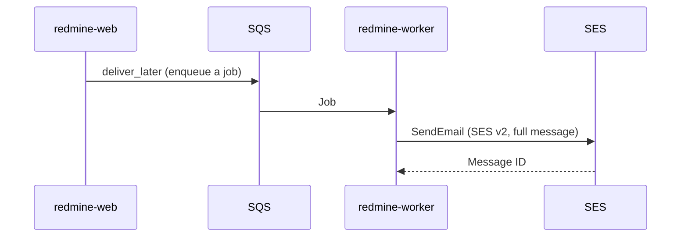
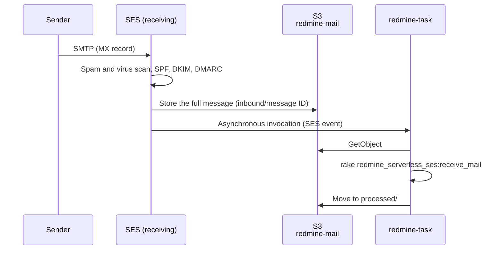

# Email

This page is the design for sending and receiving email in Redmine. Sending uses the standard Rails mechanism (an ActionMailer delivery method) and sends through the Amazon SES API. The delivery method is AWS's official gem `aws-actionmailer-ses`. For receiving, SES receives the email and the task function imports it into Redmine.

The specifications in this page were checked against official information as of 2026-11-08 and the source of Redmine 7.0.3 and `aws-actionmailer-ses` 1.2.0. Sources are listed in [sources.md](sources.md).

## Sending

### Flow of sending



1. Redmine sends notification email with `deliver_later`. The job is queued in SQS and `redmine-worker` sends it ([lambda.md](lambda.md#background-jobs)). Web requests do not wait for email to be sent.
2. The ActionMailer delivery method `:ses_v2` calls SES v2 `SendEmail`. It passes the full message (MIME) in `content.raw`, and passes the recipients separately as To, Cc and Bcc.
3. `redmine-worker` is outside a VPC, so it reaches the public SES API endpoint (`email.ap-northeast-1.amazonaws.com`) over HTTPS with IAM authentication. Email from rake tasks (such as due date reminders) is sent directly by `redmine-task`.

### Gems

| Item | Description |
| --- | --- |
| gem | `aws-actionmailer-ses` 1.2.0 (2026-05-21). Official from AWS (aws/aws-actionmailer-ses-ruby) |
| Dependencies | `actionmailer` 7.1 or later, `aws-sdk-sesv2` |
| Installation | A dependency of the plugin `redmine_serverless_ses`, installed with it when the image is built |
| Delivery method | `:ses_v2` (SES v2 API). `:ses` (SES v1 API) also exists but is not used |
| Bcc | The gem passes the message's Bcc to SES `bcc_addresses`. Bcc recipients do not appear in the message |

### Redmine settings

Redmine sets the items under `email_delivery` in `config/configuration.yml` on `ActionMailer::Base` as they are.

```yaml
production:
  email_delivery:
    delivery_method: :ses_v2
    ses_v2_settings:
      region: ap-northeast-1
```

- **Authentication:** The SES client uses the credentials of the Lambda execution role. No access keys are stored.
- **Permissions:** Give the execution role `ses:SendEmail` and `ses:SendRawEmail`. Limit the resource to the identity of Redmine's subdomain only (for example, `redmine.example.com`). Details are in [iam.md](iam.md).
- **Sender:** Set "Emission email address" (`Setting.mail_from`) under "Email notifications" in the administration screen to an address on Redmine's subdomain (for example, `redmine@redmine.example.com`). Project notifications are sent from the project's address ("Senders per project" below).
- **Enabling sending:** Redmine sends email only when `email_delivery` is set.

### SES

- **Domain verification:** Verify Redmine's subdomain as an SES identity in the Region you use (DKIM), and request production access (leaving the sandbox) in advance. SES identities and production access are per Region ([Receiving domain](#receiving-domain)).
- **Network path:** `redmine-web`, `redmine-worker` and `redmine-task` are in the VPC, so they reach the SES API through an interface endpoint for the SES API or the NAT instance ([rds.md](rds.md#routes-out-of-the-vpc)). `redmine-web` uses the SES API for "Sending email" in the administration screen and for test email ([admin.md](https://redmine-kit.github.io/redmine_serverless_ses/admin.html#sending-email)). What the plugin calls, and its permissions, are in the plugin's [setup page](https://redmine-kit.github.io/redmine_serverless_ses/setup.html#network).

### When sending fails

Email for which the SES API call fails is retried automatically, and email that still cannot be sent is recorded and can be sent again from the administration screen. The plugin `redmine_serverless_ses` raises delivery errors only in `redmine-worker` and handles each kind of SES error; the details, and the steps to send again, are in its [sending.md](https://redmine-kit.github.io/redmine_serverless_ses/sending.html). In Serverless:

- **Retries in the queue:** Account errors and temporary errors that outlast the retries inside the job are raised; SQS redelivers the message and moves it to the dead-letter queue after 3 receives ([lambda.md](lambda.md#background-jobs)), where `redmine_serverless_sqs` records it.
- **Get notified:** A CloudWatch alarm notifies when the dead-letter queue or the failure records have 1 or more items. Sending errors are also logged, and a metric filter counts them.
- **Send again:** "Sending email" (SES) and "Jobs" (SQS) in the administration screen.

## Cost

| Item | Unit price | Monthly |
| --- | --- | --- |
| SES sending | $0.0001 per recipient | $0.10 for 1,000 messages |
| SES receiving | $0.0001 per message, $0.00009 per incoming chunk | About $0.19 for 1,000 messages (1 chunk each) |
| S3, Lambda (import) | — | A few cents |

The SES unit prices are the Tokyo values from the price list (AmazonSES, published 2026-11-04). The size of an incoming chunk is not given in the price list, so it is checked on the pricing page when building.

## Receiving

Receiving is used for creating issues by email and for adding notes to issues by replying to notification email. Each project has its own receiving address. SES receives the email and stores it in S3, and the task function (`redmine-task`) imports it into Redmine. SES in Tokyo supports receiving email (the receiving endpoint is `inbound-smtp.ap-northeast-1.amazonaws.com`).



### Receiving domain

Web and email use the same host name. A subdomain for Redmine (for example, `redmine.example.com`) is used both for the web URL and after the `@` of email addresses, and each project has its own address ("Addresses per project" below).

- **No CNAME:** In DNS, a name with a CNAME cannot have other records such as MX. So the web record is an alias-type record that names CloudFront but answers with A and AAAA, and an MX record is placed on the same name.

Choose the DNS setup from the following two, depending on the DNS service of the parent domain (`example.com`).

| Setup | When it applies | Web record | Cost |
| --- | --- | --- | --- |
| No delegation | The parent domain is already in Route 53. Or the parent domain's DNS supports alias-type records (ALIAS, ANAME, CNAME flattening and similar) on subdomains | In the parent domain's DNS, name CloudFront with an alias-type record | Same as the parent domain's DNS cost |
| Delegate to Route 53 | The parent domain's DNS does not support alias-type records on subdomains | In the parent domain's DNS, add an NS record for `redmine.example.com` and delegate only the subdomain to a Route 53 hosted zone. In the hosted zone, add alias records (A and AAAA) that point to CloudFront | $0.50 per month for the hosted zone. Queries to alias records that point to CloudFront are free; others are $0.40 per million (price list, published 2026-11-04) |

- **When the parent domain is in Route 53:** Just add alias records (A and AAAA) and MX for `redmine.example.com` to the parent hosted zone. No delegation is needed.
- **With Cloudflare:** On paid plans, CNAMEs on subdomains can also be flattened per record (Cloudflare documentation; on the free plan, only the zone apex and proxied records are flattened). Whether an MX record can be placed on the same name as a flattened CNAME is not stated in the Cloudflare documentation, so it is checked when building. A proxied record (orange cloud) would put Cloudflare in front of CloudFront, so it is not used. If MX cannot be placed, or on the free plan, delegate to Route 53.
- **Delegation does not change the parent domain:** Only Redmine's subdomain is delegated. Other records and the regular email of the parent domain stay as they are.
- **Records in the same DNS:** In either setup, the web record, MX, the SES Easy DKIM CNAMEs (`<token>._domainkey.redmine.example.com`) and the certificate validation CNAME go in the DNS that holds Redmine's subdomain. With Route 53, all of them can be created with CloudFormation.
- **MX record:** Add MX (priority 10, `inbound-smtp.ap-northeast-1.amazonaws.com`) to the subdomain. The parent domain's MX (regular email) is not changed.
- **SES identity:** Verify the subdomain itself as an SES identity (the Easy DKIM CNAMEs go under the subdomain). SES receives email only for verified identities. The sender is also an address on the subdomain, so this identity is used for both sending and receiving. The DKIM signing domain and the From domain are the same, so DMARC passes reliably.

### Addresses per project

Each project can have its own address on Redmine's subdomain (`<identifier>@redmine.example.com`, or an alias), which receives email for the project and can send its notifications; email that does not belong to a project uses the address for the whole Redmine (`redmine@redmine.example.com`). `mail.perProjectAddresses` in the configuration file turns this on; without it, email is received as standard Redmine does (one address, projects chosen by subaddress). How the addresses, aliases and senders work is in the plugin's [receiving.md](https://redmine-kit.github.io/redmine_serverless_ses/receiving.html#addresses-per-project) and [sending.md](https://redmine-kit.github.io/redmine_serverless_ses/sending.html#senders-per-project).

### Receipt rules

SES receipt rules are grouped in rule sets, and only one rule set can be active per Region. When building, check that nothing else uses receiving in the Region of the account.

| Item | Setting |
| --- | --- |
| Recipient condition | Redmine's subdomain (for example, `redmine.example.com`). Any address on the subdomain is received; whether it matches a project is decided at import |
| TLS | Required |
| Spam and virus scanning | Enabled (default) |
| First action | Store in S3. Bucket `redmine-mail` (tentative), prefix `inbound/` |
| Second action | Invoke `redmine-task` asynchronously |

- **S3 bucket:** The bucket policy allows writes to `inbound/` only from SES for the receipt rules of this account. A message stored in S3 can be up to 40 MB, including headers.
- **Lambda permission:** The resource-based policy of `redmine-task` allows invocation by SES from the receipt rule. A Lambda function invoked from an SES rule must be in the same Region as SES (both Tokyo).
- **Execution role:** Give the execution role of `redmine-task` read and write access to the mail bucket.
- **Permission details:** In [iam.md](iam.md).
- **Retention period:** Email moved to `processed/` and email left in `inbound/` (discarded or failed) are both deleted after 30 days by a lifecycle rule ([security.md](security.md#retention-periods)). Re-imports must be done within this period. A re-import is run from "Receiving email" in the administration screen, where it runs in `redmine-worker` as a job ([admin.md](https://redmine-kit.github.io/redmine_serverless_ses/admin.html#receiving-email)), or locally with this command, which runs in `redmine-task`:

  ```sh
  bin/rake redmine_serverless_ses:receive_mail MESSAGE_ID=<message ID>
  ```

### Importing

The receipt rule invokes `redmine-task` asynchronously with the SES event. Its handler runs the rake task `redmine_serverless_ses:receive_mail` with the message ID, the envelope recipients and SES's verdicts from the event ([tasks.md](tasks.md#kinds-of-events)). The task reads the message from the mail bucket, chooses the project from the recipients, passes the message to Redmine's `MailHandler`, and moves it to `processed/`; the steps and the options are in the plugin's [receiving.md](https://redmine-kit.github.io/redmine_serverless_ses/receiving.html#importing).

- **Attachments:** Attachments in email are saved as Redmine attachments, and the plugin `redmine_serverless_s3` stores them in S3 ([attachments.md](https://redmine-kit.github.io/redmine_serverless_s3/attachments.html#uploads-through-lambda)).
- **On failure:** SES invokes Lambda asynchronously, so on failure Lambda retries up to 2 times. Events that still fail go to the failure destination (SQS), and an alarm reports the count.

### Spoofing and spam

Redmine decides which user an email comes from by the sender address, so the import checks SES's verdicts from the event (never from the message's headers, which the sender controls): email with a virus is always dropped, and spam and email that fails DMARC are dropped unless the receiving settings import them (`import_spam`, `import_without_dmarc_pass`; in `redmine.json`, `pluginSettings`; [deploy-config.md](deploy-config.md#fields-of-redminejson)). The rules are in the plugin's [receiving.md](https://redmine-kit.github.io/redmine_serverless_ses/receiving.html#spoofing-and-spam). The receipt rule keeps spam and virus scanning on, so that SES gives the verdicts.

### Settings for receiving replies

Set "Emission email address" to the address for the whole Redmine, and "Truncate emails after one of these lines" to a line before the quoted text, in Redmine's administration settings ([receiving.md](https://redmine-kit.github.io/redmine_serverless_ses/receiving.html#settings-for-receiving-replies)).

## To verify

- Whether the gem's delivery method is already registered when Redmine passes `ses_v2_settings` from `configuration.yml` to `ActionMailer::Base` (the gem's Railtie registers it)
- Whether the sender name (the display name of `Setting.mail_from`) appears as the From of the email
- Whether the parent domain's DNS can place an alias-type record and MX on the same name for the subdomain (if not, delegate to Route 53 with an NS record)
- How to handle recipients (`receipt.recipients`) that include addresses not on Redmine's subdomain
- Whether DMARC passes for email sent from Microsoft 365
