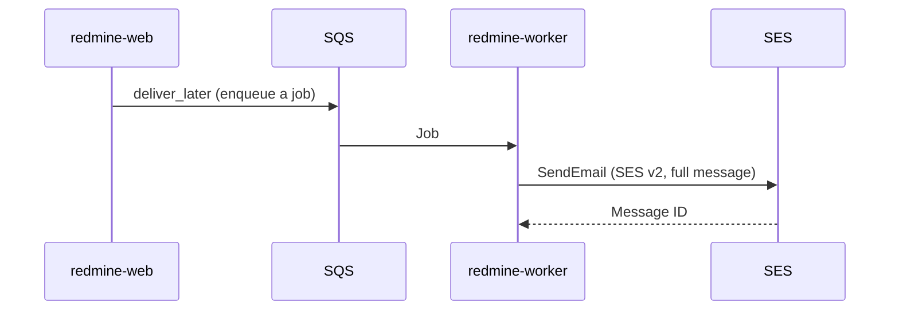
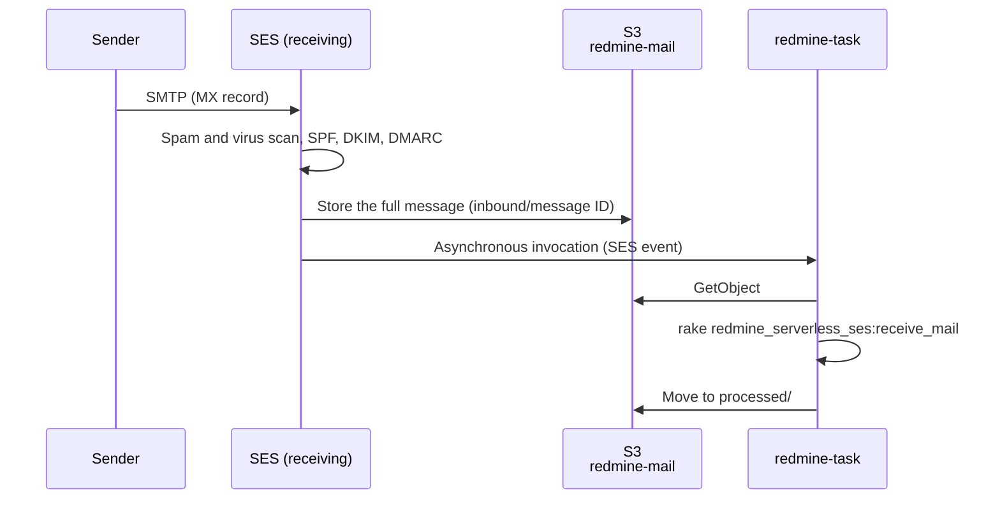

# Email

This page is the design for sending and receiving email in Redmine. Sending uses the standard Rails mechanism (an ActionMailer delivery method) and sends through the Amazon SES API. The delivery method is AWS's official gem `aws-actionmailer-ses`. For receiving, SES receives the email and the task function imports it into Redmine.

The specifications in this page were checked against official information as of 2026-11-08 and the source of Redmine 7.0.3 and `aws-actionmailer-ses` 1.2.0. Sources are listed in [sources.md](sources.md).

## Sending

### Flow of sending



1. Redmine sends notification email with `deliver_later`. The job is queued in SQS and `redmine-worker` sends it ([lambda.md](lambda.md#background-jobs)). Web requests do not wait for email to be sent.
2. The ActionMailer delivery method `:ses_v2` calls SES v2 `SendEmail`. It passes the full message (MIME) in `content.raw`, and passes the recipients separately as To, Cc and Bcc.
3. `redmine-worker` is outside a VPC, so it reaches the public SES API endpoint (`email.ap-northeast-1.amazonaws.com`) over HTTPS with IAM authentication. Email from rake tasks (such as due date reminders) is sent directly by `redmine-task`.

### Gems

| Item | Description |
| --- | --- |
| gem | `aws-actionmailer-ses` 1.2.0 (2026-05-21). Official from AWS (aws/aws-actionmailer-ses-ruby) |
| Dependencies | `actionmailer` 7.1 or later, `aws-sdk-sesv2` |
| Installation | Listed in Redmine's `Gemfile.local` and installed when the image is built |
| Delivery method | `:ses_v2` (SES v2 API). `:ses` (SES v1 API) also exists but is not used |
| Bcc | The gem passes the message's Bcc to SES `bcc_addresses`. Bcc recipients do not appear in the message |

### Redmine settings

Redmine sets the items under `email_delivery` in `config/configuration.yml` on `ActionMailer::Base` as they are.

```yaml
production:
  email_delivery:
    delivery_method: :ses_v2
    ses_v2_settings:
      region: ap-northeast-1
```

- **Authentication:** The SES client uses the credentials of the Lambda execution role. No access keys are stored.
- **Permissions:** Give the execution role `ses:SendEmail` and `ses:SendRawEmail`. Limit the resource to the identity of Redmine's subdomain only (for example, `redmine.example.com`). Details are in [iam.md](iam.md).
- **Sender:** Set "Emission email address" (`Setting.mail_from`) under "Email notifications" in the administration screen to an address on Redmine's subdomain (for example, `redmine@redmine.example.com`). Project notifications are sent from the project's address ("Senders per project" below).
- **Enabling sending:** Redmine sends email only when `email_delivery` is set.

### SES

- **Domain verification:** Verify Redmine's subdomain as an SES identity in the Region you use (DKIM), and request production access (leaving the sandbox) in advance. SES identities and production access are per Region ([Receiving domain](#receiving-domain)).
- **Network path:** `redmine-web`, `redmine-worker` and `redmine-task` are in the VPC, so they reach the SES API through an interface endpoint for the SES API or the NAT instance ([rds.md](rds.md#routes-out-of-the-vpc)). `redmine-web` uses the SES API for "Sending email" in the administration screen and for test email ([admin.md](https://redmine-kit.github.io/redmine_serverless_ses/admin.html#sending-email)). What the plugin calls, and its permissions, are in the plugin's [setup page](https://redmine-kit.github.io/redmine_serverless_ses/setup.html#network).

### When sending fails

Email for which the SES API call fails is retried automatically. Email that still cannot be sent is recorded and can be sent again from the administration screen.

#### Raising errors

Redmine's production settings (`production.rb`) have `raise_delivery_errors = false`, so SES API errors are swallowed during delivery. The Rails mail job (`ActionMailer::MailDeliveryJob`, which Redmine extends as `Mailer::DeliveryJob`) fails the job when an exception is raised. But when the error is swallowed, the job succeeds and SQS retries do not apply.

So the plugin `redmine_serverless_ses` sets `raise_delivery_errors` to `true` only in `redmine-worker` (`REDMINE_ROLE=worker`). The plugin is loaded after `production.rb`, so it can override the setting. Rake tasks in `redmine-task` (such as due date reminders) keep `false`, so that one failed message does not stop the whole task.

#### Handling by kind of error

Errors from SES v2 `SendEmail` (the list in the API reference) are split into three groups.

| Error | Meaning | Handling |
| --- | --- | --- |
| `TooManyRequestsException` (429), SES 5xx, network errors | Temporary | Retry inside the job (below) |
| `SendingPausedException`, `AccountSuspendedException`, `MailFromDomainNotVerifiedException`, `NotFoundException`, `LimitExceededException` | A problem with the account or settings. Every attempt fails until it is fixed | Record as a failure without retrying and send to the dead-letter queue |
| `MessageRejected`, `BadRequestException` | A problem with the content or recipients of that message | Record as a failure without retrying and discard the job |

- **Retries inside the job:** Add ActiveJob `retry_on` to Redmine's `Mailer::DeliveryJob`. The wait is `:polynomially_longer`, up to 5 attempts. The waits are about 3, 18, 83, 258 and 627 seconds, which fit within the maximum delay SQS allows (15 minutes).
- **SDK retries:** The AWS SDK also retries on 429 and 5xx by itself, before the job does (the default retry settings).
- **When retries run out:** When `retry_on` runs out, the exception is raised as is and SQS redelivers the message. If it still fails after 3 redeliveries, it moves to the dead-letter queue.
- **Record:** On the final failure, the job content and the error are stored in the plugin's table (`serverless_job_failures`) ([admin.md](https://redmine-kit.github.io/redmine_serverless_sqs/admin.html#jobs)).
- **Two copies can arrive:** If the response is lost after SES accepts the message, a retry can send the same message twice. This is accepted at this scale.

#### Sending again

1. **Get notified:** When the number of messages in the dead-letter queue or the number of failure records reaches 1 or more, a CloudWatch alarm sends a notification.
2. **Fix the cause:** In "Sending email" in the administration screen, check and fix the SES account status, the sender domain and the suppression list ([admin.md](https://redmine-kit.github.io/redmine_serverless_ses/admin.html#sending-email)).
3. **Send again:** In "Jobs" in the administration screen, select the failed messages and send them again. Messages left in the dead-letter queue are moved back to the original queue.

- **CloudWatch Logs:** Sending errors are also logged. A metric filter counts them as input for alarms.
- **Failures after SES accepts the message:** Messages rejected by the recipient's mail server after SES accepted them (bounces) are not API errors. SES adds the address to the suppression list and stops later sending to it. The suppression list can be checked in "Sending email" in the administration screen.

## Cost

| Item | Unit price | Monthly |
| --- | --- | --- |
| SES sending | $0.0001 per recipient | $0.10 for 1,000 messages |
| SES receiving | $0.0001 per message, $0.00009 per incoming chunk | About $0.19 for 1,000 messages (1 chunk each) |
| S3, Lambda (import) | — | A few cents |

The SES unit prices are the Tokyo values from the price list (AmazonSES, published 2026-11-04). The size of an incoming chunk is not given in the price list, so it is checked on the pricing page when building.

## Receiving

Receiving is used for creating issues by email and for adding notes to issues by replying to notification email. Each project has its own receiving address. SES receives the email and stores it in S3, and the task function (`redmine-task`) imports it into Redmine. SES in Tokyo supports receiving email (the receiving endpoint is `inbound-smtp.ap-northeast-1.amazonaws.com`).



### Receiving domain

Web and email use the same host name. A subdomain for Redmine (for example, `redmine.example.com`) is used both for the web URL and after the `@` of email addresses, and each project has its own address ("Addresses per project" below).

- **No CNAME:** In DNS, a name with a CNAME cannot have other records such as MX. So the web record is an alias-type record that names CloudFront but answers with A and AAAA, and an MX record is placed on the same name.

Choose the DNS setup from the following two, depending on the DNS service of the parent domain (`example.com`).

| Setup | When it applies | Web record | Cost |
| --- | --- | --- | --- |
| No delegation | The parent domain is already in Route 53. Or the parent domain's DNS supports alias-type records (ALIAS, ANAME, CNAME flattening and similar) on subdomains | In the parent domain's DNS, name CloudFront with an alias-type record | Same as the parent domain's DNS cost |
| Delegate to Route 53 | The parent domain's DNS does not support alias-type records on subdomains | In the parent domain's DNS, add an NS record for `redmine.example.com` and delegate only the subdomain to a Route 53 hosted zone. In the hosted zone, add alias records (A and AAAA) that point to CloudFront | $0.50 per month for the hosted zone. Queries to alias records that point to CloudFront are free; others are $0.40 per million (price list, published 2026-11-04) |

- **When the parent domain is in Route 53:** Just add alias records (A and AAAA) and MX for `redmine.example.com` to the parent hosted zone. No delegation is needed.
- **With Cloudflare:** On paid plans, CNAMEs on subdomains can also be flattened per record (Cloudflare documentation; on the free plan, only the zone apex and proxied records are flattened). Whether an MX record can be placed on the same name as a flattened CNAME is not stated in the Cloudflare documentation, so it is checked when building. A proxied record (orange cloud) would put Cloudflare in front of CloudFront, so it is not used. If MX cannot be placed, or on the free plan, delegate to Route 53.
- **Delegation does not change the parent domain:** Only Redmine's subdomain is delegated. Other records and the regular email of the parent domain stay as they are.
- **Records in the same DNS:** In either setup, the web record, MX, the SES Easy DKIM CNAMEs (`<token>._domainkey.redmine.example.com`) and the certificate validation CNAME go in the DNS that holds Redmine's subdomain. With Route 53, all of them can be created with CloudFormation.
- **MX record:** Add MX (priority 10, `inbound-smtp.ap-northeast-1.amazonaws.com`) to the subdomain. The parent domain's MX (regular email) is not changed.
- **SES identity:** Verify the subdomain itself as an SES identity (the Easy DKIM CNAMEs go under the subdomain). SES receives email only for verified identities. The sender is also an address on the subdomain, so this identity is used for both sending and receiving. The DKIM signing domain and the From domain are the same, so DMARC passes reliably.

### Addresses per project

| Address | Use |
| --- | --- |
| `<project identifier>@redmine.example.com` | The project's address. Email sent to it becomes an issue in that project, and that project's notifications are sent from this address |
| Project alias (for example, `support@redmine.example.com`) | An easy-to-remember address separate from the identifier. Added in the project settings |
| `redmine@redmine.example.com` (for the whole Redmine) | Sender of email that does not belong to a project (password reset, accounts, due date reminders and others). See "Address for the whole Redmine" below |

- **Identifiers and addresses:** Redmine project identifiers consist of lowercase letters, digits, `-` and `_`, so they can be used as they are before the `@`. The part before `@` is limited to 64 characters, so projects with longer identifiers get an alias.
- **Whether to receive:** Each project can choose whether to receive email (default: no). Email to the address of a project that does not receive is discarded without import and logged.
- **Alias collisions:** An alias must not collide with other projects' identifiers or with other aliases. `redmine`, `postmaster`, `abuse` and similar are reserved.
- **Project settings:** Add an "Email" tab to the project settings to set whether to receive, the alias and the defaults (tracker, category, priority, assignee, and whether the issue is private). Redmine administrators and people with a permission added by the plugin ("Manage email settings") can change them ([admin.md](https://redmine-kit.github.io/redmine_serverless_ses/admin.html#project-email-settings)).
- **Storage:** Per-project settings are stored in the plugin's table (`serverless_project_mail_settings`).

### Without addresses per project

When `mail.perProjectAddresses` in the configuration file is `false` (default), or the feature is disabled in the plugin settings, email is received the same way as standard Redmine.

- **Receiving address:** Only the address for the whole Redmine (for example, `redmine@redmine.example.com`).
- **Choosing the project:** With Redmine's standard subaddress (`redmine+<identifier>@redmine.example.com`; `project_from_subaddress` in `MailHandler`). Email without a subaddress goes to the default project in the plugin settings, or is discarded ([admin.md](https://redmine-kit.github.io/redmine_serverless_ses/admin.html#receiving-email)).
- **Sender:** All notifications are sent from the address for the whole Redmine.

### Address for the whole Redmine

Email that does not belong to a project is sent from the address for the whole Redmine (for example, `redmine@redmine.example.com`). This is the "Emission email address" (`Setting.mail_from`) in Redmine's administration screen.

| Email sent from the address for the whole Redmine | Redmine mailer method |
| --- | --- |
| Password reset (lost password) | `lost_password` |
| Account registration confirmation, activation request, activation notice | `register`, `account_activation_request`, `account_activated` |
| Account information (accounts created by an administrator) | `account_information` |
| Due date reminders (combining issues from several projects) | `reminder` |
| Security notifications, settings change notifications | `security_notification`, `settings_updated` |
| Test email | `test_email` |

The methods above are the Redmine 7.0.3 mailer methods that do not add the project header (`X-Redmine-Project`) (`app/models/mailer.rb`).

- **The address can be chosen:** The part before `@` can be changed in the plugin settings (default: `redmine`; `noreply` and others are possible). It is reserved so that it cannot be used as a project identifier or alias.
- **Email sent to it:** For email sent to the address for the whole Redmine, the plugin settings choose between putting it in the default project and discarding it without import (default: discard). Replies to email such as password resets usually do not need to be imported.
- **Sending identity:** The address for the whole Redmine is also sent with the SES identity of Redmine's subdomain.

### Receipt rules

SES receipt rules are grouped in rule sets, and only one rule set can be active per Region. When building, check that nothing else uses receiving in the Region of the account.

| Item | Setting |
| --- | --- |
| Recipient condition | Redmine's subdomain (for example, `redmine.example.com`). Any address on the subdomain is received; whether it matches a project is decided at import |
| TLS | Required |
| Spam and virus scanning | Enabled (default) |
| First action | Store in S3. Bucket `redmine-mail` (tentative), prefix `inbound/` |
| Second action | Invoke `redmine-task` asynchronously |

- **S3 bucket:** The bucket policy allows writes to `inbound/` only from SES for the receipt rules of this account. A message stored in S3 can be up to 40 MB, including headers.
- **Lambda permission:** The resource-based policy of `redmine-task` allows invocation by SES from the receipt rule. A Lambda function invoked from an SES rule must be in the same Region as SES (both Tokyo).
- **Execution role:** Give the execution role of `redmine-task` read and write access to the mail bucket.
- **Permission details:** In [iam.md](iam.md).
- **Retention period:** Email moved to `processed/` and email left in `inbound/` (discarded or failed) are both deleted after 30 days by a lifecycle rule ([security.md](security.md#retention-periods)). Re-imports must be done within this period. A re-import is run locally with `bin/rake redmine_serverless_ses:receive_mail MESSAGE_ID=<message ID>` (runs in `redmine-task`), or from "Receiving email" in the administration screen (runs in `redmine-worker` as a job; [admin.md](https://redmine-kit.github.io/redmine_serverless_ses/admin.html#receiving-email)).

### Importing

The rake task `redmine_serverless_ses:receive_mail` of the plugin `redmine_serverless_ses` does the following.

1. Get the full message from S3.
2. Decide whether to import it from the headers that SES added ("Spoofing and spam" below).
3. Determine the project from the recipients (below).
4. Pass the full message and options to Redmine's `MailHandler.safe_receive`. This is the same processing as Redmine's `rake redmine:email:read`.
5. On success, move it to `processed/`.

**Determining the project from the recipients:**

- **Recipients come from the SES event:** Use the recipients in the SES event (SMTP `RCPT TO`; `receipt.recipients`), not the message's `To` and `Cc` headers. Email received as Bcc is also identified correctly. The recipients are also kept in the import record for re-imports.
- **Matching:** Go through the recipient addresses on Redmine's subdomain in order, and use the first project whose identifier or alias matches. If none matches, discard without import and log it.
- **Passing to Redmine:** Pass the chosen project's identifier and the project's defaults as `MailHandler` options (`issue[:project]` and others). In Redmine's standard rules, the `Project:` keyword in the body takes precedence, so the project is not included in `allow_override`, to prevent the keyword from changing the project.
- **Replies:** Redmine attaches replies to notification email to the original issue as notes, based on the `In-Reply-To` and `References` headers (`MailHandler#dispatch`). Whichever address the reply is sent to, it is attached to the original issue.

| Option | Value | Meaning |
| --- | --- | --- |
| `unknown_user` | Project setting (default: `ignore`) | How to handle email from addresses not registered in Redmine |
| `no_permission_check` | `0` | Check the sender's permissions |
| `issue[:project]` | The project determined from the recipients | See above |
| `issue[:tracker]` and others | The project's defaults | Defaults for created issues |

- **Auto-replies:** Redmine does not import email with the `Auto-Submitted` (`auto-replied` and `auto-generated`) or `X-Autoreply: yes` headers (`MailHandler.ignored_emails_headers`). This prevents loops of notifications and imports caused by auto-reply email.
- **Attachments:** Attachments in email are saved as Redmine attachments, and the plugin `redmine_serverless_s3` stores them in S3 ([attachments.md](https://redmine-kit.github.io/redmine_serverless_s3/attachments.html#uploads-through-lambda)).
- **On failure:** SES invokes Lambda asynchronously, so on failure Lambda retries up to 2 times. Events that still fail go to the failure destination (SQS), and an alarm reports the count.

### Spoofing and spam

Redmine decides which user an email comes from by the sender (`From`) address. If email with a forged sender is imported, an issue is created as that user. So, based on the headers that SES added, the following email is discarded without import and logged.

| Header | Discard condition |
| --- | --- |
| `X-SES-Virus-Verdict` | Not `PASS` |
| `X-SES-Spam-Verdict` | Not `PASS` |
| `Authentication-Results` | No `dmarc=pass` |

- **Why DMARC is required:** If DMARC passes, the sender's domain has been verified with SPF or DKIM. Email sent from Microsoft 365 or Gmail usually passes.
- **Trusting the headers:** These headers are read as added by SES at receipt. A sender can also send headers with the same names, so only the ones in the position where SES adds them (the top) are used (when building, check how SES handles existing headers with the same names).

### Senders per project

Redmine sends all notification email from the global sender setting (`Setting.mail_from`). The plugin changes the sender to the project's address only for project notifications.

- **How they are identified:** Redmine adds the project identifier in the `X-Redmine-Project` header to project notifications (issues, news, documents, files, forums, wiki) (`Mailer#redmine_headers`). The plugin uses an ActionMailer interceptor (the standard Rails mechanism that rewrites email before sending) to read this header and change the sender to `<identifier>@redmine.example.com` (or the alias, if there is one).
- **Display name:** If the sender has no display name, Redmine uses the author's name as the display name. This display name is used as is.
- **Email without the header:** Email that does not belong to a project, such as password resets and account email, keeps the address for the whole Redmine ([Address for the whole Redmine](#address-for-the-whole-redmine)).
- **Projects that do not receive email:** The sender is the project's address, but replies are not imported, so `Reply-To` is set to the global sender.
- **Optional:** The plugin settings choose whether to use per-project senders. When not used, the behavior is the same as standard Redmine.

### Settings for receiving replies

| Setting | Value | Reason |
| --- | --- | --- |
| "Emission email address" in the administration screen | The address for the whole Redmine (for example, `redmine@redmine.example.com`) | Sender of email that does not belong to a project ([Address for the whole Redmine](#address-for-the-whole-redmine)) |
| "Truncate emails after one of these lines" in the administration screen | A line before the quoted text (such as "--- Please write your reply above this line ---") | Keep the quoted part of replies out of notes |

## To verify

- Whether the gem's delivery method is already registered when Redmine passes `ses_v2_settings` from `configuration.yml` to `ActionMailer::Base` (the gem's Railtie registers it)
- Whether the sender name (the display name of `Setting.mail_from`) appears as the From of the email
- Whether the parent domain's DNS can place an alias-type record and MX on the same name for the subdomain (if not, delegate to Route 53 with an NS record)
- How to handle recipients (`receipt.recipients`) that include addresses not on Redmine's subdomain
- How to tell SES receiving headers (`X-SES-*`, `Authentication-Results`) from headers with the same names added by the sender
- Whether DMARC passes for email sent from Microsoft 365
