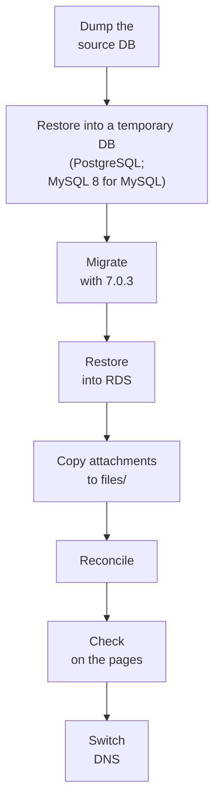
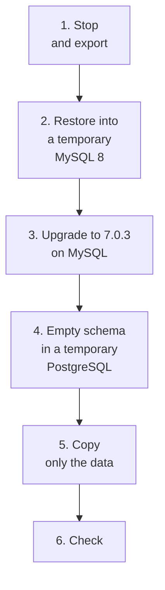

# Migrating from an older Redmine

How to move data from an older Redmine running in another environment (for example, 3.x to 6.x).

## To check before migrating

| Item | What to check | Impact |
| --- | --- | --- |
| Redmine version | The source version | How long the migrations take. From 3.x they are long |
| Database | Engine (MySQL, PostgreSQL, etc.), version and size | The target is RDS for PostgreSQL ([rds.md](rds.md)). From MySQL, conversion is needed ("Migrating from MySQL" below) |
| Attachments | Location (disk or an S3 plugin), count and size, key format | Steps to copy them to S3 |
| Plugins | Installed plugins and their tables | Features that stop working after the move |
| Theme | Whether it is a non-standard theme | It becomes the standard theme |

## Steps

1. **Database:** Restore a dump of the source database into a temporary PostgreSQL. If the source is PostgreSQL, no conversion is needed. If it is MySQL, convert it with the steps in "Migrating from MySQL" below.
2. **Migrations:** On the temporary PostgreSQL, run Redmine 7.0.3's `db:migrate` and `redmine:plugins:migrate`. This moves from the old version to 7.0 in one go. Whether you need to pass through intermediate versions is checked in Redmine's upgrade steps (the RedmineUpgrade wiki page). The temporary PostgreSQL is outside Lambda, so the 15 minutes of `redmine-task` do not apply.
3. **Restore into RDS:** Export the migrated database (`pg_dump`) and restore it into the empty RDS database (`pg_restore`). RDS is reached only from inside the VPC, so this runs through Session Manager port forwarding ([rds.md](rds.md#managing-it-with-systems-manager)).
4. **Attachments:** Copy the source files (`files/` on disk, or the S3 plugin's bucket) under `files/` in the new bucket, in a form that matches Redmine's `disk_directory` and `disk_filename`. Keys in the new design have the form `files/<disk_directory>/<disk_filename>`; old attachments whose `disk_directory` is empty become `files/<disk_filename>` ([attachments.md](https://redmine-kit.github.io/redmine_serverless_s3/attachments.html#bucket-layout)).
5. **Reconciliation:** On the "Attachments in S3" administration page, reconcile the database with S3 and check that nothing is missing ([admin.md](https://redmine-kit.github.io/redmine_serverless_s3/admin.html#attachments-in-s3)). Thumbnails are created when they are opened on a page, so they do not need to be created during the move.
6. **Digests:** Attachment digests in an older Redmine may be MD5. Redmine has a rake task that regenerates them as SHA256 (`redmine:attachments:update_digests`). Decide whether to run it based on the number of attachments.

## Migrating from MySQL

How to proceed when the source Redmine runs on MySQL. After steps 1–6 below, restore the export of the temporary PostgreSQL into RDS (step 3 of "Steps" above).

Targets that stay on MySQL (RDS for MySQL, Aurora MySQL) are not used in this design ([rds.md](rds.md#why-not-other-databases)).

1. **Stop and export:** Stop the source Redmine (stop writes) and export the database (`mysqldump` with `--single-transaction`, `--default-character-set=utf8mb4` and `--hex-blob`). Changes made after stopping are not moved, so export after stopping.
2. **Restore into a temporary MySQL 8:** Restore the export into a temporary MySQL 8.0 or 8.4 (Docker, or a temporary RDS for MySQL created from a snapshot). If the source is MySQL 5.7, it moves to 8 here. Convert tables whose character set is `utf8` (3 bytes) to `utf8mb4`.
3. **Upgrade to 7.0.3 on MySQL:** On the temporary MySQL, run Redmine 7.0.3's `db:migrate`. Redmine 7.0 supports MySQL 8.0–8.4, so the new Redmine can do the upgrade without running the old Redmine. Whether it is fine to upgrade from the old version in one go is checked in Redmine's upgrade steps (the RedmineUpgrade wiki page).
4. **Empty schema in a temporary PostgreSQL:** In a temporary PostgreSQL, build an empty schema with Redmine 7.0.3's standard `db:migrate` and `redmine:plugins:migrate` (do not load initial data). The schema is built by Redmine's migrations, not by the conversion tool.
5. **Copy only the data:** Copy only the data from the temporary MySQL (with the 7.0.3 schema) into the empty schema in the temporary PostgreSQL ("How to copy" below).
6. **Check:** Go through "To verify" below.

Before copying, check in the temporary MySQL whether there are users whose login names differ only in case (`SELECT LOWER(login), COUNT(*) FROM users GROUP BY LOWER(login) HAVING COUNT(*) > 1`). Redmine 7.0 creates a unique index on `lower(login)` in PostgreSQL (migration `20260319062845`), so such users make the copy fail. If there are any, change one of the login names or merge the two before the move.

### How to copy

| Item | Rule |
| --- | --- |
| Tool | Embulk (`embulk-input-mysql`, `embulk-output-postgresql`) is the candidate. For each table, empty the PostgreSQL table before inserting (`truncate_insert`). The last release of pgloader is 3.6.9 (2022-10), and a write-up of practice with Redmine reports that it did not work ("References" below) |
| Tables not copied | `schema_migrations` and `ar_internal_metadata` (already created by the migrations in step 4), and tables of plugins that are not installed (plugin data is not moved) |
| Binary columns | `wiki_content_versions.data` (compressed wiki text) is converted to base64 text in MySQL, copied, and decoded in PostgreSQL |
| Booleans | Put MySQL `tinyint(1)` 0 and 1 into PostgreSQL `boolean` |
| Times | Redmine stores times in UTC. Make sure the tool's handling of times does not shift them after copying (compare `created_on` of some rows after copying) |
| Zero dates | Set values such as `0000-00-00` to `NULL` |
| Next IDs | After copying, for each table with IDs, set the next ID number (sequence) to the maximum ID (`setval`) |
| Order | For tables with foreign keys (OAuth tables, etc.), copy the referenced tables first |

### To verify

- Whether the number of rows in each table is the same in MySQL and PostgreSQL
- Whether times, booleans, Japanese characters and wiki text (compressed) are the same in some rows
- Whether Redmine's "Information" administration page and the issue, wiki and attachment pages open
- Handling of values that differ only in case: MySQL collations often treat upper and lower case as the same. In PostgreSQL they are different values. Check whether display or search changes for login names and project identifiers

### References

There is a write-up of moving Redmine 6.1 from MySQL 8.0 to PostgreSQL 18 (@SKYS, "Migrating Redmine's database from MySQL to PostgreSQL", Qiita, 2026-08-09, in Japanese; not official information). It builds the schema with Redmine's migrations, copies only the data with Embulk, excludes `schema_migrations`, fixes sequences, and copies `wiki_content_versions.data` as base64. "How to copy" in this page is based on it.

## Plugins and themes

- **Plugins:** External plugins are not installed. When moving from PostgreSQL, the source database is restored as is, so plugin tables remain but do not appear on any page. When moving from MySQL, only the data is put into a newly built schema, so plugin tables and data are not moved (they remain in the source export). Either way, those plugins' features are gone.
- **Themes:** It becomes the standard theme.

## To verify

- Whether migrations from an old version to 7.0 can run in one go
- Whether Embulk can copy all of Redmine's tables (binary columns, times, booleans)
- The key format of the S3 plugin's bucket, and how to copy to the new key format
