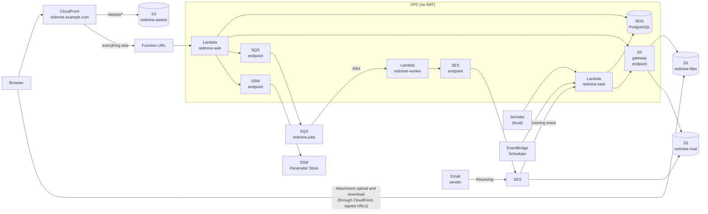
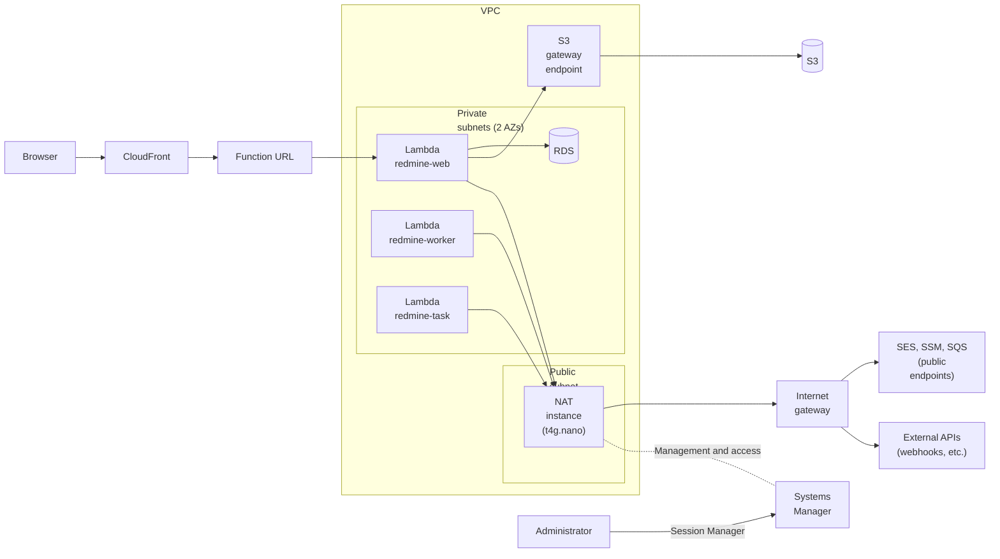

# Database (RDS for PostgreSQL)

The database is Amazon RDS for PostgreSQL in a VPC. The Lambda functions run in private subnets of the same VPC, and they reach AWS services through VPC endpoints or a NAT instance ("Routes out of the VPC" below).

The unit prices on this page come from the ap-northeast-1 file of the AWS Price List API (AmazonRDS, published on 2026-10-29). Monthly amounts are calculated with 730 hours. Sources are in [sources.md](sources.md).

## Diagram

This is the setup that reaches AWS services through VPC endpoints. The setup that reaches them through a NAT instance is in "Setup 2: NAT instance" below.

`redmine-web`, `redmine-worker` and `redmine-task` use the same image. All three use the database and each endpoint (the diagram omits these lines).

## Connecting from Rails

| Item | Decision |
| --- | --- |
| Adapter | ActiveRecord's standard PostgreSQL adapter (the `pg` gem). `config/database.yml` is `adapter: postgresql` |
| Settings | Environment variables: `REDMINE_DB_HOST`, `REDMINE_DB_NAME` (default `redmine`), `REDMINE_DB_USERNAME` (default `redmine`), `REDMINE_DB_PASSWORD`, `REDMINE_DB_PORT` (default `5432`), `REDMINE_DB_SSLMODE` (default `verify-full`) |
| Password | A SecureString at `/<instance>/env/REDMINE_DB_PASSWORD` in SSM Parameter Store, read at start-up with the other settings ([lambda.md](lambda.md#settings-and-secrets-ssm-parameter-store)). The host and the other values that are not secret are String parameters under the same path |
| TLS | `verify-full`. The image contains the RDS global CA bundle (`https://truststore.pki.rds.amazonaws.com/global/global-bundle.pem`, downloaded when the image is built and checked with a pinned SHA256) at `/var/task/rds-global-bundle.pem`, and `config/database.yml` passes it as `sslrootcert`. Only the local tests use `disable` |
| Number of connections | One per environment (`pool: 1`) |
| Database user | One user that owns the tables, used by the three functions |

## Migrations

- **Redmine's standard migrations:** `redmine-task` runs `db:migrate` and `redmine:plugins:migrate` as they are ([tasks.md](tasks.md#migrations-during-deployment)). No migration is changed or replaced.
- **Starting fresh:** After the migrations, run `redmine:load_default_data` in `redmine-task`. The language is `redmine.settings.default_language` in the configuration file (English if not set).
- **Redmine upgrades:** The new migrations are reviewed and run on a PostgreSQL container before deployment ([upgrade.md](upgrade.md)).

## Security

- **Not reachable from outside:** RDS is in private subnets without public access. Its security group allows only port 5432 from the security groups of the three functions (and of the NAT instance, for administrators; "Managing it with Systems Manager" below).
- **The password:** It is kept only in SSM Parameter Store as a SecureString and in RDS. To change it, set the new value in RDS and in SSM, then update the functions so that new environments read it.
- **Encryption:** Encryption at rest with the AWS managed key, and TLS required for connections (`rds.force_ssl`). The functions verify the server certificate (`verify-full`).
- **Administrators:** They connect through Session Manager port forwarding. No inbound port is opened to the internet.

## Database

Amazon RDS for PostgreSQL db.t4g.micro, placed inside the VPC.

| Item | Unit price | Monthly |
| --- | --- | --- |
| db.t4g.micro (2 vCPU, 1 GiB memory), Single-AZ | USD 0.025 per hour | USD 18.25 |
| gp3, 20 GB | USD 0.138 per GB-month | USD 2.76 |
| Automated backups | Free up to the amount of provisioned storage | USD 0 |
| Total | | USD 21.01 |

The engine is PostgreSQL, the latest major version on RDS (checked when creating it); Redmine 7.0 supports PostgreSQL 14 or later (RedmineInstall wiki).

The cost is predictable. Idle hours cost the same, but the cost does not grow because a lingering connection keeps the database from pausing, as can happen with Aurora. T4g runs in Unlimited mode, so sustained CPU use adds USD 0.075 per vCPU-hour.

The instance is not stopped outside business hours. RDS can be stopped for up to 7 days, but the official documentation says starting can take "minutes to hours", and Redmine should stay usable at any time.

### Settings

| Item | Value | Reason |
| --- | --- | --- |
| Subnets | 2 private subnets (2 AZs) | An RDS subnet group needs 2 AZs |
| Public access | None | — |
| Security group | Only port 5432 from the security groups of `redmine-web`, `redmine-worker` and `redmine-task` | — |
| Encryption | Encryption at rest (AWS managed key) | — |
| TLS | Required (`rds.force_ssl` in the parameter group) | The functions connect with `verify-full` ("Connecting from Rails" above) |
| Authentication | Password | IAM database authentication needs 300–1,000 MiB of extra memory on the database. That is hard on a t4g.micro with 1 GiB |
| Automated backups | 7 days | Free up to the amount of provisioned storage |
| Deletion protection | On | — |
| Multi-AZ | None | It doubles the cost. For a small team, restore from a backup when it goes down |

## Routes out of the VPC

These are the routes from Lambda inside the VPC to AWS services and the internet. There is a setup that uses VPC endpoints and a setup that uses a NAT instance.

### Common parts

| Item | Details |
| --- | --- |
| VPC | One. One private subnet in each of two AZs |
| Lambda | `redmine-web`, `redmine-worker` and `redmine-task` in the private subnets |
| RDS | Private subnets. No public access |
| S3 | Reached through a gateway endpoint (free). Present in both setups |
| From outside into the VPC | Not allowed. Pages reach the function URL (the entry point to Lambda, outside the VPC) through CloudFront |
| Where it is created | The VPC, subnets, and endpoints or the NAT instance are part of the shared base ([deploy-config.md](deploy-config.md#shared-base-and-per-instance-resources)) |
| Permissions | The execution roles get the permissions to run in a VPC ([iam.md](iam.md#permissions-common-to-the-three-functions)) |

### Setup 1: VPC endpoints

This is the setup in the diagram above.

| Destination | Route | Monthly |
| --- | --- | --- |
| S3 | Gateway endpoint | USD 0 |
| SES API | Interface endpoint (1 AZ) | About USD 10.2 |
| SSM | Interface endpoint (1 AZ) | About USD 10.2 |
| SQS | Interface endpoint (1 AZ) | About USD 10.2 |
| Internet | Not reachable | — |

- **Pros:** AWS manages it, so there is no operational work. There is no way out to the internet, so outbound traffic cannot go to the wrong place or leak.
- **Cons:** Each new destination adds an endpoint at about USD 10.2 per month. Webhooks and features that call external APIs do not work. Set `webhook_blocklist` to all addresses so that webhooks fail at once instead of waiting for a timeout ([lambda.md](lambda.md#background-jobs)).

### Setup 2: NAT instance

Like `redmine-web`, `redmine-worker` and `redmine-task` also use RDS and the S3 gateway endpoint (the diagram omits these lines).

| Destination | Route | Monthly |
| --- | --- | --- |
| S3 | Gateway endpoint (not through the NAT) | USD 0 |
| SES, SSM, SQS | NAT instance → internet gateway → public endpoints | Included in the NAT instance cost |
| Internet | Same as above | Same as above |
| NAT instance | One t4g.nano (USD 0.0054 per hour), a public IPv4 address (USD 0.005 per hour), disk | About USD 8.4 |

- **Pros:** The three interface endpoints (about USD 30.7 per month) are no longer needed, which saves about USD 22 per month. Webhooks and external APIs (such as AI features; [ai.md](ai.md)) also work.
- **Cons:** It is a single instance, so when it goes down, SES, SSM and SQS become unreachable. Lambda start-up (reading SSM), jobs and email sending stop. You handle OS updates and recovery yourself (below).

Attachment reads and writes are high in volume, so S3 stays on the gateway endpoint and does not go through the NAT instance.

#### Building the NAT instance

| Item | Details |
| --- | --- |
| Instance | t4g.nano (arm64), Amazon Linux 2023 |
| Placement | One public subnet. Attach an Elastic IP |
| Forwarding | Disable the source/destination check, and enable IP forwarding and source address translation (`iptables` MASQUERADE) |
| Routes | In the route tables of the private subnets, point `0.0.0.0/0` to the network interface of the NAT instance |
| Security group | Accept traffic only from inside the VPC. Accept nothing from outside (port 22 for SSH is not open either) |
| Recovery | Use an Auto Scaling group with a capacity of 1, so that a new instance starts when the old one stops. The new instance switches the route tables and network interface to itself (start-up script) |

#### Managing it with Systems Manager

The NAT instance is managed with Systems Manager, and access also goes through Systems Manager. No SSH keys are created and no inbound ports are opened.

| Task | Feature |
| --- | --- |
| Shell access | Session Manager. Session logs go to CloudWatch Logs |
| OS updates | Patch Manager. Apply them in a maintenance window at a low-traffic time. Outbound access is lost during the reboot, so schedule it outside business hours |
| Viewing status | Fleet Manager, Inventory |
| Connecting to the database | Session Manager port forwarding to a remote host (`AWS-StartPortForwardingSessionToRemoteHost`) forwards port 5432 of RDS to the local machine through the NAT instance |

- **Instance permissions:** Attach the AWS managed policy `AmazonSSMManagedInstanceCore` to the instance role ([iam.md](iam.md#role-of-the-nat-instance-only-with-a-nat-instance)).
- **Route to Systems Manager:** The NAT instance itself can reach the internet, so no Systems Manager endpoints are needed.
- **Connecting to the database:** In the RDS security group, allow port 5432 from the security group of the NAT instance. Administrators connect to the forwarded port with a local `psql` or similar. The database password is read from SSM Parameter Store.
- **Connecting to the database with Setup 1:** There is no NAT instance, so check with `bin/rails runner`, or, only when needed, start a small instance managed by Systems Manager and connect with the same port forwarding.

### Which to choose

| Priority | Suitable setup |
| --- | --- |
| Less operational work, no outbound traffic | Setup 1 (endpoints) |
| Lower monthly cost, use of webhooks and external APIs | Setup 2 (NAT instance) |

The Redmine and plugin code is the same in both setups. Switch with `network.mode` in the configuration file.

## Cost

| Item | Monthly |
| --- | --- |
| RDS for PostgreSQL ("Database" above) | USD 21.01 |
| Route: interface endpoints for SES, SSM and SQS (1 AZ, USD 0.014 per hour each, USD 0.01 per GB) | About USD 30.7 |
| Route: NAT instance (instead of the endpoints; instance USD 3.9, public IPv4 USD 3.65, disk about USD 0.8) | About USD 8.4 |

| Setup | Monthly | Breakdown |
| --- | --- | --- |
| RDS with SES, SSM and SQS endpoints | About USD 55.3 | RDS about USD 21.0, endpoints about USD 30.7, other (Lambda, S3, etc.; [cost.md](cost.md)) about USD 3.6 |
| RDS with a NAT instance | About USD 33.0 | RDS about USD 21.0, NAT instance about USD 8.4, other about USD 3.6 |

| Addition | Monthly | When to add |
| --- | --- | --- |
| RDS Multi-AZ | About USD 21 (double) | To shorten downtime |
| SES endpoint in 2 AZs | About USD 10 | With the endpoint setup, to keep sending email when the endpoint's AZ goes down |
| NAT Gateway | About USD 45 + USD 0.062 per GB | To reach the internet through an AWS-managed route instead of a NAT instance |
| RDS Proxy | About USD 26 | When the number of connections runs short |

The unit price of the NAT instance disk has not been checked in the price list.

## Why not other databases

| Option | Why not |
| --- | --- |
| RDS, public | It opens the database to the internet. A password would be the only protection |
| Aurora PostgreSQL Serverless v2 (minimum 0 ACU) | Resuming after a pause takes about 15 seconds (30 seconds or more after a pause of over 24 hours), which adds to Lambda start-up time. A single open connection keeps it from pausing, so the cost is unpredictable |
| MySQL (RDS for MySQL, Aurora MySQL Serverless v2) | This design, its tests and its migration procedure are written for PostgreSQL. If old Redmine data is in MySQL, move it with the procedure for moving to PostgreSQL ([migration.md](migration.md#migrating-from-mysql)) |
| SQLite (on EFS or S3 Files) | Lambda adds environments for concurrent requests, so multiple environments write to one file. The official SQLite documentation says that on network file systems, there have been cases of database corruption due to locking problems |
| Lightsail databases | No encryption, and they must be public |

## To verify

- Whether the memory and CPU credits of db.t4g.micro are enough for about 15 connections and the Redmine load
- Whether Redmine 7.0.3 runs on the latest major version of PostgreSQL on RDS (the wiki states only the minimum version)
- How long switching the route tables takes when the NAT instance is recovered by an Auto Scaling group with a capacity of 1
- What happens to Lambda requests during a Patch Manager reboot (failed SSM reads and job retries)
- Whether Session Manager and port forwarding have additional charges (check on the AWS pricing page)
- Whether `verify-full` with the RDS global CA bundle passes for the RDS endpoint name
- Whether one database user is enough, or whether the web functions should get a user without DDL permissions (`redmine-task` would keep the owner)
