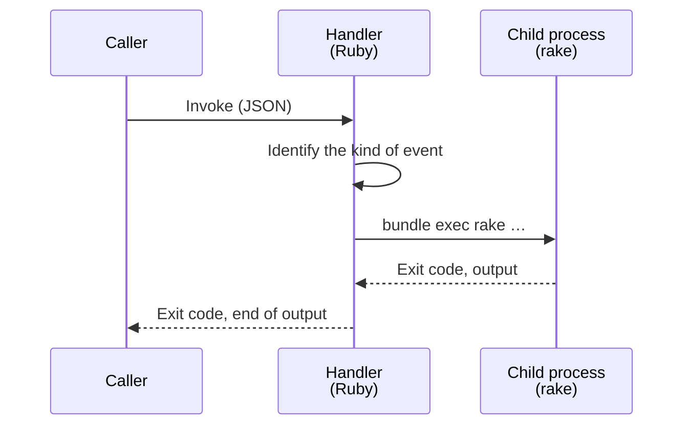

# Migrations, rake and importing email

This design runs Redmine migrations, rake tasks and the import of received email in the task function (`redmine-task`). `redmine-task` uses the same image as `redmine-web`, does not start Puma, and runs rake.

The specifications in this page were checked against official information and the Redmine 7.0.3 and Rails 8.1.4 source as of 2026-11-08. Sources are in [sources.md](sources.md).

## Usage (planned)

```sh
# migrations (Redmine itself and plugins)
bin/rake db:migrate
bin/rake redmine:plugins:migrate

# initial data (Japanese)
bin/rake redmine:load_default_data REDMINE_LANG=ja

# any rake task
bin/rake redmine:attachments:prune
bin/rake -T

# re-import received email (the ID of an email still in S3)
bin/rake redmine_aws_ses:receive_mail MESSAGE_ID=<message ID>

# rails runner (one line of code)
bin/rails runner 'puts User.count'
```

`bin/rake` and `bin/rails` are scripts kept in this repository. They invoke `redmine-task` synchronously with the AWS CLI and show its output and exit code. AWS is operated with the SSO administrator role.

- **Always runs against the deployed Redmine:** `bin/rake` and `bin/rails` in this repository do not run against a local Redmine. Locally, only tests are run, with `bin/test` ([testing.md](testing.md)).
- **`bin/rails` only does `runner`:** `bin/rails` accepts only `runner`.
- **Environment variables:** Pass them in the standard rake form (`REDMINE_LANG=ja`). Only fixed names (`REDMINE_LANG`, `MESSAGE_ID`, etc.) can be passed.
- **Show the target:** Before running, the target (AWS account, Region, function name) is shown. Tasks that change data (`db:migrate`, `runner`, etc.) are sent after confirmation.

## How one image runs everything

`redmine-task` uses the same image as `redmine-web`. The function's environment variable `REDMINE_ROLE` switches what starts. `redmine-task` does not start Puma.

| | `redmine-web` (`REDMINE_ROLE=web`) | `redmine-worker` (`REDMINE_ROLE=worker`) | `redmine-task` (`REDMINE_ROLE=task`) |
| --- | --- | --- | --- |
| Role | Pages and API | ActiveJob jobs ([lambda.md](lambda.md#background-jobs)) | rake, `rails runner`, importing email |
| Extension (`/opt/extensions/lambda-adapter`) | Starts Lambda Web Adapter | Registers as an extension that does nothing, and only waits | Same as left |
| Entry point (`/var/task/bin/start`) | Starts Puma | Runs the `aws-activejob-sqs` handler with `/lambda-entrypoint.sh` (loads Rails) | Runs the project's own handler (`handler.TaskHandler.process`) with `/lambda-entrypoint.sh` (does not load Rails) |
| Talking to Lambda | Lambda Web Adapter | The base image's runtime interface client | Same as left |
| Invoked by | CloudFront (function URL), EventBridge Scheduler (warm-up during business hours; only when used) | SQS (event source mapping) | Local commands, deployment, SES, EventBridge Scheduler |
| Timeout | 60 seconds | 900 seconds | 900 seconds |
| Reserved concurrency | 10 | 3 | 2 |
| Function URL | Yes | No | No |



`redmine-worker` and `redmine-task` are separate functions because they run differently. `redmine-worker` keeps Rails loaded so that jobs run fast. `redmine-task` runs each rake task in a new child process and keeps no state from the previous task. Its handler does not load Rails: it only checks what it received and starts the child process, and the Rails work happens inside that rake process. Importing email is also a rake task, in the plugin `redmine_aws_ses` ([mail.md](mail.md#receiving)).

Lambda starts every file in `/opt/extensions` as an extension. Lambda Web Adapter registers as an extension and also talks to Lambda (the Runtime API) itself, so if it started in `redmine-task` too, it would conflict with the handler. Therefore `/opt/extensions/lambda-adapter` is a small shell script, and the real Lambda Web Adapter is in `/opt/lambda-web-adapter/`. The script starts the real one only when `REDMINE_ROLE=web`.

In `redmine-task`, the script instead registers as an extension that receives no events (`{"events": []}`) and keeps waiting for the next event, the same way Lambda Web Adapter registers itself (`register_extension_internal` in `src/lib.rs`). It must not exit without registering, because Lambda recreates the execution environment when an extension fails. It registers under the same name as its file (`Lambda-Extension-Name: lambda-adapter`) and is written with `curl`, which is in the base image.

## Kinds of events

| Caller | Event | Processing |
| --- | --- | --- |
| `bin/rake`, deployment | `{"command": "rake", "args": ["redmine:load_default_data"], "env": {"REDMINE_LANG": "ja"}}` | Run rake |
| `bin/rails` | `{"command": "runner", "args": ["puts User.count"]}` | Run `rails runner` |
| `bin/rake` | `{"command": "rake", "args": ["redmine_aws_ses:receive_mail"], "env": {"MESSAGE_ID": "<message ID>"}}` | Import email from S3 ([mail.md](mail.md#receiving)) |
| SES receipt rule | SES event (`Records[0].ses`) | Same as above. From the event: the message ID (`mail.messageId` → `MESSAGE_ID`), the recipients (`receipt.recipients` → `SES_RECIPIENTS`, comma-separated), the envelope sender (`mail.source` → `SES_MAIL_FROM`) and the verdicts (`receipt.spamVerdict.status`, `virusVerdict`, `dmarcVerdict`, `spfVerdict`, `dkimVerdict` → `SES_SPAM_VERDICT`, `SES_VIRUS_VERDICT`, `SES_DMARC_VERDICT`, `SES_SPF_VERDICT`, `SES_DKIM_VERDICT`; `receipt.dmarcPolicy` → `SES_DMARC_POLICY`). Values that are not well formed are left out. A command event cannot pass these variables ([mail.md](mail.md#spoofing-and-spam)) |
| EventBridge Scheduler | `{"command": "rake", "args": ["redmine:attachments:prune"]}` | Scheduled tasks (below) |

- **`command`:** Only `rake` and `runner` are accepted. SES events are identified by their shape.
- **`env`:** Only fixed names (`REDMINE_LANG`, etc.) are accepted, so settings such as `REDMINE_DB_HOST` and the database user name cannot be overridden.
- **Execution:** rake and `rails runner` run as child processes with `bundle exec`. Each task runs in a new process, so no state from the previous task remains. The child process also reads settings from SSM Parameter Store when it loads the Rails environment ([lambda.md](lambda.md#settings-and-secrets-ssm-parameter-store)). The handler removes the runtime's `RUBYLIB`, `GEM_HOME` and `GEM_PATH` from the child's environment, so that the child uses only Redmine's bundle (checked on the Runtime Interface Emulator on 2026-11-09).
- **Output:** Standard output and standard error go to CloudWatch Logs as they are. The response contains the exit code and the end of the output (up to 256 KB), cut at a character boundary. A synchronous invocation response is limited to 6 MB, so the full output is not included.
- **Time:** The function timeout is 900 seconds (the Lambda maximum). Tasks longer than this cannot run (below).
- **Reserved concurrency:** Set to 2, so that a migration and an email import can run at the same time, and no more.

## Permissions

Only the SSO administrator role, the deployment role (for migrations and the initial data), SES (for receiving email) and EventBridge Scheduler can invoke `redmine-task`, and it has no function URL. Limiting who can invoke it is what protects the data: rake and `rails runner` can read and write everything in the database and S3. The details of the permissions are in [iam.md](iam.md).

## Migrations during deployment

The deployment steps are in [deploy-config.md](deploy-config.md#deployment-commands). Migrations run after the image of `redmine-task` is updated first; if they succeed, `redmine-web` and `redmine-worker` are updated (steps 7 and 9). When an instance is first set up, the same migrations create the schema in the empty database, and `redmine-task` then loads the initial data (step 8).

Between the migration and the update of `redmine-web`, old code runs against the new schema. Upgrade Redmine at a time of low use. Before upgrading, this project checks the new migrations ([upgrade.md](upgrade.md)).

## Notes on the read-only file system

Rails writes `db/schema.rb` after `db:migrate` (the default of `ActiveRecord.dump_schema_after_migration` is `true`), and Redmine's `production.rb` leaves this setting commented out, so the write fails on Lambda. `additional_environment.rb` sets it to `false`.

Tasks that move files under `files/`, such as `redmine:attachments:move_to_subdirectories`, do not move files in S3, so they are not used. Tasks that read attachments, such as `redmine:attachments:update_digests`, fetch them from S3 and read them through the `/tmp` cache ([attachments.md](https://redmine-kit.github.io/redmine_aws_s3/attachments.html#the-tmp-cache)).

## Scheduled runs

EventBridge Scheduler invokes `redmine-task` with input in the form above.

| Task | Schedule |
| --- | --- |
| `redmine:attachments:prune` | Daily |
| `redmine:send_reminders` (due date reminders) | If used, weekday mornings |
| `redmine_aws_costexplorer:refresh` (in an image that adds the plugin, a derived image: the account's costs from Cost Explorer, for the administration pages) | Daily, only with `costExplorer.enabled` ([deploy-config.md](deploy-config.md#fields-of-redminejson)) |
| `redmine_aws_sqs:prune_records[<days>]` and `redmine_aws_ses:prune_records[<days>]` (delete the plugins' records older than the retention period, `retention.recordsDays`: failed jobs and received email; [security.md](security.md#retention-periods)) | Daily |
| `redmine_aws_ses:refresh` (reads the state of SES and the domain's MX record that the email tabs show; the pages do not call SES, and their "Refresh" link reads it at once) | Hourly |

## Stopping unused functions

Lambda sets container image functions that are not invoked for several weeks to `Inactive`. The next first invocation fails, and the function stays `Pending` until image optimization finishes. `redmine-task` is invoked by the daily scheduled run, so it does not normally become `Inactive`. As a precaution, `bin/rake` and `bin/rails` check the function state before invoking and wait until it is `Active`.

## Tasks longer than 15 minutes

Tasks that may take more than 15 minutes, such as regenerating digests for many attachments (`redmine:attachments:update_digests`), cannot run on Lambda. Tasks that can be split into separate invocations are split. When that is not possible, the same image runs once as an ECS Fargate task (`RunTask`). The task runs in the same private subnets as RDS ([rds.md](rds.md)); pulling the image and writing logs need routes to ECR and CloudWatch Logs, which are prepared with it. Migrations when moving from an older Redmine run on a temporary PostgreSQL, so they are not subject to Lambda's 15 minutes ([migration.md](migration.md)). The entry point is replaced so that rake runs directly. You pay only for the time used. It is prepared when it becomes necessary.

## To verify

- Whether, with the do-nothing extension registered, the execution environment shuts down correctly on Lambda (on the Runtime Interface Emulator, the extension registers and the handler runs; checked on 2026-11-09)
- How long loading initial data (`redmine:load_default_data`) and migrating an empty database take
