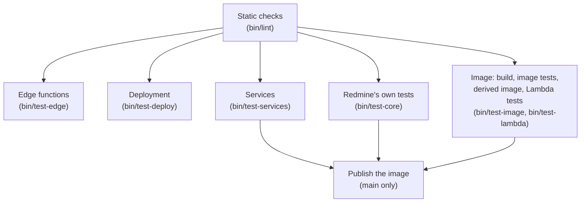

# Test plan

This is the test plan for Serverless. It checks, stage by stage, the project's own plugins, their effect on Redmine itself, the container image, the infrastructure, and behavior after deployment.

The specifications in this document were checked against official information as of 2026-11-08 and the Redmine 7.0.3 source. Sources are in [sources.md](sources.md).

## Approach

The tests follow four rules:

- Every piece of replaced code has tests: at least one for each row of the table in [attachments.md](https://redmine-kit.github.io/redmine_serverless_s3/attachments.html#replaced-code), changed in the same commit as the table.
- The tests use Redmine's standard test framework. Redmine has unit, functional, integration and system (Capybara and Selenium) tests built on Rails Minitest and mocha; the plugins' tests are written the same way and run with `rake redmine:plugins:test`.
- Tests do not connect to real AWS. They use AWS SDK response stubs (`stub_responses`), and moto (Apache-2.0) and LocalStack, which reproduce AWS APIs locally ("Which substitute to use" below).
- What cannot be reproduced locally, such as Lambda, CloudFront and SES receiving, is checked after deployment.

This project's CI uses the redmine-kit organization's LocalStack license (Ultimate, from 2026-11-09), given to the jobs as the secret `LOCALSTACK_AUTH_TOKEN`. Adopters of Serverless who run the tests need a LocalStack license of their own that allows their use; otherwise they rely on this project's CI results and their own checks after deployment.

### Running the tests

Local tests run with `bin/test` in this repository; there is no Makefile. `bin/test` runs a test image and containers for PostgreSQL, moto and LocalStack in Docker, so it works without Ruby or PostgreSQL installed locally. This repository's `bin/rake` and `bin/rails` target the deployed Redmine, so they are not used for tests ([tasks.md](tasks.md#usage-planned)).

```sh
bin/test            # Everything from static checks to Lambda integration tests, in the same order as CI
bin/test lint       # Static checks (RuboCop, ShellCheck, actionlint, cfn-lint, cfn-guard)
bin/test plugin     # Plugin unit, functional and integration tests
bin/test core       # Redmine's own tests (with the plugins installed)
bin/test system     # System tests (headless Chrome)
bin/test image      # Image tests (read-only, low-privilege user, three roles)
bin/test lambda     # Integration tests that invoke the three functions as Lambda on LocalStack
bin/test plugin test/unit/attachment_patch_test.rb   # Run a specific file
```

GitHub Actions calls the same `bin/test` stages in order, so tests run the same way locally and in CI. If a step in the CI order (below) fails, the run stops there, and nothing that fails the tests is deployed.

Until `bin/test` is put together, the stages built so far are separate scripts: `bin/lint` (static checks), `bin/test-services` (starts PostgreSQL, moto and LocalStack and checks that each answers), `bin/build-image`, `bin/test-image` (image tests), `bin/build-derived-image` (a derived image with plugins and themes), `bin/test-derived-image` (derived images), `bin/test-core` (Redmine's own tests) and `bin/update-gems` (writes `image/Gemfile.lock`).

### Working on a plugin at the same time

The image installs the plugins as gems from GitHub Packages at the versions in `image/Gemfile.lock` ([architecture.md](architecture.md#distribution)). With `REDMINE_SERVERLESS_SSM_DIR` or `REDMINE_SERVERLESS_S3_DIR` set to a checkout of the plugin, the scripts that build the image replace the installed gem with its working tree (`bin/lib/plugin.sh`). For example, to test the image with a checkout of the SSM plugin next to this repository:

```sh
REDMINE_SERVERLESS_SSM_DIR=../redmine_serverless_ssm bin/test-image
```

The scripts take Bundler's credential for GitHub Packages from the `gh` login, or from `BUNDLE_RUBYGEMS__PKG__GITHUB__COM` (CI sets it from `GITHUB_TOKEN`).

## Kinds of tests

| Kind | What it checks | Tools | When |
| --- | --- | --- | --- |
| Static checks | Ruby style, shell scripts, workflows, CloudFormation, known vulnerabilities in dependencies | RuboCop (Redmine's configuration), ShellCheck, actionlint, cfn-lint, cfn-guard, `bundler-audit` | Every commit |
| Image vulnerability scan | Known severe vulnerabilities in OS packages and gems in the image | Trivy or similar | Every image build |
| Plugin unit and functional tests | Replaced code, added pages, rake tasks | Minitest, mocha, SDK `stub_responses` | Every commit |
| Plugin integration tests | Flows that actually talk to S3, SQS and SSM | Minitest, moto | Every commit |
| Redmine's own tests | Whether Redmine's own behavior still works with the plugins installed | Redmine's tests (unit, functional, integration) | Every commit |
| System tests | Upload, download and thumbnails in the browser | Capybara, Selenium (headless Chrome), moto | Every commit |
| Image tests | Whether the three roles start with a read-only file system and a low-privilege user | Docker, Lambda Runtime Interface Emulator | Every image build |
| Edge function tests | The Lambda@Edge function and the CloudFront Functions, and that the templates carry the same code | node:test (Node.js's own) | Every commit |
| Deployment tests | The configuration schema, the stack parameters, and the steps of `bin/deploy` | check-jsonschema, a fake AWS CLI, Minitest | Every commit |
| Lambda integration tests | Whether the same image, deployed as three functions, works with SQS and SSM for the function URL, jobs from SQS and invocations of `redmine-task` | LocalStack | Every image build |
| Checks after deployment | Behavior on real AWS | `bin/smoke-test` (the project's own) | Every deployment |
| Measurements | Startup time, memory, request time | CloudWatch logs and metrics | First deployment, and on Redmine upgrades |

## Plugin tests

Tests are written per feature of the plugins: `redmine_serverless` for running on Lambda ([features](https://redmine-kit.github.io/redmine_serverless/#features)), `redmine_serverless_s3` for attachments in S3 ([documentation](https://redmine-kit.github.io/redmine_serverless_s3/)) and `redmine_serverless_ses` for sending and receiving email through SES ([documentation](https://redmine-kit.github.io/redmine_serverless_ses/)). Each plugin runs its own tests. They also check that Redmine behaves as standard when a feature's enabling conditions are not met.

### Attachments in S3 (`redmine_serverless_s3`)

The plugin tests every piece of replaced code and every call to AWS in its own repository and CI: stubs for each S3 answer, moto for the requests, GuardDuty's tags set by the tests, and CloudFront signed URLs verified with the public key. What the tests check, and what they cannot reproduce locally (CloudFront, GuardDuty, S3 rejecting a checksum that does not match), is in its [setup.md](https://redmine-kit.github.io/redmine_serverless_s3/setup.html#what-the-tests-check). Serverless checks the deployed behaviors after deployment (below).

### Running on Lambda (`redmine_serverless`)

The plugin tests `/events`, the asset setting, the fixed settings and its administration pages in its own repository and CI, with Redmine's full test suite ([its README](https://redmine-kit.github.io/redmine_serverless/#tests)).

### Email (`redmine_serverless_ses`)

The plugin tests sending through SES v2, each SES error, the import from the mail bucket with SES-event verdicts and recipients, the project addresses and the pages in its own repository and CI, against LocalStack (or moto without its token) ([sending.md](https://redmine-kit.github.io/redmine_serverless_ses/sending.html#tests), [receiving.md](https://redmine-kit.github.io/redmine_serverless_ses/receiving.html#tests)).

### Jobs (`redmine_serverless_sqs`)

The plugin tests the jobs on SQS through `aws-activejob-sqs`, the allowlist, the failure records, resending and moving the dead-letter queue back in its own repository and CI, against LocalStack (or moto without its token) ([setup.md](https://redmine-kit.github.io/redmine_serverless_sqs/setup.html#tests)).

### Settings and code outside the plugins

| Target | What to check | Tools |
| --- | --- | --- |
| SSM loading (`redmine_serverless_ssm`) | Reads everything under `/<instance>/env/`, continuing past 10 entries, and decrypts SecureString. Does not overwrite existing environment variables. Skips names that cannot be environment variables and deeper paths. Fails when SSM cannot be reached. In the image tests, the three roles read the database host, its password and `SECRET_KEY_BASE` only from SSM, which checks that the reading comes before `config/database.yml` | Minitest, moto (the plugin's `test/loader_test.rb`, `bin/test-image`) |
| Task handler | Accepts only the defined `command` and `env`. Recognizes SES events and passes their message ID, recipients and verdicts, leaving out values that are not well formed; a command event cannot pass the SES variables. Returns the child process's exit code and the end of its output. Does not cut Japanese text in the middle of a character | Minitest |
| Extension script | Depending on `REDMINE_ROLE`, starts the real Lambda Web Adapter or registers as an extension that does nothing | ShellCheck, image tests |
| Webhooks | Not sent to destinations in the `webhook_blocklist` ranges (private, link-local). An error at the destination fails the job, and it is redelivered | Minitest, moto |
| Function that adds the body hash (`edge/body-hash/`) | Sets the SHA256 of an empty body for requests without a body and with an empty body. Computes the SHA256 of a base64 body over the raw bytes (matching a locally computed value for binary bodies and multipart forms). Returns 413 for requests with `inputTruncated` and does not send them to the origin | Node.js `node:test`. No npm package dependencies |

## Redmine's own tests

The plugins replace Redmine code with `prepend`. Redmine's tests check that Redmine's own behavior is not broken.

### How they run

`bin/test-core` runs them in the `core-test` stage of the image's Dockerfile, which has the same Redmine source, `config/` files and `Gemfile.lock` as the image, plus the test gems, ImageMagick and the Subversion and Git clients, as in the image. Redmine's `master` enables a repository type only when its client is installed ([#43209](https://www.redmine.org/issues/43209)), the repositories of Redmine's test fixtures are Subversion ones, and some tests are skipped when Git is unavailable. The tests run with the plugins of the image installed: `redmine_serverless`, `redmine_serverless_s3`, `redmine_serverless_ses`, `redmine_serverless_sqs` and `redmine_serverless_ssm`. The database is the PostgreSQL of `bin/test-services`, and the tests run in parallel with one worker per processor (`PARALLEL_WORKERS` changes the number).

The image does not write `db/schema.rb` after migrations, because the file system on Lambda is read-only, but parallel tests load that file. So `bin/test-core` writes it before the tests, after Redmine's and the plugins' migrations (`redmine:plugins:migrate`, as the deployment runs). Redmine skips the tests that need SCM repositories or an LDAP server, which this stage does not set up.

### Known failures

Tests that fail because of a gem, not because of this image, are listed in `test/core/known_failures.txt` with the reason, and `bin/test-core` leaves them out. A line is removed when the cause is fixed upstream. The gems are not held back to make such tests pass, because newer versions can carry security fixes. For example, Nokogiri 1.19.5 changed how CSS selectors are read, which breaks `:match` with a regular expression in rails-dom-testing 2.3.0 ([rails/rails-dom-testing#136](https://github.com/rails/rails-dom-testing/issues/136)).

### With the plugins inactive and active

When their enabling conditions are not met (no S3 bucket settings, no `REDMINE_ROLE`, no SES settings), the plugins do not enable their replacements, so Redmine's unit, functional and integration tests must all pass with the plugins installed.

With `redmine_serverless_s3` enabled, Redmine's attachment tests (`test/unit/attachment_test.rb`, `test/unit/attachment_transaction_test.rb`, `test/functional/attachments_controller_test.rb`, `test/functional/attachments_visibility_test.rb`, `test/integration/attachments_test.rb`) run on moto, except those that assume local files (that check paths on disk directly). These are excluded, with the reason written down.

### Watching the replaced code

For each replaced Redmine method, the SHA256 of the original code is recorded, and a test compares it with the current code. If a Redmine upgrade changes the original code, the test fails, which prompts a review of the replacement.

## Which substitute to use

| Tool | Where it is used | Where it is not used, and why |
| --- | --- | --- |
| SDK `stub_responses` | Unit and functional tests. Tests that raise SES errors one by one | — |
| moto | Plugin integration tests and system tests (S3, SQS, SSM). SES v2 `SendEmail` is used only after checking that moto reproduces it; until then, SDK `stub_responses` is used instead | — |
| LocalStack (the organization's Ultimate license in CI) | Lambda integration tests. Three functions from the same image in LocalStack's ECR, function URLs, SQS event source mappings, SES v2 for the jobs' mail | CloudFront and RDS are not used: CloudFront is checked after deployment, and the database is a PostgreSQL container |

## Administration pages

| What to check | Kind |
| --- | --- |
| Non-administrators cannot open any of the pages (403) | Functional tests |
| Secrets (SSM values, `SECRET_KEY_BASE`, the database password) do not appear in the page HTML | Functional tests |
| The state of SES, SQS and S3 is shown as given by the SDK response stubs. The pages open even when an API returns an error | Functional tests |
| Resending, deleting, redriving the dead-letter queue and removing from the suppression list run after confirmation and are logged | Functional tests, system tests |
| After the receiving settings change, `redmine_serverless_ses:receive_mail` uses the new settings from the next run | Functional tests |
| Reconciliation is enqueued as a job, and the result is shown on the page | Functional tests, integration tests (moto) |

## System tests

Browser behavior is checked with Capybara and headless Chrome. S3 is reproduced with moto; the upload PUT and the signed URLs, which go through CloudFront, are checked after deployment.

| What to check | Reason |
| --- | --- |
| A file can be selected, attached and the issue saved | The basic flow of the `uploadBlob` replacement |
| Files can be attached by drag and drop and by pasting images | The standard UI flow is not broken |
| Progress is shown during upload, and the save button cannot be pressed until it finishes | Same as above |
| An error is shown for a file over the limit | Redmine's limit at presign |
| Clicking an attachment downloads it from S3 | Redirect |
| Images in wiki text and thumbnails in the attachment list are shown | Redirect to signed URLs. Whether pages with many thumbnails exceed the reserved concurrency |

## Image tests

Every image build is started in Docker under the same conditions as production.

- **Conditions:** arm64, a read-only file system (`--read-only`), only `/tmp` writable (`--tmpfs /tmp`), a low-privilege user (`--user` with any non-root ID). The database is a PostgreSQL container of the same major version as RDS. AWS (SSM and SQS) is LocalStack when `LOCALSTACK_AUTH_TOKEN` is set, as in CI, and moto otherwise (pull requests from forks, or locally without a token); with a token, LocalStack must start, or the tests fail. Nothing is mocked: LocalStack and moto both have every API the tests use. The containers run on an internal Docker network that reaches only PostgreSQL and that backend, so the tests cannot reach AWS.
- **`web`:** Check that Puma starts, the login page returns 200 with the session cookie marked `Secure` ([session.md](session.md#the-secure-attribute-of-the-session-cookie)), the assets' `.manifest.json` exists, and nothing is written outside `/tmp` after startup. On Redmine 7.1 (master), a favicon set in the settings is served with `Cache-Control: max-age=31556952, public, immutable`, which is what the CloudFront behavior `/favicons/*` caches ([lambda.md](lambda.md#the-favicon)). The page is requested from inside the container, because Puma listens only on `127.0.0.1`. The emulator does not pass requests through Lambda Web Adapter, so that path is checked in the Lambda integration tests.
- **`task`:** Invoke the handler with the Runtime Interface Emulator in the base image (`aws-lambda-rie`), and check that `rake db:migrate`, `redmine:load_default_data`, `rake -T` and `rails runner` work, that Redmine finds the Subversion and Git clients and reads a Subversion and a Git repository made in `/tmp` ([lambda.md](lambda.md#repositories)), that a failed task returns its exit code, and that commands and `env` names outside the allowed ones are rejected. Mail import is added with the plugin.
- **`worker`:** Likewise with the emulator. The job is sent to the queue and received from it, and the worker gets it in an SQS-shaped event with the message's receipt handle. Check that the invocation succeeds, the job runs (a project is deleted, and its notification mail is queued in SQS), the worker deletes the message (nothing left in flight; `redmine_serverless_sqs` deletes at `REDMINE_JOBS_QUEUE_URL`, [setup.md](https://redmine-kit.github.io/redmine_serverless_sqs/setup.html)), and that a job class outside the allowlist is not run.
- **Contents:** Check that ImageMagick's `convert`, Ghostscript, Pandoc (3.8.3 or later) and the Subversion and Git clients (`svn`, `git`) work, that everything in `/var/task` and `/opt` is readable by the low-privilege user, and that the compiled assets are there. The task handler's unit tests also run in the image. Whether the pushed manifest is arm64 only and not an index is checked when the image is pushed.
- **Derived images:** `bin/test-image <image> <redmine.json>` runs the same tests on a derived image with `image.plugins` and `image.themes` ([architecture.md](architecture.md#derived-images)), and also checks that the added plugins are loaded and their migrations have run, and that the added themes are found and their assets compiled. `bin/deploy` runs it before pushing a derived image. `bin/test-derived-image [base image]` builds and tests the derived images of `test/derived/`: one with a gem from GitHub Packages, a plugin from Git at a commit, a plugin and a theme from directories and a plugin setting; one with a gem from RubyGems, built without a GitHub token; and two that must fail with a clear message, a plugin that asks for another version of a gem of the base image, and a Git entry that needs credentials. In CI, the image job of the Redmine release runs it on the image it has just built.

## Edge function tests

`bin/test-edge` runs the tests of `edge/` with `node:test` in the Node.js image, without npm packages.

- **`redmine-body-hash` (Lambda@Edge):** The hash of an empty body, of a base64 body over its raw bytes (forms, binary, multipart) and of a text body; a forged `x-amz-content-sha256` is replaced; a truncated body (over 1 MB) gets 413; other fields of the request are kept; the settings form with a favicon of 32 KB (Redmine 7.1) passes with its hash.
- **`<instance>-incoming-size` (CloudFront Function):** Run as CloudFront runs it, a plain script with the limit written in: a PUT under `/tmp/incoming/` within the limit passes, a larger one gets 413, one without a valid `Content-Length` gets 411, and other methods and paths (signed GETs of thumbnails and zips) pass.
- **`<instance>-attachment-headers` (CloudFront Function):** Run as a plain script: every response gets the sandbox CSP; a successful one gets `Content-Disposition` and `Content-Type` from the decoded `response-content-disposition` and `response-content-type`; without them, S3's headers stay; malformed values, values that are not printable ASCII (such as a line break) and error responses get no override.
- **The templates:** The code is inline in the templates (`infra/shared-edge.yaml`, `infra/instance.yaml`), so the tests check that the templates carry the same lines as the files.

## Deployment tests

`bin/test-deploy` tests `bin/deploy` without AWS, in the tools image of `bin/deploy`.

- **Schema:** The examples in [deploy-config.md](deploy-config.md#example), the files in `test/deploy/valid/` and `test/derived/redmine.json` pass; each file in `test/deploy/invalid/` fails (a missing field, a hosted zone missing with `route53`, an image without a digest, unknown fields, a plugin with two sources or a Git source without `ref`, credentials in a URL, and so on).
- **Stack parameters:** For each valid configuration, the parameters that `deploy/params.jq` makes for each template are parameters of that template, and every parameter without a default is given. Defaults and values are compared.
- **CloudFront behaviors:** `test/deploy/behaviors.py` reads `infra/instance.yaml`: no more than 5 cache behaviors with the default one (the Free plan), and `/favicons/*` goes to Redmine, GET and HEAD only, with `CachingOptimized` and `SecurityHeadersPolicy`, and without an origin request policy (no cookies), functions or signed URLs ([lambda.md](lambda.md#the-favicon)). The origin `redmine` has the origin custom headers `X-Forwarded-Host` (the `Domain` parameter) and `X-Forwarded-Proto` (`https`) ([lambda.md](lambda.md#host-and-scheme)).
- **Steps:** `deploy/deploy.sh` runs against fake `aws`, `crane` and `curl` (`test/deploy/fake/`) that record every call: the order of the steps the first time and later (the task migrates before web and worker get the image), `--dry-run` (nothing executed, written or invoked), `--code-only`, `--account`, a stack without changes, a failed migration that stops the deployment, a failed check, and an invalid configuration that stops before any call. With `image.plugins` and `image.themes`, the derived image's tarball is pushed by its digest instead of copying from the registry, and the steps refuse to run without it. The secrets are checked: their format, SecureString, the public key in the stack matching the private key, and that no secret is on a command line or in the output.
- **Settings code:** The Ruby code that applies the settings runs in Ruby against a stand-in for Redmine's `Setting` (`initial` and `enforce`, and plugin settings merged).

## Lambda integration tests

`bin/test-lambda` runs the image as Lambda on LocalStack (its own Compose project, `test/lambda/compose.yml`). It needs `LOCALSTACK_AUTH_TOKEN` and is skipped without it. In CI it runs in the image job of the Redmine release.

- **License:** The tests need ECR, container image functions and SES v2, which the organization's Ultimate license in CI includes. With a token whose license lacks one of them, `bin/test-lambda` fails instead of skipping; only without a token does it skip. Nothing is mocked: every API the tests use is in LocalStack.
- **Image:** Pushed to LocalStack's ECR as `bin/deploy` pushes a derived image: saved as a tarball and pushed with crane under the digest computed from it (`push_tarball` of `deploy/lib.sh`). LocalStack's Lambda runs it from there by that digest.
- **Secrets:** `create_secrets` of `deploy/lib.sh` creates the secrets in SSM, and keeps them on a second run.
- **`redmine-task`:** Invoked through `task` of `deploy/lib.sh`, as `bin/deploy` does: `db:migrate`, `redmine:load_default_data`, reading `SECRET_KEY_BASE` from SSM, a failed command failing, and the settings code.
- **`redmine-worker`:** From an SQS event source mapping. The task queues a `DestroyProjectJob`; the worker runs it, and the job runs only once after the visibility timeout, which shows that the message was deleted (the image tests cannot check this with moto). The job's notification mail is sent by the worker through SES v2.
- **`redmine-web`:** `/login` through a function URL, which goes through Lambda Web Adapter.

## Infrastructure checks

| Target | Tools | What to check |
| --- | --- | --- |
| CloudFormation | cfn-lint | Template syntax and resource configuration errors |
| CloudFormation | cfn-guard | S3 Block Public Access, encryption, enforced TLS. No public access to RDS, and deletion protection on |
| CloudFormation | `aws cloudformation validate-template`, change sets | The diff before applying to production |
| Workflows | actionlint | GitHub Actions syntax |

## Checks after deployment

On every deployment, `bin/smoke-test` checks behavior on real AWS. A project and a user for checks are prepared so that regular data is not touched. `bin/smoke-test` is not built yet; the last step of `bin/deploy` checks the login page (200 with `Strict-Transport-Security`) and that `/files/` without a signature is refused ([deploy-config.md](deploy-config.md#deployment-commands)).

| What to check | Expected result |
| --- | --- |
| Login page | 200 through CloudFront. Security headers such as `Strict-Transport-Security` are present. `http://` redirects to `https://` |
| Assets | CSS under `/assets/` is returned from S3 (does not appear in the Lambda logs) |
| Direct request to the function URL | 403 because there is no signature. Does not appear in the function logs (the function is not invoked) |
| POST through CloudFront | Login and issue creation pass (the function URL accepts them with the hash added by Lambda@Edge and the OAC signature) |
| POST with a body over 1 MB | CloudFront returns 413 |
| Upload and download | In the check project, a file PUT through CloudFront can be fetched with a signed URL. The SHA256 of the fetched file matches what was sent and the attachment's digest. An upload of another size than declared is not registered |
| Attachment headers | A response under `/files/` has `Content-Security-Policy: default-src 'none'; style-src 'unsafe-inline'; sandbox`, `X-Content-Type-Options: nosniff` and the file name of the signed URL in `Content-Disposition` (a Japanese name too), and the same URL without the signature is refused. Attachments are on Redmine's origin, so this must hold after every change of the distribution |
| Download by a user without permission | No signed URL is exposed |
| Mail sending | A notification job addressed to the SES mailbox simulator (`success@simulator.amazonses.com`) is sent through SQS |
| Mail receiving | Mail sent from the check address to the receiving address becomes an issue in the check project |
| Tasks | `bin/rake -T` succeeds |

## Measurements

| Item | Where to look | Used for |
| --- | --- | --- |
| Startup time | Init duration and first request duration in the Lambda logs | Whether warm-up invocations are needed, memory size |
| Memory | Max memory used in the Lambda logs | Memory size |
| Request time | Duration in the Lambda logs | Revising the cost estimate ([cost.md](cost.md)) |
| Registering a large upload | Time of the copy in S3 when the upload is registered | Attachment size limit |

## Coverage

CI sends the coverage of what this repository tests to Codecov, with a flag for each part. The plugins send theirs from their own repositories.

| Flag | What is measured | How |
| --- | --- | --- |
| `edge` | The functions that run at CloudFront (`edge/`) | Node.js's own coverage in `bin/test-edge` (`--experimental-test-coverage`, LCOV). No npm packages |
| `image` | The image's own Ruby files (`image/*.rb`; now the task handler) | Ruby's `Coverage` in the task handler's unit tests in `bin/test-image` (`test/image/coverage.rb`, LCOV). No gem is added to the image |

The coverage is uploaded with `codecov/codecov-action` and an OIDC token, so no secret is needed. Until the Codecov GitHub App is installed for the repository, a failed upload does not fail the run. Not measured are `bin/deploy` and the other shell scripts, which `bin/test-deploy` tests against a fake AWS CLI ([Deployment tests](#deployment-tests)), and Redmine and the plugins in the image.

## Order in CI

GitHub Actions (`.github/workflows/ci.yml`) runs the jobs in the following order. The arm64 image is built on an arm64 runner. The plugins' tests run in their own repositories.



Deployment is not part of CI: `bin/deploy` runs when an administrator decides to deploy ([deploy-config.md](deploy-config.md#deployment-commands)).

If any step fails, nothing after it runs. If the checks after deployment fail, the deployment rolls back to the previous image.

### Redmine versions

The image tests and Redmine's own tests run twice (a matrix): on the Redmine release the image uses (now 7.0.3, from the release tar.gz checked by SHA256, with `image/Gemfile.lock`), and on Redmine's `master` branch, which becomes the next release (7.1; there is no `7.1-stable` branch yet, checked on 2026-11-09).

`master` is taken from GitHub without pinning (`REDMINE_BRANCH=master` for `bin/build-image` and `bin/test-core`), its gems are resolved without the lock, and its jobs do not fail the run (`continue-on-error`). They are there to show early what the next release breaks, which is also why CI runs weekly. An image built from `master` is never deployed. When 7.1 is released, the matrix moves to 7.1 (pinned) and the next `master`. Reviewing the new migrations of an upgrade and running them on test databases is a separate workflow ([upgrade.md](upgrade.md)).

### Updates

Dependabot opens weekly pull requests for the actions (with `.github/workflows/actions.lock`), the Docker images and the lint gems, for versions published at least 3 days ago (patches) or 7 days ago (others).

Dependabot cannot update `image/Gemfile.lock`, because it is resolved inside the image from Redmine's Gemfile, which is not in this repository, together with `image/Gemfile.local` and the plugins' Gemfiles. Instead, a weekly workflow (`.github/workflows/update-gems.yml`) runs `bin/update-gems --update` with Bundler's `--cooldown=7`, opens a pull request and starts CI on its branch. The lock is committed so that every build installs the same, reviewed gem versions with their checksums.

### Services and credentials

Plugin tests, Redmine's own tests and the image tests run on a PostgreSQL container of the same major version as RDS (the version is checked when building; [rds.md](rds.md#database)). The tests on every commit use no AWS credentials: only the deployment and the checks after deployment connect to AWS, with roles in the production account assumed through OIDC ([iam.md](iam.md#role-for-deploying-code-github-actions)).

LocalStack needs an auth token in `LOCALSTACK_AUTH_TOKEN`, which is never written to the repository. Locally it is set in the shell (for example, read from the macOS Keychain); in CI it is the secret `LOCALSTACK_AUTH_TOKEN`. Without the token, `bin/test-services` skips LocalStack, and pull requests from forks get no secrets, so LocalStack is skipped there too.

## To verify

- Whether moto returns `ChecksumSHA256` for a copy made with `ChecksumAlgorithm` `SHA256`
- Whether moto reproduces SES v2 `SendEmail` (sending the full message)
- Whether Lambda Web Adapter can run on the Runtime Interface Emulator
- How many of Redmine's attachment tests can pass with S3
