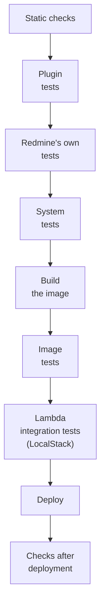

# Test plan

This is the test plan for Serverless. It checks, stage by stage, the project's own plugins, their effect on Redmine itself, the container image, the infrastructure, and behavior after deployment.

The specifications in this document were checked against official information as of 2026-11-08 and the Redmine 7.0.3 source. Sources are in [sources.md](sources.md).

## Approach

- **Every piece of replaced code has tests:** Write at least one test for each row of the table in [attachments.md](https://redmine-kit.github.io/redmine_serverless_s3/attachments.html#replaced-code). The table and the tests are changed in the same commit.
- **Use Redmine's standard test framework:** Redmine has unit, functional, integration and system (Capybara and Selenium) tests built on Rails Minitest and mocha. The plugins' tests are written the same way and run with `rake redmine:plugins:test`.
- **Use substitutes for AWS locally:** Tests do not connect to real AWS. They use AWS SDK response stubs (`stub_responses`), and moto (Apache-2.0) and LocalStack, which reproduce AWS APIs locally (see "Which substitute to use" below).
- **LocalStack is used only in this project:** Serverless is published as a non-commercial open-source project of the redmine-kit organization. LocalStack's free Hobby plan is limited to non-commercial use, so it is used in this project's tests and CI. Tests by adopters of Serverless (such as a company's business Redmine) count as commercial use, so they do not use Hobby LocalStack. Adopters rely on this project's CI results and their own checks after deployment (checked on LocalStack's pricing page on 2026-11-09).
- **Real AWS is checked after deployment:** Things that cannot be reproduced locally, such as Lambda, CloudFront and SES receiving, are checked after deployment.
- **Until `bin/test` is put together:** The stages built so far are separate scripts: `bin/lint` (static checks), `bin/test-services` (starts PostgreSQL, moto and LocalStack and checks that each answers), `bin/build-image`, `bin/test-image` (image tests), `bin/test-core` (Redmine's own tests) and `bin/update-gems` (writes `image/Gemfile.lock`).
- **Working on the plugin at the same time:** The image takes the plugin `redmine_serverless` at the commit pinned in `image/Dockerfile`. With `REDMINE_SERVERLESS_DIR` set to a checkout of the plugin, the scripts that build the image take its working tree instead (`bin/lib/plugin.sh`), for example `REDMINE_SERVERLESS_DIR=../redmine_serverless bin/test-core`. The plugin's CI uses the same to run these tests on its own changes.
- **Local tests use `bin/test`:** Local tests run with `bin/test` in this repository. There is no Makefile. `bin/test` runs a test image and containers for PostgreSQL, moto and LocalStack in Docker, so it works without Ruby or PostgreSQL installed locally. This repository's `bin/rake` and `bin/rails` target the deployed Redmine, so they are not used for tests ([tasks.md](tasks.md#usage-planned)).

```sh
bin/test            # Everything from static checks to Lambda integration tests, in the same order as CI
bin/test lint       # Static checks (RuboCop, ShellCheck, actionlint, cfn-lint, cfn-guard)
bin/test plugin     # Plugin unit, functional and integration tests
bin/test core       # Redmine's own tests (with the plugins installed)
bin/test system     # System tests (headless Chrome)
bin/test image      # Image tests (read-only, low-privilege user, three roles)
bin/test lambda     # Integration tests that invoke the three functions as Lambda on LocalStack
bin/test plugin test/unit/attachment_patch_test.rb   # Run a specific file
```

- **CI is the same:** GitHub Actions calls the same `bin/test` stages in order. Tests run the same way locally and in CI.
- **Nothing that fails tests is deployed:** If a step in the CI order (below) fails, the run stops there.

## Kinds of tests

| Kind | What it checks | Tools | When |
| --- | --- | --- | --- |
| Static checks | Ruby style, shell scripts, workflows, CloudFormation, known vulnerabilities in dependencies | RuboCop (Redmine's configuration), ShellCheck, actionlint, cfn-lint, cfn-guard, `bundler-audit` | Every commit |
| Image vulnerability scan | Known severe vulnerabilities in OS packages and gems in the image | Trivy or similar | Every image build |
| Plugin unit and functional tests | Replaced code, added pages, rake tasks | Minitest, mocha, SDK `stub_responses` | Every commit |
| Plugin integration tests | Flows that actually talk to S3, SQS and SSM | Minitest, moto | Every commit |
| Redmine's own tests | Whether Redmine's own behavior still works with the plugins installed | Redmine's tests (unit, functional, integration) | Every commit |
| System tests | Upload, download and thumbnails in the browser | Capybara, Selenium (headless Chrome), moto | Every commit |
| Image tests | Whether the three roles start with a read-only file system and a low-privilege user | Docker, Lambda Runtime Interface Emulator | Every image build |
| Lambda integration tests | Whether the same image, deployed as three functions, works with S3, SQS and SSM for the function URL, jobs from SQS and invocations of `redmine-task` | LocalStack (Hobby) | Every image build |
| Checks after deployment | Behavior on real AWS | `bin/smoke-test` (the project's own) | Every deployment |
| Measurements | Startup time, memory, request time | CloudWatch logs and metrics | First deployment, and on Redmine upgrades |

## Plugin tests

Tests are written per feature of the plugins: `redmine_serverless` for running on Lambda ([features](https://redmine-kit.github.io/redmine_serverless/#features)), `redmine_serverless_s3` for attachments in S3 ([documentation](https://redmine-kit.github.io/redmine_serverless_s3/)) and `redmine_serverless_ses` for sending and receiving email through SES ([documentation](https://redmine-kit.github.io/redmine_serverless_ses/)). Each plugin runs its own tests. They also check that Redmine behaves as standard when a feature's enabling conditions are not met.

### Attachments in S3 (`redmine_serverless_s3`)

S3 is reproduced with SDK `stub_responses` in unit and functional tests, and with moto in integration and system tests.

| Target | What to check |
| --- | --- |
| `files_to_final_location` | For uploads through Lambda (REST API, mail, forms), the file is placed in `files/<year>/<month>/` in S3 and the digest is SHA256. If PutObject fails, the record is not saved |
| `readable?` | True if the object is in S3, false otherwise. Does not fetch the local file |
| `diskfile` | Does not call S3 if the file is local. Fetches from S3 if the record is saved and the file is not local. Never reads a partial file |
| `delete_from_disk!` | Deletes the file and its thumbnails in S3. Does not delete if another attachment uses the same file (Redmine's decision is kept) |
| `reuse_existing_file_if_possible` | Shares the file if digest and size match, and deletes the new object |
| `thumbnail` | Uses the one in S3 if it exists; otherwise creates and stores it. Does not create one for non-image files. The redirect has `Cache-Control` |
| `/s3_uploads/presign` | Rejects users without permission, disallowed extensions and sizes over the limit. Returns a CloudFront signed URL for a PUT to exactly `/incoming/<UUID>` with a short expiry, and keeps the declared size and SHA256. Rejects requests without a CSRF token |
| `/s3_uploads/complete` | Reads `ChecksumSHA256` and `ContentLength` with `HeadObject` (`ChecksumMode=ENABLED`) without reading the object, and registers only if they equal the declared SHA256 and size and the checksum is `FULL_OBJECT`; otherwise deletes the object. Rejects keys outside `incoming/`. A key uploaded by someone else cannot be registered |
| `download` | Redirects to a CloudFront signed URL under `/files/` after checking permissions. Without permission, no signed URL is exposed. Japanese file names are set correctly in `response-content-disposition`. Only PDFs are inline |
| `show` (text and diffs) | Not replaced; Redmine's standard view works with the `/tmp` cache. Not shown above the limit (`file_max_size_displayed`) |
| CSV import | The import can continue in another environment (with an empty `/tmp`) by fetching from S3 |
| Downloading all attachments | Applies the standard Redmine checks for permissions and total size, writes the zip to `/tmp`, puts it in `tmp/bulk/` in S3, and redirects to a CloudFront signed URL. Does not read everything into memory. Does not rebuild for the same set |

### Running on Lambda (`redmine_serverless`)

| Target | What to check |
| --- | --- |
| `/events` middleware | Returns 204 for Lambda Web Adapter requests to `/events` without touching the database. Does nothing for other paths |
| Setting that stops automatic asset writing | Nothing is written to `public/assets` at startup |

### Email (`redmine_serverless_ses`)

| Target | What to check |
| --- | --- |
| Choosing the project from the recipient | Chooses the project by identifier and alias from the recipients in the SES event (including Bcc). Handles projects that do not receive mail, unmatched recipients and the instance-wide address as configured. A `Project:` keyword in the body cannot change the project |
| Per-project sender | Mail with `X-Redmine-Project` is sent from the project's address, and mail without it (such as password resets) from the instance-wide address. For projects that do not receive mail, `Reply-To` is the instance-wide address |
| Project email settings | Rejects overlapping aliases and reserved names. Users without permission cannot open them |
| `redmine_serverless_ses:receive_mail` | Imports only mail that passes DMARC and whose spam and virus verdicts are `PASS`. Does not import mail to unregistered addresses. Is not fooled by fake `X-SES-*` headers added by the sender. Does not import auto-replies. On success, moves the message to `processed/` |
| Mail sending retries | `raise_delivery_errors` is `true` only in `redmine-worker`. Each SES error is raised one by one with SDK response stubs: temporary errors are retried, account problems go to the dead-letter queue, and message problems are dropped. In every case, a record remains after the final failure |
| Resending from failure records | The same job can be re-enqueued from the recorded job contents |

Mail import tests use Redmine's test mail samples (`test/fixtures/mail_handler/`) with the headers SES adds.

### Settings and code outside the plugins

| Target | What to check | Tools |
| --- | --- | --- |
| Settings that cannot work on Lambda | When `REDMINE_ROLE` is set, `enabled_scm` and the others return fixed values and do not change when saved from the settings page. The inputs on the settings page are disabled and an explanation is shown. Without `REDMINE_ROLE`, Redmine behaves as standard | Minitest (unit, functional), system tests |
| SSM loading (`redmine_serverless_ssm`) | Reads everything under `/<instance>/env/`, continuing past 10 entries, and decrypts SecureString. Does not overwrite existing environment variables. Skips names that cannot be environment variables and deeper paths. Fails when SSM cannot be reached. In the image tests, the three roles read the database host, its password and `SECRET_KEY_BASE` only from SSM, which checks that the reading comes before `config/database.yml` | Minitest, moto (the plugin's `test/loader_test.rb`, `bin/test-image`) |
| Task handler | Accepts only the defined `command` and `env`. Recognizes SES events. Returns the child process's exit code and the end of its output. Does not cut Japanese text in the middle of a character | Minitest |
| Extension script | Depending on `REDMINE_ROLE`, starts the real Lambda Web Adapter or registers as an extension that does nothing | ShellCheck, image tests |
| Jobs (`aws-activejob-sqs`) | A notification mail job is enqueued to SQS, run by the job handler, and the mail is sent | Minitest, moto |
| Webhooks | Not sent to destinations in the `webhook_blocklist` ranges (private, link-local). An error at the destination fails the job, and it is redelivered | Minitest, moto |
| Mail sending (`aws-actionmailer-ses`) | Redmine's notification mail is passed to SES v2 `SendEmail` with the full message and recipients (To, Cc, Bcc) | Minitest, SDK `stub_responses` |
| Function that adds the body hash (`edge/body-hash/`) | Sets the SHA256 of an empty body for requests without a body and with an empty body. Computes the SHA256 of a base64 body over the raw bytes (matching a locally computed value for binary bodies and multipart forms). Returns 413 for requests with `inputTruncated` and does not send them to the origin | Node.js `node:test`. No npm package dependencies |

## Redmine's own tests

The plugins replace Redmine code with `prepend`. Redmine's tests check that Redmine's own behavior is not broken.

- **How they run:** `bin/test-core` runs them in the `core-test` stage of the image's Dockerfile, which has the same Redmine source, `config/` files and `Gemfile.lock` as the image, plus the test gems and ImageMagick. The database is the PostgreSQL of `bin/test-services`, and the tests run in parallel with one worker per processor (`PARALLEL_WORKERS` changes the number). The image does not write `db/schema.rb` after migrations, because the file system on Lambda is read-only, but parallel tests load it, so `bin/test-core` writes it before the tests. Redmine skips the tests that need SCM repositories or an LDAP server, which this stage does not set up. The tests run with the plugins of the image installed: now `redmine_serverless` and `redmine_serverless_ssm`; `redmine_serverless_s3` and `redmine_serverless_ses` are added to the image when they have code.
- **Known failures are listed with the reason:** Tests that fail because of a gem and not because of this image are listed in `test/core/known_failures.txt` with the reason, and `bin/test-core` leaves them out. A line is removed when the cause is fixed upstream. The gems are not held back to make such tests pass, because the newer versions can carry security fixes. For example, Nokogiri 1.19.5 changed how CSS selectors are read, which breaks `:match` with a regular expression in rails-dom-testing 2.3.0 ([rails/rails-dom-testing#136](https://github.com/rails/rails-dom-testing/issues/136)).
- **When the plugins are inactive, Redmine's own tests pass as is:** The plugins do not enable replacements when their enabling conditions are not met (no S3 bucket settings, no `REDMINE_ROLE`, no SES settings). With the plugins installed, run Redmine's unit, functional and integration tests and check that all pass.
- **When `redmine_serverless_s3` is active, the attachment tests pass with S3:** Of Redmine's attachment tests (`test/unit/attachment_test.rb`, `test/unit/attachment_transaction_test.rb`, `test/functional/attachments_controller_test.rb`, `test/functional/attachments_visibility_test.rb`, `test/integration/attachments_test.rb`), those that do not assume local files are run on moto with the plugin enabled. Those that assume local files (that check paths on disk directly) are excluded, with the reason written down.
- **Watch the original code that is replaced:** For each replaced Redmine method, record the SHA256 of the original code and compare it with the current code in a test. If upgrading Redmine changes the original code, the test fails, which prompts a review of the replacement.

## Which substitute to use

| Tool | Where it is used | Where it is not used, and why |
| --- | --- | --- |
| SDK `stub_responses` | Unit and functional tests. Tests that raise SES errors one by one | — |
| moto | Plugin integration tests and system tests (S3, SQS, SSM). SES v2 `SendEmail` is used only after checking that moto reproduces it; until then, SDK `stub_responses` is used instead | — |
| LocalStack (Hobby) | Lambda integration tests. Three functions from the same image, function URLs, SQS event source mappings | SES v2, CloudFront and RDS are not in Hobby. SES v2 is checked with moto, CloudFront in the checks after deployment, and the database is a PostgreSQL container |

## Administration pages

| What to check | Kind |
| --- | --- |
| Non-administrators cannot open any of the pages (403) | Functional tests |
| Secrets (SSM values, `SECRET_KEY_BASE`, the database password) do not appear in the page HTML | Functional tests |
| The state of SES, SQS and S3 is shown as given by the SDK response stubs. The pages open even when an API returns an error | Functional tests |
| Resending, deleting, redriving the dead-letter queue and removing from the suppression list run after confirmation and are logged | Functional tests, system tests |
| After the receiving settings change, `redmine_serverless_ses:receive_mail` uses the new settings from the next run | Functional tests |
| Reconciliation is enqueued as a job, and the result is shown on the page | Functional tests, integration tests (moto) |

## System tests

Browser behavior is checked with Capybara and headless Chrome. S3 is reproduced with moto; the upload PUT and the signed URLs, which go through CloudFront, are checked after deployment.

| What to check | Reason |
| --- | --- |
| A file can be selected, attached and the issue saved | The basic flow of the `uploadBlob` replacement |
| Files can be attached by drag and drop and by pasting images | The standard UI flow is not broken |
| Progress is shown during upload, and the save button cannot be pressed until it finishes | Same as above |
| An error is shown for a file over the limit | Redmine's limit at presign |
| Clicking an attachment downloads it from S3 | Redirect |
| Images in wiki text and thumbnails in the attachment list are shown | Redirect to signed URLs. Whether pages with many thumbnails exceed the reserved concurrency |

## Image tests

Every image build is started in Docker under the same conditions as production.

- **Conditions:** arm64, a read-only file system (`--read-only`), only `/tmp` writable (`--tmpfs /tmp`), a low-privilege user (`--user` with any non-root ID). The database is a PostgreSQL container of the same major version as RDS, and AWS is moto. The containers run on an internal Docker network that reaches only PostgreSQL and moto, so the tests cannot reach AWS.
- **`web`:** Check that Puma starts, the login page returns 200, the assets' `.manifest.json` exists, and nothing is written outside `/tmp` after startup. The page is requested from inside the container, because Puma listens only on `127.0.0.1`. The emulator does not pass requests through Lambda Web Adapter, so that path is checked in the Lambda integration tests.
- **`task`:** Invoke the handler with the Runtime Interface Emulator in the base image (`aws-lambda-rie`), and check that `rake db:migrate`, `redmine:load_default_data`, `rake -T` and `rails runner` work, that a failed task returns its exit code, and that commands and `env` names outside the allowed ones are rejected. Mail import is added with the plugin.
- **`worker`:** Likewise with the emulator, pass an SQS-shaped event and check that the job runs (a project is deleted, and its notification mail is queued in SQS), and that a job class outside the allowlist is not run. After a job succeeds, the gem deletes the message at a queue URL it builds from the event's ARN (`https://sqs.<region>.amazonaws.com/...`), which cannot be pointed at moto. Here the only failure allowed is that deletion; it is checked in the Lambda integration tests.
- **Contents:** Check that ImageMagick's `convert`, Ghostscript and Pandoc (3.8.3 or later) work, that everything in `/var/task` and `/opt` is readable by the low-privilege user, and that the compiled assets are there. The task handler's unit tests also run in the image. Whether the pushed manifest is arm64 only and not an index is checked when the image is pushed.

## Infrastructure checks

| Target | Tools | What to check |
| --- | --- | --- |
| CloudFormation | cfn-lint | Template syntax and resource configuration errors |
| CloudFormation | cfn-guard | S3 Block Public Access, encryption, enforced TLS. No public access to RDS, and deletion protection on |
| CloudFormation | `aws cloudformation validate-template`, change sets | The diff before applying to production |
| Workflows | actionlint | GitHub Actions syntax |

## Checks after deployment

On every deployment, `bin/smoke-test` checks behavior on real AWS. A project and a user for checks are prepared so that regular data is not touched.

| What to check | Expected result |
| --- | --- |
| Login page | 200 through CloudFront. Security headers such as `Strict-Transport-Security` are present. `http://` redirects to `https://` |
| Assets | CSS under `/assets/` is returned from S3 (does not appear in the Lambda logs) |
| Direct request to the function URL | 403 because there is no signature. Does not appear in the function logs (the function is not invoked) |
| POST through CloudFront | Login and issue creation pass (the function URL accepts them with the hash added by Lambda@Edge and the OAC signature) |
| POST with a body over 1 MB | CloudFront returns 413 |
| Upload and download | In the check project, a file PUT through CloudFront can be fetched with a signed URL. The SHA256 of the fetched file matches what was sent. A PUT whose contents do not match the declared SHA256 is rejected |
| Attachment headers | A response under `/files/` has `Content-Security-Policy: default-src 'none'; style-src 'unsafe-inline'; sandbox` and `X-Content-Type-Options: nosniff`, and the same URL without the signature is refused. Attachments are on Redmine's origin, so this must hold after every change of the distribution |
| Download by a user without permission | No signed URL is exposed |
| Mail sending | A notification job addressed to the SES mailbox simulator (`success@simulator.amazonses.com`) is sent through SQS |
| Mail receiving | Mail sent from the check address to the receiving address becomes an issue in the check project |
| Tasks | `bin/rake -T` succeeds |

## Measurements

| Item | Where to look | Used for |
| --- | --- | --- |
| Startup time | Init duration and first request duration in the Lambda logs | Whether warm-up invocations are needed, memory size |
| Memory | Max memory used in the Lambda logs | Memory size |
| Request time | Duration in the Lambda logs | Revising the cost estimate ([cost.md](cost.md)) |
| SHA256 computation in the browser | Time to hash large files before the upload | Attachment size limit |

## Order in CI

GitHub Actions runs the steps in the following order. The arm64 image is built on an arm64 runner.



- **Database:** Plugin tests, Redmine's own tests and the image tests run on a PostgreSQL container of the same major version as RDS (the version is checked when building; [rds.md](rds.md#database)).
- **On Redmine upgrades:** Reviewing the new migrations and running them on test databases are done in a separate workflow ([upgrade.md](upgrade.md)).
- **AWS:** Tests on every commit use no AWS credentials. Only deployment and the checks after deployment connect to AWS, with roles in the production account assumed through OIDC ([iam.md](iam.md#role-for-deploying-code-github-actions)).
- **LocalStack's auth token:** LocalStack needs an auth token in `LOCALSTACK_AUTH_TOKEN`. It is never written to the repository. Locally it is set in the shell (for example, read from the macOS Keychain); in CI it is the repository secret `LOCALSTACK_AUTH_TOKEN`. Without the token, `bin/test-services` skips LocalStack. Pull requests from forks get no secrets, so LocalStack is skipped there.
- **Stop on failure:** If any step fails, nothing after it runs. If the checks after deployment fail, roll back to the previous image.

## To verify

- Whether moto stores and returns `ChecksumSHA256` for a PUT with `x-amz-checksum-sha256`, and rejects a mismatch
- Whether moto reproduces SES v2 `SendEmail` (sending the full message)
- Whether arm64 container image functions, function URLs and SQS event source mappings work on the LocalStack Hobby plan
- The Hobby usage rules (Fair Use) for CI, and whether a CI Auth Token is available on Hobby
- Whether Lambda Web Adapter can run on the Runtime Interface Emulator
- How many of Redmine's attachment tests can pass with S3
