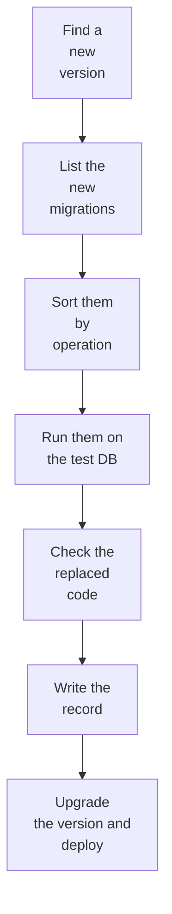

# Upgrading Redmine

This is the procedure for checking a new Redmine version in this project before upgrading to it. Before upgrading, check the new migrations, the code that the plugins replace, and changes in the Rails version, and record the results for each version.

## Flow

0. **Before the release:** The CI matrix already runs the image tests and Redmine's own tests on Redmine's `master`, which becomes the next release, so what breaks shows up before the release ([testing.md](testing.md#order-in-ci)).
1. **Find:** Every week, a scheduled GitHub Actions workflow compares the latest stable Redmine version (the redmine.org downloads and the tags of `redmine/redmine` on GitHub) with the version this project uses. If there is a new version, it creates an issue.
2. **List:** Compare `db/migrate/` of the current version and the new version, and list the new migrations.
3. **Sort:** Sort each migration into one of the categories below by the operations it uses ("Sorting migrations" below).
4. **Run:** Run the new migrations on a test database ("Test database" below).
5. **Check the replaced code:** Check whether the original code of the Redmine methods that the plugins replace has changed ([testing.md](testing.md#redmines-own-tests)).
6. **Write the record:** Write the results to `docs/upgrades/<version>.md` ("Records" below).
7. **Upgrade:** When the record is done and the test CI ([testing.md](testing.md#order-in-ci)) passes, open a PR that upgrades the version, and deploy.

## Pinning versions

Write the Redmine version and the SHA256 of the downloaded file to `redmine.lock`. Image builds use only these values. A PR that upgrades the version changes this file.

## Sorting migrations

Sort the new migrations into the following categories by the operations they use. A script in this project (`bin/check-migrations`) does the sorting by reading the migration files. A person reads the ones the script cannot decide.

| Category | Matching operations | What to check |
| --- | --- | --- |
| Light | Data-only changes on few rows, adding and removing columns, changing default values, operations that run only on other databases | Nothing more than running them |
| Locks or rewrites a table | Creating indexes, changing a column type, adding `NOT NULL`, adding foreign keys | PostgreSQL blocks writes to the table while they run, and a type change rewrites the table. Measure the time at realistic sizes, and upgrade at a time of low use if it is long |
| Changes many rows | Data changes that modify many rows in one statement (such as `update_all`) | Measure the time. Migrations run in `redmine-task`, so they must fit in 15 minutes ([tasks.md](tasks.md#tasks-longer-than-15-minutes)) |
| Read by a person | SQL written with `execute`, branches per database type | What the script cannot decide |

Redmine's migrations run on RDS for PostgreSQL as standard ([rds.md](rds.md)). The sorting is for finding slow migrations and the effect on what the plugins replace.

## Test database

| Database | Usage |
| --- | --- |
| PostgreSQL (CI container, the same major version as RDS) | Load the schema of the current version and test data, then run the new migrations. Also run `down` to check that they can be rolled back |

- **Test data:** Production data is not used. Use generated data with row counts close to production. For large tables (`journals`, `custom_values`, `attachments`, etc.), take the production row counts from the records and match them, so that the time of slow migrations is measured at realistic sizes.
- **Duration:** Measure the time each migration takes. It is the basis of the estimated downtime in the record.

## Records

For each version, write `docs/upgrades/<version>.md` and add it to the list in `docs/upgrades/README.md`.

| Section | Contents |
| --- | --- |
| Version | The versions before and after, the release date, and changes in the Rails and Ruby versions |
| New migrations | File names and the sorting result |
| Test results | Whether they passed on PostgreSQL, the time taken, and the row counts of the tables they changed |
| Effect on the plugins | Replaced code whose original code changed (in `redmine_serverless`, `redmine_serverless_s3` and `redmine_serverless_ses`), and what was fixed |
| Maintenance window | Estimated downtime in production |
| Production results | Upgrade date, actual time taken, and problems that occurred |

## Migrating from older versions

To move from an older Redmine (running in another environment), follow the procedure in [migration.md](migration.md), not this one.

## To verify

- Whether `bin/check-migrations` sorts operations from the Ruby syntax tree or by text patterns (because some migrations use conditional branches to run different operations per database type)
- Whether migrations on large tables fit in the 15 minutes of `redmine-task`
